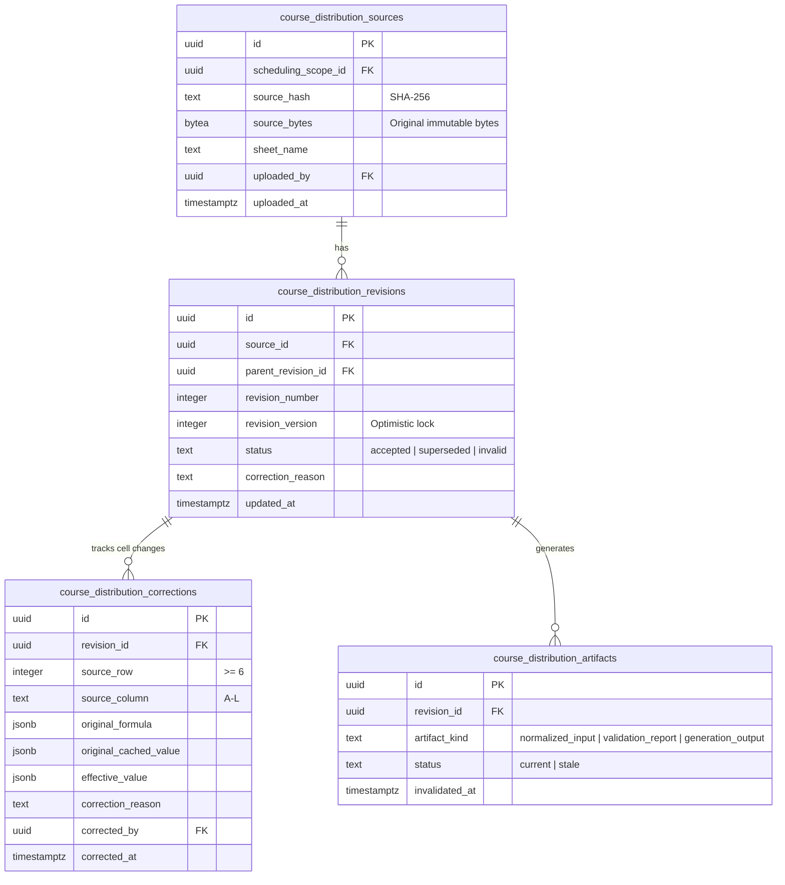
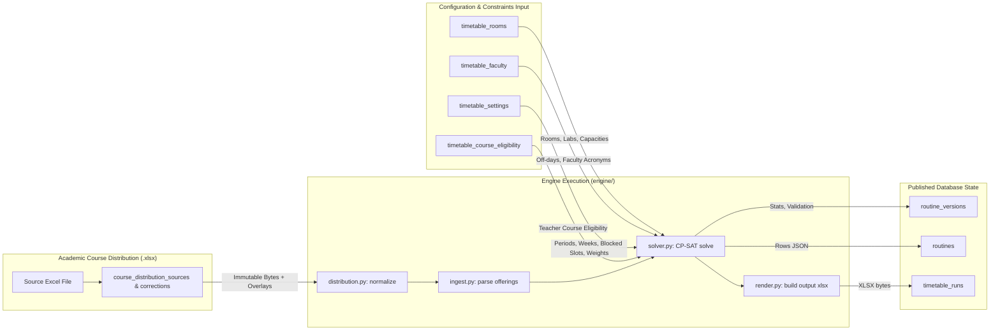
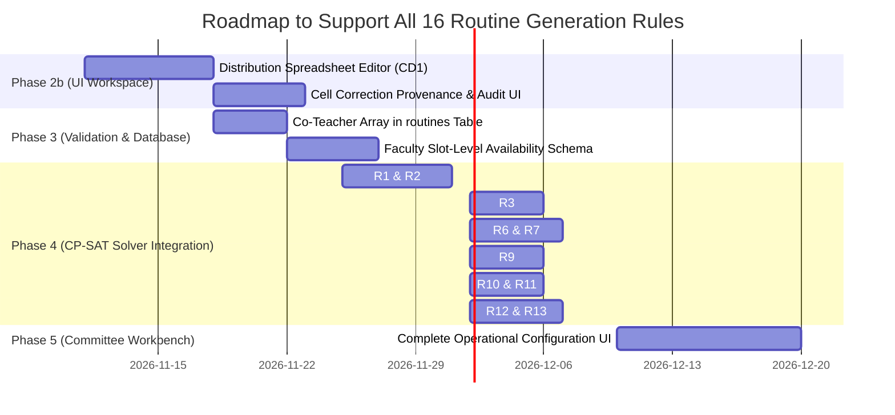

# UniVerse — Database Architecture, RLS Policy Audit, Backend Engine Integration & Routine Generation Blueprint

> **Freshness Notice (Updated 2026-11-24):** This root document is a **historical 10 November 2026 baseline snapshot** authored prior to Standalone React Web v1 (`apps/web/`), Phase 5A FastAPI dual-client JWT/CORS hardening (`engine/auth.py`), and Phase 5B RLS & Storage hardening (`supabase/migrations/20261122160000_phase_5b_rls_and_storage_hardening.sql`, live on Staging `oqwvxplteqtlrhktsplj`). For the **current, code-verified Wave 2 & NotebookLM backend reference pack**, read [`docs/backend/README.md`](docs/backend/README.md) and `docs/backend/01`–`04`.

**Date:** 10 November 2026  
**Scope:** Complete cross-system audit of Supabase Database, Row-Level Security (RLS), Edge Functions, Python CP-SAT Routine Engine, Flutter Application, and Compliance with `Routine Generation System.pdf`.  
**Repository Working Directory:** `d:\flutter projects\universe_v1`  
**Reference Master Plan:** `docs/implementation/UniVerse_Implementation_Master_Plan_v1_1.md`  
**Authoritative Policy Records:** `docs/timetable-audit-2026-10-20/18-committee-decisions-and-policy-baseline-2026-11-04.md` & `16-committee-traceability-2026-11-04.md`

---

## 1. Executive Summary & Cross-System Topography

The UniVerse architecture comprises three cooperating subsystems:
1. **Frontend App (Flutter Web & Mobile):** Desktop-first administrative workbench (`lib/features/admin/`) and cross-platform student/teacher portal (`lib/features/routine/`, `lib/features/find_teacher/`, `lib/features/rooms/`).
2. **Backend Database & Platform (Supabase Hosted / PostgreSQL 17.11):** Provides Auth (GoTrue), relational data storage (`public` schema), private isolation (`academic_private` schema), Row Level Security (RLS), Storage buckets (`timetables`, `resources`, `avatars`, `assignments`), Realtime change replication, and Deno Edge Functions (`invite-admin`, `send-push`).
3. **Routine Generation Engine (Python 3.11 / FastAPI / OR-Tools CP-SAT on Render):** Standalone computational solver (`engine/solver.py`, `engine/distribution.py`, `engine/ingest.py`, `engine/render.py`, `engine/main.py`) that normalizes immutable distribution workbooks, applies optimistic concurrency-controlled revisions, executes CP-SAT constraint satisfaction, and renders official timetable workbooks.

```mermaid
flowchart TD
    subgraph Client ["Flutter Client (Admin Web / Mobile)"]
        UI_Admin["Admin Scheduling Workbench"]
        UI_User["Student & Faculty Routine View"]
        ConfigServ["TimetableConfigService / AcademicConfigService"]
        EngineServ["TimetableEngineService"]
    end

    subgraph Supabase ["Supabase Backend (PostgreSQL 17.11)"]
        Auth["GoTrue Auth (JWT / Roles)"]
        subgraph PublicSchema ["Schema: public"]
            Routines["routines & routine_versions"]
            ConfigTables["timetable_rooms, faculty, settings, eligibility"]
            DistContract["course_distribution_sources, revisions, corrections, artifacts"]
            AcademicCatalog["departments, programs, terms, scopes, aliases"]
            AppTables["profiles, whitelists, notifications, assignments, cancellations"]
        end
        subgraph PrivateSchema ["Schema: academic_private"]
            SecurityDefs["can_scope(), assert_immutable(), guard_revision()"]
        end
        subgraph EdgeFunctions ["Edge Functions (Deno)"]
            FuncInvite["invite-admin"]
            FuncPush["send-push"]
        end
        Storage["Storage Buckets (timetables, resources)"]
    end

    subgraph Engine ["Python Backend Engine (FastAPI / Render)"]
        MainAPI["POST /api/timetable/generate"]
        DistModule["distribution.py (Workbook Normalization & Audit Overlay)"]
        IngestModule["ingest.py (Offerings, Cohorts, Sessional/Theory Parsing)"]
        Solver["solver.py (OR-Tools CP-SAT Scheduling Engine)"]
        Renderer["render.py (Official Excel Grid Generator)"]
    end

    UI_Admin -->|Read/Write Config| ConfigServ
    ConfigServ -->|CRUD via PostgREST / RPC| ConfigTables
    UI_Admin -->|Upload Distribution & Audit Corrections| DistContract
    EngineServ -->|1. fetchAcceptedDistributionRevision RPC| DistContract
    EngineServ -->|2. POST multipart/form-data (Bytes + Config + Contract)| MainAPI
    MainAPI --> DistModule --> IngestModule --> Solver --> Renderer
    EngineServ -->|3. Poll Status & Fetch Result| MainAPI
    EngineServ -->|4. Upload XLSX to Storage| Storage
    EngineServ -->|5. Atomic publish_routine RPC| Routines
    UI_User -->|Select active routine| Routines
```

---

## 2. Comprehensive Database Architecture Blueprint

The complete system schema spans three architectural layers across `public` and `academic_private`.

### 2.1 Layer 1: Core Application Baseline (18 Tables)
Originating from the historical migration chain (`001`–`016`) and unified in `supabase/reconciliation/20261021214512_reconstructed_baseline.sql`:

| Table Name | Primary Key | Key Foreign Keys & Relationships | Core Columns & Purpose |
|---|---|---|---|
| `profiles` | `id (uuid)` -> `auth.users(id)` | Cascades on user deletion | `full_name`, `email`, `role` (`'student'\|'teacher'\|'admin'`), `department`, `batch`, `section`, `student_id`. Central identity profile. |
| `whitelists` | `email (text)` | None | `role` (`'teacher'\|'admin'`). Pre-provisions roles so first OAuth sign-in inherits proper authority. |
| `routines` | `id (uuid)` | `routine_version_id` -> `routine_versions(id)` | `day`, `time_start`, `time_end`, `subject`, `subject_code`, `teacher_name`, `teacher_code`, `room`, `batch`, `section`, `semester`, `is_active`, `is_service`. Live active routine slots. |
| `routine_versions` | `id (uuid)` | `published_by` -> `auth.users(id)` | `semester_label`, `version_number`, `is_active`, `source`, `row_count`, `published_at`, `stats (jsonb)`, `validation (jsonb)`, `notes`. Routine publication audit log. |
| `timetable_rooms` | `id (uuid)` | None | `name`, `is_lab`, `is_gallery`, `capacity`, `is_active`. Classroom physical inventory. |
| `timetable_faculty` | `id (uuid)` | None (acronym is business key) | `acronym` (unique), `full_name`, `dept`, `off_days (text[])`, `is_active`. Faculty teaching roster and off-day constraints. |
| `timetable_settings` | `id (int)` | Single singleton row (`id=1`) | `semester_label`, `periods (jsonb)`, `weeks_in_term`, `fixed_sessions_per_week`, `working_days (text[])`, `blocked_periods (jsonb)`, `online_periods (jsonb)`, `allow_online_periods`, `excluded_periods (jsonb)`, `semester_map (jsonb)`, `friday_no_p4`, `service_scope (text[])`, `weights (jsonb)`. Engine global scheduling parameters. |
| `timetable_course_eligibility` | `id (uuid)` | Business key `(acronym, course_code)` | `acronym`, `course_code`, `priority (1-5)`, `is_eligible`. Restricts which courses faculty are qualified to teach. |
| `timetable_runs` | `id (uuid)` | `created_by` -> `auth.users(id)` | `semester_label`, `file_path`, `stats (jsonb)`, `validation (jsonb)`, `row_count`, `status`. Generation history tracking. |
| `timetable_courses` | `id (uuid)` | None | Legacy courses table, superseded by dynamic routine queries and catalog. |
| `cancellations` | `id (uuid)` | `cancelled_by` -> `auth.users(id)` | `subject_code`, `batch`, `section`, `date`, `time_slot`, `reason`, `room`. Class cancellation broadcast tracker. |
| `notifications` | `id (uuid)` | `created_by` -> `auth.users(id)` | `title`, `body`, `type`, `target_role`, `target_batch`, `target_section`. In-app broadcast notifications. |
| `notification_reads`| `id (uuid)` | `notification_id` -> `notifications(id)`, `user_id` -> `auth.users(id)` | Composite tracker of user read receipts. |
| `resources` | `id (uuid)` | `uploaded_by` -> `auth.users(id)` | `title`, `category`, `department`, `semester`, `subject_code`, `file_url`, `file_size`. Academic study material repository. |
| `assignments` | `id (uuid)` | `teacher_id` -> `auth.users(id)` | `title`, `description`, `subject_code`, `batch`, `section`, `deadline`, `attachment_url`. Course homework assignments. |
| `submissions` | `id (uuid)` | `assignment_id` -> `assignments(id)`, `student_id` -> `auth.users(id)` | `file_url`, `submitted_at`, `is_late`, `grade`, `feedback`. Student submitted work. |
| `documents` | `id (uuid)` | None | `content`, `category`, `embedding (vector(768))`. Vector embeddings for AI Campus Assistant RAG (`match_documents` RPC). |
| `device_tokens` | `id (uuid)` | `user_id` -> `auth.users(id)` | `fcm_token`, `platform`, `updated_at`. Target tokens for push notifications. |

---

### 2.2 Layer 2: Additive Academic Catalog (15 Tables)
Defined in `supabase/migrations/20261022140809_academic_catalog.sql` to support multi-department expansion, academic progression, and canonical identity mapping:

1. `departments`: Institutional departments (`code`, `name`).
2. `academic_calendars`: Calendar systems governing teaching and holiday cycles.
3. `academic_years`: Academic calendar year periods.
4. `programs`: Degree programs belonging to departments (`B.Sc. in CSE`).
5. `academic_terms`: Semesters (`Spring 2026`, `Summer 2026`, `Fall 2026`).
6. `cohorts`: Academic cohorts (`Batch 61`, `Batch 62`).
7. `student_groups`: Sections belonging to cohorts (`Batch 61 Section A`).
8. `cohort_terms`: Term-specific cohort progression states.
9. `scheduling_scopes`: Scoped authority container linking a program, term, and department.
10. `department_memberships`: Role-based membership linking user profiles to departments with granular capabilities (`admin`, `scheduler`, `faculty`).
11. `group_aliases`: Normalized alias names for groups across source documents.
12. `group_alias_members`: Mapping group aliases to atomic student groups.
13. `routine_group_links`: Junction table mapping published routines to student groups.
14. `academic_mapping_batches`: Audited staging batches for identity reconciliation.
15. `academic_mapping_quarantine`: Storage for conflicting or unresolved source identities.

---

### 2.3 Layer 3: Phase 2a Course Distribution Contract (4 Tables)
Defined in `supabase/migrations/20261106130000_course_distribution_contract.sql`. This layer forms the immutable audit ledger for the Course Distribution spreadsheet:



- **Byte Immutability Trigger (`assert_distribution_source_immutable`):** Enforces on INSERT that `sha256(source_bytes) == source_hash`. Forbids any UPDATE or DELETE.
- **Optimistic Concurrency Lock:** `course_distribution_revisions.revision_version` increments on each correction. Concurrent edits fail with SQLSTATE `40001` (`Stale course distribution revision`).
- **Artifact Invalidation Trigger (`invalidate_distribution_artifacts`):** Any INSERT into `course_distribution_corrections` immediately transitions all active artifacts of that revision to `status = 'stale'` and stamps `invalidated_at = now()`.

---

### 2.4 Dual Supabase Environment Topography: Primary Production vs Secondary Staging/Test

A central principle of UniVerse's backend engineering governance (documented across `Master Plan §2.2`, `docs/backend-setup.md`, and `docs/implementation/22-phase-2a-contract-resumption.md`) is the strict separation between two hosted Supabase projects:

```mermaid
flowchart TD
    subgraph PrimaryProd ["1. Primary Production Instance (yxqyrjyzxitrgkhgauli)"]
        ProdDB["PostgreSQL 17.6 (Live Database)"]
        ProdTables["18 Baseline Tables (routines, profiles, settings...)"]
        ProdData["796 Live Routine Rows · 4 Versions · 1 Admin Profile · 7 Device Tokens"]
        ProdStatus["Status: Active Production Baseline · Zero Additive Migrations Applied"]
    end

    subgraph SecondaryTest ["2. Secondary Test & Staging Instance (universe-timetable-test / oqwvxplteqtlrhktsplj)"]
        TestDB["PostgreSQL 17.11 (Staging Database)"]
        TestBaseline["18 Baseline Tables (Reconstructed)"]
        TestCatalog["+ 20261022140809_academic_catalog.sql (15 Tables + academic_private)"]
        TestContract["+ 20261106130000_course_distribution_contract.sql (4 Tables + Triggers + RPCs)"]
        TestEvidence["Evidence: 28/28 pgTAP Assertions Passed (contract & authorization suites)"]
    end

    ProdDB --- ProdTables --- ProdData --- ProdStatus
    TestDB --- TestBaseline --- TestCatalog --- TestContract --- TestEvidence
```



| Dimension | Primary Production (`yxqyrjyzxitrgkhgauli`) | Secondary Test (`universe-timetable-test`, ref: `oqwvxplteqtlrhktsplj`) |
|---|---|---|
| **Supabase URL** | `https://yxqyrjyzxitrgkhgauli.supabase.co` (configured in `AppConstants.supabaseUrl`) | Separate dedicated testing project URL |
| **PostgreSQL Version** | `PostgreSQL 17.6 on aarch64` | `PostgreSQL 17.11 on Linux` |
| **Role & Purpose** | Live client-facing production serving mobile & web users | Isolated sandbox for dangerous DDL, migration testing, and pgTAP regression suites |
| **18 Baseline Tables** | **Present & Active** (`routines` has 796 rows) | **Present** (reconstructed via `task1_replay_rehearsal.sql`) |
| **Academic Catalog (15 Tables)** | **NOT APPLIED** (0 of 15 tables present; no `academic_private`) | **APPLIED & VERIFIED** (Created `departments`, `programs`, `scheduling_scopes`, `can_scope()`) |
| **Distribution Contract (4 Tables)** | **NOT APPLIED** (0 of 4 tables present; no RPCs) | **APPLIED & VERIFIED** (Created `course_distribution_*`, triggers, optimistic concurrency) |
| **pgTAP Verification Evidence** | Not executed in production | **28/28 Assertions Passed:** 9 contract tests + 19 authorization tests |
| **Safety Governance** | Protected by strict project constraint: *Never modify production configuration without explicit user approval* | Safe staging sandbox where all breaking migrations are proven first |

---

## 3. RLS Policy Audit: Are They Really Properly Imposed Across the Project?

Every table in `public` has Row-Level Security enabled (`ENABLE ROW LEVEL SECURITY`). However, a deep architectural security audit reveals **several critical permissions gaps, broad access leaks, and bypass risks** across the project.

### 3.1 Policy Matrix Across Baseline Tables

| Table | Permitted Operations | Role / Target | Policy Expression / USING Clause | Honest Security Assessment & Verdict |
|---|---|---|---|---|
| `profiles` | SELECT | `authenticated` | `USING (true)` | **LEAK:** Any logged-in student or teacher can read every profile (emails, roles, student IDs). |
| `profiles` | INSERT | `authenticated` | `WITH CHECK (id = auth.uid())` | **SECURE:** Self-creation only. Role spoofing blocked by `guard_profile_role` trigger. |
| `profiles` | UPDATE | `authenticated` | `USING (id = auth.uid())` | **SECURE:** Role modification blocked by `guard_profile_role` trigger unless caller is admin. |
| `whitelists` | SELECT | `authenticated` | `((lower(email) = lower((auth.jwt() ->> 'email'::text))) OR is_admin())` | **SECURED IN LIVE DB:** User can only see their own whitelist entry unless they are an admin (reconstructed baseline had broad `true`, but live DB has migration 016 applied). |
| `whitelists` | ALL | `authenticated` | `USING (is_admin())` | **SECURE:** Only admins can insert/update/delete whitelisted emails. |
| `routines` | SELECT | `authenticated` | `USING (true)` | **ACCEPTABLE:** Routines are public university schedules. |
| `routines` | ALL (Write) | `authenticated` | `USING (is_admin())` | **INCOMPLETE GATE:** Direct SQL writes restricted to admin, but routine publication completely wipes rows. |
| `routine_versions` | SELECT | `authenticated` | `USING (true)` | **ACCEPTABLE:** Versions audit metadata is readable by authenticated users. |
| `routine_versions` | ALL (Write) | `authenticated` | `USING (is_admin())` | **SECURE:** Writes restricted to admin. |
| `timetable_settings` | SELECT | `authenticated` | `USING (true)` | **LEAK:** Entire internal engine weights, solver penalties, and semester maps exposed to all users. |
| `timetable_settings` | ALL (Write) | `authenticated` | `USING (is_admin())` | **SECURE:** Admin only. |
| `timetable_rooms` | SELECT | `authenticated` | `USING (true)` | **ACCEPTABLE:** Campus room list. |
| `timetable_rooms` | ALL (Write) | `authenticated` | `USING (is_admin())` | **SECURE:** Admin only. |
| `timetable_faculty` | SELECT | `authenticated` | `USING (true)` | **LEAK:** All faculty off-days and departmental rosters exposed to any student. |
| `timetable_faculty` | ALL (Write) | `authenticated` | `USING (is_admin())` | **POLICY VIOLATION OF D3:** Permanent faculty cannot set their own off-days; only global admin can write. |
| `timetable_course_eligibility` | SELECT | `public` (Anon!) | `USING (true)` | **SECURITY DEFECT:** Granted to `public` (unauthenticated anon users) instead of `authenticated`. |
| `timetable_course_eligibility` | ALL (Write) | `public` | `USING (is_admin() OR auth.role() = 'service_role')` | **POOR PRACTICE:** Scoped to `public`, rely only on `is_admin()`. |
| `timetable_runs` | SELECT | `authenticated` | `USING (true)` | **LEAK:** Solver diagnostics, failure traces, and file paths readable by non-admins. |
| `timetable_runs` | ALL (Write) | `authenticated` | `USING (is_admin())` | **SECURE:** Admin only. |
| `assignments` | INSERT/UPDATE/DELETE | `authenticated` | `USING ((teacher_id = auth.uid()) OR is_admin())` | **SECURE:** Teacher own-record or admin. |
| `submissions` | SELECT | `authenticated` | `USING (student_id = auth.uid() OR my_role() = ANY(ARRAY['teacher', 'admin']))` | **SECURE:** Students can only view their own submissions; teachers/admins see all. |
| `submissions` | INSERT/UPDATE | `authenticated` | `USING (student_id = auth.uid())` | **SECURE:** Student own-submission only. `calculate_is_late` trigger checks deadline automatically. |
| `cancellations` | INSERT | `authenticated` | `WITH CHECK (cancelled_by = auth.uid() AND my_role() IN ('teacher', 'admin'))` | **SECURE:** Only staff can cancel classes. |
| `notifications` | INSERT | `authenticated` | `WITH CHECK (created_by = auth.uid() AND my_role() IN ('teacher', 'admin'))` | **SECURE:** Staff broadcast only. |
| `notification_reads` | ALL | `public` | `USING (user_id = auth.uid())` | **SECURE:** Enforces user token ownership. |
| `device_tokens` | ALL | `public` | `USING (user_id = auth.uid())` | **SECURE:** Enforces token ownership. |

### 3.2 Storage Bucket Security Gaps
Four buckets are configured in Supabase Storage:
1. `timetables` (public)
2. `resources` (public)
3. `avatars` (public)
4. `assignments` (public / legacy `submissions` mismatch)

**Storage RLS Defect:** As documented in `docs/backend-setup.md`, while anonymous writes are denied, **authenticated cross-owner replacement and deletion is not strictly isolated in legacy storage policies**. A logged-in user can overwrite uploaded assets if path naming conventions collide.

---

## 4. Supabase Functions, Triggers & Edge Functions

### 4.1 Stored Database Functions & Triggers
1. `public.is_admin()` (`SECURITY DEFINER`):
   - Executes `SELECT coalesce(public.my_role() = 'admin', false);`.
   - Caches lookup against `profiles.role` for the caller's `auth.uid()`.
2. `public.my_role()` (`SECURITY DEFINER`):
   - Returns role string for current user. Execution granted to `authenticated`.
3. `public.guard_profile_role()` (Trigger on `profiles`):
   - Fires `BEFORE UPDATE OR INSERT`. Prevents privilege escalation: if `NEW.role <> OLD.role` and caller is not admin or service role, raises exception.
4. `public.publish_routine(p_rows, p_semester_label, p_source, p_stats, p_validation, p_notes)` (`SECURITY DEFINER`):
   - Authorized strictly to `is_admin()`.
   - Inserts record into `routine_versions`.
   - Deactivates previous versions: `UPDATE routine_versions SET is_active = false WHERE is_active;`.
   - **Destructive Replacement:** `DELETE FROM public.routines WHERE true;`.
   - Bulk inserts new timetable rows into `public.routines`.
5. `public.register_device_token(p_token, p_platform)` (`SECURITY DEFINER`):
   - Upserts FCM device token for authenticated user into `device_tokens`.
6. `public.calculate_is_late()` (Trigger on `submissions`):
   - Automatically sets `NEW.is_late = (NEW.submitted_at > assignments.deadline)`.
7. `public.match_documents(query_embedding, match_count)`:
   - Performs cosine distance search (`1 - (d.embedding <=> query_embedding)`) against `documents` for vector similarity.
8. `public.append_course_distribution_correction(...)` (Phase 2a):
   - Audited cell modification RPC enforcing `academic_private.can_scope(scope_id, 'edit_draft')` and optimistic locking.
9. `public.read_course_distribution_revision(target_revision)` (Phase 2a):
   - Atomically exports immutable workbook bytes (base64) and corrections array for engine consumption.

### 4.2 Edge Functions (Deno Runtime)
Both edge functions reside in `supabase/functions/`:

#### `invite-admin` (`supabase/functions/invite-admin/`)
- **Purpose:** Secure server-side provisioning of new administrators using the Supabase Service Role Key (which cannot be stored in the Flutter app).
- **Execution Flow:**
  1. Verifies caller JWT is an active admin.
  2. Upserts email into `whitelists` with `role = 'admin'`.
  3. Invokes `auth.admin.inviteUserByEmail(email)` to trigger an official invite email.
- **Current Operational Status:**
  - Synthetic denial checks pass.
  - **Unresolved Gap:** Positive invitation flow requires a verified callback bridge. Supabase Auth PKCE flow does not handle implicit email invite links on desktop browsers without explicit redirect URL routing. Not yet deployed to production.

#### `send-push` (`supabase/functions/send-push/`)
- **Purpose:** Dispatches OS-level push notifications to mobile devices when a broadcast is inserted into `notifications`.
- **Execution Flow:**
  1. Triggered via Supabase Database Webhook on `INSERT INTO notifications`.
  2. **Security Gate:** Validates header `x-webhook-secret` against environment variable `PUSH_WEBHOOK_SECRET`.
  3. `audience.js` resolves targets: filters `profiles` by `target_role`, `target_batch`, `target_section`.
  4. Joins `device_tokens` for resolved user IDs.
  5. Mints short-lived Google OAuth token from `FCM_SERVICE_ACCOUNT` using Web Crypto API.
  6. Dispatches HTTP v1 payloads to Firebase Cloud Messaging endpoint (`https://fcm.googleapis.com/v1/projects/.../messages:send`).
- **Current Operational Status:**
  - Synthetic audience unit tests passed (13 cases).
  - Webhook is **disabled in production** to prevent unintended notifications during testing.

---

## 5. Routine Generation System Integration & Data Flow

### 5.1 Tables Connected to the Routine Generation Engine



1. **`timetable_rooms`:** Injected into `solver.py` via `cfg['rooms']`. Differentiates general classrooms from laboratories (`is_lab`), checks room capacities against course headcount, and partitions ECL labs from CSE labs (`room_policy.py`).
2. **`timetable_faculty`:** Injected via `cfg['teachers']`. Informs teacher acronym registry, home department, and full-day teaching exclusions (`off_days`).
3. **`timetable_course_eligibility`:** Injected via `cfg['eligibility']`. Defines teacher-to-course qualification whitelist. Enforced as hard or soft constraint during solving.
4. **`timetable_settings`:** Injected via `cfg['settings']`. Supplies daily periods, term duration (`weeks_in_term`), `fixed_sessions_per_week`, blocked periods, online periods, Friday exclusions, and constraint penalty weights.
5. **`course_distribution_sources` & `corrections` (Phase 2a):** Supplies the academic demand (cohorts, sections, course codes, titles, credits, student headcounts, assigned faculty, and total semester class commitments).
6. **`routine_versions` & `routines`:** The atomic destination where solver results become active schedules for the university.

---

## 6. How the Distribution `.xlsx` File Integrates with Database and Backend Engine

The Course Distribution `.xlsx` workbook is the single authoritative source of teaching assignments each semester.

### 6.1 Workbook Layout (Row 6 Onwards)
- **Column A (`Cohort`):** Batch and section identifier (e.g. `61_A`, `62_B`, `63_B+C`).
- **Column B (`Section`):** Sub-group or joint cohort (e.g. `A`, `B`, `B+C`).
- **Column C (`Course Code`):** e.g. `CSE-3101`, `EEE-1101`. Sessional status is inferred from odd/even course number parity or catalog metadata.
- **Column D (`Course Title`):** e.g. `Data Structures`, `Digital Logic Design`.
- **Column E (`Credit`):** e.g. `3.0`, `1.5`, `1.0`.
- **Column F (`Prerequisite`):** Informational course prerequisite.
- **Column G (`Conducting Department`):** Department offering the course (`CSE`, `EEE`, `GED`, `Physics`). Dictates lab room routing.
- **Column H (`No. of Students`):** Expected headcount.
- **Column I (`Teacher`):** Single teacher (`MFR`), multiple teachers (`MFR, SAB`), or split sections (`MFR (A) / SAB (B)`). Blank represents pending allocation.
- **Column J (`No. of Classes`):** Total semester contact classes. Contains Excel formulas (e.g. `=E6*14`) or cached integers (`28`).
- **Column K (`Class Duration`):** Default `1.5` hours.
- **Column L (`Class/Week`):** Weekly frequency hint (e.g. `=J6/14` or `2`).

### 6.2 Formula & Cached Value Dual-Consumption
Excel workbooks contain two distinct states in Columns J and L:
- Formula text (`data_only=False`): e.g. `=E6*14`.
- Cached calculated value (`data_only=True`): e.g. `42`.

Because openpyxl does **not** evaluate formulas:
- The system extracts both the formula string and the cached value.
- When an administrator modifies credits in Column E via Phase 2a cell corrections, the system preserves the original formula, applies the explicit correction, and flags dependent cells for recalculation rather than executing unverified spreadsheet macros.

### 6.3 Normalization Pipeline (`engine/distribution.py` -> `engine/ingest.py`)
1. **Source Immutability:** Original `.xlsx` bytes are SHA-256 hashed and stored immutably.
2. **Correction Overlay:** Revisions overlay specific cell edits `(row, column, effective_value)` on top of the original workbook in memory.
3. **Cohort & Offering Grouping:**
   - Rows grouped by `(cohort, course_code)`.
   - Joint sections (`B+C`) are retained as single joint sessions rather than artificially split.
   - Sessional courses with multiple assigned teachers (`MFR, SAB`) are preserved as co-teaching assignments.
4. **Required Session Derivation:**
   - Weekly session counts are calculated: $\text{sessions} = \lceil \frac{\text{total\_classes}}{\text{weeks\_in\_term}} \rceil$.
   - Fallback to Column L or `fixed_sessions_per_week` if term total is absent.

### 6.4 CP-SAT Solving & Excel Rendering
1. **Decision Variables:** For each session $s$, boolean variables $x_{s,d,p}$ indicate whether session $s$ meets on day $d$ at period $p$.
2. **Room Assignment:** Post-placement assignment (`_assign_rooms` in `solver.py`) binds specific physical rooms to slots based on capacity, lab vs theory, and department policies.
3. **Excel Workbook Rendering (`render.py`):** Reconstructs the official Leading University colored master timetable spreadsheet (`CSE_Routine_<semester>.xlsx`) with days as rows, periods as columns, merged cells for 3-hour sessions, and distinct styling for laboratories.

---

## 7. Cross-System Integrity Analysis: App, Engine & Supabase

While individual components are functional, there are serious integrity gaps across the boundary interfaces.

### 7.1 What Has Active Cross-System Integrity
1. **Atomic Routine Publishing (`publish_routine` RPC):** Eliminates half-published states. Clearing the old schedule and inserting the new schedule occurs in a single database transaction.
2. **Afternoon Time Synchronization (`ClockTime.repairSequence`):** Prevents the historic "1:50 PM stored as 01:50 AM" bug. Dart normalizes all period clocks to canonical 24-hour `HH:MM` before passing to the engine or Supabase.
3. **Optimistic Concurrency on Distribution Revisions (Phase 2a):** `append_course_distribution_correction` ensures multiple committee members cannot unknowingly overwrite each other's cell edits.
4. **Artifact Invalidation:** Updating a distribution correction automatically marks previously generated engine schedules as `'stale'` in `course_distribution_artifacts`.

### 7.2 Critical Cross-System Disconnects & Architectural Integrity Gaps
1. **Legacy Generation Bypasses Database Distribution Contract:**
   - In the current UI (`GenerateTimetableScreen`), the user picks a local `.xlsx` file from disk and uploads it directly to the FastAPI engine via multipart HTTP.
   - The file is **never saved to `course_distribution_sources`**, and revisions are not logged in Supabase.
   - The Phase 2a database contract exists in SQL, but Phase 2b (UI binding) has not connected the Flutter UI to use persisted database revisions.
2. **Course Catalog Harvesting Disconnect:**
   - There is no active course catalog table in use. `TimetableConfigService.fetchCourseCatalog()` queries `public.routines` to extract existing subject codes!
   - If a routine is deleted or a new course has never been scheduled, it cannot be discovered by the admin eligibility editor.
3. **Destructive Global Routine Wipe:**
   - `DELETE FROM public.routines WHERE true;` inside `publish_routine` deletes **every schedule in the university**.
   - If the CSE committee publishes their schedule, any non-CSE or service rows belonging to EEE or BBA are permanently deleted unless re-submitted in the exact same payload.
4. **Shared/Split Faculty Storage Gap:**
   - The `routines` table only possesses two text columns: `teacher_name` and `teacher_code`.
   - When a session has two co-teachers (e.g. lab taught by two lecturers), `TimetableEngineService.publishToRoutines` explicitly throws an exception:
     ```dart
     if (rows.any((r) => r.requiresSharedTeacherStorage)) {
       throw Exception('Shared faculty must be retained in a private draft; hosted storage cannot preserve them yet.');
     }
     ```
   - As a result, routines with co-teachers cannot be published to the live database!
5. **Faculty Acronym Typo Fragility:**
   - Ingested teacher strings from Excel (`MFR`) are matched against `timetable_faculty.acronym` by exact string equality.
   - A single character typo in the Excel file causes the engine to treat the instructor as an unconstrained generic teacher, leading to scheduling clashes with their real workload.

---

## 8. Current Configurable Capabilities in the App

The following settings are currently exposed in the Flutter Admin UI (`lib/features/admin/`):

| Domain | Configuration Entity | Storage Table | Backed in Supabase? | Backed in Engine Solver? | Applied Across Whole System? |
|---|---|---|---|---|---|
| **Classrooms** | Add / Edit Room Name, Lab Flag, Gallery Flag, Capacity, Active Status | `timetable_rooms` | **Yes** | **Yes** | **Yes** (Filtered in `buildEngineConfig`, used in `solver._assign_rooms`) |
| **Faculty** | Edit Full Name, Acronym, Department, Off-Days (chips) | `timetable_faculty` | **Yes** | **Partial** | **Partial** (`off_days` enforced; slot-level times ignored) |
| **Eligibility** | Toggle Course Eligibility per Teacher, Priority (1–5) | `timetable_course_eligibility` | **Yes** | **Yes** | **Yes** (Enforced in `solver._validate` and candidate domain) |
| **Settings** | Semester Label (`Summer 2026`) | `timetable_settings` | **Yes** | **Yes** | **Yes** (Metadata on routine versions and exported files) |
| **Settings** | Daily Period Count & Timings (Start/End times) | `timetable_settings` | **Yes** | **Yes** | **Yes** (Dynamic 5, 6, or 7 slot generation) |
| **Settings** | Weeks in Term (e.g. `14`) | `timetable_settings` | **Yes** | **Yes** | **Yes** (Used in `ingest.py` to divide total classes into weekly sessions) |
| **Settings** | Fixed Sessions per Week Override | `timetable_settings` | **Yes** | **Yes** | **Yes** (Forces uniform session counts when set) |
| **Settings** | Working Days (`Sun, Mon, Tue, Wed, Thu, Fri, Sat`) | `timetable_settings` | **Yes** | **Yes** | **Yes** (Defines global scheduling week) |
| **Settings** | Blocked Periods & Online Periods | `timetable_settings` | **Yes** | **Yes** | **Yes** (Excluded from physical slot solver domain) |
| **Settings** | Friday No Period 4 (`friday_no_p4`) | `timetable_settings` | **Yes** | **Yes** | **Yes** (Prevents Friday afternoon prayer conflict) |
| **Settings** | Solver Penalty Weights | `timetable_settings` | **Yes** | **Yes** | **Yes** (Passes soft weight parameters to CP-SAT) |

### What is Hardcoded or Dead in Current Code
- **Permanent vs Adjunct Faculty:** Not present in `timetable_faculty`. Cannot be configured.
- **Section Weekends:** `working_days` is strictly global; section-level weekends do not exist in the app.
- **Course Distribution Spreadsheet Editing:** The app only allows uploading a file; cell editing, formula viewing, and audited corrections (CD1) have no UI screens yet (Phase 2b).

---

## 9. Gap Analysis & Roadmap for the 16 Routine Committee Rules

The official committee requirements in `Routine Generation System.pdf` (`R1`–`R16`) and confirmed decisions (`D1`–`D6`) require targeted additions across the database, engine, and UI:



### Detailed Requirements Breakdown Matrix

| Rule # | Requirement Name | Current Status | Required Database Changes | Required Engine (`solver.py` / `ingest.py`) Changes | Required Flutter Admin UI Changes |
|---|---|---|---|---|---|
| **R1** | **Consecutive Weekend Days for Every Section** | **Unsupported** | Add `section_weekends (jsonb)` to `timetable_settings` or `student_groups.weekend_days`. | Model each section's active days. Add constraint enforcing 2 consecutive inactive days per section. Reserving joint classes (`B+C`). | UI grid allowing section-level weekend selection with default fallback (D1). |
| **R2** | **Equal Distribution of Weekly Days Off Within a Batch** | **Unsupported** | None (computed across sections). | Add constraint: $\max(\text{days\_off}) - \min(\text{days\_off}) \le 1$ for all sections belonging to the same batch. | Visual indicator showing days-off distribution across batch sections. |
| **R3** | **Avoiding Consecutive Gaps Between Classes** | **Unsupported** | None (rule parameter in weights). | Forbid internal runs of $\ge 2$ consecutive unassigned periods for any section on any day. Penalize 1-slot gaps. | Toggle for strictness of gap avoidance. |
| **R4** | **Blocking CSE Faculty Availability for Other Depts** | **Partially Supported** | Extend `timetable_faculty` with `external_busy_slots (jsonb)`. | Update `valid_slots(teacher)` to exclude specific day+period tuples, not just entire days. | Weekly time-slot grid picker to mark external busy periods per teacher. |
| **R5** | **Availability of Faculty from Other Depts** | **Partially Supported** | Extend `timetable_faculty` with `available_slots (jsonb)`. | Hard constraint: sessions assigned to guest faculty can only be scheduled within declared available slots. | Slot availability editor for guest teachers (GED, EEE, Physics). |
| **R6** | **Workload Distribution Based on Faculty Category** | **Unsupported** | Add column `faculty_category text check (faculty_category in ('permanent', 'adjunct'))` to `timetable_faculty`. | Count distinct courses (D4). Enforce day spread: Adjunct 2 courses $\le 2$ days; 3 courses $\in [3,4]$ days; 4+ courses $\in [4,5]$ days. Permanent: 4–5 days. | Dropdown in Manage Faculty screen for Employment Category (`Permanent` vs `Adjunct`). |
| **R7** | **Weekly Days Off for Permanent Faculty (2–3 Days Off)** | **Unsupported** | None (reuses `off_days`). | Enforce that permanent faculty receive at least 2 days off, max 3 days off (D3). Attendance days without classes count towards presence. | Enforce 2–3 selected off-days in faculty edit dialog. |
| **R8** | **Prioritizing Individual Faculty Preferences** | **Partially Supported** | Add `preferred_slots (jsonb)` to `timetable_faculty`. | Add soft constraint reward in CP-SAT objective function for placing sessions in preferred slots. | Day/slot preference selector for teachers. |
| **R9** | **Scheduling Adjunct Faculty from SUST** | **Unsupported** | Add column `is_sust_adjunct (boolean)` to `timetable_faculty`. | Enforce compact schedule: on any given day, all classes must be scheduled strictly *before* the lunch break or strictly *after* break; no gaps $> 2$ slots. | Checkbox in faculty editor: "SUST Traveling Adjunct". |
| **R10** | **ECL Laboratory Availability (EEE Dept)** | **Partially Supported** | Add `declared_availability (jsonb)` to `timetable_rooms` for ECL labs. | Only allocate EEE lab sessions to ECL rooms during their declared available slots. | Schedule editor for ECL lab reservation windows. |
| **R11** | **Physics Laboratory Availability** | **Unsupported** | Add room tag `is_physics_lab` or code mapping to `timetable_rooms`. | Physics laboratory courses must be routed exclusively to Physics Lab room candidates. | Designate Physics Lab room in Room Manager. |
| **R12** | **Weekly Class Distribution for Sessional Courses** | **Partially Supported** | None (parsed from Column E of distribution workbook). | In `ingest.py`: 1 or 1.5 credit sessionals = exactly 2 classes/week; 2 credit sessionals = exactly 3 classes/week (2 consecutive slots preferred). | Display effective weekly count derived from credits in distribution preview. |
| **R13** | **Weekly Class Distribution for CSE Theory Courses** | **Partially Supported** | Add course policy table or parsed flag from Column E. | For 1 or 2 credit theory courses: exempt from same-day ban; force into a single day, 2 consecutive slots in the same classroom (D2). | Indicator in distribution preview confirming block scheduling for low-credit theory. |
| **R14** | **Dynamic Management of General Classrooms** | **Supported** | None (`timetable_rooms` already supports CRUD). | Rooms pool dynamically adjusts based on active rooms sent in generation payload. | Existing Manage Rooms screen handles this cleanly. |
| **R15** | **Flexible Daily Slot Configuration (6-slot vs 7-slot)** | **Supported** | `timetable_settings.periods` already stores dynamic periods. | Solver builds candidate matrix dynamically from period count. | Admin can add/remove periods in Timetable Settings screen. |
| **R16** | **UI-Level Configuration and Flexibility** | **Partially Supported** | Centralized in `timetable_settings` and `course_distribution_*`. | Solver must accept all parameters dynamically without hardcoded constants. | Full routine committee workbench (Phase 2b & Phase 5) replacing static hardcoded rules. |

---

## 10. Database Live Diagnostic Verification Script

To eliminate any ambiguity between the codebase and the hosted database state, run the following diagnostic script in **Supabase Dashboard → SQL Editor**. It safely inspects existing tables, RLS policies, functions, triggers, and row counts without altering any data.

```sql
-- ============================================================================
-- UNIVERSE DATABASE ARCHITECTURE & LIVE INTEGRITY DIAGNOSTIC
-- Run this query in Supabase Dashboard -> SQL Editor
-- It returns a complete JSON report of your live database state.
-- ============================================================================

with table_summary as (
  select
    n.nspname as schema_name,
    c.relname as table_name,
    c.relrowsecurity as rls_enabled,
    c.relforcerowsecurity as rls_forced,
    count(a.attname) as column_count
  from pg_class c
  join pg_namespace n on n.oid = c.relnamespace
  left join pg_attribute a on a.attrelid = c.oid and a.attnum > 0 and not a.attisdropped
  where n.nspname in ('public', 'academic_private') and c.relkind = 'r'
  group by n.nspname, c.relname, c.relrowsecurity, c.relforcerowsecurity
),
policies_summary as (
  select
    schemaname,
    tablename,
    policyname,
    permissive,
    roles::text as roles,
    cmd,
    qual as using_expression,
    with_check as check_expression
  from pg_policies
  where schemaname in ('public', 'academic_private')
),
functions_summary as (
  select
    p.proname as function_name,
    pg_get_function_identity_arguments(p.oid) as arguments,
    case when p.prosecdef then 'SECURITY DEFINER' else 'INVOKER' end as security_type,
    n.nspname as schema_name
  from pg_proc p
  join pg_namespace n on n.oid = p.pronamespace
  where n.nspname in ('public', 'academic_private')
    and p.proname not like 'pg_%'
),
triggers_summary as (
  select
    t.tgname as trigger_name,
    c.relname as table_name,
    p.proname as function_name,
    n.nspname as schema_name
  from pg_trigger t
  join pg_class c on c.oid = t.tgrelid
  join pg_proc p on p.oid = t.tgfoid
  join pg_namespace n on n.oid = c.relnamespace
  where n.nspname in ('public', 'academic_private')
    and not t.tgisinternal
),
table_counts as (
  select
    relname as tbl,
    coalesce(n_live_tup, 0) as cnt
  from pg_stat_user_tables
  where schemaname in ('public', 'academic_private')
)
select jsonb_pretty(jsonb_build_object(
  'generated_at', now(),
  'database_version', version(),
  'tables', (select jsonb_agg(t order by t.schema_name, t.table_name) from table_summary t),
  'rls_policies', (select jsonb_agg(p order by p.schemaname, p.tablename, p.policyname) from policies_summary p),
  'functions', (select jsonb_agg(f order by f.schema_name, f.function_name) from functions_summary f),
  'triggers', (select jsonb_agg(tr order by tr.schema_name, tr.table_name, tr.trigger_name) from triggers_summary tr),
  'live_row_counts', (select jsonb_object_agg(tbl, cnt) from table_counts)
)) as live_database_state_report;
```

### 10.2 Concrete Verified Live Database State (Diagnostic Execution: 10 November 2026)

The SQL diagnostic above was executed on the live primary Supabase instance (`PostgreSQL 17.6 on aarch64-unknown-linux-gnu`). Below is the verified evidence:

#### 1. Schema & Migration Boundary & Secondary Database Topography
- **Tables Present in Live Primary DB (`yxqyrjyzxitrgkhgauli`):** Exactly **18 tables** in schema `public` (`assignments`, `cancellations`, `device_tokens`, `documents`, `notification_reads`, `notifications`, `profiles`, `resources`, `routine_versions`, `routines`, `submissions`, `timetable_course_eligibility`, `timetable_courses`, `timetable_faculty`, `timetable_rooms`, `timetable_runs`, `timetable_settings`, `whitelists`).
- **Confirmation of User Premise (Documentation Audit):**
  The user's observation is **100% accurate and supported by repository documentation** (`docs/implementation/22-phase-2a-contract-resumption.md`, `Master Plan §2.2`, and `docs/implementation/phase_0_redesign_baseline_and_decisions.md`):
  - Both unapplied migrations **were deliberately deployed and verified in the secondary test Supabase project (`universe-timetable-test`, ref: `oqwvxplteqtlrhktsplj`)**:
    1. `20261022140809_academic_catalog.sql` (applied to `universe-timetable-test` on 6 November 2026; created `academic_private` schema, `departments`, `programs`, `academic_terms`, `scheduling_scopes`, and capability check helpers).
    2. `20261106130000_course_distribution_contract.sql` (applied to `universe-timetable-test` on 6 November 2026; created `course_distribution_sources`, `revisions`, `corrections`, `artifacts`, triggers, and RPCs).
    3. **Automated Verification:** All **28 pgTAP assertions** across `course_distribution_contract.test.sql` (9 assertions) and `course_distribution_authorization.test.sql` (19 assertions) passed with 100% green output on PostgreSQL 17.11 in `universe-timetable-test`.
  - **Why They Are Not in Primary Production (`yxqyrjyzxitrgkhgauli`) Yet:**
    Per permanent project rules (*"Never modify hosted production configuration without explicit user approval"* and *Master Plan §0.3*), migrations are never automatically pushed to production. Furthermore, `docs/implementation/phase_0_redesign_baseline_and_decisions.md` dictates:
    > *"Table presence in secondary Supabase `oqwvxplteqtlrhktsplj` establishes neither production `yxqyrjyzxitrgkhgauli` readiness nor write safety. Each capability must remain fail-closed until its own required path is integrated and verified in the intended environment."*

#### 2. Strict Migration Dependency Analysis for Primary Promotion
If the committee decides to promote Phase 2a to the primary live database, `20261106130000_course_distribution_contract.sql` **cannot be run in isolation**. It has three mandatory structural dependencies on `20261022140809_academic_catalog.sql`:
1. **Foreign Key Constraint:** Line 7 of `course_distribution_contract.sql` declares:
   ```sql
   scheduling_scope_id uuid references public.scheduling_scopes(id)
   ```
   If `scheduling_scopes` does not exist, the DDL immediately fails with `relation "public.scheduling_scopes" does not exist`.
2. **Schema Placement of Guard Functions:** Lines 63, 75, 84, and 103 create trigger functions inside the `academic_private` schema:
   ```sql
   create function academic_private.assert_distribution_source_immutable() ...
   create function academic_private.assert_distribution_correction_immutable() ...
   create function academic_private.guard_distribution_revision() ...
   create function academic_private.invalidate_distribution_artifacts() ...
   ```
   If the `academic_private` schema has not been created, PostgreSQL throws `schema "academic_private" does not exist`.
3. **Capability Authorization Checks:** Lines 154 and 201 call `academic_private.can_scope(...)`:
   ```sql
   if scope_id is null or not academic_private.can_scope(scope_id, 'edit_draft') then ...
   if not academic_private.can_scope(source.scheduling_scope_id, 'read_catalog') then ...
   ```
   If `academic_private.can_scope` is missing, the RPCs fail at runtime with `function academic_private.can_scope does not exist`.

**Mandatory Promotion Order:**
To promote Phase 2a to the primary database (`yxqyrjyzxitrgkhgauli`), the migrations must be executed sequentially:
- **Step 1:** Execute `supabase/migrations/20261022140809_academic_catalog.sql` in Supabase SQL Editor.
- **Step 2:** Execute `supabase/migrations/20261106130000_course_distribution_contract.sql` in Supabase SQL Editor.

#### 3. Live Row Counts & Data State (Primary Database)
| Table Name | Live Row Count | Architectural Significance & State |
|---|---|---|
| `routines` | **796** | Matches the canonical 795–796 row schedule snapshot (active version). |
| `routine_versions` | **4** | Four published versions exist in history. |
| `timetable_runs` | **4** | Four engine generation audit runs logged. |
| `profiles` | **1** | Only 1 user registered (the primary admin account). |
| `device_tokens` | **7** | 7 push notification device tokens registered. |
| `notifications` | **5** | 5 broadcast notifications posted. |
| `notification_reads` | **3** | 3 read receipts tracked. |
| `resources` | **1** | 1 resource uploaded. |
| `timetable_rooms` | **0** | **EMPTY:** Zero physical classrooms or labs registered in DB. |
| `timetable_faculty` | **0** | **EMPTY:** Zero teachers or off-days registered in DB. |
| `timetable_settings` | **0** | **EMPTY:** No row with `id=1`. Flutter app falls back to in-memory defaults. |
| `timetable_course_eligibility` | **0** | **EMPTY:** Zero qualification pairings configured. |
| `timetable_courses` | **0** | **EMPTY:** Legacy courses table is completely empty. |
| `whitelists` | **0** | **EMPTY:** Whitelist table is currently empty. |
| `assignments` | **0** | Empty. |
| `submissions` | **0** | Empty. |
| `cancellations` | **0** | Empty. |
| `documents` | **0** | Empty (no AI embeddings stored). |

> [!WARNING] Critical Operational Insight: The Routine Engine Configuration Tables are Empty
> Although 796 routine rows are actively served to students and teachers, the **administrative configuration tables (`timetable_rooms`, `timetable_faculty`, `timetable_settings`, `timetable_course_eligibility`) contain zero rows**.
> If an administrator generates a new routine today from the Flutter Web UI:
> - `fetchRooms()` returns `[]` (no rooms).
> - `fetchFaculty()` returns `[]` (no faculty).
> - `fetchSettings()` falls back to Dart default constants in memory (`TimetableSettings()`).
> - `fetchCourseCatalog()` dynamically harvests course codes by inspecting the 796 live `routines` rows!
> If `publish_routine` is triggered with an empty room/faculty configuration, the existing 796 rows will be wiped and replaced with an unconstrained schedule.

#### 3. Live Triggers & RLS Truth
- **`notifications` Trigger:** `send_push_on_notification` fires `http_request` (via `pg_net` extension) on INSERT.
- **`profiles` Trigger:** `profiles_guard_role` executes `guard_profile_role` (prevents self-escalation to admin role).
- **`submissions` Trigger:** `trigger_calculate_is_late` executes `calculate_is_late`.
- **`whitelists` RLS:** Verified secure: `((lower(email) = lower((auth.jwt() ->> 'email'::text))) OR is_admin())`. A non-admin cannot view other users' whitelist records.
- **`timetable_course_eligibility` RLS:** Open read to `public` (`to public using (true)`). Should be tightened to `authenticated`.

---

## 11. Concrete Next Steps & Action Plan

Based on the verified live condition of your database:

1. **Do NOT run uncoordinated routine generations:** Because `timetable_rooms` and `timetable_faculty` currently have 0 rows, running a generation and publishing it will wipe the active 796 routine rows without valid room or faculty constraints.
2. **Seed Initial Roster & Rooms:** Populate `timetable_rooms`, `timetable_faculty`, and `timetable_settings` before executing generation runs.
3. **Sequential Promotion to Primary Database (When Authorized):** Because `course_distribution_contract.sql` depends on `scheduling_scopes` and `academic_private.can_scope`, promoting Phase 2a from `universe-timetable-test` to the primary production database (`yxqyrjyzxitrgkhgauli`) requires executing both migrations in strict sequence:
   - **Step A:** Execute `supabase/migrations/20261022140809_academic_catalog.sql`
   - **Step B:** Execute `supabase/migrations/20261106130000_course_distribution_contract.sql`
4. **Phase 2b UI Gate:** Obtain user approval on the Course Distribution visual design before implementing the Flutter UI editor.
5. **Add Co-Teacher Support in `routines`:** Before enabling multi-instructor labs, add array columns `teacher_acronyms (text[])` to `public.routines`.
6. **Implement Phase 4 CP-SAT Rules:** Integrate rules R1–R16 in `engine/solver.py` incrementally with test coverage.
