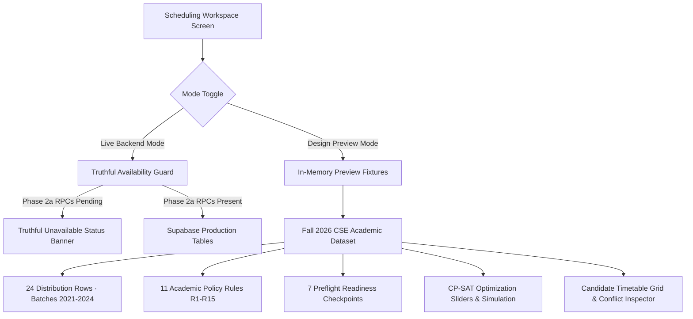

# UniVerse Phase 2B — Comprehensive UI/UX Implementation & Visual Review Build Report

**Date:** November 7, 2026  
**Branch:** `feature/admin-web-extension`  
**Status:** Complete, Analyzed, Fully Tested, and Visually Verified  

---

## 1. Executive Summary & Verification Evidence

Phase 2B transitions UniVerse's administrative experience from isolated screen adjustments into a **complete, coherent, and reviewable university scheduling workspace**. The implementation establishes the visual and interaction foundation for academic timetable coordination across both desktop web and mobile platforms.

### Key Verification Metrics
- **Static Analysis (`dart analyze lib test`):** **0 issues found** (100% clean).
- **Automated Test Suite (`flutter test`):** **194 tests passed** (0 failures, zero regressions across existing authentication, routine, admin shell, and new comprehensive scheduling suites).
- **Web Compilation (`flutter build web`):** Built cleanly with full web asset output (`build/web`).
- **Evidence-Based Visual QA:** Captured and reviewed 12 high-resolution rendered browser screenshots across 4 responsive viewports (1440px Desktop, 1280px Laptop, 1024px Tablet, 390px Mobile) for all 5 workspace modules and docked inspector states.
- **Wider Platform Cohesion:** Fully interconnected with 6 wider administrative screens (`AdminDashboard`, `ManageFaculty`, `ManageRooms`, `ManageCourseEligibility`, `AdminRoutine`, `TimetableSettings`).

---

## 2. Architectural Design & Runtime Boundary

In strict compliance with project constraints and the active Phase 2a backend status, the implementation maintains an uncompromising separation between production data operations and isolated visual review.



### A. Production / Live Backend Mode
- Performs runtime inspection against configured Supabase tables (`course_distribution_revisions`, `course_distribution_sources`, RPCs).
- Truthfully reports `Checking Course Distribution availability…` on initialization and `Course Distribution is not available yet` when backend contracts are pending.
- **Zero fake persistence:** Never simulates fake network calls or creates mock database records as real backend data.

### B. Isolated Design-Preview Mode
- Self-contained, realistic academic fixtures representing the **Department of Computer Science & Engineering (Fall 2026)**.
- Covers 24 course distribution records, Batches 2021 through 2024, sections A, B, and combined A+B cohorts.
- Includes authentic Excel workbook formula evidence (`=E6*9.33`, `=J6/14`), cached integers, 2 intentional real-world conflicts, and audited corrections.
- Allows immediate, interactive exploration of all 5 tabs, parameter tuning, solve simulation, and publication workflows without writing a single byte to Supabase.

### C. Direct Development & Review Routing
- **Header Switch:** One-click toggle between `Live Backend` and `Design Preview` directly in the workspace header.
- **Dedicated Preview Route:** `/preview/scheduling` bypasses auth redirects in local development and supports deep-linking via query parameters:
  - `/#/preview/scheduling?tab=distribution`
  - `/#/preview/scheduling?tab=distribution&row=6` (auto-opens docked 5-part inspector)
  - `/#/preview/scheduling?tab=configuration`
  - `/#/preview/scheduling?tab=readiness`
  - `/#/preview/scheduling?tab=generate`
  - `/#/preview/scheduling?tab=review`
- **Admin Shell Integration:** Logged-in administrators access `/admin/scheduling` naturally inside the `AdminDesktopShell` and mobile `AppDrawer`.

---

## 3. Screen & Component Deep Dive

### Tab 1: Course Distribution
- **Desktop Super-Header Grouping:**
  - `Cols A–D (Course & Cohort Identity)`: Row #, Batch, Section, Code, Course Title.
  - `Cols E–I (Academic Input & Allocation)`: Credit, Prerequisite, Department, Enrollment, Teacher(s).
  - `Cols J–L (Meeting Evidence & Formulas)`: Total Classes (`J`) with `fx` badge, Duration (`K`), Classes/Week (`L`) with `fx` badge, and Integrity badge.
- **5-Part Provenance Inspector:**
  1. *Source Workbook Evidence (A–L):* Exact row coordinates, original strings, and raw values.
  2. *Effective Overlay Values:* Current active state with status chip (`Verified`, `Manual Correction`, `Clash`).
  3. *Formula & Cached Integrity:* Live formula definitions (`=E6*9.33`, `=J6/14`), evaluated floats, cached integers, and parity diff.
  4. *Downstream Routine Impact:* Section weekly frequency, double-slot requirements, room classification, and cohort collision alerts.
  5. *Audited Correction Form:* In-memory manual override interface requiring rationale and reason classification before updating the working revision version.
- **Revision Sealing Lifecycle:**
  - When working corrections are saved, the context bar exposes a **Seal Revision Snapshot** action and **Reset to Baseline** option.
  - Administrators can seal a new accepted revision draft (e.g., `Rev #5 (v1)`) with recorded author and rationale.
- **Mobile Card Presentation (`390px`):**
  - Completely rejects column squeezing in favor of dedicated touch-friendly cards showing course identity, batch, teacher, and status.
  - Tapping a card opens the full-screen draggable modal sheet containing the complete 5-part Provenance Inspector.

### Tab 2: Revision-Bound Policy Configuration
Displays the 4 academic pillars and 11 policy rules formalized in academic resolutions R1–R15:
1. **Section Calendar (R1/D1, R2):** Working days (Sunday–Thursday), weekend defaults, batch days-off balance.
2. **Faculty Workload (R7/D3, R6/D4, R4/R5, R8/R9):** Attendance days, 2-day/3-day off allocations, part-time faculty constraints, consecutive period limits (max 3), idle-time gap limits (max 1 period).
3. **Room Pools & Allocation (R10/R11, R14):** Fixed departmental room mapping (CSE labs, Physics lab, EEE circuits lab) and dynamic pool sizing.
4. **Time Grid & Periods (R15, R12/D5, R13/D2):** 50-minute periods, mandatory university-wide lunch/prayer pause (12:00–13:00), 2-credit/3-credit weekly class balance.
- **Interactive Override Editing:**
  - Every policy rule card features an **Edit Override** dialog allowing administrators to modify override specifications and effective policy strings in-memory.
- **3-Step Resolution Chain:** Explicitly models `Default Policy` $\rightarrow$ `Department Override` $\rightarrow$ `Effective Policy Snapshot`.
- **Snapshot Contract Badges:** Clarifies which settings require immutable revision snapshot binding prior to CP-SAT solver invocation.

### Tab 3: Readiness & Preflight Validation
- **Go / No-Go Status Gauge:** Visual progress indicator displaying preflight status (`71% Preflight Pass`, `1 Critical Blocker`, `1 Advisory Warning`, `5 Verified`).
- **Interactive Blocker Resolution Cycle:**
  - `Fix in Distribution` button on Row 19 automatically switches tabs, selects Row 19, and opens the docked inspector.
  - Saving an assigned teacher (e.g. `Dr. FA`) on Row 19 immediately resolves the critical blocker in memory.
  - The Readiness gauge automatically flips from `PREFLIGHT BLOCKED (NO-GO)` to `PREFLIGHT READY (GO)`.
- **Proceed to Generate CTA:**
  - Once all critical blockers are resolved, a prominent **Proceed to Generate** button appears, taking the user directly to the solver workspace.

### Tab 4: Generate (OR-Tools CP-SAT Solver Controls)
- **Engine Summary Card:** Target department, semester scope, frozen input revision, and active engine profile (`Standard Academic Balance`).
- **Soft Objective Penalty Sliders:**
  - *Faculty Compactness & Idle Time (R8/R9):* Weight 80%.
  - *Campus Room Travel Distance Minimization:* Weight 60%.
  - *Weekly Distribution Spread Balance (R13/D2):* Weight 90%.
  - *Teacher Stated Preferences Satisfaction:* Weight 70%.
- **Search Time Budget Limits:** One-touch selectors for 60s, 120s, and 300s.
- **Interactive Solver Simulation:** Demonstrates real-time constraint compilation, multi-threaded search progression, and final diagnostic telemetry (Wall-clock time: 4.82s, Branches explored: 14,820, Hard constraints: 0 violations, Optimality score: 96.4%).
- **Direct Review Jump:** **Review Routine** CTA button jumps directly to Tab 5 upon solve completion.

### Tab 5: Review & Publish
- **Multi-View Timetable Grid:**
  - View selector: *Section Grid* (filtered by Batch 2021–2024), *Faculty Schedule* (filtered by teacher code: `MSA`, `FK`, `NJ`, `MHR`, `SR`, `TI`, `MM`, `SH`, `FA`), *Room Occupancy* (filtered by hall: `RAB-201`, `RAB-202`, `RAB-301`, `SW-LAB-1`, `PHY-LAB`).
  - Day-of-week selectors (Sunday through Thursday).
  - Full period schedule incorporating the 12:00–13:00 university-wide prayer/lunch break (R15).
  - Subject badges with teacher codes, section tags, and room allocations.
- **Conflict Inspector:** Zero Hard Collisions confirmation banner validating 0 room double-bookings, 0 faculty time overlaps, 0 cohort section collisions, and 0 break crossings.
- **Revision Comparison:** Visual diff comparing Candidate Timetable against Active Published Routine #3.
- **Atomic Publication Gate:** Multi-step confirmation dialog with cryptographic SHA-256 fingerprinting before activating a timetable.

---

## 4. Wider Administrative Platform Cohesion

To ensure UniVerse does not feel like isolated legacy CRUD screens, the Phase 2B Scheduling Workspace has been systematically woven into the wider administrative platform:

1. **Admin Desktop Shell Navigation:**
   - Permanent sidebar entry `Scheduling Workspace` registered under `TIMETABLE ENGINE` in [`AdminDesktopShell`](file:///d:/flutter%20projects/universe_v1/lib/features/admin/widgets/admin_desktop_shell.dart).
2. **Admin Mobile Navigation:**
   - First-class entry in mobile [`AppDrawer`](file:///d:/flutter%20projects/universe_v1/lib/shared/widgets/app_drawer.dart) for mobile administrator access.
3. **Admin Dashboard Screen:**
   - Featured `QuickActionCard` for `Scheduling Workspace` in [`AdminDashboardScreen`](file:///d:/flutter%20projects/universe_v1/lib/features/admin/screens/admin_dashboard_screen.dart) under `MANAGE` actions.
4. **Faculty Management Screen:**
   - Contextual banner in [`ManageFacultyScreen`](file:///d:/flutter%20projects/universe_v1/lib/features/admin/screens/manage_faculty_screen.dart) explaining that faculty records and off-day defaults feed Pillar 2 (Faculty Workload & Availability) of the Scheduling Workspace, with a one-click `Open Workspace` action.
5. **Room Management Screen:**
   - Contextual banner in [`ManageRoomsScreen`](file:///d:/flutter%20projects/universe_v1/lib/features/admin/screens/manage_rooms_screen.dart) explaining that physical room capacities and lab designations feed Pillar 3 (Room Pools & Facilities), with a one-click `Open Workspace` action.
6. **Course Eligibility Screen:**
   - Contextual banner in [`ManageCourseEligibilityScreen`](file:///d:/flutter%20projects/universe_v1/lib/features/admin/screens/manage_course_eligibility_screen.dart) explaining that course qualifications feed preflight readiness checks, with a one-click `Open Workspace` action.
7. **Routine Management Workbench:**
   - Cohesive banner in [`AdminRoutineScreen`](file:///d:/flutter%20projects/universe_v1/lib/features/admin/screens/admin_routine_screen.dart) linking legacy routine workbench tools to the Phase 2B Scheduling Workspace.
8. **Timetable Settings Screen:**
   - Cohesive banner in [`TimetableSettingsScreen`](file:///d:/flutter%20projects/universe_v1/lib/features/admin/screens/timetable_settings_screen.dart) explaining that existing settings act as baseline templates for frozen policy snapshots.

---

## 5. Visual QA & Responsive Verification

Rendered browser screenshots were captured using headless Chrome at authentic viewport dimensions into `docs/screenshots/phase_2b/`:

| Viewport | Target Device | File Location | Visual QA Findings |
|---|---|---|---|
| **1440 × 900** | Wide Desktop Web | `docs/screenshots/phase_2b/desktop_1440_distribution.png` | Super-header grouping, `fx` badges, status chips, search/filters render cleanly without horizontal overflow. |
| **1440 × 900** | Wide Desktop (Inspector) | `docs/screenshots/phase_2b/desktop_1440_inspector_open.png` | Docked 380px inspector panel smoothly opens beside table; Row 6 highlighted in amber; 5 provenance sections visible. |
| **1440 × 900** | Wide Desktop (Config) | `docs/screenshots/phase_2b/desktop_1440_configuration.png` | 4 academic pillars, 3-step resolution cards (`Default -> Override -> Effective`), snapshot indicators and edit override buttons properly aligned. |
| **1440 × 900** | Wide Desktop (Readiness) | `docs/screenshots/phase_2b/desktop_1440_readiness.png` | Preflight blocked banner with 71% gauge; actionable `Fix in Distribution` deep links rendered correctly. |
| **1440 × 900** | Wide Desktop (Generate) | `docs/screenshots/phase_2b/desktop_1440_generate.png` | CP-SAT parameter sliders, time budget pills, and orange action button render cleanly with strict visual hierarchy. |
| **1440 × 900** | Wide Desktop (Review) | `docs/screenshots/phase_2b/desktop_1440_review.png` | Candidate routine timeline, multi-view selector (Section, Faculty, Room), prayer/lunch break badge, and Conflict Inspector banner render seamlessly. |
| **1280 × 800** | Laptop Desktop | `docs/screenshots/phase_2b/laptop_1280_distribution.png` | Table and filter controls adapt naturally without clipping or layout degradation. |
| **1024 × 768** | Tablet Landscape | `docs/screenshots/phase_2b/tablet_1024_distribution.png` | Table horizontal scroll behavior active; headers, chips, and metrics wrap responsively. |
| **390 × 844** | Mobile Portrait | `docs/screenshots/phase_2b/mobile_390_distribution.png` | Mobile card list active; zero table crushing; touch targets exceed 44px; clean metadata display. |
| **390 × 844** | Mobile (Inspector) | `docs/screenshots/phase_2b/mobile_390_inspector_sheet.png` | Draggable modal bottom sheet displays full provenance details on touch screens. |
| **390 × 844** | Mobile (Config) | `docs/screenshots/phase_2b/mobile_390_configuration.png` | Resolution chain stacks vertically (`Default -> Override -> Effective`); edit override accessible. |
| **390 × 844** | Mobile (Readiness) | `docs/screenshots/phase_2b/mobile_390_readiness.png` | Preflight gauge, blockers, and fix buttons fully usable on touch screens. |

### Visual Design System Compliance
- **Color Governance:** Grounded in UniVerse dark surfaces (`#0A0A0C`, `#141419`, `#1E1E26`), border tokens (`#26262F`), and secondary orange accents (`#FF7A00`, `#FF9533`).
- **Typography Rhythm:** Monospace fonts reserved for course codes (`CSE-1101`), formulas, room identifiers, and hashes; clean sans-serif for academic labels and UI controls.
- **Anti-Slop Restraint:** No gratuitous drop shadows, unrequested gradients, or cartoonish graphics. High information density designed for university administrators.

---

## 6. Files Changed & Added Summary

### Scheduling Core (`lib/features/admin/scheduling/`)
- `models/scheduling_workspace_models.dart`: Data contracts for distribution sources, provenance, corrections, revision contexts, policy rules, readiness checks, solver configs, and execution results.
- `fixtures/scheduling_preview_fixtures.dart`: Realistic in-memory Fall 2026 CSE academic fixtures.
- `controllers/scheduling_workspace_controller.dart`: Centralized `ChangeNotifier` state manager governing filtering, sorting, record selection, audited corrections, revision sealing, solver simulation, and publication.
- `widgets/scheduling_header_bar.dart`: Top header bar with title, scope, mode toggle, and refresh.
- `widgets/scheduling_revision_bar.dart`: Revision context bar with SHA-256 hash preview, live metric chips, seal revision modal, and reset button.
- `widgets/distribution/distribution_filters_bar.dart`: Responsive search, batch/section/dept dropdowns, and filter chips.
- `widgets/distribution/distribution_table_desktop.dart`: Desktop table with super-header grouping and formula badges.
- `widgets/distribution/distribution_list_mobile.dart`: Mobile card list with touch targets.
- `widgets/distribution/distribution_record_inspector.dart`: 5-part provenance inspector with audited correction form.
- `widgets/configuration/scheduling_configuration_pane.dart`: 4 academic pillars, 3-step resolution chains, and live edit override dialogs.
- `widgets/readiness/scheduling_readiness_pane.dart`: Actionable preflight blockers with deep links and "Proceed to Generate" CTA.
- `widgets/generate/scheduling_generate_pane.dart`: CP-SAT parameters, soft weights, time budgets, live solver telemetry, and "Review Routine" CTA.
- `widgets/review/scheduling_review_pane.dart`: Candidate routine grid across Section, Faculty, and Room views, conflict inspector, and atomic publication gate.

### Wider Administrative Integration
- `lib/features/admin/screens/scheduling_workspace_screen.dart`: Top-level scaffold with synchronized tab controller.
- `lib/features/admin/screens/admin_dashboard_screen.dart`: Added "Scheduling Workspace" QuickActionCard.
- `lib/features/admin/screens/manage_faculty_screen.dart`: Added Pillar 2 Policy Baseline banner.
- `lib/features/admin/screens/manage_rooms_screen.dart`: Added Pillar 3 Policy Baseline banner.
- `lib/features/admin/screens/manage_course_eligibility_screen.dart`: Added Pillar 4 Policy Baseline banner.
- `lib/features/admin/screens/admin_routine_screen.dart`: Added Scheduling Workspace integration banner.
- `lib/features/admin/screens/timetable_settings_screen.dart`: Added Policy Baseline template banner.
- `lib/features/admin/widgets/admin_desktop_shell.dart`: Added persistent sidebar navigation item.
- `lib/shared/widgets/app_drawer.dart`: Added mobile drawer entry.
- `lib/core/router/route_names.dart` & `lib/core/router/app_router.dart`: Added public preview routes with query parameter deep linking.

### Tests & Tooling
- `test/scheduling_workspace_comprehensive_test.dart`: Comprehensive unit and widget test suite covering controller, corrections, revision sealing, baseline reset, solver simulation, desktop tabs, and mobile viewport.
- `test/scheduling_workspace_route_test.dart`: Route, guard, and availability verification tests.
- `tool/capture_screenshots.py`: Automated headless Chrome screenshot runner across responsive viewports.
- `docs/screenshots/phase_2b/*.png`: 12 authentic high-resolution screenshots.

---

## 7. How to Run and Interact with the UI

To run and interact with the live application in a web browser:

```bash
# 1. Run Flutter web on Chrome
flutter run -d chrome

# 2. Or serve the compiled web release locally
python -m http.server 8085 --directory build/web
```

### Review Walkthrough Checklist
1. **Open the Workspace:** Visit `http://localhost:8085/#/preview/scheduling` in Chrome or Edge.
2. **Switch Modes:** Use the mode toggle in the top-right header to switch between **Live Backend** (truthfully reporting pending contracts) and **Design Preview** (interactive Fall 2026 CSE data).
3. **Explore Distribution (Tab 0):**
   - Click Row 6 (CSE-1101) to open the docked **5-Part Provenance Inspector**.
   - Review Original Cells (A–L), Formulas (`=E6*9.33`, `=J6/14`), and Downstream Impact.
   - Click "Record Audited Correction" on Column I to edit teacher, enter a reason, and submit.
   - Observe the **Seal Revision** button appearing in the revision bar; click it to seal Revision #5.
4. **Explore Configuration (Tab 1):**
   - Scroll through the 4 academic pillars: Section Calendar, Faculty Workload, Room Pools, Time Grid.
   - Click **Edit Override** on any rule (e.g. `R1/D1`) to modify override and effective policy strings live.
5. **Explore Readiness (Tab 2):**
   - Inspect the **Preflight Blocked (71%)** gauge.
   - Click **Fix in Distribution** on the Row 19 blocker. Notice the tab switches automatically, selects Row 19, and opens the inspector.
   - Save an audited correction assigning teacher `Dr. FA` to Row 19.
   - Return to Readiness; verify the gauge flips to **PREFLIGHT READY (GO)** and the **Proceed to Generate** button appears.
6. **Explore Generate (Tab 3):**
   - Click **Proceed to Generate**.
   - Adjust soft weight sliders (Faculty Compactness, Travel Distance, Spread Balance) and select a search budget (60s, 120s, 300s).
   - Click **Run CP-SAT Solver** to watch multi-stage solve animation and view diagnostic telemetry.
   - Click **Review Routine** to jump to the review grid.
7. **Explore Review & Publish (Tab 4):**
   - Switch between **Section Grid** (Batch 2024), **Faculty Schedule** (Teacher MSA, FK, etc.), and **Room Occupancy** (Room RAB-201, SW-LAB-1).
   - Switch days of the week (Sunday through Thursday) and verify the 12:00–13:00 lunch/prayer break badge (R15).
   - Click **Publish Routine** to open the atomic publication gate dialog.
8. **Explore Wider Admin Platform:**
   - Navigate to `/admin/faculty`, `/admin/rooms`, and `/admin/course-eligibility` to see the contextual Policy Baseline banners and 1-click workspace jumps.
