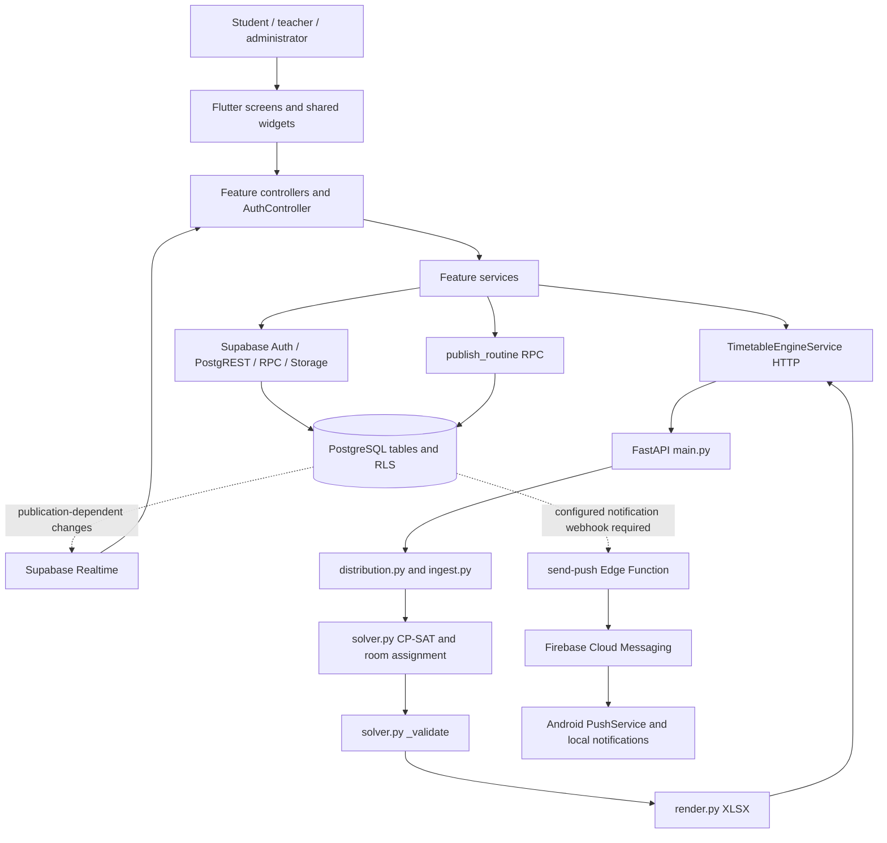
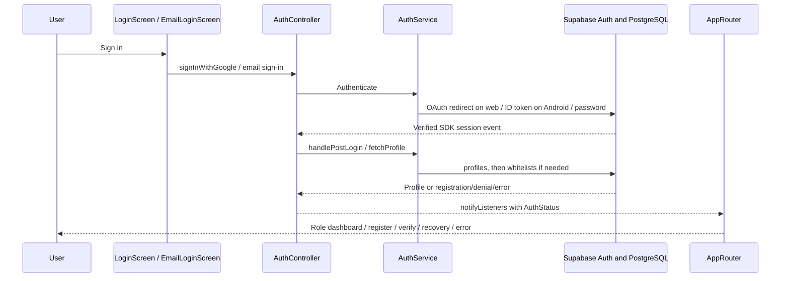
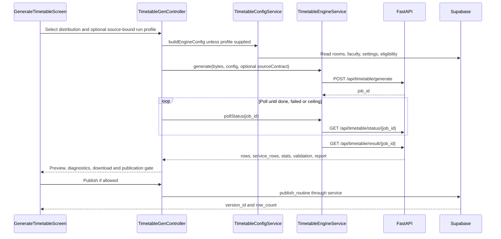
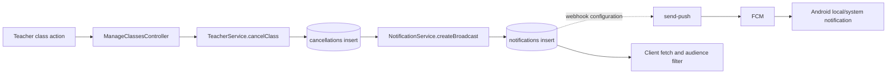
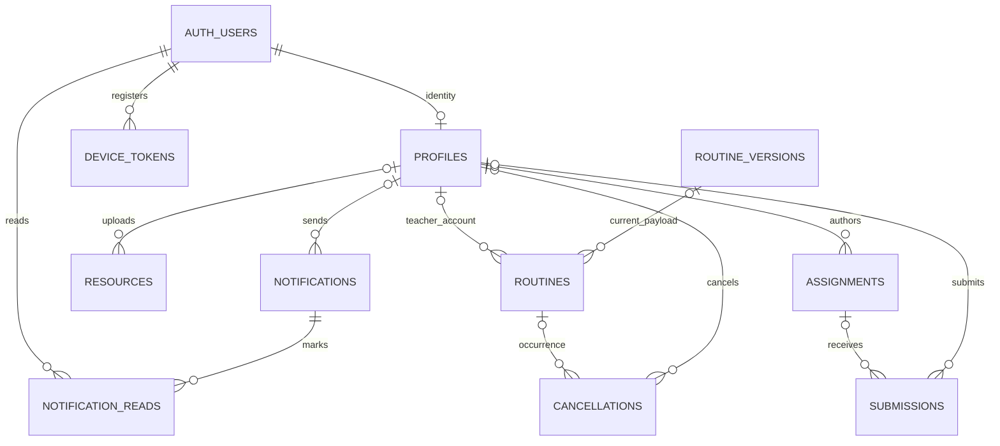
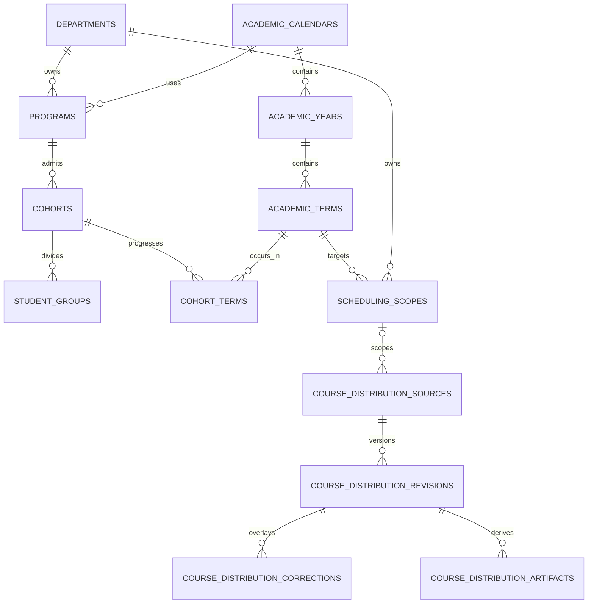
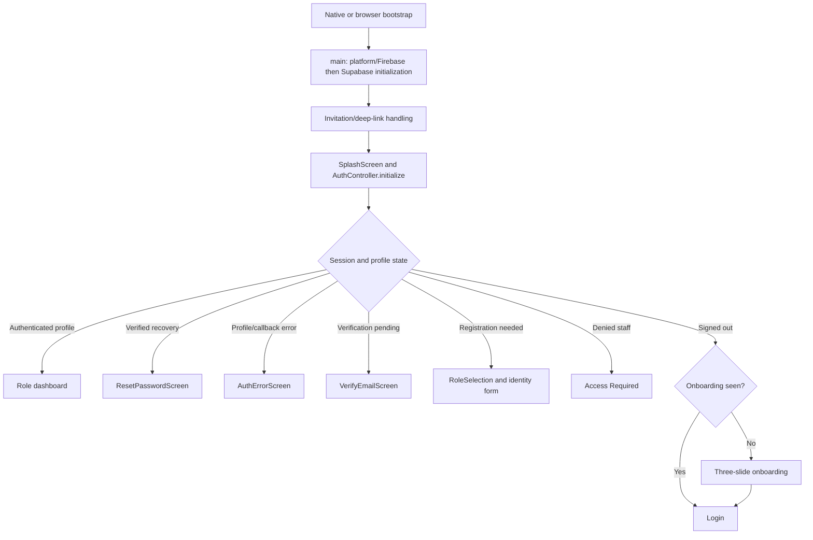
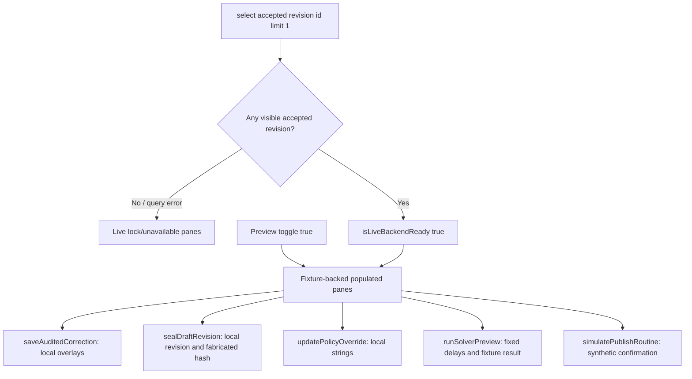

# UniVerse — Current Architecture and UI/UX Dossier

Investigation date: **7 November 2026 (Asia/Dhaka)**. Workspace: `D:\flutter projects\universe_v1`. This is a current-working-tree investigation, including uncommitted Phase 2B work. It is not a production acceptance certificate or an implementation proposal approved for execution.

## 1. Executive Summary

UniVerse is a Flutter campus application for students, teachers, and administrators. Its working core connects Supabase authentication, profiles, published routines, learning resources, announcements, class cancellations, and Android push notifications. A separate Python FastAPI service ingests Course Distribution workbooks, places sessions with Google OR-Tools Constraint Programming SAT (CP-SAT), assigns rooms, validates output, and renders an Excel routine. The frontend is feature-first, with `ChangeNotifier`/`SafeChangeNotifier`, feature services, and `GoRouter`; a replacement web framework is neither needed nor authorized.

**VERIFIED:** The repository contains a substantial Scheduling Workspace at `/admin/scheduling`, plus an unauthenticated `/preview/scheduling` route. **PARTIAL:** Its populated distribution, configuration, readiness, solver, and publication experience is fixture-backed. The controller does not call the correction RPC, actual solver, or publication RPC. Its simulated success states cannot establish academic correctness or persistence.

**CODE-DERIVED, high priority:** The live workspace gate has a consequential defect. `_buildTabContent` locks the UI only when both preview is off and `isLiveBackendReady` is false. Readiness here means merely that a query found one accepted revision ID. When one exists, the same fixture-backed panes become reachable with live mode selected. No source-record reader replaces `_records`, and actions still mutate local fixtures. Production currently lacks these contract tables, so the present production schema causes the unavailable branch; the problem becomes particularly important when the contract is deployed or environments change.

**VERIFIED, live metadata:** Production `yxqyrjyzxitrgkhgauli` has 18 public application tables, all reporting Row Level Security (RLS) enabled, but no canonical academic catalog or Course Distribution tables. The secondary project `oqwvxplteqtlrhktsplj` has those additive tables. Their presence confirms deployment there, not that this investigation executed the historical pgTAP assertions or established that environment's isolation is safe.

**VERIFIED, live definition:** `publish_routine` checks administrator permission and nonempty input and atomically replaces all routine rows. It does not independently validate academic constraints or require a successful validation report. Historical version metadata survives; the old routine rows do not. “Version history” must not be presented as fully recoverable timetable history.

**VERIFIED, live metadata:** Storage policies allow unrestricted object reads and broad authenticated insertion, replacement, and deletion across buckets. Notification audience filtering occurs in the client while the live notification SELECT policy allows all authenticated users. These are architectural access boundaries, not problems solved by hiding buttons.

The redesign should retain the orbit identity, semantic status patterns, usable task labels, published-routine identity rules, truthful errors, and separate desktop/mobile scheduling compositions. Its first priorities should be truthful operational states, mobile clipping, onboarding claims about unavailable AI, and coherent navigation between legacy routine tools and the new workspace. Preserve services and contracts while improving presentation components; coordinate validation, revision persistence, authorization, and publication work with backend phases.

## 2. Project Identity and Current Strategic Direction

**VERIFIED:** `pubspec.yaml` names the package `universe`, version `1.0.0+1`, with publication disabled. `AppConstants` identifies a campus companion for Leading University, Sylhet, initially focused on Computer Science and Engineering (CSE). Screens distinguish student, teacher, and admin roles. This is one Flutter application and one scheduling service, not separate student/admin web applications.

The intended direction is a maintainable university platform with recognizable dark/orange branding, distinct mobile and desktop experiences, clearer information hierarchy, purposeful motion, and future academic expansion. This direction is a redesign brief, not evidence that university-wide tenancy, AI assistance, assignment submission, or committee operations already work.

Preserve the current Flutter architecture, Supabase backend, Python engine, existing worktree, and workbook source bytes. New material UI, navigation, theme, or workflow changes require explicit design approval. No iOS work, hosted writes, migrations, deployments, or Supabase CLI use was performed for this dossier. Only this Markdown deliverable is created.

## 3. Investigation Scope and Evidence Method

### 3.1 Evidence vocabulary

| Label | Meaning in this document |
|---|---|
| VERIFIED | A concrete fact directly inspected in source/configuration, existing image evidence, or read-only live metadata; the evidence type is specified. Source existence does not imply runtime success. |
| CODE-DERIVED | Behavior inferred by tracing executable source, without exercising that interaction in a running app. |
| REPORTED | A result stated by a project report, not rerun or independently reproduced here. |
| PLANNED | A roadmap requirement whose complete operational path is absent. |
| PARTIAL | Some implementation exists but the intended end-to-end capability is incomplete. |
| UNKNOWN | Available evidence does not establish the fact. |
| DEPRECATED | An explicitly retired artifact or behavior, not merely a file that appears unused. |

Screen composition descriptions below are **CODE-DERIVED** unless explicitly identified as inspected screenshots. They describe widget construction, not usability-study results. Performance concerns are risks unless measured. No benchmark figures are invented.

### 3.2 Work performed and limits

Inspected route construction, shells, every feature's screen inventory and screen action/layout declarations, authentication logic, feature services/controllers, core models, theme tokens, shared widgets, Python engine entry points and solver constraints, SQL migrations and reconstructed baseline, Edge Function code, tests, reports, deployment definitions, and agent configuration. Read-only connected Supabase calls inspected both projects' public table inventory and production columns, constraints, policies, bucket flags, Realtime publication, key function definitions, and Edge Function metadata. No application rows containing names, email addresses, workbook contents, device tokens, or student identifiers were needed.

Twelve existing Phase 2B screenshots were opened: six 1440 px desktop views (distribution, inspector, configuration, readiness, generate, review), 1280 px distribution, 1024 px distribution, and four 390 px views (distribution, inspector-named image, configuration, readiness). These are **existing rendered evidence**, not newly captured runtime evidence. Relevant local-port checks found no active preview on the checked ports, including 8085 used by the capture script. No environment changes, preview build, server launch, login, real email, device test, or fresh browser walkthrough was attempted. The screenshots do not show an authenticated admin shell. Other screens were investigated through source, not screenshots.

Previously recorded passing suites were not rerun. Their status remains REPORTED, with source tests inspected for what they actually cover. No documentation claim that every test passes is promoted to an independent result.

### 3.3 Snapshot and conflicts

The initial worktree already contained modified routing, admin screens/shell, drawer, icon shim, and untracked scheduling implementation, tests, report, proposal, screenshots, and capture script. These are included as current implementation and preserved. `AGENTS.md`, `CLAUDE.md`, README, master-plan checkpoint, and Phase 2B report disagree about phase status. The dossier resolves behavior using current code and live metadata and preserves uncertainty about formal acceptance.

## 4. Complete Repository Structure

The meaningful structure below omits dependency caches, generated build trees, Git internals, and raw personal-data filenames. A folder's presence does not prove an independently deployed service.

```text
universe_v1/
├── AGENTS.md                         Shared Codex/Antigravity rules and approval gates
├── CLAUDE.md                         Claude rules and architecture summary; contains drift
├── .agents/skills/                   Seven project skills: implementation plus six UX skills
│   └── universe-implementation/      Task routing, five specialist references, mcap_config.json
├── .claude/settings.json             Narrow command permission entries
├── .vscode/settings.json             Java build update and Linux CMake location
├── .github/workflows/                Backend validation and hosted REST keep-alive
├── lib/
│   ├── main.dart                     Initialization, callbacks, app root and global sign-out overlay
│   ├── firebase_options.dart         Generated Firebase platform configuration
│   ├── core/
│   │   ├── constants/                Environment lookup names, role/table constants, enums
│   │   ├── models/                   Profiles, routines, resources, alerts, academic/config contracts
│   │   ├── platform/                 Conditional web/native downloads and callback URL cleanup
│   │   ├── router/                   AppRouter, RouteNames, AppShell
│   │   ├── services/push_service.dart Android FCM/local notification lifecycle
│   │   ├── theme/                    AppColors, AppSpacing, AppTextStyles, AppTheme
│   │   └── utils/                    Clocks, date logic, room identity, validation, safe notifier
│   ├── features/
│   │   ├── auth/                     Login, registration, verification, recovery and callback logic
│   │   ├── dashboard/                Student dashboard/controller
│   │   ├── teacher/                  Teaching dashboard, class actions and cancellation service
│   │   ├── routine/                  Student/teacher published routine
│   │   ├── resources/                Semester folders and resource retrieval
│   │   ├── notifications/            Audience filtering, reads, local dismissal and subscription
│   │   ├── profile/                  Profile display and avatar selection
│   │   ├── rooms/                    Schedule-derived occupancy and room detail
│   │   ├── find_teacher/             Schedule-derived teacher status and weekly detail
│   │   └── admin/
│   │       ├── screens/              Management, broadcast, resources, routine tools, workspace
│   │       ├── controllers/          Mutable admin state, generation/upload pipelines
│   │       ├── services/             Supabase admin/config, workbook parsing, engine HTTP
│   │       ├── widgets/              AdminDesktopShell and responsive card grid
│   │       └── scheduling/           Workspace models/controller/fixtures and five pane families
│   └── shared/
│       ├── widgets/                  U* controls, cards, navigation, weekly schedule and status widgets
│       └── utils/                    Navigation fallback and icon compatibility
├── engine/
│   ├── main.py                       FastAPI routes, in-memory jobs and worker threads
│   ├── distribution.py               Immutable workbook + correction overlay/replay contract
│   ├── ingest.py                     Distribution header/cell parser and session derivation
│   ├── solver.py                     CP-SAT placement, greedy room allocation, validation
│   ├── render.py                     Excel workbook output and hygiene
│   ├── domain.py                     Canonical academic and normalization dataclasses
│   ├── legacy_mapping.py             Reviewed mapping/quarantine helpers
│   ├── room_policy.py                Physical room aliases and departmental room rules
│   ├── config.json                   Engine baseline; not a revision-bound database policy snapshot
│   ├── tests/ and fixtures/          Contract, solver, ingestion, room and rendering evidence
│   ├── tools/                        Conversion/config/document helpers; some mutate outputs
│   ├── routine generation files/     Ignored private source workbooks; never execute or rewrite
│   └── requirements*.txt, Procfile, runtime.txt, README.md
├── supabase/
│   ├── migrations/                   001–016 with no 010; academic and distribution timestamped SQL
│   ├── reconciliation/               Restricted reconstructed baseline and staged verification SQL
│   ├── tests/                        pgTAP and reconciliation checks
│   ├── seed/                         Reference/demo SQL; not proof of live content
│   ├── functions/invite-admin/       Admin-authorized Auth invitation and callback policy
│   ├── functions/send-push/          Webhook gate, audience resolver and FCM HTTP v1 delivery
│   ├── config.toml                   Local service template; not hosted Auth configuration
│   └── diagnostics.sql               Inspection SQL
├── test/                            Flutter unit/widget/route and publication-gate tests
├── tool/                            Browser evidence, rehearsal, audit and document scripts
├── docs/
│   ├── implementation/              Master plan, Phase 1/2a evidence and Phase 2B proposal
│   ├── timetable-audit-2026-10-20/   Committee decisions, traceability and historical audits
│   ├── screenshots/phase_2b/        Existing rendered preview evidence
│   └── backend-setup.md             Environment reconciliation and limitations
├── assets/icon/                     Orbit launcher PNG sources
├── android/                         Native launch, deep links, permissions, Gradle configuration
├── web/                             Flutter bootstrap, base href, manifest and icons
├── linux/, macos/, ios/             Platform scaffolding; iOS work excluded from this task
├── workbook/, new genarated routine/ Workbook/output holdings; not application modules
├── .task1-local/                     Private local evidence; excluded from public dossier contents
├── .widget_preview/                 Preview tooling artifacts, not a separate product
├── pubspec.yaml, pubspec.lock        Flutter dependency and package definitions
├── analysis_options.yaml            Dart lint configuration
├── dart_defines.example.json         Configuration-variable template
├── dart_defines.json                 Local configuration; values deliberately excluded
├── render.yaml                      Render scheduling-service blueprint
├── PROJECT_STRUCTURE.md, README.md   Navigation/documentation; verify claims against code
├── PHASE_2B_UI_UX_IMPLEMENTATION_REPORT.md
├── UI_UX_SKILLS_INTEGRATION_REPORT.md, GLOBAL_FLUTTER_DART_SKILLS_REPORT.md
└── Reports/PDF/DOCX and generator scripts Historical project/defense artifacts, not runtime
```

UI-only work normally belongs in screens, feature widgets, shared widgets, and approved central theme tokens. Routing, model serialization, identity utilities, authentication state, services, SQL, native callback configuration, and engine code should change only when a named functional requirement justifies it. Generated Firebase files and platform-generated outputs should not become hand-maintained presentation modules. Dependencies such as Hive, PDF viewing, or cached image packages being declared does not prove an active feature uses them.

## 5. High-Level System Architecture



The solver is separate from Supabase: it does not fetch current permissions or an accepted revision directly from the database. Flutter can obtain a capability-checked accepted-revision bundle and send it with immutable workbook bytes. Python validates the supplied bundle's internal contract; that does not independently authenticate the HTTP caller or prove the bundle is still the latest database revision. The existing FastAPI source has wildcard Cross-Origin Resource Sharing (CORS), no endpoint authentication dependency, and process-local job storage.

The new Scheduling Workspace uses a different controller from the legacy generation screen. A polished preview of the future workflow is not the connected path represented by `TimetableEngineService`.

## 6. Frontend Architecture

### 6.1 Startup and ownership

`main()` ensures Flutter bindings, applies system UI/orientation, initializes Firebase and push on non-web platforms, initializes Supabase with Proof Key for Code Exchange (PKCE), creates `AuthController`, consumes invitation callbacks, constructs `AppRouter`, registers notification navigation, subscribes to Auth events, and calls `runApp`. `UniVerseApp` installs `MaterialApp.router`, `AppTheme.dark`, and a global sign-out blocking overlay animated for 150 ms.

The startup awaits external/platform initialization before the Flutter app root is shown. A visual splash rewrite cannot make failed pre-`runApp` initialization reliable. The current theme method also requests portrait-up orientation; changing orientation behavior is functional platform work.

Screens usually create/dispose a feature controller and rebuild with `ListenableBuilder`; services use the singleton Supabase client. This is not a universal repository abstraction or dependency-injection container. Some controller/service constructors support injected test doubles; others instantiate services directly. Detail screens sometimes own direct async service loading. Auth verification itself directly refreshes the Supabase session in addition to using `AuthController`.

### 6.2 Authentication state and redirects

`AuthStatus` includes initial, loading, authenticated, unauthenticated, registering, notWhitelisted, awaitingVerification, error, profileError, and passwordRecovery. `AppRouter.redirectFor` responds to this state and role; it is more than a boolean login guard. Recovery is established by a verified SDK event and matching session user, with a recovery timeout. Operation epochs prevent stale callback completion after sign-out or newer events. Preserve those checks during animation or navigation changes.

`AuthService.handlePostLogin` first reads the existing profile. A matching whitelist can create a teacher/admin profile. No matching profile/whitelist moves the flow toward registration; student registration can create a student profile, while teacher/admin assignment remains governed by database policy and the role trigger. Role-selection cards are intent, not permission grants.

### 6.3 Layout and navigation

`AppShell` wraps primary authenticated routes. At width ≥800 with admin role, it uses `AdminDesktopShell`, a persistent 250 px sidebar, administrative header, content pane, notification affordance, and checked engine-health state. Other roles remain in the standard shell even on wide web viewports. Primary mobile tabs use `AppBottomNav`; secondary routes can omit that navigation. Dashboards provide `AppDrawer` and an Explore floating action menu for room/teacher discovery. The floating action button scales/fades away while the drawer is open.

The mobile shell intercepts back: close drawer, let local folder/selection state unwind through `ShellBackRegistry`, return to role home, then require a second back within two seconds to exit. Browser back/forward and direct URL behavior require separate verification; native exit logic is not automatically an appropriate desktop history model.

### 6.4 Local state and persistence

| State | Storage/lifetime | Redesign implication |
|---|---|---|
| Supabase session | SDK persistence and Auth events | Never replace with a decorative logged-in flag. |
| Current profile/pending registration/recovery epoch | AuthController memory | Preserve transitions and clear on sign-out. |
| Onboarding completion | SharedPreferences `onboarding_done` | Account/session behavior is distinct from first-run preference. |
| Notification read state | `notification_reads` server rows | Cross-session behavior differs from dismissal. |
| Notification dismissal | SharedPreferences `dismissed_notifs_<userId>` | “Remove” hides locally; it does not delete a broadcast. |
| Avatar preset | SharedPreferences `avatar_preset_<userId>` | Device-local presentation choice, not an uploaded photo or profile-table update. |
| Generation result/job ID | TimetableGenController memory | Refresh can lose preview; durable draft IDs are future work. |
| Private draft export | JSON download/native file | `universe-routine-draft-v1`, preview-only; not a hosted accepted revision. |
| Scheduling corrections/policy/solve/publish preview | SchedulingWorkspaceController memory | Reset/refresh loses local changes; no persistence RPC. |

### 6.5 Domain identity

`RoutineEntry` preserves scalar primary teacher plus co-teacher codes in memory, combined section matching, service-class status, and optional canonical academic IDs. `matchesStudent` recognizes `B+C`; `matchesTeacher` checks all teacher codes. `toDraftMap` preserves `teachers`; legacy `toMap` does not store those arrays. The publication service refuses rows requiring shared-teacher storage. `ClockTime` handles teaching-order afternoon normalization; database clocks and engine clocks have different serialized shapes. `RoomIdentity` groups physical aliases. These utilities are high-risk dependencies beneath apparently simple labels.

## 7. Backend Architecture

### 7.1 Responsibilities

Supabase Auth manages identity/session/email operations. PostgreSQL stores profiles, access intent, schedules, announcements, resources, cancellations, token registrations, and legacy timetable settings/history. PostgREST exposes permitted operations; RLS and functions provide actual server access decisions. Storage holds downloadable files. Edge Functions handle privileged invitations and push delivery. Firebase is messaging infrastructure, not the application's primary database or login provider.

The Python service handles scheduling computation and file rendering. No complete AI inference/Retrieval-Augmented Generation (RAG) service was found. A vector table and similarity function exist as infrastructure, but no active AI screen/service calls them.

### 7.2 Legacy versus canonical contracts

Legacy runtime primarily uses text `batch`, `section`, `teacher_code`, and `room`, singleton settings, and global active routine replacement. Canonical SQL adds departments, calendars, years, programs, terms, cohorts, student groups, scope membership/capabilities, reviewed aliases, and mapping quarantine. `academic_model.dart`, `domain.py`, and `AcademicConfigService` support those contracts, but legacy generation explicitly retains `buildEngineConfig` until the new validation/publication boundary is ready.

Canonical schema existence in the secondary database does not make production multi-tenant. Do not infer authorization from a profile's text department. Scope membership and capabilities are separate server-managed records.

### 7.3 Operations with multiple side effects

Cancellation insertion followed by notification insertion is two requests. Eligibility saving deletes the current teacher's list and then inserts replacements; it is not one database transaction. Resource upload, metadata creation, and optional notification are separate. Routine publication is transactional inside its RPC, but workbook upload, run-history insertion, and subsequent notification occur outside that transaction. A secondary failure can occur after the primary operation already succeeded. Redesign must represent partial outcomes rather than blindly retrying all side effects.

## 8. Internal Engines and Business Logic

| Engine/workflow | Entry, inputs and processing | Outputs, consumers and contract risks |
|---|---|---|
| Auth resolution | `main.dart`, `AuthController.initialize`, AuthService; session → profile/whitelist → state | Role route/profile/recovery states; every shell depends on it. Wrong state ownership can bypass recovery or show the wrong account. |
| Distribution source ledger | `distribution.py`: SourceWorkbook, DistributionDraft, CellCorrection, CorrectionRevision; immutable bytes/hash, formulas/caches, overlays, optimistic revision checks | Effective workbook-derived dataset and `source_contract`; legacy generation can consume accepted bundle. Do not overwrite originals or remove provenance. |
| Distribution ingestion | `ingest_bytes`/`ingest_workbook`; row-5 headers, A–L rows, teacher/group parsing, meeting derivation and exclusions | Offerings, sessions, cohorts, metadata/warnings/excluded rows. Group or teacher flattening changes collision constraints. |
| Canonical domain/mapping | `domain.py`, `legacy_mapping.py`, Dart academic models | Typed catalogs, normalized input, policy/report types, reviewed mapping/quarantine. Existence is not full live solver adoption. |
| CP-SAT session placement | `solver.solve`; sessions, days/periods, teacher off-days, room-pool counts, eligibility/config | Day/period assignments with solver stats. Hard teacher and atomic-group non-overlap; different-day and adjacency behavior. |
| Room allocation | `solver._assign_rooms`, `room_policy.py`; placed sessions and actual room inventory/aliases | Physical room assignments, room failures and service rows. Greedy allocation can fail after placement; pool capacity is not full joint room/time optimization. |
| Validation | `solver._validate`, parser validation, client publish gates | Conflict/coverage/room/assignment diagnostics; several independent validators, not yet one server authority. |
| Rendering/import | `render.render_bytes`; Dart `RoutineWorkbookParser.parse` for rendered workbooks | XLSX and parsed routine rows; distribution workbook and rendered routine are different formats. Preserve time/group/teacher interpretation. |
| Job execution | `main.py` thread + `JOBS` dictionary | queued/ingesting/solving/rendering/done/failed; result/download endpoints; restart loses state, no durable queue or cancellation endpoint. |
| Dashboard timing | Student/teacher controllers, `RoutineEntry.startOn/endOn`, date utilities | Current/next classes, counts and today lists based on schedule/device time. Not location telemetry. |
| Room/teacher status | RoomsController/FindTeacherController; active rows grouped by room/teacher and current time | Occupied/free/current/next cards; missing schedule ≠ confirmed physical vacancy or actual teacher location. |
| Notification audience/read engine | NotificationItem.matchesAudience, NotificationService and NotificationController | Client-filtered visible alerts, optimistic read updates/rollback, local dismissal. Server read scope remains broader. |
| Push audience/delivery | `send-push/audience.js`, webhook handler, FCM service account OAuth | Token-targeted OS delivery and pruning; deployment/webhook/secrets are independent dependencies. |
| New workspace preview | SchedulingWorkspaceController + SchedulingPreviewFixtures | Filtering, local corrections, local seal/policy updates, delayed simulated solve/publish. Not the real scheduling engine. |

The present solver enforces one slot per session, teacher/cohort collisions, lab/theory pool limits, ECL/CSE lab pools, declared off-days/blocked periods, default different-day teaching, theory/lab adjacency modes, and objective terms including cohort compactness/late slots. It does not establish implementation of every R1–R16 committee requirement. For example, default different-day sessions differ from the approved future low-credit theory same-day block. Preview travel-distance sliders are not evidence of a travel-distance objective in this solver.

## 9. Frontend-to-Backend Integration Map

### 9.1 Core sequence diagrams







### 9.2 Action-level contracts

All flows below are CODE-DERIVED unless the live metadata establishes an object. “Integrated” means a real call path exists; it does not mean this investigation performed the action.

| Action / initiator | State/service and actual boundary | Response, authorization, failure and status |
|---|---|---|
| Launch / SplashScreen | AuthController.initialize → AuthService current session/profile; SharedPreferences onboarding flag | Loading/recovery/profile error/registration/dashboard. Operation epoch protects stale completions. Integrated. |
| Google login | AuthController → AuthService.signInWithGoogle | Web external OAuth redirect; Android account chooser + ID-token exchange. Callback/Google configuration errors block. Integrated, real OAuth untested here. |
| Email signup/login | AuthService signUp/signInWithPassword → Supabase Auth | Confirmed session or awaiting verification; profile resolution follows. No email provider independently identified. |
| Verify code/resend/manual check | VerifyEmailScreen → AuthController.verifyEmailCode/resendVerificationEmail; direct SDK refresh | Signup OTP verification; resend cooldown; 5-second polling catches failures silently. Sessionless refresh cannot alone establish verification. |
| Password reset/invitation | AuthCallbackPolicy, bridge/coordinator, AuthController recovery → updateUser password | Verified user/epoch/recovery timeout required; route/query alone insufficient. Invitation consumes verified token flow. |
| Profile and avatar | ProfileController.load → ProfileService.fetchProfile → profiles; ProfileScreen saves preset in SharedPreferences | Current screen displays/refetches profile and changes avatar locally. ProfileService.updateProfile exists but is not a current profile-edit UI flow. No authority from presentation. |
| Student routine/dashboard | RoutineController / StudentDashboardController → RoutineService.fetchForStudent | Active rows paged in 250-row chunks by batch, then joint-section filtering; errors/empty views. Integrated. |
| Teacher routine/dashboard | Teacher controllers → RoutineService.fetchForTeacher | All active pages fetched, then all-teacher-code matching. Profile teacher code is key. Integrated. |
| Cancel/undo/update class | ManageClassesController → TeacherService | cancellations insert/delete; notification insert separate. Teacher/admin server policy, date occurrence key, undo scoped to canceller. Integrated; no physical cancellation guarantee in rooms status. |
| Resources browse/open | ResourceController → ResourceService fetchAll/fetchForSemester; url_launcher | Semester/category filtering, external file/link opening, unavailable-link snackbar. Integrated; no in-app AI/PDF feature inferred. |
| Upload resource | ResourceAdminController → ResourceService uploadBinary/createResource, optional NotificationService | Storage upload and metadata are separate; deletion removes metadata via service, not demonstrated object cleanup. Staff/owner/admin policies apply. |
| Notification read/dismiss | NotificationController → NotificationService reads/upserts; preferences for dismissal | Optimistic mark-read rollback; multi-select removal is local, broadcasts remain. Audience filtering client-side. |
| Broadcast/history | BroadcastController → createBroadcast/fetchAllForAdmin/deleteBroadcast | Type/role/batch/section targeting; form required text; sending is database insertion, not confirmation of FCM delivery. |
| Admin user roles | ManageUsersController → AdminService.updateUserRole → profiles update | Backend RLS/role trigger apply; frontend choice alone cannot authorize. |
| Teacher whitelist/admin invite | WhitelistController → AdminService whitelist upsert/delete or functions.invoke('invite-admin') | Admin function verifies caller role and callback then whitelist and Auth invitation; partial failure possible between steps. |
| Room/faculty/settings baseline | Corresponding admin controllers → TimetableConfigService direct CRUD/upsert | Active resource flags, off-days, singleton typed settings. Mutable legacy data, not versioned policy snapshot. |
| Course eligibility | CourseEligibilityController → fetchCourseCatalog/saveEligibilityFor | Catalog from routine labels plus saved eligibility; delete+insert list, no atomic replacement RPC. |
| Generate | TimetableGenController → engine HTTP and config services | Poll every 2s, rate-limit backoff, transient retry ceiling, result/error. UI source/profile gates; no HTTP Auth guard in engine source. |
| Load accepted revision | TimetableEngineService.fetchAcceptedDistributionRevision → read_course_distribution_revision | Base64 bytes plus source/revision/hash/corrections; scoped read_catalog capability. Service/controller support exists; new workspace does not wire it. |
| Upload rendered routine | RoutineUploadController → RoutineWorkbookParser + settings/title maps | Client parse/validation → preview → Storage → publish_routine → run history → best-effort notice. Separate from Course Distribution import. |
| Manual routine edits | RoutineAdminController → RoutineService create/update/delete | Direct routines mutations; no shared authoritative validation. Admin UI/RLS. |
| New workspace availability | SchedulingWorkspaceScreen and controller each select accepted revision ID, limit 1 | Duplicate checks, generic catch maps to unavailable; not scoped selection or source-record fetch. PARTIAL. |
| Workspace correction/seal/config/readiness | SchedulingWorkspaceController methods | In-memory changes only, synthetic revision/hash; readiness row-specific local rules. No append RPC or validator. Preview only in intent; gate flaw documented. |
| Workspace generate/review/publish | runSolverPreview / simulatePublishRoutine | Fixed delays, fixture OPTIMAL result and synthetic confirmation ID. No FastAPI or publish RPC. PARTIAL demonstration. |
| Rooms / teacher finder | Corresponding controller → active routines fetch/stream | Schedule-derived time status; retry/empty/search. Routine Realtime publication missing live. |
| AI/RAG | Constants, ChatBubble, documents/match_documents only | No registered assistant route or calling service. PARTIAL infrastructure; no existing interactive AI journey. |

## 10. Supabase Architecture

### 10.1 Environment boundary

Production is `https://yxqyrjyzxitrgkhgauli.supabase.co`. The secondary URL is `https://oqwvxplteqtlrhktsplj.supabase.co`. Only read-only metadata inspection was performed. Production had the 18 tables below; the secondary additionally had academic and distribution tables. No assumption is made about permission to write to either environment. `supabase/config.toml` contains local defaults, including local redirect URLs and email-confirmation behavior, which do not establish hosted settings.

### 10.2 Production tables and relationships

**VERIFIED, live column/constraint inspection.** UUID means Universally Unique Identifier. Most application rows use UUID primary identity; exceptions include token text, whitelist email, singleton settings integer, and the read composite key. Key design details are cross-checked against repository baseline/migrations; primary-key and index definitions below are explicitly source-derived rather than claimed from the live constraint query that selected only foreign/unique/check constraints.

| Table | Important fields and identity | Dependencies and constraints |
|---|---|---|
| profiles | id, email, role, name, avatar_url, batch, section, semester, student_id, teacher_code, designation, department, courses[] | id references auth.users, cascade; role check student/teacher/admin. Auth, every role screen and audience use it. |
| whitelists | email identity, role, name, teacher_code, cohort and staff metadata | Role check; preauthorization, not an Auth account. No inferred automatic revoke of existing profiles. |
| routines | id, day, time_start/end (`time`), subject/code, teacher_id/name/code, room, batch, section, semester, is_active, is_service, routine_version_id | teacher_id → profiles SET NULL; version → routine_versions CASCADE. Text identity remains primary runtime matching. |
| routine_versions | id, semester_label, source, is_active, row_count, stats/validation JSONB, notes, published_at/by | publisher → auth.users; source engine/upload/manual. Stores metadata, not complete previous row snapshots. |
| cancellations | id, routine_id, cancelled_by, reason, class_date, duplicated cohort/subject/day/start metadata | routine and canceller reference profiles/routines with SET NULL. Date-specific override, not removal of recurring routine. |
| notifications | id, title/body/type, sent_by, target_role/batch/section, created_at | sender → profiles SET NULL; six checked types university/class_cancel/room_change/test_reminder/assignment/exam. |
| notification_reads | user_id + notification_id, read_at | Both Auth user and notification deletion cascade; user-specific read markers. |
| resources | id, title/category/semester, subject_code, drive_link/file_url, uploaded_by | uploader → profiles SET NULL; folders/categories are presentation grouping. |
| device_tokens | token text, user_id, platform, updated_at | user → auth.users CASCADE; register RPC binds token ownership to current user. |
| assignments | id, title/description, subject_code, teacher_id, batch/section, deadline | teacher → profiles CASCADE; no active assignment feature screen found. |
| submissions | id, assignment_id, student_id, file_url, submitted_at, is_late | assignment/student cascade; lateness trigger infrastructure, no current submission screen found. |
| documents | id, content, embedding, category | Repository vector(768), similarity/HNSW infrastructure; live table exists and is empty at inspection. No current ingestion/chat pipeline found. |
| timetable_rooms | id, unique name, building, is_lab/gallery, capacity, is_active, dept | Legacy physical resource pool and configuration UI. |
| timetable_faculty | id, unique acronym, full_name, dept/designation, off_days[], active, courses[] | Separate from Auth profiles; faculty resource ≠ account. |
| timetable_settings | id=1, label, periods, weights, working_days[], weeks_in_term, blocked/online/excluded periods, allow_online, service_scope, semester_map, fixed_sessions_per_week | weeks 1–52; fixed session override null or 0–7. Global mutable settings. |
| timetable_course_eligibility | id, acronym/course_code, is_eligible, priority, timestamps | Unique teacher/course, positive optional priority; no FK that turns acronym into Auth identity. |
| timetable_courses | id, code/title, batch/section, dept, lab flag, file_teacher/assigned_teacher | Unique code+batch+section. Service currently derives selectable catalog from routines/eligibility instead. |
| timetable_runs | id, label/file_path, stats/validation, status/count, created_by/at | creator → profiles; output history metadata, not durable engine job queue. |

**VERIFIED repository definitions, live parity not independently checked:** the reconstructed baseline defines `id` as primary key for assignments, cancellations, documents, notifications, profiles, resources, routine_versions, routines, submissions, timetable_course_eligibility, timetable_courses, timetable_faculty, timetable_rooms, timetable_runs and timetable_settings. The remaining keys are device_tokens(token), notification_reads(user_id, notification_id), and whitelists(email). Important named indexes are `cancellations_date_idx`, unique `cancellations_routine_date_uniq`, `idx_device_tokens_user`, `idx_notification_reads_user`, partial unique `routine_versions_one_active`, `routines_lookup_idx` (batch,section,day), `routines_teacher_idx` (teacher_code,day), `routines_version_idx`, `timetable_course_eligibility_acronym_idx`, and HNSW cosine `documents_embedding_idx`. The live unique/check/FK query confirms many business constraints in the table above, but was not an independent full index audit.



These lines represent foreign keys, not universal business cardinality guarantees. Teacher matching often uses text codes instead of teacher_id. Resources may be external links, and device token ownership uses Auth identity directly.

### 10.3 Additive canonical academic schema

**VERIFIED in migration source and secondary table inventory, absent from production inventory:** departments; academic_calendars; academic_years; programs; academic_terms; cohorts; student_groups; cohort_terms; scheduling_scopes; department_memberships; group_aliases; group_alias_members; routine_group_links; academic_mapping_batches; academic_mapping_quarantine. Programs connect department/calendar; years connect calendar; terms connect year; cohorts connect program; groups connect cohort; cohort_terms connect cohort/term/study stage. Scope combines department, optional program, and term. Composite foreign keys prevent mismatched program/department and cross-cohort alias membership. Optional IDs augment profiles/routines/resources rather than guessing historical mappings.

`academic_private.can_access`/`can_scope` and membership capabilities authorize scoped catalog/draft work. Public RPCs include `academic_catalog`, `save_academic_alias`, `review_academic_alias`, and `replace_academic_alias_members`; Dart `AcademicConfigService` exposes typed methods. Reviewed aliases and mapping quarantine are academic integrity mechanisms. UI redesign must keep unresolved identities visible rather than silently converting text labels into canonical IDs.



### 10.4 Distribution ledger

`course_distribution_sources` stores nonempty bytea, 64-hex SHA-256, sheet, scope and uploader/time, unique scope/hash. Its trigger verifies hash and forbids update/delete. Revisions carry source, parent, positive revision number/version, accepted/superseded/invalid status, reason and author/timestamps; unique source+revision number and a partial unique index allow one accepted revision per source. The revision guard forbids identity/status changes and demands version +1. Do not assume a complete supersede/seal lifecycle exists simply because those statuses are declared.

Corrections store revision, row ≥6, column A–L, original formula/cache JSONB, effective JSONB, reason, author/time, unique revision+row+column; triggers make them immutable and mark derived artifacts stale. Artifact kinds are normalized_input, validation_report, generation_output; current/stale status matches invalidation time. Supporting indexes cover source and revision lookups.

`append_course_distribution_correction` authenticates, locks revision, checks accepted status, scoped edit_draft capability, and expected version (`40001` stale error), then appends the audited change and advances version. `read_course_distribution_revision` authenticates, checks scoped read_catalog and accepted status, and returns source/revision identity, hash, base64 bytes and corrections. Client SELECT grants and RLS are distinct from RPC EXECUTE grants. Source read policies also contain a null-scope read branch, while these privileged RPCs reject null scope; broad table visibility is not equivalent to permission to generate/correct.

### 10.5 Security boundaries and verified production concerns

RLS is enabled on all 18 production public tables, but predicate scope matters. Live `profiles_select`, `routines_select`, `notifications_select`, `resources_select`, cancellation and several config SELECT policies use `true` for authenticated users. Notification target fields therefore do not establish confidentiality. Staff insert policies generally bind creator identity and teacher/admin role; owner/admin policies govern modification or deletion. Cancellation policies do not, by themselves, prove that the cancelling teacher owns the chosen routine. Assignment/submission objects have staff/owner policies but no active product journey found.

`guard_profile_role` is SECURITY DEFINER and enforces teacher/admin whitelist entry for role changes except existing unchanged roles and privileged contexts; live search_path is `public`. Its trigger complements policies that alone permit student/teacher roles. A profile editor must not remove trigger/error handling or infer security from hidden role fields. `register_device_token`, `is_admin`, and `my_role` are also definer functions; production `publish_routine` is invoker. Canonical/distribution functions use tighter explicit capability checks and empty search paths in source. These are different generations of design.

**High-risk, VERIFIED live policy metadata:** Storage SELECT to public uses true, authenticated INSERT/UPDATE checks use true, DELETE uses true, with no bucket/owner/path scoping. All four buckets—avatars, resources, assignments, timetables—report public. Do not present private academic workbooks as access-controlled merely because the UI lacks a download link. This task did not exercise destructive access or change any policy.

### 10.6 Realtime, RPCs, and triggers

**VERIFIED live:** `supabase_realtime` publication lists `public.cancellations` only. Notification INSERT subscriptions and routine streams exist in client code, but their tables were not in that publication. Their declarations do not establish functioning live updates. Pull-to-refresh/reload paths remain important.

| Object | Purpose/input/output | Authorization/status |
|---|---|---|
| publish_routine | p_rows plus label/source/stats/validation/notes → version_id,row_count | Live admin/nonempty checks, transactionally global delete+insert; no academic revalidation. |
| register_device_token | token/platform → current-user registration | Live definer function; client fallback for missing RPC. |
| guard_profile_role trigger | New/updated profile role → allow/42501 with not_whitelisted hint | Live; existing same-role upserts preserved. |
| match_documents | embedding + match_count → similar document content | Live function metadata; repository SQL uses vector similarity; no current caller. |
| calculate_is_late trigger function | Submission timestamp versus assignment deadline | Repository baseline infrastructure; no current frontend workflow. |
| academic_catalog/alias RPCs | Canonical snapshot and reviewed group mapping | Secondary/additive source; not production inventory. |
| distribution RPCs/triggers | Immutable provenance, append, version guard, stale artifacts, accepted read | Secondary objects exist; historical test results REPORTED. |

No active materialized-view workflow or application-specific database enum was identified in the inspected implementation. Roles, types and statuses predominantly use text plus CHECK constraints and Dart enums. Exact complete live extension/view/trigger inventories were not extracted; do not treat that absence of inventory as proof those objects cannot exist.

## 11. External Services and Integrations

| Integration | Actual role and configuration locations | Failure implications / evidence boundary |
|---|---|---|
| Supabase | Auth, PostgreSQL, PostgREST, RPC, Storage and selected Realtime; AppConstants, define files, SQL/functions | Login/profile/CRUD blocked or stale; local TOML does not establish hosted OAuth/SMTP. |
| Google OAuth / native Google Sign-In | AuthService, AuthCallbackPolicy, Android intent filters; GOOGLE_WEB_CLIENT_ID environment lookup | Web redirect versus native ID token; cancellation, SHA/client mismatch and callback errors require honest states. Real flows not executed. |
| Firebase/FCM | main.dart non-web initialization, firebase_options.dart, PushService, send-push | Token/permission/service-account/webhook failures can prevent delivery after successful announcement insertion. Web skips initialization/push. |
| Supabase Auth email transport | Signup confirmation, password reset, inviteUserByEmail | Provider, production templates, rate limits and delivery UNKNOWN. No active Brevo/Resend integration found in application/function code. |
| Google Gemini / embeddings | GEMINI_API_KEY lookup, generationModel/embeddingModel constants and suggested questions | Constants only; no active SDK/service request path. Model names are source values, not a recommendation or availability claim. |
| PostgreSQL vector extension | documents embedding and match_documents; reconstructed HNSW cosine index | Partial RAG substrate, no ingestion/retrieval/chat journey. |
| Render | render.yaml Python service, health route, requirements, Procfile | Blueprint exists; deployment version, uptime, scale and live auth UNKNOWN. Free-plan comments are not performance evidence. |
| Google Fonts | GoogleFonts.interTextTheme in central theme | Font loading/offline behavior not runtime-tested; no explicit bundled font asset list in pubspec. |
| External URLs / document apps | url_launcher, native OpenFilex, browser download abstraction | Browser popup/download support and installed viewers differ from Android; no blanket PDF-viewer claim. |
| GitHub Actions | Validation and scheduled REST keep-alive | CI definition exists; last execution unknown; no Flutter CI job found in validate.yml. |

Configuration variable names relevant to integration are `SUPABASE_URL`, `SUPABASE_ANON_KEY`, `GEMINI_API_KEY`, `GOOGLE_WEB_CLIENT_ID`, `TIMETABLE_BASE_URL`, `AUTH_WEB_CALLBACK_URLS`, `SUPABASE_SERVICE_ROLE_KEY`, `FCM_SERVICE_ACCOUNT`, `PUSH_WEBHOOK_SECRET`, and `SOLVER_WORKERS`. The client uses compile-time defines; server secrets belong in server environments. No values are included here. Defining an AI key in a client build would not create a safe server-side AI boundary.

Production Edge Function metadata reports `invite-admin` active version 2 with JWT verification on and `send-push` active version 2 with JWT verification off. Source `send-push/index.ts` explicitly labels its dedicated-secret wrapper test-only/not deployed. Live deployed bodies were not retrieved, so this investigation does not certify that production contains the wrapper or the latest invitation callback policy. Disabled gateway JWT verification alone does not prove absence of an internal auth gate.

## 12. Complete Route and Screen Inventory

**VERIFIED from `app_router.dart` and `route_names.dart`.** “Shared” means one screen implementation used across targets; it does not promise equal desktop/mobile quality. Auth routes are state-controlled, not universally accessible under every state. All `/admin` routes require an authenticated admin in the router; backend access is separately enforced. Room/finder routes lie outside AppShell but remain subject to global redirects. The preview route explicitly bypasses those redirects without a build-mode guard.

| Path/navigation entry | Screen | User / shell / implementation | Main dependencies/status |
|---|---|---|---|
| / | SplashScreen | All; standalone shared | AuthController startup and onboarding preference |
| /onboarding | OnboardingScreen | First run; standalone shared | PageView, markOnboardingSeen |
| /login | LoginScreen | Signed out; standalone shared | Google/email entry |
| /login/email | EmailLoginScreen | Signed out; standalone shared | Email/password AuthService |
| /signup/email | EmailSignupScreen | Registration; standalone shared | Pending role data + Auth signup |
| /verify-email | VerifyEmailScreen | Awaiting verification; standalone shared | OTP/resend/refresh |
| /forgot-password | ForgotPasswordScreen | Signed out; standalone shared | Reset email/cooldown |
| /reset-password | ResetPasswordScreen | Verified recovery; standalone shared | Recovery user/epoch, password update |
| /auth-error | AuthErrorScreen | Failed profile/callback; standalone shared | Retry/sign-out |
| /role-selection | RoleSelectionScreen | Registration; standalone shared | Role intent and access explanations |
| /register/student | StudentRegisterScreen | Student registration; standalone shared | Name, ID, batch, section; pending data |
| /register/faculty | FacultyRegisterScreen | Teacher intent; standalone shared | Name/code/department/designation; whitelist gate |
| /not-whitelisted | NotWhitelistedScreen | Denied staff; standalone shared | Access guidance/sign-out |
| /student/dashboard | StudentDashboardScreen | Student; AppShell shared | Routine and notification controllers |
| /student/routine | RoutineScreen | Student; AppShell shared | Batch/joint-section schedule |
| /teacher/dashboard | TeacherDashboardScreen | Teacher; AppShell shared | Teacher schedule/current next/alerts |
| /teacher/routine | RoutineScreen | Teacher; AppShell shared | Teacher-code schedule |
| /teacher/manage-classes | ManageClassesScreen | Teacher; AppShell shared | Date occurrence cancellation/notices |
| /student/resources | ResourcesScreen | Student role route; AppShell shared | Semester folders/categories/links |
| /notifications | NotificationsScreen | Authenticated roles; AppShell | Shared controller/read/dismiss states |
| /profile | ProfileScreen | Authenticated roles; AppShell | ProfileController/avatar/about/sign-out |
| /rooms | RoomsScreen | Authenticated; standalone shared | Occupancy derived from active routines |
| /rooms/detail | RoomDetailScreen | Authenticated; standalone shared | String room in `extra`; weekly schedule |
| /find-teacher | FindTeacherScreen | Authenticated; standalone shared | Search/status derived from routines |
| /find-teacher/detail | TeacherDetailScreen | Authenticated; standalone shared | TeacherDetailArgs in `extra` |
| /admin/dashboard | AdminDashboardScreen | Admin; adaptive AppShell | Counts + management actions |
| /admin/routine | AdminRoutineScreen | Admin; adaptive AppShell | Manage/Generate/Upload embedded tabs |
| /admin/routine?tab=manage | RoutineManagementScreen embedded | Admin | Direct CRUD routines |
| /admin/routine?tab=generate | GenerateTimetableScreen embedded | Admin | Real engine HTTP/config/result |
| /admin/routine?tab=upload | UploadRoutineScreen embedded | Admin | Rendered workbook parser/publication |
| /admin/scheduling | SchedulingWorkspaceScreen | Admin; adaptive AppShell | New workspace boundary and preview toggle |
| /preview/scheduling | SchedulingWorkspaceScreen preview | Unguarded standalone shared | Fixtures; tab and row query parameters |
| /admin/broadcast | CampusBroadcastScreen | Admin; adaptive AppShell | Announcement creation |
| /admin/broadcast/history | BroadcastHistoryScreen | Admin; adaptive AppShell | Sent list/delete dialog |
| /admin/users | ManageUsersScreen | Admin; adaptive AppShell | Profile search/filter/role sheet |
| /admin/registration | AdminRegistrationScreen | Admin; adaptive AppShell | Whitelist and invitation forms |
| /admin/resources | ManageResourcesScreen | Admin; adaptive AppShell | File/link metadata/upload/notice |
| /admin/resources/library | ResourceLibraryScreen | Admin; adaptive AppShell | Semester library/delete dialog |
| /admin/timetable/rooms | ManageRoomsScreen | Admin; adaptive AppShell | Room pools and bottom-sheet CRUD |
| /admin/timetable/faculty | ManageFacultyScreen | Admin; adaptive AppShell | Search/cards/name/off-day sheet |
| /admin/timetable/course-eligibility | ManageCourseEligibilityScreen | Admin; adaptive AppShell | Faculty selection/course checkboxes/priority |
| /admin/timetable/settings | TimetableSettingsScreen | Admin; adaptive AppShell | Mutable term/period/rule/weight form |
| /admin/timetable/grid | TimetableGridScreen | Admin; adaptive AppShell | TimetablePreview or row list in `extra` |
| No registered route | PlaceholderScreen | Reusable standalone placeholder | Not evidence of a completed feature |
| Constant only: /student/ai-assistant | No registered screen | Not a working destination | AI constants/ChatBubble ≠ integration |
| Constant only: /teacher-directory | No registered screen | Not the /find-teacher implementation | Preserve distinction in future routing |

Generate/Upload/Manage screens can construct standalone scaffolds but are currently embedded under AdminRoutineScreen. The report's suggested `/admin/faculty`, `/admin/rooms`, and `/admin/course-eligibility` URLs do not match the registered `/admin/timetable/...` paths.

## 13. Detailed UI/UX Screen-by-Screen Audit

### 13.1 Reading guide and common states

The following subsections describe actual source composition and actions, not speculative designs. Shared dark backgrounds, 20 px horizontal screen padding, 16 px card padding and 12 px radii are defaults where those shared tokens are used; individual screens also use local dimensions. Most screens use fixed vertical mobile-style composition, not a universal responsive grid. Loading commonly uses ULoading/spinners or skeleton rows; empty states use UEmptyState; errors vary between a page state, banner and snackbar. There is no single state presenter that guarantees all screens distinguish network failure from a truly empty dataset. See each screen below before removing helper text or controls.

### 13.2 SplashScreen — startup trust boundary

Source: `lib/features/auth/screens/splash_screen.dart`, especially `_setupAnimations` and `_initializeApp`. A centered orbit mark and UniVerse wordmark/subtitle introduce the brand on a dark background; animated dots indicate waiting. Logo fade/scale runs for 900 ms, subtitle fades in later, and a repeating 600 ms dots animation starts after a 600 ms delay. Auth initialization has a separate default 1800 ms delay in AuthController.

Initialization resolves returning sessions, recovery, profile errors and registration before first-run onboarding/login routing. Authenticated/verification/denied states rely on router redirects instead of blindly navigating to login. Retain that division. The logo/dot composition is presentation-level; delaying or changing session decisions is high risk. Reduced-motion response is not demonstrated. Android native launch resources precede this Flutter screen; their existence does not establish an animated native splash.

### 13.3 OnboardingScreen and OnboardSlide — brand and inaccurate promises

Sources: `auth/screens/onboarding_screen.dart`, `auth/widgets/onboard_slide.dart`. Top row: three progress marks and Skip. Middle: swipeable PageView with a 100×100 rounded icon tile, 44 px icon, centered multiline title and explanation. Bottom: full-width 52 px Next/Get Started action. Active progress mark widens from 6 to 20 px over 300 ms; advancing animates the page for 350 ms. Slides cover class timing, AI answers, and notifications with orange, blue, and green icons.

**VERIFIED source content, High:** The AI slide claims the assistant is trained on university data and promises factual answers without hallucination. No active assistant route/service supports that promise. Role-selection copy also advertises assignments/AI beyond the current product. Correct content independently of backend work; never imply an unimplemented feature is usable. The composition is a small icon-and-copy template, not custom illustration. No distinct desktop onboarding layout exists. Skip and finish must still persist completion and proceed to login. Large text/short-height overflow remains unverified.

### 13.4 LoginScreen — authentication choice

Source: `auth/screens/login_screen.dart`. The page uses a vertical Column with flexible spacers, centered 64 px orbit tile and 28 px wordmark, then left-aligned Welcome back and university Google-account guidance. A GoogleSignInButton is primary, email sign-in is secondary, and account creation is another entry; footer identity/help text occupies remaining space. Busy state disables actions and reports auth errors through snackbar/listener behavior.

The orbit is consistent branding, but fixed Column/spacers and lack of an independently designed wide form region are desktop and short-screen risks. Google and email are actual choices and should remain distinguishable. No runtime evidence here establishes the exact Google provider configuration. Preserve controller listeners and error reporting when extracting a branded auth layout.

### 13.5 EmailLoginScreen and EmailSignupScreen — forms

Sources: `auth/screens/email_login_screen.dart`, `email_signup_screen.dart`. Email login has back/title app bar, scrollable safe-area form, Welcome back heading, description, external field labels, email field, obscured password field with visibility action, forgot-password link, and submit. Email validation checks nonempty/basic address shape; keyboard actions move between fields. Errors are surfaced through the AuthController result and snackbar. Submit/loading must suppress duplicate requests.

Signup is a corresponding account-creation form with email, password and confirmation/validation, fed by pending student/faculty data from the preceding registration screen. The user can reach verification rather than a dashboard immediately. The repeated direct field decoration code is a component opportunity, but changing form/controller lifecycle can discard pending role details. Password toggles need explicit accessible names and keyboard checks; they are not decorative icons. Wide-screen max-width treatment is not consistently centralized.

### 13.6 RoleSelectionScreen — intent versus authority

Source: `auth/screens/role_selection_screen.dart`. App bar says Create account, followed by I am a and three role cards. Cards use distinct semantic role colors, subtitles, animated selection outline/check, and a disabled-until-selected Continue button. Selection animates over 200 ms. Student proceeds to student registration. Teacher/admin intent can show access explanation bottom sheets; an admin card does not self-create administrative permission.

This communicates different audiences but presents capabilities absent from current implementation in some subtitles. Keep server-controlled admission visible and concise; reduce misleading product promises. Role cards can be redesigned freely as presentation while preserving `_proceed`, pending-data handling and denied-state routing.

### 13.7 StudentRegisterScreen and FacultyRegisterScreen — identity collection

Sources: `auth/screens/student_register_screen.dart`, `faculty_register_screen.dart`. Both have Create account app bar, introductory role identity, stacked labeled form fields, email continuation and Google registration actions. Student asks name, student ID, batch and section. Faculty asks full name, exact routine teacher code, department and designation dropdowns, with code guidance. Required validation and disabled busy states protect submission. The source supports storing pending details before authentication and completing registration afterward.

Faculty code is a schedule-matching key, not just display text. Department selection does not grant canonical departmental capability. Retain not-whitelisted error mapping. The two forms share a visual pattern but implement their own fields; extraction should retain distinct validators, privacy purpose and keyboard behavior. Avoid inferring batch/section from guessed academic identities.

### 13.8 VerifyEmailScreen — multiple verification mechanisms

Source: `auth/screens/verify_email_screen.dart`. Back cancels/returns through sign-out handling. The scrollable body uses LayoutBuilder, minimum-height constraint and IntrinsicHeight so it can center content while allowing scroll. A 96 px blue envelope tile with animated status dot precedes Check your inbox, pending email chip, explanation, numeric code field (maximum eight characters; local minimum six), verify action, resend/cooldown feedback, manual verification check and change-email route.

It polls session refresh every five seconds, manually refreshes on demand, and delegates OTP verification and resend to AuthController; successful resend starts a 60-second cooldown. Timers and text controller are disposed. Poll errors are silently caught; this can leave the user waiting without a diagnosis, especially when no session exists to refresh. The code-entry path remains essential. Pulsing-dot motion is continuous (1400 ms); reduced-motion handling was not identified. Long email in a compact Row, IntrinsicHeight cost and screen-reader countdown chatter need targeted verification, not assumed failure. Redesign must retain pending email, duplicate-request suppression, explicit resend state and safe cancellation.

### 13.9 ForgotPasswordScreen and ResetPasswordScreen — recovery

Sources: `auth/screens/forgot_password_screen.dart`, `reset_password_screen.dart`. Forgot-password presents reset app bar, explanatory heading/icon, email field and Send reset link. After success it changes to an inbox confirmation with resend countdown and Back to sign in. Reset-password presents New password app bar, password and confirmation inputs with visibility toggles and strength feedback, Update password, then success and Sign in now.

Sending a request is not proof of delivery. A reset route alone cannot enable update: AuthController requires verified recovery identity, guards concurrent updates and tracks completion/expiry. Replacing this with a generic password settings form would break the recovery contract. These are good candidates for a shared bounded auth form layout with platform-specific composition, after design approval.

### 13.10 AuthErrorScreen and NotWhitelistedScreen — failure and denial

Sources: `auth/screens/auth_error_screen.dart`, `not_whitelisted_screen.dart`. AuthErrorScreen provides recovery for profile/callback failure through retry and sign-out rather than silently treating a valid session as a valid profile. NotWhitelistedScreen uses Access Required, warning/access explanation, account context and sign-out/change-account action on a centered dark layout. This is not a network-error screen. Maintain separate copy and actions for permission denial, missing profile, expired recovery and connectivity failure. Actual rendered layout and long-message behavior were not inspected.

### 13.11 StudentDashboardScreen — daily task hierarchy

Source: `dashboard/screens/student_dashboard_screen.dart`, StudentDashboardController. Personalized greeting and cohort subtitle in UAppBar, drawer entry, date text, live/next/message hero, AT A GLANCE statistics, Today's Classes with See all, a four-action grid (routine, resources, alerts, profile), and Recent Alerts. LiveClassCard/NextClassCard communicate time, course, room and teacher; message states distinguish no classes, done for today and no scheduled classes. Skeleton initial loading and retry page cover errors when no useful data loaded; refresh reloads content.

The current/next class emphasis is task-appropriate and worth retaining. Multiple stats, class list, shortcuts, bottom navigation, drawer and Explore menu create repeated access paths; repetition is visible in source, but the optimum reduction needs task testing. A broad desktop dashboard remains the same vertical experience rather than a distinct desktop information workspace. Preserve current/next computation and cancellation semantics; do not convert scheduled presence into physical attendance claims.

### 13.12 TeacherDashboardScreen — teaching overview

Source: `teacher/screens/teacher_dashboard_screen.dart`, TeacherDashboardController. Same shared dashboard grammar, but hero subtitle is cohort context, section statistics replace student-specific counts, Today's Teaching leads to My Classes, and Manage Classes replaces Resources in quick actions. Drawer, alert badge/list, loading, error and no-teaching states parallel the student dashboard.

Shared visual components make sense; teacher tasks do not justify a literal copy of student information priority. Retain teaching workload/cohort context and access to class updates. Duplicated dashboard scaffolding can be separated from role-specific data composition without merging the two controllers' business logic.

### 13.13 RoutineScreen — published daily agenda

Source: `routine/screens/routine_screen.dart`, RoutineController. UAppBar title switches My Routine/My Classes by role; day selector precedes a vertically separated class-card list. Cards expose subject/code, time, room, teacher/cohort and status. Loading uses skeleton rows, no-day entries use an empty state, and refresh reloads. Student matching includes combined sections; teacher matching includes in-memory co-teachers.

A mobile daily agenda is useful for rapid consultation. Desktop could offer a weekly overview using the same service rather than squeezing cards into arbitrary columns. Do not change day indexing or local-clock interpretation while restyling the day selector. No drag-and-drop edit affordance exists here.

### 13.14 ManageClassesScreen — consequential teacher actions

Source: `teacher/screens/manage_classes_screen.dart`, ManageClassesController/TeacherService. Manage Classes app bar, date/day context, class list with cancellation state, and tap-to-open action sheet. The sheet shows subject, cohort/time, then Cancel this class or Undo cancellation, plus Post an update. Cancellation opens a reason form (optional reason), submit busy state and result snackbar. Update opens type chips, required title/message and send action.

Keep selected occurrence date explicit: cancellation affects a date, not every recurring class. Cancellation insertion and broadcast insertion are separate operations; failure feedback must account for that. Undo removes cancellation but does not retract the old notification. Desktop currently uses the same sheet-centric task, so a contextual panel is a possible future alternative, not implemented. Ensure focus returns to the initiating class after closing a modal.

### 13.15 ResourcesScreen — semester folders and external files

Source: `resources/screens/resources_screen.dart`, ResourceController/ResourceService. Root Resources app bar and semester-folder grid show counts and a YOURS marker for the profile semester. Opening a folder changes the title to Semester N and installs back behavior; horizontal category chips precede resource cards. Cards show resource identity/category metadata; tapping opens file_url or drive_link externally. Missing/unlaunchable link produces feedback. Loading skeletons and no-resource states are present.

Folder identity and category filters are meaningful information architecture, not arbitrary decorative cards. Desktop can benefit from search/filter/list composition; mobile folder flow can remain focused. Preserve folder back integration with ShellBackRegistry. No assignment submission or document chat operation occurs here.

### 13.16 NotificationsScreen — persistent reads, local removal

Source: `notifications/screens/notifications_screen.dart`, NotificationController. UAppBar offers Mark all read and selection entry; selection changes title/actions to selected count, exit and removal. Horizontal type filters sit above notification tiles. Tiles show type-colored icon, title/body/time and unread state; tap marks read, long press enters selection. Remove confirmation says removal from the user's list and persists dismissed IDs locally. Loading and filtered-empty states use shared components.

Preserve the difference between read state (server) and removal (device/user preference). It is misleading to redesign removal as permanent database deletion. Client audience filtering currently matches role/batch/section after fetching rows, and cannot be branded as confidential targeting. Realtime insertion subscription exists but production publication lacks notifications. Add clear manual refresh/retry affordances in any approved redesign.

### 13.17 ProfileScreen — identity and presentation settings

Source: `profile/screens/profile_screen.dart`, ProfileController/ProfileService. Header identity card with tappable local avatar, name, role badge/email; role-dependent stats (department/courses or batch/section); INFORMATION rows; SETTINGS/About entry; project credits/about content; sign-out action with confirmation and global blocking overlay. Avatar picker is a bottom sheet with default/preset illustrations/icons, not evidence of arbitrary photo upload.

The page blends account facts, personalization and project credits. A hierarchy redesign can reduce emphasis on secondary credits while keeping attribution available. Role fields are not a permissions editor. Avatar selection persists `avatar_preset_<userId>` locally; it does not call ProfileService.updateProfile. That service method exists without a current general profile-edit form. Sign-out duplication across drawer, shell and profile should share behavior even if entry points remain contextual.

### 13.18 RoomsScreen and RoomDetailScreen — schedule-based occupancy

Sources: `rooms/screens/rooms_screen.dart`, `room_detail_screen.dart`, room_status_card.dart and RoomsController. Standalone app bar/back/refresh, loading spinner, retry error or room status card list. A room card shows occupied/free, current subject/teacher/cohort, remaining minutes, or next class/time. Detail receives room via route extra, shows weekly schedule through WeeklyScheduleView, and has loading/error/retry/no-classes states.

This is a schedule-derived estimate, not a room sensor system. Only rooms represented by active routines appear; an absent room is not known free. RoomIdentity aliases matter. Cancellation changes are not universally applied by this controller. The detail route has no stable path ID; browser refresh/direct link can lose the extra payload. Preserve an explicit no-selection state rather than showing false empty schedules.

### 13.19 FindTeacherScreen and TeacherDetailScreen — expected teaching status

Sources: `find_teacher/screens/find_teacher_screen.dart`, `teacher_detail_screen.dart`, teacher_location_card.dart and FindTeacherController. Standalone header/back/refresh, labeled search, loading/error/retry or filtered teacher cards. Cards expose teacher identity, In Class/Free/No Class Today, current room/subject/cohort and remaining/next slot. Detail takes TeacherDetailArgs and renders WeeklyScheduleView with retry/empty states.

Status is computed from routine code and device time; it is not GPS, office presence or guaranteed availability. The finder controller groups scalar teacherCode, unlike RoutineService's all-teacher matching, which matters for future co-teacher storage. Avoid labeling “Free” as confirmed appointment availability. Browser refresh loses route extra. Search focus/keyboard and actual small-device card fit remain unverified.

### 13.20 AdminDesktopShell and AdminDashboardScreen — platform frame

Sources: `admin/widgets/admin_desktop_shell.dart`, `admin/screens/admin_dashboard_screen.dart`, AdminDashboardController. Desktop shell has 250 px persistent sidebar, brand, grouped management links, active state, engine connectivity/retry, profile/sign-out and administrative header above child content. Dashboard itself retains a user/title app bar, Overview statistics (students, teachers, routine slots, broadcasts) and Manage action cards linking scheduling, generation/upload/manual routines, faculty, rooms/settings/eligibility, broadcasts/users/resources/registration.

The desktop frame is a real platform-specific implementation. Nested child headers and many equivalent dashboard/sidebar links add vertical and conceptual repetition. Counts are fetched as lists of IDs and counted client-side, not server aggregate counts. The sidebar's default `?tab` assumption can highlight Generate when `/admin/routine` defaults to the Manage index; align navigation contract before moving tabs. Busy counts show dashes rather than pretending zero. A healthy engine does not establish available distribution/policy/publication capabilities.

### 13.21 AdminRoutineScreen — legacy tool container

Source: `admin/screens/admin_routine_screen.dart`. Routine app bar, new Scheduling Workspace banner with explanatory copy/action, then animated segmented Manage/Generate/Upload controls and an IndexedStack of embedded screens. Query parameters select tabs; local tab changes are also state. The legacy container remains operational, not deprecated just because a new workspace exists.

The banner connects old and future workflows but increases repeated guidance across admin pages. Keep a concise distinction between a published-routine editor, a real generator, and fixture preview. IndexedStack preserves child state and can initialize hidden children, so replacing it with a rebuilding switch changes state lifetime. Preserve explicit query navigation behavior and test direct entry/back/refresh if redesigned.

### 13.22 RoutineManagementScreen — direct schedule CRUD

Source: `admin/screens/routine_management_screen.dart`, RoutineAdminController/RoutineService. Day-filter chips, add action, loading/empty or responsive entry cards/grid. Each entry exposes edit/delete; an entry bottom sheet collects schedule fields such as course, teacher, room, batch/section, semester, day and times; deletion requires confirmation. Width ≥700 selects a grid arrangement.

This edits routines directly rather than revision-bound draft assignments. A prettier form or grid must not imply validation parity with generation. Preserve 24-hour normalization, synthetic versus stored IDs and field validation. Do not add drag-and-drop or instant auto-save under a UI-only task. Planned server validation should precede more powerful editing affordances.

### 13.23 GenerateTimetableScreen — real computational pipeline

Source: `admin/screens/generate_timetable_screen.dart`, TimetableGenController. Intro/engine card; quick links to baseline room/faculty/eligibility/settings; optional source-bound JSON run profile; distribution XLSX picker; generation action; actual job progress; failure diagnostics or results. Results show class/cohort/teacher/solve-time stats, validation status and ingest report, View Full Grid, Download Workbook, private draft export where needed, Publish to App, and Start Over. Download and publication have independent errors/busy states.

This path calls the Python engine, unlike the new workspace preview. Publication is blocked by failed validation, private rehearsal profile or unsupported co-teacher storage. Service/non-CSE rows must accompany printed cohort rows into publication so room/teacher status is complete. Download may upload to Supabase for non-private runs, so it is not always a local-only action. Run profile/source hash binding is essential. Preserve diagnostics rather than replacing real stages with a fixed animated percentage.

### 13.24 UploadRoutineScreen — rendered workbook import

Source: `admin/screens/upload_routine_screen.dart`, RoutineUploadController and RoutineWorkbookParser. Intro explaining existing workbook publication, XLSX picker, Review Workbook action, parsing state, then stats (classes/cohorts/teachers/clashes), warnings and grid preview. Publish is enabled only when parser validation permits; successful publication shows confirmation and Upload Another Routine. Failure returns recoverably with error text.

This imports the rendered routine format, not a Course Distribution workbook. Maintain that distinction in labels and file guidance. It relies on period settings and subject/teacher title maps; changed parsing labels can break a seemingly presentation-only upload. Server publication currently trusts client validation metadata. Storage/history/notification side effects are separate from the routine transaction.

### 13.25 TimetableGridScreen — transient preview matrix

Source: `admin/screens/timetable_grid_screen.dart`. Generated preview app bar, dropdown filters and day chips above a horizontally scrollable cohort/time matrix. Cells display course code, all teacher display and room, with visible overlapping-entry warning. At ≥800, cohort width is 80 and slot width 160; compact widths use 64 and 118. Empty route payload shows No Timetable Preview Available and generator navigation; no rows on day shows a different empty state.

This is a useful responsive dense view, but it is transient `extra` state rather than a recoverable run URL. Keep overlap warning, room aliases and all faculty. Do not imply editable draft or durable revision history. Desktop keyboard navigation and virtualized scale are unverified; horizontal scrolling on mobile is deliberate here, unlike clipped non-scrollable headers.

### 13.26 ManageFacultyScreen — baseline teacher resources

Source: `admin/screens/manage_faculty_screen.dart`, TimetableFacultyController. Manage Faculty header/subtitle, policy-baseline/workspace notice, search, count/with-off-days summary, list or ≥700 px grid of acronym/name/department/off-day cards. Tap opens a bottom-sheet editor for full name and unavailable-day chips, then Save/busy feedback.

It edits existing legacy faculty resources, not accounts or a full permanent/adjunct attendance policy. Off-days mean unavailable teaching days here; they must not be relabeled as mandatory attendance without backend support. Keep exact acronym stable. Card density is reasonable for mobile; desktop bulk editing is a possible future requirement, not an existing capability.

### 13.27 ManageRoomsScreen — baseline resource pools

Source: `admin/screens/manage_rooms_screen.dart`, TimetableRoomsController. Header and add action, workspace/baseline notice, grouped room pools with counts and responsive cards. Empty offers Add Room. Add/edit sheet includes room name, building, type chips, active/inactive status, save and delete for existing room. Cards display room/building/type/inactive state.

Changing global physical-room records differs from per-term allocation. The future roadmap requires adding/removing allocations without deleting physical identity. The present editor does not expose every metadata field in the database (for example a complete capacity/calendar editor). Do not infer those controls from the schema. Preserve active-resource filtering and room aliases through any card/table redesign.

### 13.28 ManageCourseEligibilityScreen — teacher/course selection

Source: `admin/screens/manage_course_eligibility_screen.dart`, CourseEligibilityController. Course Assignments header/subtitle and baseline notice; faculty search/selection pane; selected acronym/count, course search, eligible checkboxes and priority dropdown; Save disabled without changes, busy state and result snackbar. Compact layout uses a Back action from selected teacher to chooser.

Catalog derives from routine labels plus persisted eligibility, not a fully populated canonical course catalog. Course titles missing from current routines remain as codes. Saving replaces one teacher's list using delete+insert. Keep unsaved-change state, selection identity and priority meaning; a desktop split view/mobile drill-in is appropriate separation. Don't advertise transaction-safe bulk saving until backend work supports it.

### 13.29 TimetableSettingsScreen — powerful mutable form

Source: `admin/screens/timetable_settings_screen.dart`, TimetableSettingsController. Header, workspace banner, TERM label and semester label/weeks/global weekly-count fields; CLASS PERIODS list with add/remove and start/end inputs, day-exclusion chips and online flag; working-day controls; online/reserve and service-scope rules; soft weight numeric fields; validation errors and Save Settings. Scrollable long-form composition uses local period drafts and validates intervals before persistence.

The optional fixed sessions/week value overrides derivation for every offering and has major academic consequences. Service resource-only versus ignore changes whether external classes occupy resources. These explanations are justified, unlike repeated navigation banners. Redesign should group defaults/advanced rules and show impact, but retain clear consequences and ClockTime repair. These settings are not a sealed policy snapshot; do not apply a “revision bound” badge without new persistence.

### 13.30 ManageUsersScreen and AdminRegistrationScreen — account governance

Sources: `admin/screens/manage_users_screen.dart`, `admin_registration_screen.dart`. Users has search, role-filter chips and profile rows/cards with identity/role marker. Tap opens a change-role sheet; controller reports result. Registration contains whitelist list/removal confirmation, Add a teacher form (email/name/code, optional department/designation), and Invite a new admin form (email/name) with send status.

These screens change authority, not routine resources. The whitelist is an admission record; removing one is not demonstrated as revoking an existing user's session/profile. Invitation success must reflect the function result; email delivery remains outside current evidence. Keep existing account-role trigger behavior and approved callback policy. A redesign could separate enrollment and account management more clearly, but must not introduce self-service admin creation.

### 13.31 CampusBroadcastScreen and BroadcastHistoryScreen — audience and lifecycle

Sources: `admin/screens/campus_broadcast_screen.dart`, `broadcast_history_screen.dart`, BroadcastController. Composer app bar links sent history; type chips and audience choices (Everyone/Students/Teachers/Admins), optional batch/section targeting, required title/body, Send broadcast/busy state and guidance. History lists NotificationTile entries with loading skeleton/no-broadcast state; selecting an entry opens deletion confirmation.

Audience fields control delivery/display selection, not current server confidentiality. Deleting a sent broadcast is different from locally dismissing a recipient tile and cannot retract a previously delivered OS notification. Preserve target null-as-everyone semantics and joint-section audience matching. Avoid using success language that asserts device receipt.

### 13.32 ManageResourcesScreen and ResourceLibraryScreen — creation and cleanup

Sources: `admin/screens/manage_resources_screen.dart`, `resource_library_screen.dart`, ResourceAdminController. Form starts details/title/optional subject code, category chips, semester chips, FILE OR LINK picker/Drive URL, selected-file remove control, Notify students switch and Upload resource. Library app bar changes with selected semester, folder grid leads to file list, and deletion asks confirmation. Uploading/loading/empty/error states are separate at controller level.

The field structure helps avoid empty metadata but can be compacted for desktop with a bounded metadata panel and separate attachment region after approval. Keep file versus link precedence and notification selection. Deletion through ResourceService deletes the row; object cleanup is not demonstrated. Displaying “permanently deleted file” would overstate behavior.

### 13.33 Scheduling Workspace — common frame and live boundary

Sources: `admin/screens/scheduling_workspace_screen.dart`, `scheduling/widgets/scheduling_header_bar.dart`, `scheduling_revision_bar.dart`. Header: orange stack mark, title/subtitle, mode badge, Live Backend/Design Preview toggle and refresh. Revision strip: scope/term, accepted revision/version/hash/file metadata, counts/status, seal/reset controls. Five scrollable tabs follow: Distribution, Configuration, Readiness, Generate, Review & publish.

Actual breakpoints are ≥1024 for desktop distribution and <768 for compact padding; AppShell's admin breakpoint is ≥800, a different decision. On authenticated desktop the sidebar consumes 250 px, but workspace desktop choice uses full MediaQuery width rather than local content constraints. Therefore standalone preview evidence at 1024 does not prove the same table fits inside the real shell.

Unavailable live mode shows centered lock cards explaining missing revision reader/policy/readiness/engine/publication contracts. This is valuable truthful capability feedback. However, finding an accepted revision changes `isLiveBackendReady` and bypasses those lock panes without a real reader: see §20. Refresh updates controller availability but the screen also retains a separately created Future, risking inconsistent availability messages. Locking and loading must remain separate from an empty distribution.

### 13.34 Distribution tab and provenance inspector

Sources: `distribution_filters_bar.dart`, `distribution_table_desktop.dart`, `distribution_list_mobile.dart`, `distribution_record_inspector.dart`. **VERIFIED existing screenshots:** a dark rounded filter panel has search, batch/section/department dropdowns, conflict/corrected/pending-teacher chips and inspector toggle. Desktop table groups A–D identity, E–I academic allocation, J–L meeting/formula evidence and integrity/audit; rows show formula badges, teacher groups, joint sections, status and an inspect action. Horizontal overflow is scrollable. Selection highlights the row; a 380 px docked panel shows five numbered evidence sections.

Inspector sections are original workbook A–L evidence, effective overlay, formula/cache integrity, downstream impact and correction form/history. Edits request value and rationale; save updates local corrections/version. Desktop screenshot with inspector confirms a smaller table viewport and bottom horizontal scrollbar. Course titles are visibly truncated, so full title in inspector matters. The screenshot/footer shows 23 source records, while report/readiness text says 24; preview consistency needs correction before real academic data use.

Mobile switches to course cards rather than squeezing 12 columns, with row/cohort label, code/title, teacher and status, and intended draggable modal inspector on tap. The saved image named mobile inspector sheet shows selected card but no visible sheet. Query preselection only selects state and does not demonstrate a modal opening. Do not report a mobile modal walkthrough as verified. Saved 390 px captures show right-edge clipping of header/subtitle and some controls; “no widget overflow” in a test does not establish complete visual accessibility.

### 13.35 Configuration tab

Source: `configuration/scheduling_configuration_pane.dart`. **VERIFIED screenshots:** title/explanatory panel, category sections such as Section Calendar and Faculty Workload, numbered R/D policy badges, description, Snapshot Bound status/edit override, and Default → Override → Effective Policy strip. Desktop supports comparison in one row; mobile stacks comparison values but surrounding title/actions are visibly clipped in saved captures. Dialog edit updates controller strings, not typed database policy or engine configuration.

The preview text describes authoritative frozen policy behavior that is not implemented by this controller. Snapshot requirement identifiers shown in footers are future-contract hints, not proof those named database tables exist. Keep the explanatory distinction but move implementation names out of normal operational UI when users cannot act on them. Do not mistake fixture labels (fixed Friday/Saturday weekend) for the approved per-section calendar rule.

### 13.36 Readiness tab

Source: `readiness/scheduling_readiness_pane.dart`. **VERIFIED screenshots:** red Preflight Blocked/No-go banner, percentage/progress bar, critical/warning/verified counts, resolve action, then checkpoint cards with icons/status, title, explanation, affected entities and Fix in Distribution link. This link changes tab/selects row. Ready state can expose Proceed to Generate.

The displayed 71% is five of seven fixture prerequisites, not a server validation result. Row 19 teacher changes and row 24 corrections resolve hardcoded readiness items in controller code; they do not run normalization/validation. Some header/actions are cut off at 390 px in saved evidence. Preserve severity, entity-specific navigation and unknown-versus-passed distinction in a real implementation; avoid a reassuring aggregate percentage masking critical blockers.

### 13.37 Generate tab

Source: `generate/scheduling_generate_pane.dart`. **VERIFIED screenshot:** engine binding summary, objective sliders for faculty compactness, travel distance, spread and preferences, 60/120/300-second chips, then Run CP-SAT Solver and later telemetry/result/review action. The frame looks operational, but button calls `runSolverPreview`, which waits fixed milliseconds and installs fixture solvedResult with fixed diagnostic claims. Config sliders do not call the real engine.

The controller method only checks `_isSolving`; it does not enforce accepted backend revisions or readiness. The Generate tab remains independently reachable. A future operational flow must gate server-side, not rely on visiting readiness first. Make preview simulation unmistakable on actions/results as well as page header. Preserve the real generator elsewhere during transition.

### 13.38 Review & publish tab

Source: `review/scheduling_review_pane.dart`. **VERIFIED screenshot:** Section Grid/Faculty Schedule/Room Occupancy segmented view, batch/faculty/room selector, day pills, time-row candidate grid with course/section/teacher/room chips and lunch/prayer break row, Conflict Inspector with zero-hard-collision label, comparison against current published routine, and publication controls/dialog. No drag-and-drop/interactive delta-validation pipeline was found here.

Review content and zero-conflict assertions are fixture data. Publish dialog calls `simulatePublishRoutine` and produces a synthetic ID after a delay. It is not a dry run of `publish_routine`, not atomic validation and not publication history. The screenshot can show a clean candidate while distribution revision bar still shows two clashes, demonstrating independent preview-state consistency limitations. Redesign should preserve comparison intent while withholding operational success until server validation exists.

### 13.39 Placeholder and unused destinations

`auth/screens/placeholder_screen.dart` displays configurable icon/title/explanation/links. No current registered route proves it is serving an active feature. `ChatBubble` is a reusable animated/copyable message widget, not evidence of an assistant screen. Keep these out of feature-completion claims. No explicit deprecation registry was found, so unused route constants are described as unregistered rather than categorically deprecated.

### 13.40 Findings ranked for redesign planning

| Severity / evidence | Location and issue | User impact / category | Can presentation work alone resolve it? |
|---|---|---|---|
| High, CODE-DERIVED | Workspace live gate exposes fixture panes when any accepted revision exists | False correction/acceptance/generation/publication confidence; functional integrity | No; fix capability/data wiring deliberately before operational use. |
| High, VERIFIED source | Onboarding AI facts/no-hallucination promise without AI implementation | Misleading first impression; product/content | Yes, honest copy; real AI requires separate backend scope. |
| High, VERIFIED saved images | 390 px workspace/config/readiness clipping | Critical context/actions partly off-screen; responsive | Layout fix possible without backend, with rendered retest. |
| High, VERIFIED live | Storage broad write scope and notification broad read policy | UI privacy claims could be false; authorization | No; separately approved backend remediation. |
| High, VERIFIED live | publish_routine lacks academic revalidation; global replacement deletes old rows | Invalid publication/history loss risk; domain contract | No; Phase 3. |
| Medium, CODE-DERIVED | Routine/detail preview state in route extra and local controllers | Refresh loses context/results; navigation/state | Stable ID persistence requires backend coordination. |
| Medium, source/images | Many banners, badges, helper paragraphs and repeated navigation in admin | Reduced useful content area; hierarchy | Mostly yes, preserve necessary provenance/consequence detail. |
| Medium, VERIFIED images/source | Preview counts/rules/status claims disagree | Harder to trust readiness; content/state model | Fix preview consistency; real validation remains separate. |
| Medium, CODE-DERIVED | Realtime subscriptions versus missing publication entries | User may expect automatic updates that do not arrive | Honest refresh/status UI now; backend configuration separately. |
| Medium, CODE-DERIVED | Most student/teacher/auth pages reuse vertical mobile composition on web | Unused space and inefficient scanning; platform IA | Yes, with shared business contracts and design approval. |
| Medium, source | Shrink-wrapped text actions, small labels, custom InkWell controls | Touch/focus/contrast risks; accessibility | Mostly, with measured contrast and keyboard/semantics tests. |

These findings do not establish that every dense screen is unusable. Provenance tables, academic warnings and consequence explanations are justified; repeated orientation copy and implementation identifiers deserve selective reduction.

## 14. Mobile Experience Audit

The intended mobile context is quick, touch-based consultation: next class, routine, alerts, resources, expected teacher/room status, and teacher class actions. The actual standard shell supplies five bottom destinations by role, dashboard drawer and Explore menu. Secondary pages use back navigation and modal sheets. Vertical class/resource/notification cards fit the task model better than wide administrative tables.

| Area | Current mobile behavior | Design protection / opportunity |
|---|---|---|
| Auth/first run | Shared fullscreen vertical forms and PageView | Preserve keyboard scrolling, pending data, visible primary CTA and session states. Short-height/text-scale tests needed. |
| Dashboard/routine | Hero, stats, vertical classes, day chips and shortcuts | Prioritize live/next information; reduce duplicate links only after task review. |
| Teacher operations | Tap class → sheet → cancel/notice form | Keep occurrence date and destructive consequence visible; thumb-reachable submit. |
| Resource/alerts | Folder drill-in, category chips, long-press selection | Preserve local back unwinding and accessible alternatives to long press. |
| Admin | Bottom nav + drawer; cards/grids adapt | Dense work remains possible but mobile is not equivalent to desktop bulk review. |
| Distribution | Cards and intended draggable evidence sheet | Good platform-specific direction; capture tap-open sheet and full action reachability. |
| Policy/readiness | Stacked values but some fixed rows | Saved captures prove clipping; allow wrap, vertical actions, bounded dialogs. |
| Grid | Smaller fixed cells with horizontal scroll | Preserve meaningful scroll affordance and full cell detail access. |

Touch sizes are mixed: base buttons are 52 px, compact buttons 40 px, chips 34 px, and global TextButton style shrink-wraps the target. Do not claim universal 48 px minimums. No Android physical-device acceptance or gesture study was performed. Orientation is currently requested portrait-up; landscape expansion would require intentional platform behavior work. iOS was excluded.

## 15. Web Experience Audit

Desktop administrators have a genuine persistent navigation frame and room/faculty responsive grids; scheduling provides an evidence table and docked inspector. Those are productive web-specific patterns. Students/teachers and many auth/resource/profile pages largely retain the mobile composition. A desktop redesign can use task overview/detail regions and bounded forms while sharing controllers/services, instead of blindly widening cards.

Source breakpoints are local and inconsistent by purpose: shell 800, faculty/room/manual layouts around 700, scheduling compact 768 and desktop 1024, grid cells 800. The skills' suggested 1440/1280/1024/768/390 checks are a verification matrix, not implemented global breakpoint tokens. Prefer available content width for an approved future layout, especially after sidebar deduction.

Hover/focus behavior largely relies on Material/InkWell defaults; no comprehensive keyboard-first administrative grid navigation was verified. Browser history, refresh, direct links, selection, clipboard and downloads need explicit web acceptance. File picking uses bytes and conditional download helpers, not native paths. Timetable previews and detail arguments held only in `extra` do not survive arbitrary URL reload. `/preview/scheduling` is not restricted to debug builds in the inspected router.

Saved previews do not include the actual admin sidebar or logged-in header. They therefore cannot prove multi-viewport authenticated admin workflow quality. No freshly rendered 768 px view, browser zoom, tab traversal, Escape/focus-return or screen-reader evidence was collected.

## 16. Visual Identity and Design System

**VERIFIED central source:** `lib/core/theme/app_colors.dart`, `app_spacing.dart`, `app_text_styles.dart`, `app_theme.dart`.

| Foundation | Actual implementation |
|---|---|
| Base surfaces | bgPrimary #0F0F10; bgCard #1A1A1C; bgElevated #222325; bgSubtle #1C1C1E |
| Orange | primary #FF7A00; primaryDark #E66A00; soft #2A1A0A; muted #3D2000 |
| Text | White primary; secondary #B0B3B8; muted #6E7278; disabled #4A4D52 |
| Borders | #2A2C30, orange focus, red error |
| Semantics | success #22C55E; info #3B82F6; warning #F59E0B; error #EF4444; done muted gray; corresponding dark soft surfaces |
| Roles/notifications | Student green, teacher blue, admin orange; notification semantic colors by type |
| Gradients | primaryGradient orange #FF7A00 → #E64D00; cardOverlay transparent/dark; UButton uses primary gradient |
| Theme | Material 3 dark; ColorScheme primary orange, secondary blue, surface card. No light-mode selection in app root. |
| Typography | GoogleFonts Inter base; explicit AppTextStyles override theme entries. h1 24/700, h2 18/600, h3 16/600, h4 14/600; body 14, bodySm 13, chip 12, badge 10, label 12, labelCaps/caption 11 |
| Spacing | 4,8,12,16,20,24,32,40,48; screen H20/V16, card16; scroll padding reserves 88 at bottom |
| Radii | 8,12,16,20,24 and full100 |
| Sizes | Buttons52/40, inputs52, chips34, bottom nav72, app bar56; avatar28/36/44/64/80; icons16/20/24/32 |
| Borders/elevation | Thin0.5/normal1/thick2/accent3; mostly flat components, snackbar elevation4, popup elevation4 |
| Icons | Phosphor-style compatibility constants mapped by local shim; phosphor_flutter dependency commented out. Do not assume an active original Phosphor package. |
| Assets | Orbit launcher PNGs in assets/icon; splash/login compose orbit graphics in widgets; no declared Lottie/Rive animation assets/library in pubspec. |

The intended human identity is black/orange, while code names orange `primary` and blue `secondary`; design language must not confuse semantic role with framework field name. `UButton` uses a gradient DecoratedBox/Material/InkWell, whereas direct Elevated/FilledButtons are flat orange; this is an existing consistency difference. Screens mix shared tokens with local numeric padding, widths and font copyWith adjustments. Central theme is a useful foundation, not proof every component is token-complete.

AppTheme defines input borders/fill, chips, navigation, checkbox/switch, dialogs/sheets, menus and status bars. Static AppTextStyles hardcode colors, which makes a future light theme more than swapping ColorScheme. GoogleFonts theme application plus explicit styles should be visually verified rather than assuming every text run inherits identical font family. Focus/disabled contrast and white-on-orange labels need measured acceptance; no contrast pass is certified here.

## 17. Onboarding, Splash, and First-Impression Audit



Preserve the recognizable orbit mark and animation timing separation from session resolution. Improve first impressions by truthful product content, clearer mobile/desktop composition and purposeful transitions, not by extending arbitrary waits. Existing orbit scale/fade is a distinctive asset; the generic icon-slide onboarding offers greater visual redesign freedom. Verification's pulsing envelope and recovery success states are important feedback moments but cannot replace actual backend results.

First-use dashboards show no-classes/no-alerts states, resource folders can be empty, and production configuration tables were empty in the inspected table inventory. Design first-use administration around real setup dependencies and denied/unavailable distinctions; do not fill empty views with supposedly real academic records. The preview's accepted badge is not an acceptable first-use substitute for a missing accepted source.

## 18. Component and Widget Architecture

| Family / source under lib/shared/widgets | Responsibility / preservation requirements |
|---|---|
| u_button, u_text_field, u_chip, u_badge, u_card, u_divider, u_section_header | Common visual vocabulary; preserve enabled/loading/validation semantics and action targets. |
| u_app_bar, u_bottom_nav, app_bottom_nav, app_drawer, explore_fab_menu | Shared frame and role destinations; route identity must remain separate from appearance. |
| u_loading, u_empty_state, scrollable_empty, u_blocking_overlay | Initial/loading/empty/blocking feedback; distinguish error from no data. |
| u_avatar, u_local_avatar, role_card, settings_tile, info_row | Identity/preset/settings presentation; do not introduce role-edit authority. |
| class_card, live_class_card, next_class_card, message_hero_card, day_selector | Schedule/time status display; preserve date/time and teacher/group semantics. |
| stat_card, quick_action_card, notification_tile, resource_card | Dashboard/task metadata and user actions; counts and badges are actual state, not decoration. |
| weekly_schedule_view | Shared weekly detail renderer for room/teacher schedules. |
| shell_back_scope | Local back-handler registry; essential for selection/folder/navigation state. |
| chat_bubble | Message styling/interaction only; no integrated assistant journey. |
| utils/phosphor_compat and shared/utils/phosphor_compat | Compatibility paths exist in two locations; inspect imports before consolidation. |

AdminDesktopShell/AdminCardGrid are feature-level shared components. New scheduling pane widgets are local to the scheduling feature, with a separate fixture model/controller. Responsive table and mobile cards appropriately share domain state without sharing every visual row. Auth forms, dashboards and bottom-sheet patterns contain duplication that can be reduced with bounded presentation components; do not force every platform into one universal widget.

There is no inspected ThemeExtension-based alternate design system or universal motion/reduced-motion service. Existing motion is distributed across screens/shared widgets. A future component catalog should show idle/hover/focus/pressed/disabled/loading/error/success and locked/unavailable states with real state inputs, not silently instantiate a production service just to preview a control.

## 19. Main User Journeys

| Journey | Start → required input/action → outcome | Blocking states and recovery |
|---|---|---|
| Returning user | Launch → restored Auth session/profile → role dashboard | Profile failure → AuthError retry/sign-out; recovery event must take precedence. |
| New student | Role selection → name/ID/batch/section → Google/email signup → verify if needed → profile → home | Invalid form, pending verification, network error; preserve entered role data and resend/manual code path. |
| Teacher admission | Admin whitelist → teacher authentication → staff profile → teaching dashboard | Not whitelisted → access guidance/change account; code mismatch can yield no teaching schedule. |
| Admin admission | Existing admin sends invitation → approved callback → verified recovery/password → profile/dashboard | Invalid/expired callback, missing admin authority, email failure; no self-grant via route/card. |
| Attend class | Dashboard live/next → routine day list → time/room/teacher | No schedule versus done today versus load error; refresh/retry remain distinct. |
| Teacher cancellation | Manage class occurrence → reason → cancellation row + notice | Two-step failure; undo cancellation doesn't retract old notice. |
| Find resource | Semester folder → category → file/link | Empty folder, bad link or external viewer; back closes folder before leaving tab. |
| Read alerts | Type filter → tile/read → optional selection/local removal | Read rollback on server error; removal isn't broadcast deletion. |
| Generate real routine | Legacy Generate → workbook + config/profile → job/poll → diagnostics/preview → download/private draft or publish | Source mismatch, infeasibility, room assignment/validation issues, unsupported shared teacher persistence, engine unavailable. |
| Publish uploaded routine | Legacy Upload → rendered XLSX → parse/review → validated publish | Wrong workbook format, invalid rows/clashes, Storage/RPC/history error; preserve published state if later side effect fails. |
| Inspect future workflow | Scheduling preview → filter/select → local correction/policy/readiness → simulated solve/review | Demonstration only; no accepted backend revision is created. |
| Consult room/teacher | Explore → status list/search → weekly detail | Stale/missing schedule, lost extra arguments, unavailable fetch; labels must express schedule-derived expectation. |

The state system is part of the experience. A redesign should not remove warnings, academic provenance, source profile identity, shared faculty, pending instructor status, validation details, or irreversible-action context merely to reduce word count.

## 20. Scheduling Architecture and Phase 2B Status

### 20.1 What is actually present

**VERIFIED source:** the route, five-pane screen, models, controller, fixture dataset, desktop table/mobile list, inspector, policy/readiness/generate/review views, revision bar, preview route, admin links, and tests exist. The report records clean static analysis, 194 passing Flutter tests, a web build, and 12 screenshots. Those results are **REPORTED**; they were not rerun. Test source includes fixture initialization/filtering, local correction/version changes, policy override, simulated solve, local seal/reset and responsive widget rendering. It does not prove authenticated RPC correction, engine invocation or publication.

### 20.2 Exact live/preview gate



The screen's “reader pending” branch for an available revision exists in `_buildLiveDistributionBoundary`, but controller availability can cause `_buildTabContent` to choose populated panes instead. Two independent checks create timing/inconsistency risk. No scope selector, actual selected revision fetch, record parser or server correction result replaces fixtures. Comments claiming the correction method connects to an authoritative RPC are contradicted by its body.

`saveAuditedCorrection` requires nonempty reason and known row, then creates a local ID/timestamp/author string, replaces same-column correction in the local record, changes hardcoded readiness checks, bumps version and notifies. It has no live/preview authorization gate. `sealDraftRevision` increments revision number, sets accepted status and constructs a non-cryptographic hash-like string with time. It is not compatible evidence of immutable-source hashing. Reset restores fixtures. Simulated solve does not use selected budget/weights to run CP-SAT, and simulated publication does not call a database.

### 20.3 Completion reconciliation

| Reported assertion | Current evidence and accurate conclusion |
|---|---|
| “Phase 2B complete” | Presentation/demo layer substantial; §5.4 master-plan requirement that UI edits create validated revisions is not met by this controller. PARTIAL operational delivery. |
| No mock distributions/simulations in initial task summary | Current fixtures and simulation methods demonstrably exist. The current report itself describes preview simulation. |
| Live mode checks sources/RPCs | Inspected live code queries revision IDs only, twice; no source/RPC capability discovery. |
| Isolated preview | No hosted writes found in workspace action methods, but populated fixture panes can appear under live mode after accepted-row detection. Intentional isolation is incomplete at the presentation gate. |
| 24 records | Screenshot table footer/revision count show 23 while readiness/report says 24. Do not use those counts as academic evidence. |
| Mobile sheet verified | Saved inspector-named image does not show sheet. Actual tap-to-modal behavior needs runtime confirmation. |
| Fully responsive | Tests/report are useful recorded evidence; saved mobile images still show clipping, and authenticated shell wasn't pictured. |

### 20.4 Source contract semantics to preserve

A batch, B section/joint attendance, C course code, D title, E credit, F prerequisite metadata, G conducting department, H enrolled count, I teacher assignments, J total classes/formula cache, K duration warning, L classes/week formula hint. Missing enrollment is unknown, not zero/unlimited. Credits do not independently dictate all solver duration. Conducting department is not necessarily cohort or faculty home department. Joint sections and split/co-teachers must remain explicit. Corrections change derived offerings and invalidate downstream artifacts; previews cannot preserve a green readiness result after an input changes without validation.

## 21. Performance, Reliability, and Accessibility

### 21.1 Existing optimizations and measured-evidence boundary

RoutineService pages active routine queries at 250 rows, preventing a single default response cap from silently losing part of the timetable in its student/teacher path. Many lists use builder/separated constructors. Configuration reads use Future.wait. SafeChangeNotifier prevents post-disposal notifications in participating controllers. Generation has bounded polling, retry/backoff, cached downloaded workbook bytes and distinct download/publish errors. Material native controls supply some keyboard/focus behavior. These are VERIFIED implementation patterns, not performance benchmarks.

### 21.2 Specific risks

| Risk / evidence | Why it matters | Appropriate future verification |
|---|---|---|
| CODE-DERIVED: AdminService counts downloads ID lists | Scales with row count and can hit response caps | Server count comparison with representative data; no benchmark claimed. |
| CODE-DERIVED: some fetchAll/status queries not paginated | Finder/rooms/resources/alerts may omit larger datasets | Explicit row-cap cases and pagination acceptance. |
| CODE-DERIVED: Rooms/FindTeacher stream listeners not retained for cancellation | Lifecycle leak/post-dispose updates; stream callback refetches | Navigate repeatedly, inspect subscriptions/network; no production leak measured. |
| VERIFIED live publication mismatch | Client subscriptions may not receive changes | Authorized realtime setup plus event delivery checks separately. |
| CODE-DERIVED: mutable controller-wide rebuilds and local sort/filter | Keystroke rebuild cost grows with distribution size | Profile realistic table size, not just 23 fixture records. |
| CODE-DERIVED: verify-email IntrinsicHeight and recurring polling | Additional layout/network work; failure can look idle | Text-scale/keyboard layouts and sessionless verification cases. |
| CODE-DERIVED: JOBS + daemon thread per request | Restart loss, unbounded jobs/resources, no user isolation | Separate backend capacity/auth/durable-job design. |
| VERIFIED source: staged progress | Actual engine progress is coarse processing milestones, preview is fixed simulation | Label stages honestly; never market exact remaining time without evidence. |
| CODE-DERIVED: startup awaits external init before runApp | Initialization failure may prevent Flutter splash | Controlled init-failure acceptance; don't add delay for decoration. |
| CODE-DERIVED: separate upload/history/notification writes | Partial success/retry ambiguity | Failure injection in isolated authorized environment. |

### 21.3 Accessibility

Shared labels and Material inputs are a useful baseline, and busy/disabled states often prevent duplicate requests. However, custom InkWell buttons, cards and compact chips need explicit semantics/focus behavior verification. Global TextButton minimum size zero and shrinkWrap reduce guaranteed hit area. Muted/disabled text on dark surfaces and white labels on orange need measured contrast. Small 10–12 px labels in dense scheduling tables need scalable text and detail access. Status colors should retain icon/text labels; screenshots already include labels rather than color alone.

No screen-reader pass, browser keyboard traversal, focus restoration audit, high text-scale acceptance or reduced-motion pass was performed. Repeating splash dots, verification pulse and drawer/FAB transitions have no demonstrated central reduced-motion contract. Any future motion work should preserve controller completion/error feedback and respect platform preferences. Do not claim accessibility compliance from widget tests that only locate text or detect layout exceptions.

## 22. UI Redesign Safety Map

### 22.1 Risk classes

**A — Generally presentation-level:** central color/typography/spacing/radius refinements; icon or illustration replacement; card surface changes; content hierarchy and decorative animation that do not alter event timing or state. Even these need contrast, text-scale and cross-screen verification. Static AppTextStyles and UButton gradient mean a color change can affect more than ColorScheme.

**B — Implementation-level care:** form/component extraction, table/card switching, modal composition, state/error layout, tabs and navigation presentation. Preserve ownership/disposal, field controllers, validation, focus, route parameters, IndexedStack lifetime, scroll positions and semantic states.

**C — High risk:** Auth/callbacks, role model, RPC contracts, persistence/revision semantics, clocks/group/teacher identity, server validation/publication, Storage/Realtime configuration, push payloads, engine input/output, startup and external integrations. These require explicit functional scope and backend coordination.

### 22.2 Screen/component protection table

| Element | Can redesign visually? | Functional dependency | Risk level | Required protection |
|---|---|---|---|---|
| Orbit/splash/launch composition | Yes | Startup and Auth resolution | A visually, C lifecycle | Keep init/callback ordering; reduced-motion/failed-init cases. |
| Onboarding slides | Yes | Completion preference and login handoff | A/B | Remove unsupported promises; persist seen flag. |
| Login and email forms | Yes | AuthController, OAuth platform split | C | Preserve fields, busy/error, callback contracts. |
| Role/student/faculty registration | Yes | Pending details, profile/whitelist trigger | C | No self-grant; retain exact code/cohort validation. |
| Verification/recovery/error/denial | Yes | OTP/session/epoch/timeouts | C | Preserve all distinct outcomes, cleanup and resend rules. |
| Student dashboard | Yes | Current/next/time/routine/alerts | B | Keep counts/context accurate; no fictitious live status. |
| Teacher dashboard | Yes | Teacher identity and class actions | B | Preserve workload/cohort access and cancellation state. |
| Routine cards/day selector | Yes | Joint sections/co-teachers/clocks | B/C | Identity/time regression cases and service rows. |
| Manage Classes sheets | Yes | Date cancellation + separate notification | C | Explicit occurrence/date and partial outcome. |
| Resource folders/cards | Yes | Semester/category, external link | B | Folder back, selected category, no missing URL action. |
| Notifications | Yes | Server reads/local dismissal/audience | C | Preserve read rollback and local remove meaning. |
| Profile/avatar/About | Yes | Profile fields and sign-out | B/C | No role authority from presentation; shared sign-out. |
| Rooms/finder/detail | Yes | Active schedule/time/extra arguments | B/C | Schedule-derived language, stale/empty, stable identity. |
| Admin shell/dashboard | Yes | Role routes, health, selected query tab | B/C | Direct links/history/role redirects, correct active state. |
| Legacy routine container | Yes | IndexedStack and query state | B | Preserve result/controller lifetime and tab entry. |
| Manual routine editor | Yes | Direct DB CRUD and clock parsing | C | Do not imply shared validation or draft semantics. |
| Real generator | Yes | File/profile/hash/config/poll/result | C | Actual progress/errors, shared faculty gate, complete rows. |
| Upload parser screen | Yes | Rendered workbook format/validation | C | Preserve parser inputs/preview/publication protections. |
| Grid preview | Yes | Route extra, aliases, overlaps | B | Honest refresh-empty state; all teacher/room data. |
| Faculty baseline | Yes | Acronym/off-days/resource identity | C | No attendance-policy relabel without model changes. |
| Rooms baseline | Yes | Physical identity/active pools | C | Distinguish global room deletion from term allocation. |
| Eligibility | Yes | Selected teacher/list replacement | C | Preserve unsaved state and failure semantics. |
| Settings | Yes | Time grid/session override/service scope | C | Typed validation, impact explanation, no fake revision binding. |
| Users/registration | Yes | Authority and invitation | C | RLS/trigger/callback checks; no simulated email success. |
| Broadcast/history | Yes | Target fields, insert/delete | C | Insertion ≠ delivered; delete ≠ retract OS message. |
| Resource upload/library | Yes | Storage/metadata/optional alert | C | Partial outcomes, file/link precedence, cleanup truth. |
| Workspace header/revision strip | Yes | Mode/capability/scope/revision identity | C | Fix live/fixture gate; distinguish synthetic versus accepted. |
| Distribution table/mobile cards/inspector | Yes | Source formulas/overlays/provenance | C | Never mutate originals; RPC revision errors and real normalization. |
| Configuration/readiness | Yes | Typed snapshot and validation not wired | C | Keep functional controls locked until supported. |
| Workspace generate/review/publish | Yes as explicit preview | Simulation versus real engine/RPC | C | Never claim solved/published from fixtures. |
| Shared U* controls | Yes centrally | Semantics/focus/loading callbacks | B | Cross-screen keyboard/touch/text-scale verification. |
| AI/assignment affordances | Prepare only | Missing product/backend flow | C | No active promises or fake chat/submission success. |

A safe major transformation can introduce presentation adapters/view models and platform-specific layouts around current services. Freeze serialized contracts during each visual slice, keep domain tests, verify representative full journeys, and change infrastructure only through a separately reviewed functional scope. This does not freeze the architecture; it makes changes deliberate.

## 23. Current Development Roadmap and Phase Status

Approved source: `docs/implementation/UniVerse_Implementation_Master_Plan_v1_1.md`, especially §2, §3–9 and §14. Its own checkpoints contain stale next steps; this table separates intended phases from observed implementation.

| Phase | Approved responsibility | Current evidence-based status |
|---|---|---|
| 1 Browser admin foundation | Admin shell, web files, callbacks, responsive foundation and acceptance | Implemented source; local remediation/test/build passes REPORTED. Real callback/auth/device acceptance remains incompletely established; no fresh acceptance here. |
| 2a Accepted distribution contract | Immutable bytes, audited corrections, concurrency, normalization and invalidation | Implemented Python/Dart/SQL. Secondary table deployment VERIFIED live; 14 Python, 16 focused Flutter and 28 SQL assertions REPORTED in resumption/master plan. AGENTS still says SQL-unverified; do not silently overwrite its boundary. |
| 2b Distribution/configuration workspace | Real validated revision edits, evidence comparison/history/impact and revision-bound configuration | Substantial UI/preview source exists; operational acceptance PARTIAL. No workspace correction/typed snapshot integration found. |
| 3 Shared validation/safe drafts/publication | Server authority across engine/upload/manual/publish, durable draft IDs, stale protection, atomic recoverable history | PLANNED; legacy atomic replacement is a narrower existing subset. |
| 4 Committee CP-SAT requirements | All R1–R16 typed/configurable constraints and diagnostics | PARTIAL baseline solver; full approved matrix not established. |
| 5 Committee workbench | Scoped source/policy/preflight/solve/review/edit/diff/publish workflow | PLANNED operationally; new preview resembles it visually. |
| 6 University expansion | Department/resource coordination, calendar progression and tenant isolation | PLANNED/deferred until verified CSE operations. |

The task after a report of Phase 2B completion should not be blindly labeled Phase 3 implementation. First reconcile accepted design/status and the workspace's operational gap; the master plan's Phase 2b acceptance requires real validated revisions. No approval transcript was inspected, so the presence of a design proposal does not independently prove the required user design approval occurred. This dossier does not reopen settled design or execute any work.

## 24. Planned Features and Future Design Dependencies

| Capability | Current status / backend responsibility | Frontend responsibility and navigation impact | Prepare now / wait for functionality |
|---|---|---|---|
| Real source correction UI | Ledger/RPC exists secondary; real client read/append not wired in workspace | Scoped revision chooser, original/effective/formula/history, stale conflict recovery | Prepare evidence components; wait for authenticated parsing/correction integration before save/accept success. |
| Versioned policy configuration | PolicySnapshot types exist, full persistence not established | Default/override/effective controls with scoped revision and impact | Keep typed adapter boundaries; do not wire to mutable legacy settings as substitute. |
| Shared validation | Phase 3 server rules for all ingestion/edit/publish paths | One report vocabulary with issue entity navigation | Prepare issue list/detail; wait for authoritative pass/permission. |
| Durable drafts/runs | Process/client memory today; planned stable IDs and stale rejection | Recoverable URLs, refresh resume, comparison and safe save | Reserve run/draft context in navigation; don't fabricate recovery. |
| Atomic recoverable publication | Existing global transaction lacks full historical rows/revalidation | Confirm scope/source/policy/report freshness and consequences | Prepare review/confirmation hierarchy; backend change required for stronger guarantees. |
| All committee rules | R1 section consecutive weekend; R2 days-off fairness; R3 section gaps; R4 external commitments; R5 declared external availability; R6 adjunct course/day bands; R7 permanent attendance/off-days; R8 preferences; R9 SUST adjunct compactness; R10 ECL windows; R11 Physics windows; R12 sessional blocks; R13 low-credit theory blocks/spread; R14 term room allocation; R15 6/7 slots/breaks; R16 configurable policies | Group by calendar/faculty/rooms/time rather than exposing internal solver variables | Preserve approved distinctions; wait for solver-backed knobs. |
| Interactive committee editing | Phase 5 delta-validation/conflict inspector/diff | Dedicated desktop workbench, focused mobile review; edit permissions/status | Prepare components and state model, not fake drag-and-drop acceptance. |
| Multi-department | Additive catalog source, no production deployment; Phase 6 isolation | Scope-aware navigation and shared resource context | Avoid hardcoded CSE-only assumptions in new adapters; defer tenant operations. |
| Academic progression | Canonical terms/cohort terms support concept; automation deferred | Separate batch/admission cohort from current study stage/term | Keep labels precise; don't infer study stage from year. |
| AI/RAG | Infrastructure remnants, no active flow or approved detailed roadmap in inspected plan | No working chat entry; future citations/loading/errors must reflect real service | Remove unsupported promises now; separate approved feature design later. |
| Assignments/submissions | Tables/policies exist, no active UI | Future task/list/submission states require ownership/deadline/file contracts | Do not advertise as current; detailed implementation schedule UNKNOWN. |

Preserve now: real auth, published routine consultation, class actions, resources/alerts, legacy admin tools and identity gates. Redesign now after approval: visual hierarchy, bounded forms, shared components, platform composition, truthful copy and accessibility. Prepare architecturally now: scope/revision/report adapters and durable-route-friendly presentation. Enable later: capabilities whose backend contract is still absent.

## 25. AI Agents, Skills, Plugins, and Development Workflow

### 25.1 Actual project instructions and agents

| Agent/tool family | Evidence and intended responsibility | Limits |
|---|---|---|
| Codex Terra/Sol | AGENTS.md; current Codex session exposes filesystem, shell, Supabase and other connector tools | Availability is session-specific; name in a plan does not establish a running specialist. |
| Claude Code | CLAUDE.md and .claude/settings.json | Same architectural/approval constraints; no Claude runtime invocation verified. |
| Antigravity | Shared AGENTS.md and implementation/skills reports; Phase 2B report attributed to its work | Report is evidence, not proof every claim is correct or agent currently active. |
| Gemini Argon | Intended downstream consumer of this dossier via NotebookLM | No repository-owned Argon execution/tool configuration independently established. |
| Specialist roles | Master plan and universe-implementation references: web, distribution UI, scheduling, backend, independent reliability | Role documents are guidance, not independently installed autonomous processes. |

Current user task overrides generic implementation-first language: this investigation is explicitly read-only. Project constraints take precedence over skill suggestions to run CLI, change code, or create extra artifacts. User-approved design is required for future material UI changes; this documentation does not grant it. Single-writer discipline and preserving untracked work apply across agents.

### 25.2 Project skills inventory

Locations are relative to `.agents/skills/`; each has `SKILL.md`. The six UX skills plus universe-implementation make **seven**, even where reports colloquially say six project-specific skills.

| Skill | Activation / rules / dependencies |
|---|---|
| universe-implementation | Admin/distribution/scheduling/backend coordination; master-plan checkpoint, one relevant specialist reference, evidence boundaries and single writer. Five reference files are web-platform, admin-distribution-ui, scheduling-cp-sat, backend-data-integrity, testing-reliability. |
| universe-ux-principles | Journeys/forms/feedback/decisions; truthful academic states, consequences and approval brief. Depends on actual role/task/service contracts. |
| universe-visual-design-system | Theme/hierarchy/components; central token governance and identity preservation. |
| flutter-web-responsive-ui | Desktop-first screen layouts; deliberate mobile/tablet adaptations and responsive acceptance. |
| flutter-interaction-motion | Interaction states/motion; purposeful feedback and reduced motion. |
| accessibility-performance | Keyboard/semantics/contrast/text scaling/rebuild and rendering review. |
| visual-ui-qa | Screenshot/runtime review, viewport/state matching, evidence/severity and regression checks; cannot certify unseen screens. |

AGENTS/CLAUDE route tasks selectively and prescribe scope → baseline → skills → problem → alternatives → explicit approval → architecture-preserving implementation → verification → rendered checks → report. The current read-only audit stops before implementation; approval is not needed merely to document findings. Project skills are shared by path, not duplicated under a repository `.claude/skills` tree.

### 25.3 Global Flutter/Dart skills and duplication

**VERIFIED filesystem:** `C:/Users/fahmi/.agents/skills` contains codex-research and eight Flutter/Dart skills. The eight also exist in `C:/Users/fahmi/.claude/skills`; all eight corresponding SKILL.md files were byte-compared and identical during this investigation. `GLOBAL_FLUTTER_DART_SKILLS_REPORT.md` records copying via npx skills and intended Antigravity discovery. A separate guessed `.gemini/antigravity/skills` path was absent; that does not disprove other Gemini plugin mounts.

| Global skill | Purpose / necessary dependency |
|---|---|
| flutter-build-responsive-layout | LayoutBuilder/MediaQuery/Flexible patterns; Flutter source and rendering verification. |
| flutter-fix-layout-issues | Diagnose overflow/unbounded constraints; real failing screen evidence. |
| flutter-add-widget-test | WidgetTester rendering/actions; test harness and meaningful fixture state. |
| flutter-add-widget-preview | Interactive preview infrastructure; only when implementation task authorizes artifacts. |
| flutter-add-integration-test | App-flow automation; actual platform/integration harness, not proof of real OAuth by itself. |
| dart-run-static-analysis | Analyze/mechanical fixes; automatic fixes forbidden in this read-only task. |
| dart-add-unit-test | Unit-test organization and regression logic. |
| dart-collect-coverage | Coverage collection/report; runtime/tool dependency and separate artifact scope. |

Codex's visible catalog also exposes system/product and plugin skills for OpenAI, Supabase, Figma, security, research, slides, Sites, Notion and other tools. This is session availability, not a dependency of the UniVerse application. Do not invoke every available plugin merely because it is installed. No OpenAI API or AI-key setup was needed for this investigation.

### 25.4 Plugins, MCP, permissions and CI

Model Context Protocol (MCP) tools connect an agent to external systems. The connected Supabase plugin was actually usable here for read-only metadata. Other available session tools include GitHub, Figma, Notion, Atlassian, Linear, Sites, document control and security; their presence is not proof this project stores work in those services. Write scopes need task authorization, and a generic plugin with account access must not be treated as production change permission.

`.agents/skills/universe-implementation/mcap_config.json` contains a Context7 MCP server URL, but its unusual filename/location does not establish automatic discovery by Codex/Claude/Antigravity. It is configuration text, not a confirmed live Context7 connection in this session. `.claude/settings.json` has allow entries for selected Flutter commands and a config-reading Python command; it does not grant unrestricted hosted writes. `.vscode/settings.json` configures Java build update and Linux CMake only.

`.github/workflows/validate.yml` runs canonical Python contracts, tool tests, Deno webhook/audience tests and a local-database rehearsal. **VERIFIED instruction conflict:** it installs Supabase CLI despite the permanent no-CLI project rule. That existing workflow was inspected, not executed or modified. `supabase_keep_alive.yml` has a scheduled REST GET and a literal client-key configuration; do not copy key values into documentation, and do not claim the scheduled job guarantees availability. Actual recent CI outcomes were not retrieved.

### 25.5 Interoperability and recommendations

The strongest current arrangement is shared project rules plus task-scoped skills and evidence-bearing handoffs. A handoff should state source commit/dirty files, exact changed contracts, implemented versus preview behavior, environment, recorded tests with dates, unverified gates, approval status and file ownership. Concurrent agents must not edit the same file; a review agent should not author the patch under review.

Before redesign implementation, reconcile phase status in AGENTS/CLAUDE/master plan; correct obsolete validator.py/renderer.py references in CLAUDE (actual active functions are in solver.py/render.py); reconcile reports with fixture/live behavior and correct route examples; align CI guidance with the no-CLI rule; document the supported MCP configuration discovery location; and establish a version/hash check for copied global skills. No synchronization/validation automation for the project UX skill set was identified in the inspected tree; identical global copies today are not evidence of future automatic synchronization.

## 26. Recommended Redesign Strategy

1. **Establish a truthful functional baseline before visual sign-off.** Reconcile Phase 2B acceptance, live gate, preview labels, counts and unsupported onboarding claims. Acceptance: live mode never presents synthetic correction/revision/solve/publish results as operational; available backend state maps to a real selected scoped revision or remains explicitly locked.
2. **Agree on role/platform information architecture.** Compare grounded alternatives for student/teacher daily consultation and admin desktop workbench; preserve current destinations while deciding how legacy tools and future workspace coexist. Acceptance: each route has clear purpose, next action, back/history behavior and role gate. Obtain explicit user design approval before implementation.
3. **Refine shared foundations centrally.** Retain orbit and recognizable orange/dark identity; evaluate complementary surfaces/semantic colors, typography and density. Standardize buttons, fields, focus, status, error/loading/empty and permission states. Acceptance: representative auth/dashboard/admin screens pass contrast, text-scale and keyboard checks with one token system.
4. **Redesign first impression and primary daily journeys.** Prioritize splash/login/verification/onboarding, then current/next-class dashboards, routine and notifications. Use distinct bounded desktop compositions and focused touch layouts. Acceptance: actual initialization and Auth failure/recovery remain correct; no unsupported feature promises or added artificial delay.
5. **Improve administrative presentation without disguising backend gaps.** Reduce repeated banners/headers; build coherent source table/detail, form and conflict components. Resolve observed 390 px clipping and verify inside the actual shell at 1440/1280/1024/768/390. Acceptance: every important label/action remains reachable and provenance/unknowns survive reflow.
6. **Coordinate real distribution/policy integration and Phase 3.** Wire accepted revision reading/corrections, stale handling, shared authoritative validation, durable drafts and recoverable publication through approved backend scope. Acceptance: invalid/stale/unauthorized changes fail closed in isolated real database checks; manual/upload/engine/publish paths share authority.
7. **Enable solver and committee workflow progressively.** Implement approved R1–R16 with typed inputs, real diagnostics and constraint-specific fixtures; then operational review/edit/diff/publication. Acceptance: UI controls have actual solver effects and do not silently relax hard rules. Keep future multi-department work deferred until CSE operations are accepted.

Useful tools/skills: the project UX/design/responsive skills for design work; motion/accessibility only for relevant slices; visual-ui-qa for actual screenshots and interactions; global Flutter tests/analysis for targeted checks; universe-implementation plus one specialist reference for contract work; Supabase plugin for authorized inspection/verification. Figma can help approved visual exploration if explicitly requested, but is not required to replace Flutter or change the backend. Retain an evidence ledger; avoid repeating unchanged suites merely to produce impressive counts.

## 27. Known Limitations, Unknowns, and Unverified Assumptions

- No fresh runtime walkthrough, login, OTP email, OAuth redirect, Android callback, push delivery, physical device, screen-reader, keyboard, zoom or motion-sensitivity verification occurred. Existing scheduling screenshots were inspected; other screen layouts are code-derived.
- Existing images may predate some current edits and do not prove screenshot/source parity. Mobile inspector filename is not evidence of a visible open modal. No authenticated-shell screenshots or new 768 px capture were reviewed.
- Test/build numbers in reports were accepted as historical reported evidence without rerunning. The document does not assert all current tests pass or reproduce pgTAP against either hosted project.
- Secondary table existence was checked, but its Auth/SMTP/webhook isolation and safety for future writes remain unverified. No write authorization is implied.
- Production Auth provider settings, approved redirects, email templates/provider, secret values, Firebase console state, actual Render deployment and last CI execution remain UNKNOWN.
- Production Edge Function metadata was inspected; deployed source bodies were not fetched. Repository function changes may differ from production. No exploit/notification/Storage destructive probe was performed.
- No full live database dump was made. Live public columns, selected constraints, policies, bucket flags, key function definitions and publication entries were inspected; complete PK/index/view/extension/trigger deployment parity was not independently established. The reconstruction is a restricted historical baseline, not a complete replayable production migration chain.
- Raw private workbooks, user records and historical PDFs were not opened to expand product claims. Source semantics came from code and approved plan. No academic source correction or identity guess was made.
- Some code paths were inspected through action/layout/symbol extraction rather than every line of every generated/platform/support file. Major routes/screens and significant services/contracts are covered; obscure dead-code behavior may remain.
- Formal Phase 2B design approval and phase acceptance were not independently established. Reports, source and instructions disagree; operational completeness is explicitly PARTIAL.
- No production uptime, responsiveness, scale, data correctness, RLS exploit resistance or university-wide readiness certification is made.

For an unverified read-only catalog detail, use the connected Supabase plugin. If unavailable, the following exact Dashboard → SQL Editor query is safe metadata inspection (return output before making deployment claims):

```sql
select n.nspname as schema_name, c.relname as table_name,
       con.conname, con.contype, pg_get_constraintdef(con.oid) as definition
from pg_constraint con
join pg_class c on c.oid = con.conrelid
join pg_namespace n on n.oid = c.relnamespace
where n.nspname = 'public'
order by c.relname, con.contype, con.conname;
```

This query does not apply migrations, execute pgTAP, test authorization as a real user, or establish safe publication.

## 28. Technical Glossary

| Term | Meaning in UniVerse |
|---|---|
| CP-SAT | OR-Tools constraint solver used to place sessions under hard rules and weighted preferences. |
| Offering/session | An offered course/group/teacher allocation versus one required weekly meeting to place. |
| Course Distribution / CD1 | Authoritative source workbook A–L evidence and accepted correction contract, not the rendered routine import. |
| Cohort/group/term | Admission/program cohort; attendance section/group; academic period. These are separate identities. |
| Service class | Non-CSE/cohort class that still consumes real teacher/room time. |
| Joint section | One teaching event shared by atomic groups such as B+C; not two independent events. |
| Co-teacher/split teacher | Multiple faculty attached to source teaching; scalar storage can lose identity. |
| Policy snapshot | Intended versioned typed rule set bound to a revision; not the mutable singleton settings table. |
| R1–R16 / D1–D6 | Committee requirement IDs / approved interpretation decisions, not generic UI labels. |
| RLS | PostgreSQL Row Level Security controlling rows after table privileges permit access. |
| RPC | Remote Procedure Call to a PostgreSQL function through Supabase. |
| SECURITY DEFINER | Database function runs with owner privileges; requires explicit caller authorization. |
| PKCE | OAuth code-exchange protection used by Supabase Auth client configuration. |
| OTP | One-time password/code used for email verification. |
| JWT | Signed identity/access token; a URL flag is not a verified session. |
| FCM | Firebase Cloud Messaging used for Android remote notifications. |
| Realtime publication | PostgreSQL replication publication enabling relevant table change delivery; a client listener alone is insufficient. |
| SHA-256/provenance | Cryptographic source hash / recorded source-cell and correction lineage. |
| Optimistic concurrency | Client supplies expected revision version; stale writes are rejected. |
| Artifact invalidation | Source correction makes normalization/validation/generation outputs stale. |
| RAG | Retrieval-Augmented Generation; vector retrieval plus model response. Infrastructure here does not form a complete implemented feature. |
| MCP | Model Context Protocol connecting development agents to tools/services. |
| Route extra | In-memory GoRouter payload; generally not encoded in the URL or durable after refresh. |

## 29. Source and Evidence Index

### 29.1 Primary evidence groups

| Evidence ID | Source / symbols | Supports |
|---|---|---|
| E01 | AGENTS.md, CLAUDE.md | Constraints, architecture preservation, approval gates and instruction drift |
| E02 | docs/implementation/UniVerse_Implementation_Master_Plan_v1_1.md §2–9,14 | Approved phase definitions and future requirements |
| E03 | docs/implementation/22-phase-2a-contract-resumption.md | Reported Python/Flutter/secondary SQL verification; no rerun here |
| E04 | PHASE_2B_UI_UX_IMPLEMENTATION_REPORT.md; design proposal 22-phase-2b-scheduling-workspace-design-proposal.md | Reported design/build/test/screenshot work, compared with source |
| E05 | lib/main.dart; core/router/app_router.dart, route_names.dart, app_shell.dart | Startup, route inventory, redirect logic, shell ownership |
| E06 | features/auth/controllers/auth_controller.dart; services/auth_service.dart and callback bridge/coordinator/policy | Identity, profile, role, recovery, OTP and invitation contracts |
| E07 | core/theme/*.dart; shared/widgets/U* and navigation widgets | Actual tokens, sizing, typography, shared states |
| E08 | feature screens/controllers/services under dashboard,teacher,routine,resources,notifications,profile,rooms,find_teacher | Existing user journeys and UI composition |
| E09 | admin/services/timetable_engine_service.dart, timetable_config_service.dart, academic_config_service.dart, routine_workbook_parser.dart, generation_profile.dart | HTTP/RPC/config/workbook contracts and source-bound profiles |
| E10 | admin/controllers/timetable_gen_controller.dart, routine_upload_controller.dart, routine_admin_controller.dart | Real generation/upload/manual/publication flow |
| E11 | admin/screens/scheduling_workspace_screen.dart; scheduling/controllers/scheduling_workspace_controller.dart; fixtures and pane widgets | Fixture/live gate, local mutations, simulated solver/publication |
| E12 | engine/main.py, distribution.py, ingest.py, solver.py, room_policy.py, render.py, domain.py, legacy_mapping.py | Actual computation, source normalization, validation and canonical types |
| E13 | supabase/migrations/001–016; 20261022140809_academic_catalog.sql; 20261106130000_course_distribution_contract.sql | Repository schema, role and revision contracts |
| E14 | supabase/reconciliation/20261021214512_reconstructed_baseline.sql | Historical baseline table/vector/index/function evidence; not current deployment proof |
| E15 | supabase/functions/invite-admin/handler.js/callback_policy.js/index.ts; send-push/index.ts/webhook_auth.js/audience.js | Privileged invitation, dedicated-secret test wrapper, delivery dependencies |
| E16 | test/scheduling_workspace_comprehensive_test.dart, scheduling_workspace_route_test.dart and other focused tests; engine/tests; supabase/tests | What test source actually covers; pass counts remain reported |
| E17 | docs/screenshots/phase_2b/*.png named in §3 | Existing rendered preview evidence; twelve opened images |
| E18 | Production read-only Supabase table/column/constraint/policy/function/bucket/publication/Edge metadata on investigation date | Current live boundary and risks; no user-row export or writes |
| E19 | Secondary read-only public table inventory on investigation date | Academic/distribution object presence; no assertion rerun or safe-write designation |
| E20 | pubspec.yaml; render.yaml; web/index.html; Android manifest; supabase/config.toml; .github/workflows | Dependency/platform/deployment definitions and CI conflict |
| E21 | .agents/skills, .claude/settings.json, mcap_config.json; global skill paths and file comparisons; skills reports | Agent interoperability and available guidance |

### 29.2 How to maintain this dossier

Treat paths plus named symbols as locators; line numbers move as the dirty working tree evolves. Update evidence date, environment and confidence when implementation or deployment changes. A source change, report of success, live object presence and exercised authorized user flow are different evidence levels. Future NotebookLM/Gemini prompts should quote those distinctions and the requested functional scope rather than treating this document as permission to redesign or deploy.
