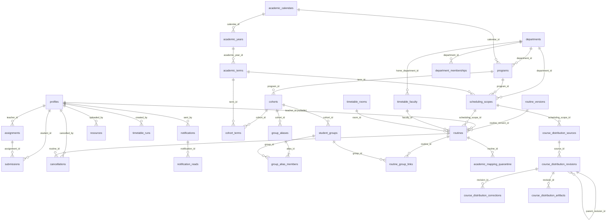

# 01 — Supabase Database & Security Architecture

**Freshness Date:** 2026-11-28

**Primary Sources:** `supabase/reconciliation/20261021214512_reconstructed_baseline.sql`, `supabase/migrations/001`–`016`, `supabase/migrations/20261022140809_academic_catalog.sql`, `supabase/migrations/20261106130000_course_distribution_contract.sql`, `supabase/migrations/20261122160000_phase_5b_rls_and_storage_hardening.sql`, `supabase/migrations/20261127120000_stage_5a_gate_c_catalogs_and_policy.sql`, `supabase/migrations/20261127180000_stage_5c_gate_d_durable_jobs_and_archiving_publish.sql`, `supabase/functions/invite-admin/`, `supabase/functions/send-push/`, `docs/architecture/WEB_PHASE_0_COMPATIBILITY_AND_AUDIT_ADDENDUM.md`, `docs/implementation/web_phase_5_staging_verification_and_ci_fix.md`.

> **Plugin Access Note (`2026-11-28`):** Live read-only `supabase_mcp` metadata/count checks verified the 37-table Phase 5B baseline on both Production (`yxqyrjyzxitrgkhgauli`) and Staging (`oqwvxplteqtlrhktsplj`) `[VERIFIED: Live Plugin]`. Wave 2B (`Phase 4A-2`) migrations (`20261127120000` Gate C `catalog_courses`/`policy_snapshots` + `20261127180000` Gate D `solver_jobs`, `routines.teacher_codes text[]`, archiving `publish_routine()`, and `restore_routine_version()`) are implemented in `supabase/migrations/` `[VERIFIED: Repo Source]` and queued for owner-executed SQL Editor promotion (Staging → Production). Edge Function secret values (such as exact `AUTH_WEB_CALLBACK_URLS`, `PUSH_WEBHOOK_SECRET`, and `FCM_SERVICE_ACCOUNT`) remain `[UNVERIFIED: External Dashboard / No Plugin Access]`.

---

## 1. Schema Layers & Complete Table Inventory (`37` Tables + `academic_private`)

`[VERIFIED: Repo Source]` (`supabase/reconciliation/20261021214512_reconstructed_baseline.sql`, `supabase/migrations/20261022140809_academic_catalog.sql`, `supabase/migrations/20261106130000_course_distribution_contract.sql`)

UniVerse's PostgreSQL 17 database is structured in **three additive public-schema layers** (`18 + 15 + 4 = 37` tables in `public`) plus one isolated security-helper schema (`academic_private`), alongside `pgvector` (`0.8.2` locally / `0.8.x` hosted).

> **Provisioning Governance:** Historical incremental files `supabase/migrations/001`–`016` (there is no `010`) are **not** a fresh-install replay chain (`supabase/config.toml` sets `[db.migrations] enabled = false`). Clean local rebuilds start from `supabase/reconciliation/20261021214512_reconstructed_baseline.sql`, followed by `20261022140809`, `20261106130000`, and `20261122160000`. All developer/owner database operations use **Supabase Dashboard → SQL Editor** (never Supabase CLI).

### 1.1 Entity-Relationship Overview (Mermaid ER Diagram)

### 1.2 Layer 1 — Core Application Baseline (`18` Tables in `public`)

`[VERIFIED: Repo Source]` (`supabase/reconciliation/20261021214512_reconstructed_baseline.sql:21-329`)

> **Schema Naming Corrections vs. Legacy Docs:** Note that `profiles` uses column **`name`** (not `full_name`), `notifications` uses **`sent_by`** (not `created_by`), `device_tokens` PK is **`token (text)`** (not `id uuid`), `notification_reads` PK is composite **`(user_id, notification_id)`**, and `cancellations` uses **`routine_id`, `class_date`, `subject`, `day`, `time_start`** (not `subject_code`, `date`, `time_slot`, `room`).

| # | Table | PK | Foreign Keys | Unique / Check Constraints & Key Indexes | Columns (Baseline + *[Layer 2 Additive]*) |
| :--- | :--- | :--- | :--- | :--- | :--- |
| 1 | `profiles` | `id (uuid)` | `id -> auth.users(id) ON DELETE CASCADE`; *[L2: `department_id`, `program_id`, `cohort_id`, `student_group_id`, `faculty_id`]* | `CHECK (role IN ('student','teacher','admin'))` | `id, email, role, name, avatar_url, batch, section, semester, student_id, teacher_code, designation, department, courses (text[]), created_at` + *[L2: `department_id, program_id, cohort_id, student_group_id, faculty_id`]* |
| 2 | `whitelists` | `email (text)` | None | `CHECK (role IN ('student','teacher','admin'))` | `email, role, name, teacher_code, batch, section, semester, department, designation` |
| 3 | `routines` | `id (uuid)` | `routine_version_id -> routine_versions(id) ON DELETE CASCADE`; `teacher_id -> profiles(id) ON DELETE SET NULL`; *[L2: `scheduling_scope_id`, `cohort_id`, `student_group_id`, `faculty_id`, `room_id`]* | *[L2: `UNIQUE (id, cohort_id)`]*; `routines_lookup_idx (batch, section, day)`, `routines_teacher_idx (teacher_code, day)`, `routines_version_idx (routine_version_id)` | `id, day, time_start (time), time_end (time), subject, subject_code, teacher_id, room, batch, section, semester (int), is_active (bool), teacher_name, teacher_code, routine_version_id, is_service (bool)` + *[L2: `scheduling_scope_id, cohort_id, student_group_id, faculty_id, room_id`]* |
| 4 | `routine_versions` | `id (uuid)` | `published_by -> auth.users(id)` | `CHECK (source IN ('engine','upload','manual'))`; partial unique index `routine_versions_one_active ON (is_active) WHERE is_active` | `id, semester_label, source, is_active, row_count, stats (jsonb), validation (jsonb), notes, published_at, published_by, created_at` |
| 5 | `timetable_rooms` | `id (uuid)` | None | `UNIQUE (name)`; *[L2: `CHECK (capacity > 0) NOT VALID`]* | `id, name, building, is_lab, is_gallery, capacity, is_active, dept` + *[L2: `campus (text), features (text[] DEFAULT '{}')`]* |
| 6 | `timetable_faculty` | `id (uuid)` | *[L2: `home_department_id -> departments(id)`]* | `UNIQUE (acronym)` | `id, acronym, full_name, dept, designation, off_days (text[]), is_active, courses (text[])` + *[L2: `home_department_id`]* |
| 7 | `timetable_settings` | `id (int)` | None | `CHECK (id = 1)`; `CHECK (weeks_in_term BETWEEN 1 AND 52)`; `CHECK (fixed_sessions_per_week IS NULL OR fixed_sessions_per_week BETWEEN 0 AND 7)` | `id, semester_label, periods (jsonb), friday_no_p4 (bool), service_scope (text), weights (jsonb), working_days (text[]), weeks_in_term (int), blocked_periods (jsonb), online_periods (jsonb), allow_online_periods (bool), excluded_periods (jsonb), semester_map (jsonb), fixed_sessions_per_week (int)` |
| 8 | `timetable_course_eligibility` | `id (uuid)` | None | `UNIQUE (acronym, course_code)`; `CHECK (priority IS NULL OR priority > 0)`; `acronym_idx` | `id, acronym, course_code, is_eligible (bool), priority (int), created_at, updated_at` |
| 9 | `timetable_runs` | `id (uuid)` | `created_by -> profiles(id)` | — | `id, semester_label, file_path, stats (jsonb), validation (jsonb), status, row_count, created_by, created_at` |
| 10 | `timetable_courses` | `id (uuid)` | None | `UNIQUE (code, batch, section)` | `id, code, title, batch, section, dept, is_lab, file_teacher, assigned_teacher, updated_at` *(legacy unused table)* |
| 11 | `cancellations` | `id (uuid)` | `routine_id -> routines(id) ON DELETE SET NULL`; `cancelled_by -> profiles(id) ON DELETE SET NULL` | `UNIQUE (routine_id, class_date)`; `cancellations_date_idx (class_date)` | `id, routine_id, cancelled_by, reason, created_at, class_date (date), batch, section, subject, day, time_start` |
| 12 | `notifications` | `id (uuid)` | `sent_by -> profiles(id) ON DELETE SET NULL` | `CHECK (type IN ('university','class_cancel','room_change','test_reminder','assignment','exam'))` | `id, title, body, type, sent_by, target_role, target_batch, target_section, created_at` |
| 13 | `notification_reads` | `(user_id, notification_id)` | `user_id -> auth.users(id) ON DELETE CASCADE`; `notification_id -> notifications(id) ON DELETE CASCADE` | Composite PK; `idx_notification_reads_user` | `user_id, notification_id, read_at` |
| 14 | `resources` | `id (uuid)` | `uploaded_by -> profiles(id) ON DELETE SET NULL` | — | `id, title, category, semester (int), subject_code, drive_link, file_url, uploaded_by, created_at` |
| 15 | `assignments` | `id (uuid)` | `teacher_id -> profiles(id) ON DELETE CASCADE` | — | `id, title, description, subject_code, teacher_id, batch, section, deadline (timestamptz), created_at` |
| 16 | `submissions` | `id (uuid)` | `assignment_id -> assignments(id) ON DELETE CASCADE`; `student_id -> profiles(id) ON DELETE CASCADE` | — | `id, assignment_id, student_id, file_url, submitted_at, is_late (bool)` |
| 17 | `documents` | `id (uuid)` | None | HNSW index `documents_embedding_idx USING hnsw (embedding vector_cosine_ops)` | `id, content, embedding (vector(768)), category` |
| 18 | `device_tokens` | `token (text)` | `user_id -> auth.users(id) ON DELETE CASCADE` | `idx_device_tokens_user (user_id)` | `token, user_id, platform (default 'android'), updated_at` |

### 1.3 Layer 2 — Canonical Academic Catalog (`15` Tables + `academic_private`)

`[VERIFIED: Repo Source]` (`supabase/migrations/20261022140809_academic_catalog.sql:4-378`)

| # | Table | PK | Foreign Keys | Key Constraints & Invariants | Columns |
| :--- | :--- | :--- | :--- | :--- | :--- |
| 19 | `departments` | `id (uuid)` | — | `UNIQUE (label_key(code))`, non-blank `code`/`name` | `id, code, name, is_active` |
| 20 | `academic_calendars` | `id (uuid)` | — | Trigger `academic_calendar_zone` checks `pg_timezone_names` | `id, name, timezone` |
| 21 | `academic_years` | `id (uuid)` | `calendar_id -> academic_calendars(id)` | `UNIQUE (calendar_id, label_key(label))` | `id, calendar_id, label` |
| 22 | `programs` | `id (uuid)` | `department_id -> departments(id)`; `calendar_id -> academic_calendars(id)` | `UNIQUE (id, department_id)`, `UNIQUE (department_id, label_key(code))` | `id, department_id, calendar_id, code, title, is_active` |
| 23 | `academic_terms` | `id (uuid)` | `academic_year_id -> academic_years(id)` | `CHECK (sequence > 0)`, `CHECK (start_date <= end_date)`, `UNIQUE (academic_year_id, sequence)` | `id, academic_year_id, sequence, label, start_date, end_date` |
| 24 | `cohorts` | `id (uuid)` | `program_id -> programs(id)` | `status IN ('active','graduated','archived')`, lifecycle date ordering checks, `UNIQUE (program_id, label_key(code))` | `id, program_id, code, admitted_on, status, graduated_on, archived_on` |
| 25 | `student_groups` | `id (uuid)` | `cohort_id -> cohorts(id)` | `UNIQUE (id, cohort_id)`, `UNIQUE (cohort_id, label_key(code))` | `id, cohort_id, code, is_active` |
| 26 | `cohort_terms` | `id (uuid)` | `cohort_id -> cohorts(id)`; `term_id -> academic_terms(id)` | `CHECK (study_stage > 0)`, `UNIQUE (cohort_id, term_id)`, calendar-match trigger | `id, cohort_id, term_id, study_stage` |
| 27 | `scheduling_scopes` | `id (uuid)` | `department_id -> departments(id)`; `(program_id, department_id) -> programs(id, department_id)`; `term_id -> academic_terms(id)` | `UNIQUE NULLS NOT DISTINCT (department_id, program_id, term_id)`, calendar-match trigger | `id, department_id, program_id, term_id` |
| 28 | `department_memberships` | `id (uuid)` | `user_id -> auth.users(id)`; `department_id -> departments(id)`; `(program_id, department_id) -> programs` | `capabilities <@ ARRAY['read_catalog','manage_catalog','import','edit_draft','review','approve','publish','manage_policy']`, `UNIQUE NULLS NOT DISTINCT (user_id, department_id, program_id)` | `id, user_id, department_id, program_id, capabilities (text[]), valid_from, valid_until` |
| 29 | `group_aliases` | `id (uuid)` | `cohort_id -> cohorts(id)` | `UNIQUE (id, cohort_id)`, `UNIQUE (cohort_id, label_key(label))`; deferred constraint trigger `alias_members_required` | `id, cohort_id, label, reviewed (bool)` |
| 30 | `group_alias_members` | `(alias_id, group_id)` | `(alias_id, cohort_id) -> group_aliases(id, cohort_id) ON DELETE CASCADE`; `(group_id, cohort_id) -> student_groups(id, cohort_id)` | Same-cohort composite FK + `group_alias_member_review` invalidates `reviewed` on edit | `alias_id, cohort_id, group_id` |
| 31 | `routine_group_links` | `(routine_id, group_id)` | `(routine_id, cohort_id) -> routines(id, cohort_id) ON DELETE CASCADE`; `(group_id, cohort_id) -> student_groups(id, cohort_id)` | Links published `routines` rows to atomic `student_groups` | `routine_id, cohort_id, group_id` |
| 32 | `academic_mapping_batches` | `id (uuid)` | `approved_by -> auth.users(id)` | `CHECK (jsonb_typeof(links) = 'array')`, `CHECK ((approved_by IS NULL) = (approved_at IS NULL))`, immutability trigger once approved | `id, source_checksum, links (jsonb), approved_by, approved_at, applied_at` |
| 33 | `academic_mapping_quarantine` | `id (uuid)` | `routine_id -> routines(id) ON DELETE SET NULL` | `UNIQUE NULLS NOT DISTINCT (routine_id, source_checksum, reason)` | `id, routine_id, source_checksum, reason, details (jsonb)` |

### 1.4 Layer 3 — Track 2 Course Distribution Contract (`4` Tables)

`[VERIFIED: Repo Source]` (`supabase/migrations/20261106130000_course_distribution_contract.sql:5-62`)

| # | Table | PK | Foreign Keys | Constraints & Triggers | Columns |
| :--- | :--- | :--- | :--- | :--- | :--- |
| 34 | `course_distribution_sources` | `id (uuid)` | `scheduling_scope_id -> scheduling_scopes(id)`; `uploaded_by -> auth.users(id)` | `source_hash ~ '^[0-9a-f]{64}$'`; `octet_length(source_bytes) > 0`; `UNIQUE (scheduling_scope_id, source_hash)`; trigger `course_distribution_source_immutable` verifies `encode(extensions.digest(source_bytes, 'sha256'), 'hex') = source_hash` and blocks `UPDATE`/`DELETE` | `id, scheduling_scope_id, source_hash, source_bytes (bytea), sheet_name, uploaded_by, uploaded_at` |
| 35 | `course_distribution_revisions` | `id (uuid)` | `source_id -> course_distribution_sources(id)`; `parent_revision_id -> course_distribution_revisions(id)`; `created_by -> auth.users(id)` | `status IN ('accepted','superseded','invalid')`; `UNIQUE (source_id, revision_number)`; partial unique index `course_distribution_one_accepted_revision` (`WHERE status = 'accepted'`); trigger `course_distribution_revision_guard` enforces immutable identity and `revision_version = old.revision_version + 1` | `id, source_id, parent_revision_id, revision_number, revision_version, status, correction_reason, created_by, created_at, updated_at` |
| 36 | `course_distribution_corrections` | `id (uuid)` | `revision_id -> course_distribution_revisions(id)`; `corrected_by -> auth.users(id)` | `source_row >= 6`; `source_column ~ '^(A\|B\|C\|D\|E\|F\|G\|H\|I\|J\|K\|L)$'`; `UNIQUE (revision_id, source_row, source_column)`; `course_distribution_correction_immutable` blocks `UPDATE`/`DELETE`; `course_distribution_correction_invalidates_artifacts` marks downstream artifacts `'stale'` | `id, revision_id, source_row, source_column, original_formula (jsonb), original_cached_value (jsonb), effective_value (jsonb), correction_reason, corrected_by, corrected_at` |
| 37 | `course_distribution_artifacts` | `id (uuid)` | `revision_id -> course_distribution_revisions(id)` | `artifact_kind IN ('normalized_input','validation_report','generation_output')`; `status IN ('current','stale')`; `CHECK ((status='current' AND invalidated_at IS NULL) OR (status='stale' AND invalidated_at IS NOT NULL))` | `id, revision_id, artifact_kind, status, invalidated_at, created_at` |

---

## 2. Side-by-Side Live Environment Diff (`yxqyrjyzxitrgkhgauli` Production vs. `oqwvxplteqtlrhktsplj` Staging)

`[VERIFIED: Live Plugin]` (Live read-only `supabase_mcp` `execute_sql` & `list_edge_functions` queries run on **2026-11-27** against both `yxqyrjyzxitrgkhgauli` and `oqwvxplteqtlrhktsplj`) `[VERIFIED: Repo Source]` (`supabase/migrations/20261022140809_academic_catalog.sql`, `20261106130000_course_distribution_contract.sql`, `20261122160000_phase_5b_rls_and_storage_hardening.sql`)

| Dimension | Production (`yxqyrjyzxitrgkhgauli`) *(2026-11-27 Live `supabase_mcp`)* | Staging (`oqwvxplteqtlrhktsplj`) *(2026-11-27 Live `supabase_mcp`)* |
| :--- | :--- | :--- |
| **Governance Role** | Live client-facing production (`AppConstants.supabaseUrl` + Cloudflare Pages **Environment B** `https://universe-admin-exi.pages.dev`). Protected against unauthorized agent mutations. | Owner-approved isolated non-production staging target. Powers Cloudflare Pages **Environment A** (`https://universe-bfi.pages.dev`). |
| **PostgreSQL / Timezone** | PostgreSQL `17.6` (`UTC`) | PostgreSQL `17.11` (`UTC`) |
| **Schemas Present** | `academic_private`, `auth`, `extensions`, `graphql`, `graphql_public`, `net`, `public`, `realtime`, `storage`, `supabase_functions`, `vault` | `academic_private`, `auth`, `extensions`, `graphql`, `graphql_public`, `public`, `realtime`, `storage`, `vault` *(`supabase_functions` absent)* |
| **`public` Table Count** | **`37` tables** (`18 + 15 + 4`; all `37` have `rls_enabled = true`) — Layers 1 + 2 (`20261022140809`) + 3 (`20261106130000`) promoted | **`37` tables** (`18 + 15 + 4`; all `37` have `rls_enabled = true`) |
| **`schema_migrations` Table** | Absent (migrations applied via SQL Editor) | Absent (migrations applied via SQL Editor) |
| **Aggregate Row Counts (`COUNT(*)`)** | `routines: 796`, `routine_versions: 6` (`1` active), `timetable_runs: 23`, `timetable_rooms: 30`, `timetable_faculty: 76`, `timetable_settings: 1`, `timetable_course_eligibility: 0`, `profiles: 9`, `whitelists: 3`, `cancellations: 0`, `notifications: 50`, `resources: 14`, `course_distribution_*: 0` | `routines: 4`, `routine_versions: 1` (`1` active), `timetable_runs: 1`, `timetable_rooms: 3`, `timetable_faculty: 2`, `timetable_settings: 1`, `timetable_course_eligibility: 2`, `profiles: 1`, `whitelists: 2`, `cancellations: 0`, `notifications: 1`, `resources: 1`, `course_distribution_*: 0` |
| **Extended Layer 2 Columns** | **Present** (`profiles`: 19 cols, `routines`: 21 cols, `timetable_rooms`: 10 cols, `timetable_faculty`: 9 cols) | **Present** (`profiles`: 19 cols, `routines`: 21 cols, `timetable_rooms`: 10 cols, `timetable_faculty`: 9 cols) |
| **Outbound Push Webhook Trigger (`send_push_on_notification`)** | **INSTALLED & ENABLED** on `public.notifications` → `supabase_functions.http_request` | **ABSENT (`0` triggers on `public.notifications`)** — zero outbound push webhooks |
| **Core `SECURITY DEFINER` `search_path`** | **Hardened (`prosecdef = true`, `proconfig = ["search_path=\"\""]`)** on `my_role`, `is_admin`, `guard_profile_role`, `register_device_token`, `append_course_distribution_correction`, `read_course_distribution_revision` + all `academic_private.*` helpers | **Hardened (`prosecdef = true`, `proconfig = ["search_path=\"\""]`)** on all identical `SECURITY DEFINER` functions + `academic_private.*` helpers |
| **Installed Public RPCs** | All 7 baseline functions + `academic_catalog`, `apply_academic_mapping`, `save_academic_alias`, `replace_academic_alias_members`, `review_academic_alias`, `append_course_distribution_correction` (8 params), `read_course_distribution_revision` (`publish_routine` remains `SECURITY INVOKER`, `search_path=public`) | Full parity across all baseline + Layer 2 + Layer 3 RPCs |
| **`supabase_realtime` Publication** | **`public.cancellations` ONLY** | **`public.cancellations` ONLY** |
| **`storage.buckets` Limits & MIMEs** | **Explicitly hardened:** • `timetables`: `public = true`, `file_size_limit = 15728640` (15 MiB), `allowed_mime_types = [xlsx, xls, octet-stream]` • `resources`: `public = true`, `file_size_limit = 52428800` (50 MiB), `allowed_mime_types = [pdf, docx, pptx, xlsx, zip, png, jpeg, txt]` • `avatars`: `public = true`, `file_size_limit = 5242880` (5 MiB), `allowed_mime_types = [png, jpeg, webp]` • `assignments`: `public = true`, `file_size_limit = 26214400` (25 MiB), `allowed_mime_types = null` | All 4 buckets `public = true`, `file_size_limit = null`, `allowed_mime_types = null` *(Staging awaits bucket MIME/size alignment)* |
| **`storage.objects` Counts (`COUNT(*)`)** | `timetables: 43`, `resources: 2`, `assignments: 0`, `avatars: 0` | `timetables: 1`, `resources: 0`, `assignments: 0`, `avatars: 0` |
| **`storage.objects` Policies** | **Hardened (Phase 5B `20261122160000`):** `storage_public_read` + 12 bucket/role/folder-scoped policies (`storage_timetables_*_admin`, `storage_resources_*_staff`, `storage_avatars_*_own`, `storage_assignments_*_scoped`); **zero** `storage_auth_*` wildcards | **Hardened (Phase 5B `20261122160000`):** identical 13 policies (`storage_public_read` + 12 scoped); **zero** `storage_auth_*` wildcards |
| **Deployed Edge Functions (`list_edge_functions`)** | `invite-admin` (`ACTIVE`, v3, `verify_jwt: true`), `send-push` (`ACTIVE`, v3, `verify_jwt: false`) | Test slugs only: `invite-admin-auth-test` (v2), `send-push-auth-test` (v3), `send-push-audience-test` (v2) |

---

## 3. Stored Functions, RPCs & Triggers Inventory

`[VERIFIED: Repo Source]` (`supabase/reconciliation/20261021214512_reconstructed_baseline.sql:365-563`, `supabase/migrations/20261022140809_academic_catalog.sql:8-547`, `supabase/migrations/20261106130000_course_distribution_contract.sql:63-228`, `supabase/migrations/20261122160000_phase_5b_rls_and_storage_hardening.sql:25-119`) `[VERIFIED: Live Plugin]` (2026-11-27 `pg_proc` check on both environments)

### 3.1 Public RPCs & Trigger Functions

| Function Signature | Security | `search_path` (Staging & Prod) | Execute Grants | Purpose & Key Failure Codes |
| :--- | :--- | :--- | :--- | :--- |
| `public.my_role() -> text` | `SECURITY DEFINER` (`STABLE`) | `''` | `authenticated` | Selects `role` from `public.profiles WHERE id = auth.uid()`. |
| `public.is_admin() -> boolean` | `SECURITY DEFINER` (`STABLE`) | `''` | `authenticated` | `coalesce(public.my_role() = 'admin', false)`. |
| `public.guard_profile_role() -> trigger` | `SECURITY DEFINER` | `''` | `anon, authenticated` | `BEFORE INSERT OR UPDATE ON profiles`. Allows SQL editor (`auth.uid() IS NULL`), `is_admin()`, unchanged `role`, or `student`; requires matching `(lower(email), role)` in `public.whitelists` for `teacher`/`admin`, else raises `SQLSTATE 42501` with `hint = 'not_whitelisted'`. |
| `public.register_device_token(p_token text, p_platform text DEFAULT 'android') -> void` | `SECURITY DEFINER` | `''` | `authenticated` | Deletes stale row for same `token` owned by another `user_id`, then upserts `(token, auth.uid(), p_platform, now())` into `public.device_tokens`. |
| `public.publish_routine(p_rows jsonb, p_semester_label text, p_source text, p_stats jsonb, p_validation jsonb, p_notes text) -> jsonb` | `SECURITY INVOKER` | `'public'` | `authenticated` | Requires `is_admin()` (`42501`) and non-empty JSON array (`22023`). Inserts `routine_versions` row, sets old `is_active = false`, runs **`DELETE FROM public.routines WHERE true`** (satisfying `safeupdate`), bulk-inserts `p_rows`, activates new version, returns `{version_id, row_count}`. **Warning:** Permanently wipes prior `routines` rows without snapshot archival until Stage 5 Gate D ships. |
| `public.calculate_is_late() -> trigger` | `SECURITY INVOKER` | default | `anon, authenticated` | `BEFORE INSERT OR UPDATE ON submissions`; sets `NEW.is_late = (NEW.submitted_at > assignments.deadline)`. |
| `public.match_documents(query_embedding vector, match_count int DEFAULT 3) -> TABLE(...)` | `SECURITY INVOKER` | default | `anon, authenticated` | Cosine similarity (`1 - (d.embedding <=> query_embedding)`) RAG search over `public.documents`. |
| `public.academic_catalog() -> jsonb` *(Layer 2)* | `SECURITY INVOKER` (`STABLE`) | `''` | `authenticated` | Returns atomic `schema_version = 1` JSON bundle of all catalog tables plus directory-filtered `faculty` and `rooms`. |
| `public.apply_academic_mapping(p_mapping_id uuid) -> jsonb` *(Layer 2)* | `SECURITY INVOKER` | `''` | `authenticated` | Admin-only transactional identity backfill linking legacy `routines` rows to `scheduling_scopes`, `cohorts`, `student_groups`/`routine_group_links`, `timetable_faculty`, and `timetable_rooms` (`40001` on stale row). |
| `public.save_academic_alias` / `replace_academic_alias_members` / `review_academic_alias` *(Layer 2)* | `SECURITY DEFINER` | `''` | `authenticated` | Scoped `manage_catalog` / `approve` management of combined-group aliases (`B+C`). |
| `public.append_course_distribution_correction(target_revision uuid, expected_revision_version int, target_row int, target_column text, prior_formula jsonb, prior_cached_value jsonb, next_effective_value jsonb, reason text) -> uuid` *(Layer 3, Gate B)* | `SECURITY DEFINER` | `''` | `authenticated` | Locks revision row `FOR UPDATE`, checks `status = 'accepted'` (`23514`), `academic_private.can_scope(scope_id, 'edit_draft')` (`42501`), `revision_version = expected_revision_version` (**`SQLSTATE 40001` optimistic concurrency**), inserts immutable correction, increments `revision_version` (+1), triggers artifact invalidation. Returns `P0002` if `target_revision` missing. |
| `public.read_course_distribution_revision(target_revision uuid) -> jsonb` *(Layer 3, Gate A)* | `SECURITY DEFINER` | `''` | `authenticated` | Verifies `status = 'accepted'` (`23514`) and `can_scope(scope_id, 'read_catalog')` (`42501`); returns `{source_id, revision_id, revision_number, revision_version, status, source_sha256, source_bytes_base64, sheet_name, corrections[]}`. |

### 3.2 `academic_private` Capability & Integrity Helpers (Live on Both Production & Staging)

- **Capability Evaluators (`SECURITY DEFINER`, `SET search_path = ''`):** `can_access(dept, program, capability)` (grants access if `public.is_admin()` OR active `department_memberships` row matches `valid_from <= now() < valid_until` and `capability`), `can_directory()`, `can_cohort(cohort, capability)`, `can_scope(scope, capability)`, `calendar_visible(calendar)`, `year_visible(year_id)`, plus `IMMUTABLE` Unicode whitespace normalizer `label_key(text)`.
- **Trigger Guards:** `validate_calendar_links()`, `keep_identity()` (blocks parent ownership reassignments on 10 catalog tables), `review_alias()`, `invalidate_alias_review()`, `require_alias_members()` (`DEFERRABLE INITIALLY DEFERRED`), `guard_legacy_refs()` (prevents non-admins from mutating canonical FK columns on `profiles`/`routines`), `guard_mapping_batch()`, `assert_distribution_source_immutable()`, `assert_distribution_correction_immutable()`, `guard_distribution_revision()`, and `invalidate_distribution_artifacts()`.

---

## 4. Complete Security & Access-Control Matrix (RLS & Grants)

`[VERIFIED: Repo Source]` (`supabase/reconciliation/20261021214512_reconstructed_baseline.sql:564-782`, `supabase/migrations/20261122160000_phase_5b_rls_and_storage_hardening.sql:120-336`, `supabase/tests/phase_5b_rls_hardening_verification.sql`) `[VERIFIED: Live Plugin]` (2026-11-27 live `pg_policies` + `role_table_grants` check on Production `yxqyrjyzxitrgkhgauli`)

> **Service Role (`service_role`):** Bypasses RLS everywhere; used exclusively server-side in `invite-admin`, `send-push`, and `engine/auth.py` (when `SUPABASE_SERVICE_ROLE_KEY` / `SUPABASE_SECRET_KEY` is configured).

### 4.1 Layer 1 Baseline Tables — Phase 5B Hardened Parity (Production & Staging)

| Table | `anon` Access | `student` (`authenticated`) | `teacher` (`authenticated`) | `admin` (`is_admin()`) | Notes (`20261122160000` Live on Prod & Staging) |
| :--- | :--- | :--- | :--- | :--- | :--- |
| `profiles` | None | `SELECT` **own row only** (`id = auth.uid()`); `INSERT`/`UPDATE` own row (`role='student'`) | `SELECT` **own row only**; `INSERT`/`UPDATE` own row (if whitelisted as `teacher`) | `SELECT` all, `UPDATE` all, `DELETE` all | `profiles_select` hardened on both Prod & Staging (`(id = auth.uid()) OR is_admin()`). |
| `whitelists` | None | `SELECT` own email (`lower(email) = lower(jwt.email)`) | `SELECT` own email | `ALL` | Identical (`016` applied on both). |
| `routines` | None | `SELECT` all | `SELECT` all | `ALL` (direct CRUD + `publish_routine` RPC) | Student/Teacher mobile `Find Teacher` & `Room Status` derive data strictly from `routines`. |
| `routine_versions` | None | `SELECT` all | `SELECT` all | `ALL` | Identical. |
| `timetable_rooms` | Revoked | **DENIED (`0` rows)** | **DENIED (`0` rows)** | `ALL` | `SELECT` restricted to `is_admin()`; `anon` grants revoked (`anon_grants: null` verified on Prod). |
| `timetable_faculty` | Revoked | **DENIED** | **DENIED** | `ALL` | `SELECT` restricted to `is_admin()` (hides faculty off-days from students); `anon` grants revoked. |
| `timetable_settings` | Revoked | **DENIED** | **DENIED** | `ALL` | `SELECT` restricted to `is_admin()`; `anon` grants revoked. |
| `timetable_runs` | Revoked | **DENIED** | **DENIED** | `ALL` | `SELECT` restricted to `is_admin()`; `anon` grants revoked. |
| `timetable_course_eligibility` | **Revoked / DENIED** | **DENIED** | **DENIED** | `ALL` | Legacy `read_all` public policy dropped and `anon` grant revoked on both Prod and Staging; `SELECT` restricted to `is_admin()`. |
| `timetable_courses` | None (RLS) | `SELECT` all | `SELECT` all | `ALL` | Unused legacy table (`0` rows). |
| `cancellations` | None | `SELECT` all | `SELECT` all; `INSERT` (`cancelled_by = auth.uid()`); `DELETE` own | `SELECT` all; `INSERT`; `DELETE` any | Published on `supabase_realtime`. |
| `notifications` | None | `SELECT` all *(client-filtered by `matchesAudience`)* | `SELECT` all; `INSERT` (`sent_by = auth.uid()`); `DELETE` own | `SELECT` all; `INSERT`; `DELETE` any | `notifications_insert_authorized` requires `sent_by = auth.uid()`. |
| `notification_reads` | None (`auth.uid()` null) | `ALL` own (`user_id = auth.uid()`) | `ALL` own | `ALL` own | Policy role is `public`, gated by `user_id = auth.uid()`. |
| `device_tokens` | None (`auth.uid()` null) | `ALL` own (`user_id = auth.uid()`) | `ALL` own | `ALL` own | Policy role is `public`, gated by `user_id = auth.uid()` (plus `register_device_token` RPC). |
| `resources` | None | `SELECT` all | `SELECT` all; `INSERT`/`UPDATE`/`DELETE` own (`uploaded_by = auth.uid()`) | `SELECT` all; `INSERT` own; `UPDATE`/`DELETE` any | Identical. |
| `assignments` | None | `SELECT` all | `SELECT` all; `INSERT`/`UPDATE`/`DELETE` own (`teacher_id = auth.uid()`) | `SELECT` all; `INSERT` own; `UPDATE`/`DELETE` any | Identical. |
| `submissions` | None | `SELECT`/`INSERT`/`UPDATE`/`DELETE` own (`student_id = auth.uid()`) | `SELECT` all | `SELECT`/`DELETE` all | Identical. |
| `documents` | None | `SELECT` all (+ `match_documents` RPC) | `SELECT` all | `ALL` | `match_documents` granted to `anon`, though `documents` RLS blocks `anon` rows. |

### 4.2 Layer 2 & Layer 3 Tables (Live on Both Production & Staging)

- **Layer 2 (`departments`..`routine_group_links`):** `anon` revoked; `authenticated` granted DML subject to RLS: `can_directory()` (`departments`), `calendar_visible()` (`academic_calendars`, `academic_years`), `year_visible()` (`academic_terms`), `can_access(..., 'read_catalog' / 'manage_catalog')` (`programs`, `cohorts`, `scheduling_scopes`), `can_cohort(..., 'read_catalog' / 'manage_catalog')` (`student_groups`, `cohort_terms`, `group_aliases`, `group_alias_members`), `user_id = auth.uid() OR is_admin()` (`department_memberships` read; admin write), `is_admin()` (`academic_mapping_batches`, `academic_mapping_quarantine`, `routine_group_links` write).
- **Layer 3 (`course_distribution_*`):** Direct `INSERT`/`UPDATE`/`DELETE` table grants are **revoked** from both `anon` and `authenticated` (all writes must traverse `append_course_distribution_correction` or SQL owner). Under Phase 5B (`20261122160000:275-335`), `SELECT` is `TO authenticated USING (public.is_admin() OR (scheduling_scope_id IS NOT NULL AND academic_private.can_scope(scheduling_scope_id, 'read_catalog')))` (verified live on Production `pg_policies` on 2026-11-27).

### 4.3 `storage.objects` & `storage.buckets` Access Matrix (4 Public Buckets)

All 4 buckets (`timetables`, `resources`, `avatars`, `assignments`) have `public = true` and `storage_public_read FOR SELECT TO public USING (true)`, plus the 12 Phase 5B scoped write policies on both Production and Staging (`[VERIFIED: Live Plugin]`):

| Bucket | Write Policies *(Phase 5B Hardened on Both Prod & Staging)* | Production Explicit Bucket Limits (`2026-11-27` Live) | Staging Bucket Limits (`2026-11-27` Live) |
| :--- | :--- | :--- | :--- |
| `timetables` | **Admins ONLY:** `bucket_id = 'timetables' AND public.is_admin()` | `15 MiB` (`15728640` B); `allowed_mime_types`: `.xlsx`, `.xls`, `application/octet-stream` | `null` / `null` |
| `resources` | **Teachers & Admins ONLY:** `bucket_id = 'resources' AND public.my_role() IN ('teacher', 'admin')` | `50 MiB` (`52428800` B); `allowed_mime_types`: `pdf`, `docx`, `pptx`, `xlsx`, `zip`, `png`, `jpeg`, `txt` | `null` / `null` |
| `avatars` | **Owner Folder or Admin:** `bucket_id = 'avatars' AND ((storage.foldername(name))[1] = auth.uid()::text OR public.is_admin())` *(Note: zero Flutter/React code currently uploads to `avatars`)* | `5 MiB` (`5242880` B); `allowed_mime_types`: `png`, `jpeg`, `webp` | `null` / `null` |
| `assignments` | **Owner Folder or Staff:** `bucket_id = 'assignments' AND ((storage.foldername(name))[1] = auth.uid()::text OR public.my_role() IN ('teacher', 'admin'))` *(Note: `AppConstants.bucketSubmissions = 'submissions'` is an unused Dart constant drift vs. deployed bucket `assignments`)* | `25 MiB` (`26214400` B); `allowed_mime_types`: `null` | `null` / `null` |

---

## 5. Supabase Auth, Provisioning & Edge Functions

### 5.1 GoTrue PKCE, Whitelist Provisioning & Admin Role Gate

`[VERIFIED: Repo Source]` (`apps/web/src/services/supabase.ts:13-22`, `apps/web/src/features/auth/AuthProvider.tsx:169-303`, `lib/main.dart:35-41`, `lib/features/auth/services/auth_service.dart:206-349`, `supabase/migrations/20261122160000_phase_5b_rls_and_storage_hardening.sql:48-87`)

1. **PKCE Client Configuration:** Both React Web (`createClient(..., { auth: { flowType: "pkce", detectSessionInUrl: true, autoRefreshToken: true, persistSession: true } })`) and Flutter (`FlutterAuthClientOptions(authFlowType: AuthFlowType.pkce)`) enforce PKCE. Email sign-in on both clients rejects unconfirmed accounts (`!user.email_confirmed_at` → immediate `signOut()`).
2. **Table Truth (`public.whitelists`, NEVER `approved_users`):** Pre-provisioned roles live exclusively in `public.whitelists` (`email` PK).
3. **First-Login Profile Auto-Provisioning & `409` Race Recovery:**
   - **React Web (`AuthProvider.resolveAdminGate`):** Queries `profiles` (`id = user.id`). If missing, queries `whitelists` (`ilike("email", emailLower).eq("role", "admin")`). If matched, inserts `profiles` (`role: "admin"`), deduplicating concurrent calls via `inFlightGateRef` and recovering cleanly from `23505` / `409 Conflict` duplicate inserts. Any `student` or `teacher` role sets `status = "accessDenied"` (`deniedReason = "non_admin_role"`) and routes to `/access-required` (mobile-app guidance).
   - **Flutter Mobile (`AuthService.handlePostLogin`):** Queries `profiles` (`id = user.id`). If missing, checks `whitelists` (`eq('email', email.toLowerCase())`); if matched, inserts `profiles` with the whitelisted `role` (`teacher` or `admin`). Un-whitelisted users proceed to interactive onboarding (`completeStudentRegistration` → `role = 'student'`, or `completeFacultyRegistration` → `role = 'teacher'`, which `guard_profile_role()` rejects with `SQLSTATE 42501` / `hint = 'not_whitelisted'` unless whitelisted).

### 5.2 Edge Function 1: `invite-admin` & Implicit-to-PKCE Callback Bridge

`[VERIFIED: Repo Source]` (`supabase/functions/invite-admin/index.ts`, `handler.js`, `callback_policy.js`, `apps/web/src/services/supabase.ts:48-203`, `lib/features/auth/services/invitation_callback_bridge.dart`)

- **Server-Side Contract (`supabase/functions/invite-admin/`):**
  1. Requires `Authorization: Bearer <caller_jwt>` (`401` if missing/invalid via `callerClient.auth.getUser()`).
  2. Instantiates service-role client (`SUPABASE_SERVICE_ROLE_KEY`) and verifies `profiles.role === 'admin'` (`403` if non-admin).
  3. **Callback Gate Before Any Write (`callback_policy.js`):** Validates `body.redirect_to` *before* touching `whitelists` or sending email (`400: Invitation callback is not approved.`). Accepts `undefined`/`null` or `'com.example.universe://reset-callback/'` (native default), or an exact HTTPS (or `http://localhost|127.0.0.1|[::1]`) URL with zero query, zero hash, zero wildcards, and exact membership in comma-separated env var `AUTH_WEB_CALLBACK_URLS`. Request `Origin` headers are never trusted.
  4. Upserts `public.whitelists` (`{ email: rawEmail, role: 'admin', name }`, `onConflict: 'email'`).
  5. Calls `admin.auth.admin.inviteUserByEmail(rawEmail, { data: { full_name }, redirectTo })`.
- **Client Implicit-to-PKCE Bridge (`apps/web/src/services/supabase.ts` & Flutter `InvitationCallbackBridge`):**
  - Because `inviteUserByEmail` starts on the server without a browser PKCE `code_verifier`, GoTrue redirects with implicit hash fragment `#access_token=...&refresh_token=...&expires_in=...&token_type=bearer&type=invite`.
  - Both React Web (`extractAndScrubInviteHash` + `adoptInviteSession` — hardened after the Phase 0 audit!) and Flutter (`InvitationCallbackBridge.consume`) now enforce full parity:
    1. Immediately scrub the URL hash via `window.history.replaceState` before router redirects settle.
    2. Reject any URL containing query string parameters (`window.location.search.length > 0`).
    3. Verify `GET /auth/v1/user` with `invite.accessToken`, requiring `id`, `invited_at != null`, and `email_confirmed_at != null`.
    4. Exchange `refresh_token` via `POST /auth/v1/token?grant_type=refresh_token`, verify `session.user.id === verifiedUser.id` and `expires_at > now + 60`, and adopt the session (`setSession` / `recoverSession`).
    5. Enter a bounded 10-minute `passwordRecovery` window (`RECOVERY_TTL_MS = 600_000`) routing to `/reset-password`; after password update, sign out so the first clean sign-in triggers `resolveAdminGate` profile creation.
- **Live Deployment Status:** `[VERIFIED: Live Plugin]` (`list_edge_functions` on `2026-11-27`): `invite-admin` is deployed & `ACTIVE` (v3, `verify_jwt: true`) on Production `yxqyrjyzxitrgkhgauli`, while Staging `oqwvxplteqtlrhktsplj` hosts test harness slugs (`invite-admin-auth-test`, v2). Production `AUTH_WEB_CALLBACK_URLS` is configured for `https://universe-admin-exi.pages.dev/` (exact secret value in Supabase Edge Function Secrets remains `[UNVERIFIED: External Dashboard / No Plugin Access]`). Note `usersService.ts:284-286` still handles HTTP `404` gracefully when `invite-admin` is undeployed on non-prod environments.

### 5.3 Edge Function 2: `send-push` Summary Contract

`[VERIFIED: Repo Source]` (`supabase/functions/send-push/index.ts`, `webhook_auth.js`, `audience.js`)

- Triggered via Supabase Database Webhook (`POST` with `payload.record` from `public.notifications`).
- **`webhook_auth.js` (`protectWebhook`):** Fails closed (`503`) if `PUSH_WEBHOOK_SECRET` is unset/blank; returns `401` if header `x-webhook-secret` is missing or fails non-short-circuiting XOR comparison against `PUSH_WEBHOOK_SECRET` (`Cache-Control: no-store`).
- **`audience.js` (`resolveNotificationTargets`):** Uses `SUPABASE_SERVICE_ROLE_KEY` (bypassing Phase 5B `profiles_select` RLS) to filter `public.profiles` by non-null `target_role`, `target_batch`, `target_section` (AND semantics), then queries `public.device_tokens` (`in('user_id', userIds)`).
- **`index.ts`:** Mints 1-hour Google OAuth2 access tokens (`scope: firebase.messaging`) from `FCM_SERVICE_ACCOUNT` via Web Crypto `RSASSA-PKCS1-v1_5` SHA-256, dispatches to FCM HTTP v1, and deletes stale `400`/`404` tokens from `public.device_tokens`. *(Full pipeline detailed in `03_FIREBASE_PUSH_AND_EXTERNAL_INTEGRATIONS.md`.)*
- **Live Deployment Status:** `[VERIFIED: Live Plugin]` (`2026-11-27`): DB trigger `send_push_on_notification` (`supabase_functions.http_request`) is **enabled on Production `yxqyrjyzxitrgkhgauli`** alongside `send-push` (`ACTIVE`, v3, `verify_jwt: false`), and **absent on Staging `oqwvxplteqtlrhktsplj`** (`0` triggers on `notifications`; test slugs `send-push-auth-test` / `send-push-audience-test` only). Live secret values (`PUSH_WEBHOOK_SECRET`, `FCM_SERVICE_ACCOUNT`) on Production remain `[UNVERIFIED: External Dashboard / No Plugin Access]`.
