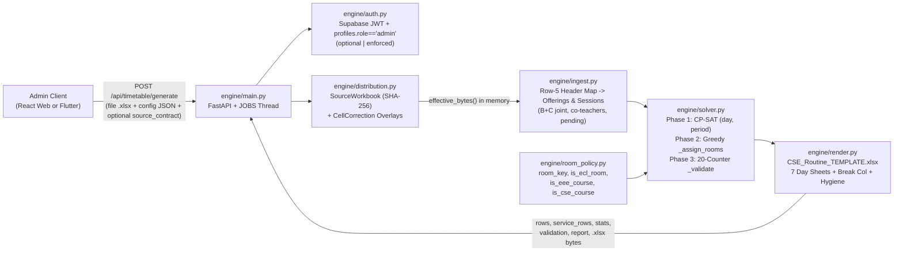

# 02 — Timetable Engine & CP-SAT Solver Architecture

**Freshness Date:** 2026-11-24  
**Primary Sources:** `engine/main.py`, `engine/auth.py`, `engine/distribution.py`, `engine/ingest.py`, `engine/solver.py`, `engine/room_policy.py`, `engine/render.py`, `engine/domain.py`, `engine/legacy_mapping.py`, `engine/config.json`, `engine/requirements.txt`, `engine/Procfile`, `engine/runtime.txt`, `render.yaml`, `apps/web/src/features/routine/`, `apps/web/src/features/admin/services/settingsService.ts`, `lib/features/admin/services/timetable_engine_service.dart`, `lib/features/admin/services/routine_workbook_parser.dart`, `docs/timetable-audit-2026-10-20/18-committee-decisions-and-policy-baseline-2026-11-04.md`, `docs/timetable-audit-2026-10-20/16-committee-traceability-2026-11-04.md`.

---

## 1. Module-by-Module Architecture & Execution Pipeline

`[VERIFIED: Repo Source]` (`engine/*.py`, `engine/config.json`, `engine/requirements.txt`, `engine/Procfile`, `render.yaml`)



### 1.1 Module Responsibilities & Data Models

| File | Responsibility & Key Symbols | Wiring Status |
| :--- | :--- | :--- |
| `engine/main.py` | FastAPI v2.0.0 HTTP entrypoint, `CORSMiddleware`, volatile in-memory `JOBS: dict[str, dict]`, background daemon `Thread(target=_run_job)`, and `normalize_generation_distribution()`. | **Live** |
| `engine/auth.py` | Phase 5A dual-client security: `get_auth_mode()` (`optional` \| `enforced`), `get_allowed_origins()`, `verify_supabase_token()` (60s monotonic SHA-256 TTL cache via `_VERIFICATION_CACHE`), and `require_admin_caller()` FastAPI dependency. | **Implemented locally; pending Render redeploy** *(see §2.4)* |
| `engine/distribution.py` | Immutable Track 2 normalization boundary: `SourceCell`, `SourceWorkbook` (SHA-256), `CellCorrection` (`row >= 6`, `col in A..L`), `CorrectionRevision`, `DistributionDraft` (dual openpyxl load: `data_only=False` formulas + `data_only=True` cached values; rejects un-cached `J`/`L` formulas unless overridden), `normalize()`, and `normalize_persisted_revision()`. Never mutates original `.xlsx` bytes. | **Live** |
| `engine/ingest.py` | Sole spreadsheet parser (`Course Distribution` sheet, header row `5`, data start row `6`). Header-prefix lookup (`_col`). Groups rows by `(cohort, code)` into `Offering` and expands weekly `Session` items: `required_sessions = fixed_sessions_per_week` if set, else `ceil(classes_total / weeks_in_term)`, else `Class/Week`, else `2`. Preserves joint sections (`B+C`), split/co-teachers (`teachers: list[str]`), blank teachers (`pending_faculty_source_rows`), lab parity (`last_digit % 2 == 0`), and `is_service` (non-numeric batch except `retake`/`improvement`, or `^(GED\|WD\|WE)` section, or explicit `Is Service` col). | **Live** |
| `engine/room_policy.py` | Physical room & course ownership predicates: `room_key(label, aliases)` (normalizes whitespace/case, detects cyclic aliases), `is_ecl_room` (`^ECL([-_ \d]\|$)`), `is_eee_course`, `is_cse_course`. | **Live** |
| `engine/solver.py` | 3-phase scheduling engine (`ortools.sat.python.cp_model`): `_normalize_config()` merges `config.json` or DB override; **Phase 1** (`solve`) places `(day, period)` via CP-SAT (`SOLVER_WORKERS` env default `8`, Render sets `"2"`); **Phase 2** (`_assign_rooms`) greedily assigns physical rooms sorted by `(category_rank, -students)` with capacity checks (`TBA` on exhaustion); **Phase 3** (`_validate`) computes exact 20-counter reconciliation + capped (`DETAIL_LIMIT = 50`) offending-row traces across `rows + service_rows`. | **Live** |
| `engine/render.py` | Loads `engine/templates/CSE_Routine_TEMPLATE.xlsx`, clears legacy red fonts/fills/AutoFilters/tables/`#REF!` defined names/below-routine furniture (`DATA_FIRST_ROW = 3`, `DATA_LAST_ROW = 90`, capacity `88` cohorts/sheet), writes dynamic period headers + merged `BREAK` column (`break_col` default `'G'`, absorbs `col+1` when blocked e.g. Friday `P4`), draws thick batch-boundary borders, stamps `TBA` legend on Sunday if needed, and writes `wb.properties.subject` provenance (`revision`, `revision_id`, `sha256`). | **Live** |
| `engine/domain.py` | Strict immutable Schema-v1 canonical catalog & future solver exchange dataclasses (`Department`, `AcademicCalendar`, `AcademicTerm`, `Cohort`, `StudentGroup`, `SchedulingScope`, `GroupAlias`, `AcademicCatalog`, `SourceRef`, `TeacherAssignment`, `RoomCriteria`, `Offering`, `Assignment`, `PolicySnapshot`, `ValidationReport`, `NormalizedInput`). | **Implemented & unit-tested; NOT yet wired into `solver.py`** *(legacy dict adapter used until Wave 2 Phase 4A-2)* |
| `engine/legacy_mapping.py` | Read-only quarantine helper (`quarantine_unapproved`) flagging unapproved mappings, reversed/midnight clock intervals (`end <= start`), unresolved service scopes, and blank teachers without mutating rows. | **Used by Task 2 catalog checks** |
| `engine/config.json` | Fallback local configuration (7 days `Sunday`–`Saturday`, 7 periods `idx 1..7` on `D,E,F,H,I,J,K`, `friday_no_p4: true`, 30 rooms including 8 labs `ACL-1..4, ECL-1..2, GL, NL` & 3 galleries `G1..G3`, and static teacher roster). Overridden in production by DB-assembled `config` JSON. | **Fallback** |
| `requirements.txt` / `Procfile` / `runtime.txt` | `fastapi>=0.110`, `uvicorn[standard]>=0.29`, `ortools>=9.10`, `openpyxl>=3.1`, `python-multipart>=0.0.9`, `httpx>=0.27`. `Procfile`: `web: uvicorn main:app --host 0.0.0.0 --port $PORT`. Note minor version drift: `engine/runtime.txt` & `.python-version` say `3.11` (`python-3.11.9`), whereas `render.yaml` sets `PYTHON_VERSION: 3.12.7` and CI uses `'3.12'`. | **Deployment Config** |

---

## 2. HTTP API, Auth, Thread Model & Live Render Probe

### 2.1 Complete Endpoint Contract (`engine/main.py`)

`[VERIFIED: Repo Source]` (`engine/main.py:106-206`)

| Method & Path | Auth Gate | Request Schema | Response Schema & Status Codes |
| :--- | :--- | :--- | :--- |
| `GET /` *(Note: `/health` does **NOT** exist → `404`)* | **Public** (no `Depends`) | None | `200 OK`: `{"service": "universe-timetable-engine", "version": "2.0.0", "ok": true, "auth_mode": "optional"\|"enforced"}` *(live Render currently omits `auth_mode`; see §2.4)*. |
| `POST /api/timetable/generate` | `Depends(auth.require_admin_caller)` | `multipart/form-data`:<br/>• `file`: `.xlsx`/`.xls` (`UploadFile`, required)<br/>• `config`: JSON string (`Form(None)`, optional)<br/>• `source_contract`: JSON object string (`Form(None)`, optional Track 2 bundle)<br/>• `time_limit_s`: `float` (`Form(60.0)`; React & Flutter send `180`) | `200 OK`: `{"job_id": "<12-char hex>"}`<br/>`400`: non-xlsx filename or malformed JSON<br/>`401`/`403`/`503`: auth failure when `ENGINE_AUTH_MODE=enforced`. |
| `GET /api/timetable/status/{job_id}` | `Depends(auth.require_admin_caller)` | Path `job_id` | `200 OK`: `{"job_id", "state": "queued"\|"ingesting"\|"solving"\|"rendering"\|"done"\|"failed", "progress": 0.0..1.0}` + (`stats`, `validation`, `source_contract` when `done`; `error` when `failed`).<br/>`404`: `{"detail": "Unknown job_id."}` (evicted on container restart/spin-down). |
| `GET /api/timetable/result/{job_id}` | `Depends(auth.require_admin_caller)` | Path `job_id` | `200 OK`: `{"job_id", "rows": [...], "service_rows": [...], "stats": {...}, "validation": {"ok": bool, ...20 counters..., "details": {...}, "source_contract": {...}}, "source_contract": {...}, "report": {"source_contract", "cohorts", "meta", "excluded", "warnings", "offerings"}, "has_workbook": bool}`.<br/>`404`: unknown `job_id`; `409`: job not yet `done`. |
| `GET /api/timetable/download/{job_id}` | `Depends(auth.require_admin_caller)` | Path `job_id` | `200 OK`: binary `application/vnd.openxmlformats-officedocument.spreadsheetml.sheet` (`Content-Disposition: attachment; filename="CSE_Routine_<label>.xlsx"`).<br/>`404` / `409` if missing. |

### 2.2 Period Grid, Online Slot (`idx: 8` / `Col L`), and Dynamic Midday Break Contract

`[VERIFIED: Repo Source]` (`apps/web/src/features/admin/services/settingsService.ts:8-211`, `apps/web/src/core/utils/breakPolicy.ts:24-140`, `engine/solver.py:83-104`, `engine/render.py:109-120,469-502`)

- **Decoupled Regular vs. Online Slots (React Web Fix over Legacy Config):**
  - Legacy `engine/config.json` placed the evening online slot at `idx: 7, col: "K"` (`online_periods: [7]`), which collided with 7-slot on-campus schedules (**R15**).
  - React Web (`settingsService.ts`) cleanly decouples **R15 regular on-campus periods** (`6` slots = `idx 1..6` on `D,E,F,H,I,J`; `7` slots = `idx 1..7` on `D,E,F,H,I,J,K`, keeping `Col G` exclusively as the template break column) from the **independent Online Slot** (`ONLINE_SLOT_IDX = 8`, `ONLINE_SLOT_COL = "L"`, `19:00-20:20`, `online_periods: [8]`). Both `solver.py` and `render.py` read `idx`, `col`, and `online_periods` dynamically from `config`, so `Col L` renders cleanly without code changes.
- **Dynamic Midday Break Clocks:**
  - Neither `timetable_settings` nor `solver.py` hardcodes a static break period. `resolveMiddayBreak()` (`breakPolicy.ts`) and `render.py:_write_period_headers()` detect the gap where `next.start != prev.end` (`>= 15 min` in UI) between consecutive regular periods, while `solver.py:343-346` defines period adjacency (`neighbors`) strictly by touching clock endpoints (`p.end == q.start`), naturally preventing classes/labs from straddling the midday break unless clocks touch.

### 2.3 Phase 5A Security (`engine/auth.py`) & Volatile Thread Model

`[VERIFIED: Repo Source]` (`engine/auth.py:18-176`, `engine/main.py:19-28,142-147`, `render.yaml:11-32`)

- **CORS (`ALLOWED_ORIGINS`):** Defaults to `["http://localhost:5173", "http://127.0.0.1:5173"]` if `ALLOWED_ORIGINS` is unset; strips whitespace and trailing slashes; `allow_credentials=False`, `allow_methods=["GET", "POST", "OPTIONS"]`, `allow_headers=["Authorization", "Content-Type"]`.
- **Dual-Mode Admin JWT Verification (`ENGINE_AUTH_MODE`):**
  - `optional` (default): Logs warnings on missing/invalid/non-admin tokens without rejecting requests (required while a single shared Render instance serves both Staging React Web and Production Flutter).
  - `enforced`: Fails closed with **`503`** if `SUPABASE_URL` or `SUPABASE_SERVICE_ROLE_KEY`/`SUPABASE_ANON_KEY` is missing; calls `${SUPABASE_URL}/auth/v1/user` (`401` on invalid/expired JWT) and `${SUPABASE_URL}/rest/v1/profiles?id=eq.<uid>&select=role` (`503` on upstream error, `403` if `role != 'admin'`); caches verified `(user_id, role)` by `sha256(token)` for **60 seconds** (`time.monotonic()`) under `_CACHE_LOCK`.
- **Volatile In-Memory `JOBS` Model:** `JOBS` is a process-local Python `dict` with zero Redis/Postgres persistence and zero TTL eviction. Render's `free` plan (`512 MB` RAM, `SOLVER_WORKERS="2"`) spins down after ~15 minutes of inactivity and restarts on OOM/redeploy, wiping `JOBS` and returning `404 Unknown job_id.` to active pollers.

### 2.4 Live Render Health Probe (`2026-11-24`)

`[VERIFIED: Live Plugin]` (Live HTTP `GET https://universe-timetable-engine.onrender.com/` executed 2026-11-24T06:32–06:33+06:00)

1. **Probe #1 (25s timeout):** Timed out while waking the spun-down Render free-tier container (confirming real-world >25s cold-start latency).
2. **Probe #2 (immediate retry):** Returned **`HTTP 200` in `948 ms`** with exact body:
   ```json
   {"service":"universe-timetable-engine","version":"2.0.0","ok":true}
   ```
3. **Newly Verified Deployment Drift:** Notice the live Render response **omits `"auth_mode"`** (which `engine/main.py:112` in the local working tree returns). This proves the hosted Render service is still running the pre-Phase-5A commit from `main` (wildcard CORS, no `engine/auth.py` deployed yet) until the current branch is pushed and redeployed. `timetableEngineService.ts:106-114` already treats top-level `source_contract` and `auth_mode` as optional for backward compatibility with this live Render deployment.

---

## 3. Code-Verified Committee Rule Matrix (`R1`–`R16`, `D1`–`D6`, `CD1`)

`[VERIFIED: Repo Source]` (`engine/solver.py`, `engine/ingest.py`, `engine/room_policy.py`, `engine/distribution.py`, `docs/timetable-audit-2026-10-20/18-committee-decisions-and-policy-baseline-2026-11-04.md`, `16-committee-traceability-2026-11-04.md`)

| Rule / Decision | Committee Requirement | Current Engine Status (`solver.py` / `ingest.py`) | Required Wave 2 (`Phase 4A-2`) DB + Engine + UI Work |
| :--- | :--- | :--- | :--- |
| **R1 (`D1`)** | Consecutive 2-day weekend per section (default + optional section override; sections in same batch may differ). | **Unsupported.** `days` is global; `by_cohort` has no per-section weekend domain. | **DB:** Persist section weekend default + per-section overrides in `PolicySnapshot` / group policy table.<br/>**Engine:** Add start-day BoolVars enforcing 2 consecutive class-free days per atomic section (including `B+C` joint members) + validator check.<br/>**UI:** Bind Policy Studio section weekend overrides to live Gate C RPC. |
| **R2 (`D1`)** | Batch fairness: `max(days_off) - min(days_off) <= 1` across sections in the same batch. | **Unsupported.** Solver only applies soft per-cohort active-day penalty (`w["compactness"] = 3`). | **DB:** Included in `PolicySnapshot`.<br/>**Engine:** Hard CP-SAT constraint `max_off[b] - min_off[b] <= 1` across atomic sections of batch `b` + independent validator check.<br/>**UI:** Surface batch off-day spread in Preflight & Validation. |
| **R3** | Forbid internal gaps `>= 2` consecutive empty teachable slots for any section on any day (1-slot gap & midday break allowed). | **Unsupported.** No internal hole/span variables in `solver.py`. | **DB:** Policy toggle/strictness in `PolicySnapshot`.<br/>**Engine:** Add daily first/last occupied slot span variables per section forbidding `>= 2` consecutive empty teachable periods (ignoring midday break) + optional soft penalty on 1-slot holes.<br/>**UI:** Gap diagnostic details in validation drawer. |
| **R4** | Block CSE faculty's declared external teaching commitments. | **Partially Supported.** Whole-day `off_days` and in-file `is_service` rows reserve teachers, **no** per-(day, slot) external block calendar exists. | **DB:** Add faculty slot-level external reservation table / `PolicySnapshot` blocks.<br/>**Engine:** Exclude overlapping intervals in `valid_slots()` and check interval overlaps in `_validate()`.<br/>**UI:** Unlock slot-level external busy picker in Faculty / Policy Studio. |
| **R5** | External/guest faculty (GED/EEE/Physics/English) scheduled **only** within declared available slots (undeclared = zero availability). | **Partially Supported.** Only whole-day `off_days` exist; missing `off_days` currently defaults to **unrestricted** availability! | **DB:** Add positive `available_slots` whitelist + external/guest faculty flag.<br/>**Engine:** Hard-intersect guest faculty domains with declared slots; fail preflight if guest faculty has zero/missing declaration.<br/>**UI:** Guest faculty availability grid + preflight blocker. |
| **R6 (`D4`)** | Adjunct workload span by **distinct course codes** across sections: `2` courses → `<=2` days; `3` → `3–4` days; `4+` → `4–5` days. | **Unsupported.** No permanent/adjunct category or distinct-course day-span constraint in `solver.py`. | **DB:** Add `employment_type` (`permanent` \| `adjunct`) on `timetable_faculty` + policy band config.<br/>**Engine:** Deduplicate distinct course identities per adjunct across all sections/co-teaching and constrain/penalize active teaching-day count.<br/>**UI:** Unlock employment category & distinct-course workload band summary. |
| **R7 (`D3`)** | Permanent faculty: 2 off-days (explicitly configurable to 3); remaining 5/4 days are university attendance days (teaching not required every attendance day). | **Partially Supported.** `off_days` is enforced **hard** in `valid_slots()` (`solver.py:366`) and `_validate()`, and empty teaching days are naturally allowed, **but** no permanent category, 2-vs-3 count guard, or faculty self-service RLS exists. | **DB:** `employment_type` + explicit `allow_three_off_days` flag (+ optional own-faculty RLS if self-service enabled).<br/>**Engine:** Validate permanent faculty off-day count (`2` or authorized `3`).<br/>**UI:** Enforce 2/3 off-day rule on Permanent faculty form. |
| **R8** | Prioritize individual faculty slot/day teaching preferences. | **Unsupported.** `timetable_course_eligibility.priority` is parsed (`solver.py:242-247`) **but never used in CP-SAT objective**, and no slot-preference store exists. | **DB:** Faculty preferred windows + priority tier in DB/`PolicySnapshot`.<br/>**Engine:** Add tiered soft objective terms rewarding preferred `(day, period)` placements; report unmet preferences separately from hard errors.<br/>**UI:** Faculty preference matrix + soft-preference satisfaction score. |
| **R9** | SUST adjuncts: compact travel schedule — prefer one side of midday break (soft), max internal gap `<= 2` slots (**hard**). | **Unsupported.** No `is_sust_adjunct` flag or faculty gap/break-side model. | **DB:** Add `is_sust_adjunct` boolean on `timetable_faculty`.<br/>**Engine:** Hard constraint forbidding internal gap `> 2` slots per day for SUST faculty + soft penalty when teaching both before and after break.<br/>**UI:** SUST adjunct toggle + break-split indicator. |
| **R10** | 2 EEE-owned ECL labs scheduled **only** during EEE-approved windows. | **Partially Supported.** `room_policy.py` + `solver.py:419-428,720-725` **hard-enforce** EEE lab → `ecl_lab_rooms` pool count and CSE lab exclusion from ECL, **but** no per-slot ECL availability calendar exists. | **DB:** Per-room slot availability / reservation windows (`timetable_rooms` / `PolicySnapshot`).<br/>**Engine:** Move room-window availability into Phase 1 CP-SAT capacity per `(day, period)` and Phase 2 `_assign_rooms` + `_validate`.<br/>**UI:** Unlock ECL lab availability window editor. |
| **R11** | Explicit Physics lab course codes use **only** Physics Lab within declared free windows. | **Unsupported.** Non-EEE/non-CSE labs fall back to generic `lab_pool` (`solver.py:728`), allowing Physics labs into CSE/generic labs or vice versa. | **DB:** Canonical Physics Lab room designation + explicit Physics lab course code list + room window calendar.<br/>**Engine:** Hard-pin listed Physics lab courses to Physics Lab room & windows in Phase 1 + Phase 2 + `_validate`.<br/>**UI:** Physics Lab course-code binding & window controls. |
| **R12 (`D5`)** | Sessionals: `1/1.5` cr → **2** classes/wk; `2` cr → **3** classes/wk. Prefer consecutive same-lab pair for 2-cr; break-crossing allowed **only** with explicit admin permission. | **Partially Supported.** Session counts come from `classes_total / weeks_in_term` (not credits); `_build_pairs` pairs even-digit lab with odd-digit *theory* (`CSE-1102 <-> CSE-1101`), **not** two lab slots of the same sessional, and `_assign_rooms` doesn't link consecutive lab rooms. | **DB:** Explicit `allow_sessional_Across_break` boolean (default `false`) in `PolicySnapshot`.<br/>**Engine:** Enforce credit-based sessional counts (2 vs 3), soft-reward same-day consecutive **same-lab** sessional pairs (coupled room assignment), allowing cross-break pair only when permission is true.<br/>**UI:** Explicit scoped sessional break-crossing switch. |
| **R13 (`D2`)** | CSE theory `1/1.5/2` cr → **2** classes/wk, **same day, consecutive slots, same room** (hard). `3`-cr theory distributed across working days. | **Unsupported / Conflicting.** `solver.py:465-480` enforces a **hard same-day ban** (`sum(terms) <= 1`), and `same_day_exempt_courses` only switches to a soft penalty (`w["different_days"]`) without forcing same-day consecutiveness or common room! | **DB:** Course credit/pattern policy in `PolicySnapshot` *(after settling 3-cr spread rule)*.<br/>**Engine:** For `1/1.5/2`-cr CSE theory, replace same-day ban with hard same-day consecutive BoolVars + coupled same-room assignment; enforce approved multi-day spread for `3`-cr theory.<br/>**UI:** Course pattern preview & conflict disclosure. |
| **R14** | Dynamically add/remove general classrooms per semester allocation. | **Partially Supported (Working in Baseline).** Active rooms in `timetable_rooms` dynamically populate `theory_rooms` (`is_active`), **caveat:** `solver.py:136` silently skips non-lab, non-gallery rooms whose `name` contains **no digits** (e.g. `"Seminar Hall"`), and deletion is global rather than term-scoped. | **DB:** Term-scoped room pool membership (`PolicySnapshot` / scope rooms).<br/>**Engine:** Drop the `any(ch.isdigit() for ch in name)` filter (`solver.py:136`) so named theory rooms are never silently dropped.<br/>**UI:** Semester pool toggle in Manage Rooms / Policy Studio. |
| **R15** | Flexible 6-slot vs. 7-slot daily configuration + evening online slot. | **Supported (Hardened in React Web).** `solver.py` + `render.py` accept dynamic non-overlapping period lists, blocked periods, and `allow_online_periods`; React Web `settingsService.ts` cleanly separates 6/7 regular slots (`D..K`) from Online Slot (`idx: 8`, `Col L`). | **Wave 2 Polish:** Support per-day distinct clock grids only if committee requests seasonal Friday clock shifts; synchronize Flutter `TimetableSettingsScreen` if mobile admin fallback is ever unfrozen. |
| **R16 (`D6` / `CD1`)** | All rules & Course Distribution (`CD1`) configurable via UI; structured solver outcomes (`OPTIMAL`, `FEASIBLE`, `INFEASIBLE`, `UNKNOWN`, `TIME_LIMIT_EXHAUSTED`, `INPUT_ERROR`) without silent relaxation. | **Partially Supported.** Track 1 Studio + Phase 2a `distribution.py` / SQL exist, **but** `solver.py:542-545` lumps all non-feasible CP-SAT statuses into `RuntimeError("No feasible timetable...")` and suggests relaxing `lab_adjacency` (violating `D6`). | **DB + Engine + UI:** Wire `PolicySnapshot` + `ValidationReport` (**Gate C**), durable jobs + archiving `publish_routine` (**Gate D**), and structured `D6` outcome/conflict diagnostics in `solver.py`. |

---

## 4. Dual-Client Communication, Validation Gate & Phase 3B / Gate D Split

`[VERIFIED: Repo Source]` (`apps/web/src/features/routine/services/timetableEngineService.ts`, `distributionXlsxBuilder.ts`, `validationGate.ts`, `apps/web/src/features/routine/components/UploadRoutineGatedTab.tsx`, `lib/features/admin/services/timetable_engine_service.dart`, `routine_workbook_parser.dart`)

### 4.1 React Web (`apps/web/`) vs. Flutter (`lib/`) Engine Integration

| Capability | Standalone React Web (`apps/web/` — Active Admin Client) | Flutter (`lib/` — Mobile Active; Admin Web **FROZEN**) |
| :--- | :--- | :--- |
| **Auth Headers (`Phase 5A`)** | `timetableEngineService.ts:165-174` attaches `Authorization: Bearer <session.access_token>` to `generate`, `status`, `result`, `download`; fast-fails on `401`/`403` (`kind: "auth"`). `GET /` (`engineHealth.ts`, 5s timeout, 60s poll) is unauthenticated. | `timetable_engine_service.dart:155-168` attaches `Authorization: Bearer <currentSession.accessToken>` to `generate`, `pollStatus`, `fetchResult`, `downloadWorkbook`. `EngineConnectivityService.check()` (`GET /`) is unauthenticated. |
| **Distribution Input** | **Dual Input:** (1) In-browser **Course Distribution Studio** (`distributionXlsxBuilder.ts` builds zero-dependency uncompressed STORE OOXML `.xlsx` in memory with canonical Row-5 `A`–`L` headers, omitting blank headcounts rather than writing `0`) OR (2) uploaded `.xlsx` file. | File-picker `.xlsx` upload (`GenerateTimetableScreen`) + `fetchAcceptedDistributionRevision` helper (`read_course_distribution_revision` RPC). Note: `SupabaseSchedulingWorkspaceGateway` in Flutter has stale 6-param RPC / column mismatches (`F-19`) and is frozen. |
| **Polling Resilience** | `runResilientJobPolling`: `time_limit_s = 180`, polls every `2s` up to `240` polls (~8 min), backs off `4s` on `429` without incrementing failure count, fails immediately on `404` (`engine-restart`) or `401`/`403` (`auth`), fails on 5th consecutive network/5xx error. | `TimetableGenController`: identical `180s` solve budget, `2s` poll, `240` max polls, `4s` `429` backoff, 5-strike failure threshold. |
| **Pre-Publish Validation Gate** | `validationGate.ts`: Enforces **all 20 exact blocking counters** (`missing_courses`, `under_scheduled`, `over_scheduled`, `unexpected_courses`, `teacher_clashes`, `cohort_clashes`, `room_clashes`, `same_day_sessions`, `ineligible_assignments`, `dayoff_violations`, `blocked_period_violations`, `lab_room_violations`, `unplaced_rooms`, `lab_theory_violations`, `invalid_time_slots`, `invalid_days`, `teacher_assignment_mismatches`, `unknown_rooms`, `room_capacity_violations`, `unresolved_teachers`) + `validation.ok === true` + **Co-Teacher Blocker** (`findCoTeacherBlockers`: blocks if `teachers.length > 1`) + **Empty-Config Guard** (`activeRooms > 0`, `activeFaculty > 0`, `hasSettings === true`; warns if `eligibility === 0`). | `TimetableGenController.blockingValidationErrorFor` + `TimetableEngineService.publishToRoutines`: Enforces the same 20 counters, `validation['ok'] == true`, and `requiresSharedTeacherStorage` co-teacher throw, **but lacks** the empty-config pre-publish guard and silently swallows Phase A extended-column DB errors in `TimetableConfigService`. |
| **3-Step Publication Pipeline** | `publishRoutinePipeline`: **(1)** Upload `.xlsx` to Storage `timetables` (`CSE_Routine_<safe>_<epoch>.xlsx`), **(2)** Call `publish_routine` RPC with `rows + service_rows` (`ClockTime.toHms` `HH:MM:SS`), **(3)** Best-effort insert into `timetable_runs` (`status: "published"`, retryable via `retryRecordTimetableRun`) + optional `notifications` broadcast (`type: "university"`). | Same 3 steps (`uploadWorkbook` → `publishToRoutines` → `recordRun` + optional broadcast). |
| **Rendered `.xlsx` Upload (`?tab=upload`)** | **Intentionally Gated (`UploadRoutineGatedTab.tsx`):** Refuses to duplicate 1,100 lines of browser XML heuristics; awaits **Phase 3B** server-side FastAPI parse endpoint. | `RoutineWorkbookParser` (`1,107` lines in Dart using `archive` + `xml`): parses both 7-sheet `UniVerse day sheets` (`Sunday`–`Saturday`, `ClockTime.repairSequence`, `CODE TEACHER ROOM` tokens) and generic `Tabular workbook` sheets. Frozen fallback. |

### 4.2 Exact Wave 2 Backend Requirements for `Phase 3B` & `Gate D`

1. **Phase 3B — Additive FastAPI Rendered-Workbook Parse Endpoint (`engine/main.py`):**
   - Add a non-mutating admin-authenticated endpoint (e.g., `POST /api/timetable/parse-rendered`, protected by `Depends(auth.require_admin_caller)`).
   - Accept an uploaded `.xlsx` (either a rendered 7-day Leading University routine workbook or a tabular routine workbook) + `config` JSON (`periods`, `rooms`, `teachers`, `room_aliases`, `unavailable_rooms`, `semester_map`) + optional `subject_titles` map.
   - Achieve fixture-verified 1:1 output equivalence with `RoutineWorkbookParser.parse()` (`rows`, `service_rows`, `warnings`, `stats`, and full server-authoritative `validation` report) using `ClockTime` afternoon sequence repair and `room_key` normalization, unlocking `/admin/routine?tab=upload` in React Web without client-side Excel libraries.
2. **Gate D — Durable Solver Jobs, Co-Teacher Persistence & Archiving `publish_routine()`:**
   - **Durable Jobs:** Replace/back `JOBS: dict` in `engine/main.py` with a Supabase Postgres table (e.g., `solver_jobs` / `timetable_runs` + Storage artifact) so Render free-tier spin-downs or page refreshes never lose in-flight/completed `job_id` state.
   - **Multi-Teacher / Co-Teacher Storage:** Add `teacher_codes text[] not null default '{}'` (and/or `routine_faculty_links`) to `public.routines`, update `publish_routine()` `jsonb_to_recordset` to persist `teacher_codes`, and verify backward compatibility with `RoutineEntry.fromMap` (`lib/core/models/routine_model.dart:114` already reads `map['teachers'] ?? map['teacher_codes']`!) before lifting `findCoTeacherBlockers`.
   - **Snapshot-Recoverable `publish_routine()`:** Archive prior `routines` rows (e.g., JSONB snapshot on `routine_versions` or version-partitioned `routines.is_active` rows instead of `DELETE FROM public.routines WHERE true`), scope replacement by `scheduling_scope_id` so multi-department schedules never wipe each other, and validate revision freshness + server-side validation report (`course_distribution_artifacts`) inside the RPC instead of trusting client `p_validation`.
