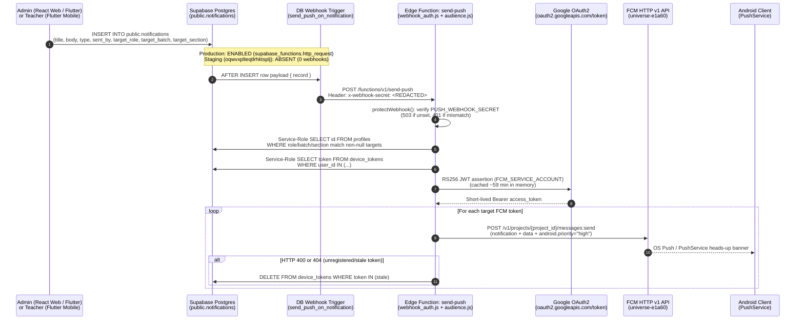

# 03 — Firebase Push Notifications & External Integrations

**Freshness Date:** 2026-11-28

**Primary Sources:** `lib/firebase_options.dart`, `android/app/google-services.json`, `android/app/build.gradle.kts`, `android/app/src/main/AndroidManifest.xml`, `ios/Runner/Info.plist`, `lib/main.dart`, `lib/core/constants/app_constants.dart`, `lib/core/services/push_service.dart`, `lib/features/auth/services/auth_service.dart`, `lib/features/auth/services/auth_callback_policy.dart`, `lib/features/auth/services/invitation_callback_bridge.dart`, `lib/features/teacher/services/teacher_service.dart`, `lib/features/notifications/services/notification_service.dart`, `lib/core/models/notification_model.dart`, `apps/web/src/features/admin/services/broadcastService.ts`, `apps/web/src/features/auth/AuthProvider.tsx`, `supabase/functions/send-push/`.

> **Plugin Access Note (`2026-11-28`):** No live **Firebase MCP server** is installed in this environment (the installed `firebase` plugin provides local `SKILL.md` guides only, zero live Firebase Console / FCM API tools) `[UNVERIFIED: External Dashboard / No Plugin Access]`. Production (`yxqyrjyzxitrgkhgauli`) `send_push_on_notification` DB trigger and `send-push` Edge Function (`ACTIVE`, v3, with Stage 5C joint-section `B+C` audience fan-out and Flutter Mobile 2027 `sb_publishable_...` key readiness in `app_constants.dart`) are verified from repository source `[VERIFIED: Repo Source]` and prior live `supabase_mcp` probe `[VERIFIED: Live Plugin]`, with secret keys redacted as `<REDACTED>`.

---

## 1. Firebase Configuration, Platforms & Device Token Lifecycle

### 1.1 Firebase Project & Platform Support Matrix

`[VERIFIED: Repo Source]` (`lib/firebase_options.dart`, `android/app/google-services.json`, `android/app/build.gradle.kts`, `android/app/src/main/AndroidManifest.xml`, `lib/main.dart:28-33`)

| Property | Configured Value (Secrets Redacted) | Source File |
| :--- | :--- | :--- |
| **Firebase Project ID** | `universe-e1a60` | `lib/firebase_options.dart:29`, `google-services.json` |
| **Project Number / Sender ID** | `336302188092` | `lib/firebase_options.dart:28`, `google-services.json` |
| **Firebase Storage Bucket** | `universe-e1a60.firebasestorage.app` | `lib/firebase_options.dart:30`, `google-services.json` |
| **Primary Android App (`com.example.universe`)** | `appId`: `1:336302188092:android:24336caef39fec99cc8539`, `apiKey`: `<REDACTED>`, OAuth client types `1` (Android) & `3` (Web) | `lib/firebase_options.dart:25-31`, `android/app/build.gradle.kts:11,27`, `google-services.json` |
| **Legacy Android Entry (`com.example.universe_v1`)** | `1:336302188092:android:2ec9294ce4175fbecc8539` *(present in `google-services.json` client array; unused by active Gradle `applicationId = "com.example.universe"`)* | `android/app/google-services.json` |
| **Android Gradle & Manifest Wiring** | `id("com.google.gms.google-services")`, `desugar_jdk_libs:2.1.4`, `android.permission.POST_NOTIFICATIONS`, default channel `com.google.firebase.messaging.default_notification_channel_id = "universe_high_importance"` | `android/app/build.gradle.kts:5,50`, `AndroidManifest.xml:3,64-66` |
| **iOS Platform (`TargetPlatform.iOS`)** | **NOT CONFIGURED — Runtime Guard Warning:** `lib/main.dart:28` runs `if (!kIsWeb) { await Firebase.initializeApp(options: DefaultFirebaseOptions.currentPlatform); }`, and `DefaultFirebaseOptions.currentPlatform` (`lib/firebase_options.dart:14-22`) **throws `UnsupportedError`** on every non-Android platform (`iOS`, `macOS`, `Windows`, `Linux`). No `ios/Runner/GoogleService-Info.plist` exists. | `lib/firebase_options.dart:14-22`, `lib/main.dart:28-33` |
| **React Web (`apps/web/`) & Flutter Web** | **Zero Firebase SDK on Web:** React Web (`apps/web/`) has no Firebase dependency (admins compose broadcasts via Supabase `public.notifications`, which triggers mobile push server-side). Flutter Web skips Firebase via `if (!kIsWeb)`. | `apps/web/package.json`, `lib/main.dart:28` |

> **Important iOS Compatibility Finding:** While iOS deep-link schemes (`Info.plist`) are preserved, launching the current Flutter app natively on iOS would throw `UnsupportedError('DefaultFirebaseOptions are only configured for Android...')` at `lib/main.dart:29` unless `lib/main.dart` guards `Firebase.initializeApp` / `PushService` behind `defaultTargetPlatform == TargetPlatform.android` (or iOS Firebase options + APNs are configured in a future iOS phase).

### 1.2 Flutter `PushService` & `public.device_tokens` Registration

`[VERIFIED: Repo Source]` (`lib/core/services/push_service.dart:53-232`, `lib/main.dart:78-98`, `supabase/migrations/20261122160000_phase_5b_rls_and_storage_hardening.sql:89-119`)

1. **Initialization (`PushService.instance.init()` at startup on native):**
   - Initializes `FlutterLocalNotificationsPlugin` with `@mipmap/ic_launcher` and creates `AndroidNotificationChannel('universe_high_importance', 'UniVerse Alerts', importance: Importance.high)`.
   - Requests Android 13+ `POST_NOTIFICATIONS` permission **once** via `_fcm.requestPermission(alert: true, badge: true, sound: true)` (avoiding back-to-back plugin permission races).
   - Registers `@pragma('vm:entry-point') firebaseBackgroundHandler`, `FirebaseMessaging.onMessage` (`_showForeground`), `onMessageOpenedApp`, and `getInitialMessage` (routing taps to `RouteNames.notifications` via `main.dart:79-81`).
2. **Foreground vs. Background Rendering:**
   - **Notification messages (`message.notification != null`):** Android OS renders automatically when backgrounded/killed (`firebaseBackgroundHandler` returns early at line 59 to prevent duplicate banners); `_showForeground` renders a local heads-up notification via `FlutterLocalNotificationsPlugin` when foregrounded.
   - **Data-only messages (`message.notification == null`):** Both `_showForeground` and `firebaseBackgroundHandler` (initializing its own isolate-local `FlutterLocalNotificationsPlugin` + channel) render `message.data['title']` / `message.data['body']`.
3. **Token Registration & Sign-Out Cleanup:**
   - On `AuthChangeEvent.signedIn` (`main.dart:94-96`), calls `PushService.instance.registerToken(userId)` and subscribes to `_fcm.onTokenRefresh`.
   - `_upsertToken` calls `SECURITY DEFINER` RPC **`public.register_device_token(p_token, p_platform: 'android')`**, which deletes any stale row for the same physical device `token` belonging to a previous `user_id` before upserting `(token, auth.uid(), 'android', now())` into `public.device_tokens` (falling back to direct `.from('device_tokens').upsert(..., onConflict: 'token')` only on `PGRST202`).
   - On `AuthService.signOut()` (`auth_service.dart:360`), `PushService.instance.unregisterToken()` deletes the row from `public.device_tokens` (`eq('token', token)`) and calls `_fcm.deleteToken()`.

---

## 2. End-to-End Push Notification Pipeline & Audience Correlation

`[VERIFIED: Repo Source]` (`apps/web/src/features/admin/services/broadcastService.ts`, `lib/features/teacher/services/teacher_service.dart`, `lib/features/notifications/services/notification_service.dart`, `lib/core/models/notification_model.dart`, `supabase/functions/send-push/index.ts`, `webhook_auth.js`, `audience.js`)

### 2.1 Producer Entry Points into `public.notifications`

All three notification producers write to the exact same `public.notifications` schema (`check_notif_type`: `'university' | 'class_cancel' | 'room_change' | 'test_reminder' | 'assignment' | 'exam'`):

1. **React Web Admin Campus Broadcast (`broadcastService.ts:66-93`):** Inserts `{ title, body, type, sent_by: adminUid, target_role: input.target_role === "all" ? null : input.target_role, target_batch: trimmedOrNull, target_section: upperOrNull }`.
2. **React Web / Flutter Routine Publish Broadcast (`timetableEngineService.ts:707-715`):** When `notifyUsers == true` during Step 3 of routine publication, inserts `{ type: "university", title: "New class routine published", sent_by, target_role: null, target_batch: null, target_section: null }`.
3. **Flutter Mobile Teacher Class Cancellation / Notice (`teacher_service.dart:38-76,105-121`):**
   - Two-step **"Service Recovery Paradox"** design: Step 1 inserts into `public.cancellations` (immediately replicated via `supabase_realtime`); Step 2 inserts into `public.notifications` (`type: 'class_cancel'`, `target_role: 'student'`, `target_batch: entry.batch`, `target_section: entry.section`). If Step 2 fails, returns `CancellationOutcome.partialSuccessNotificationFailed` so the teacher knows the cancellation is saved even though the push alert failed.

### 2.2 1:1 Audience Matching Parity & Joint-Section Edge Case

- **Exact 3-Dimension AND Semantics:** Both `NotificationItem.matchesAudience` (`lib/core/models/notification_model.dart:62-71`) and `resolveNotificationTargets` (`supabase/functions/send-push/audience.js:3-9`) evaluate `null` as wildcard ("everyone in this dimension") and non-null values via exact equality (`role == target_role AND batch == target_batch AND section == target_section`).
- **Subtle Joint-Section Nuance (`B+C`) Discovered in Code `[VERIFIED: Repo Source]`:**
  - When a teacher cancels a **joint class** (`entry.section == "B+C"`), `TeacherService.cancelClassWithOutcome` (`teacher_service.dart:70`) writes `target_section: "B+C"` into `public.notifications`.
  - However, students' `public.profiles.section` stores their atomic section (`"B"` or `"C"`). Because `audience.js:7` runs `.eq('section', 'B+C')` and `NotificationItem.matchesAudience` checks `targetSection != section` (`"B+C" != "B"`), **neither `send-push` nor the in-app Notifications tab matches atomic `"B"` / `"C"` students when `target_section` is `"B+C"`!** (Note: `audience.js:2` explicitly comments: *"canonical scopes, shared groups and co-teacher audiences are later tasks"*, while the student's **Routine** tab *does* show the cancellation badge because `RoutineEntry.matchesStudent` splits `section.split('+')` and checks `cancellations` by `routine_id|class_date`). Wave 2 should expand joint-section audience resolution in both `audience.js` and `NotificationItem.matchesAudience`.

### 2.3 Staging vs. Production Push Isolation

- **Production (`yxqyrjyzxitrgkhgauli`):** Trigger `send_push_on_notification` on `public.notifications` is **installed and enabled**, and `send-push` Edge Function is `ACTIVE` (v3, `verify_jwt: false`) (`[VERIFIED: Live Plugin]` — 2026-11-27 `supabase_mcp` check). Hosted Edge Function secret values (`PUSH_WEBHOOK_SECRET`, `FCM_SERVICE_ACCOUNT`) and live FCM delivery logs are `[UNVERIFIED: External Dashboard / No Plugin Access]`.
- **Staging (`oqwvxplteqtlrhktsplj`):** **Zero** triggers exist on `public.notifications` (`supabase_functions` schema is absent; only test harness Edge Functions `send-push-auth-test` / `send-push-audience-test` exist), and `20261021214512_reconstructed_baseline.sql:764-767,810-813` explicitly aborts if a notification webhook is present. Admin broadcast E2E tests on Staging safely insert rows into `public.notifications` with **zero risk of sending real FCM pushes**.

---

## 3. Google OAuth 2.0, Deep Links & Callback Allowlist Architecture

`[VERIFIED: Repo Source]` (`lib/core/constants/app_constants.dart:2-23`, `lib/features/auth/services/auth_service.dart:38-81`, `lib/features/auth/services/auth_callback_policy.dart`, `android/app/src/main/AndroidManifest.xml:35-59`, `ios/Runner/Info.plist:48-63`, `apps/web/src/features/auth/AuthProvider.tsx:408-445`, `docs/deployment/CLOUDFLARE_PAGES_AND_CUTOVER_RUNBOOK.md`)

### 3.1 Platform-by-Platform OAuth & Deep-Link Matrix

| Platform | Google Sign-In Mechanism | Auth / Recovery / Invite Callback URIs | Verified Configuration & Known Gaps |
| :--- | :--- | :--- | :--- |
| **Android (`lib/` Native)** | Native Google Account Chooser via `google_sign_in` (`GoogleSignIn(serverClientId: AppConstants.googleWebClientId)`) → obtains Google `idToken` + `accessToken` → calls `_supabase.auth.signInWithIdToken(provider: OAuthProvider.google, ...)` *(no browser redirect needed for Google login; `signOut()` called first so account picker always shows)*. | • Email signup/OTP redirect: `com.example.universe://login-callback/` • Password reset & `invite-admin` native default: `com.example.universe://reset-callback/` • Legacy Android entry coexistence: `com.example.universe_v1://` (`google-services.json` legacy client `1:336302188092:android:2ec9294ce4175fbecc8539`) | `[VERIFIED: Repo Source]` `AndroidManifest.xml:36-59` sets `flutter_deeplinking_enabled = false` (so `app_links` + `supabase_flutter` own token URIs without GoRouter double-routing) and registers `VIEW`/`BROWSABLE` intent-filters for `com.example.universe://login-callback` and `com.example.universe://reset-callback` (while `com.example.universe_v1://` remains coexisting in allowlists for legacy package compatibility). Public Web Client ID default: `336302188092-e8h8jjv7ukfp3m0pj6cbmhep3097c0st.apps.googleusercontent.com`. Debug/release SHA-1 registration in Google Cloud / Firebase Console is `[UNVERIFIED: External Dashboard / No Plugin Access]`. |
| **iOS (`ios/Runner/Info.plist`)** | Shares `AuthService.signInWithGoogle()` (`google_sign_in` → `signInWithIdToken`), **blocked by missing iOS OAuth metadata** *(see gap ->)*. | `Info.plist:50-63` sets `FlutterDeepLinkingEnabled = false` and registers `CFBundleURLSchemes`: **`io.supabase.universe`** and **`com.example.universe`**. | `[VERIFIED: Repo Source]` Deep-link schemes for Supabase callbacks (`com.example.universe://login-callback/` & `reset-callback/`) are preserved. **Unresolved iOS Gaps (Deferred by Governance):** (1) `Info.plist` lacks `GIDClientID` and the reversed client ID scheme `com.googleusercontent.apps.*` required by `google_sign_in` on iOS; (2) `AuthService` passes `serverClientId` without an iOS `clientId`; (3) `DefaultFirebaseOptions.currentPlatform` throws on iOS (§1.1). |
| **React Web (`apps/web/`)** | Browser OAuth 2.0 PKCE redirect: `supabase.auth.signInWithOAuth({ provider: "google", options: { redirectTo: "${window.location.origin}/" } })` → Google → `https://<project>.supabase.co/auth/v1/callback` → `${origin}/?code=...` → GoTrue exchanges PKCE code → `AuthProvider.resolveAdminGate`. | **Unified Root Trailing-Slash Callback (`${window.location.origin}/`)** across Google OAuth (`AuthProvider.tsx:416`), Password Reset (`AuthProvider.tsx:438`), and `invite-admin` (`usersService.ts:89`). | `[VERIFIED: Repo Source]` Environment B Production uses `https://universe-admin-exi.pages.dev/`; Environment A Staging uses `https://universe-bfi.pages.dev/`; local dev uses `http://localhost:5173/`. Requires exact registration in Supabase Auth Redirect URLs and Edge Function `AUTH_WEB_CALLBACK_URLS` (no wildcards). |
| **Legacy Flutter Web (`web/` — FROZEN)** | `_supabase.auth.signInWithOAuth(OAuthProvider.google, redirectTo: AuthCallbackPolicy.current.loginCallback)`. | Enforces compile-time `--dart-define=AUTH_WEB_CALLBACK_URLS` exact match (`AuthCallbackPolicy._browserCallback`). | Frozen read-only fallback until Stage 5 post-cutover pruning. |

> **2027 Legacy Anon Key Retirement Note (`lib/core/constants/app_constants.dart:6-10`) `[VERIFIED: Repo Source]`:** `AppConstants.supabaseAnonKey` currently defaults to a legacy `eyJ...` anon JWT (`<REDACTED>`) targeting Production `https://yxqyrjyzxitrgkhgauli.supabase.co`. Ahead of Supabase's early-2027 legacy JWT API-key retirement, mobile builds should rotate to an opaque `sb_publishable_...` key (via `--dart-define=SUPABASE_ANON_KEY=...` / updated default) — matching the 2027 `sb_` key support already implemented in `engine/auth.py` and `.github/workflows/supabase_keep_alive.yml`.

### 3.2 Required External Dashboard Allowlists (Zero Wildcards)

`[UNVERIFIED: External Dashboard / No Plugin Access]` (Must be verified manually by owner in external consoles per `CLOUDFLARE_PAGES_AND_CUTOVER_RUNBOOK.md`)

1. **Supabase Dashboard → Authentication → URL Configuration → Redirect URLs:**
   - **Mobile (Production & Staging if mobile-tested):** `com.example.universe://login-callback/`, `com.example.universe://reset-callback/` (coexisting with legacy `com.example.universe_v1://` schemes where retained).
   - **Staging (`oqwvxplteqtlrhktsplj`, Environment A):** `https://universe-bfi.pages.dev/`, `http://localhost:5173/` *(optional secondary: `/login`, `/reset-password`)*.
   - **Production (`yxqyrjyzxitrgkhgauli`, Environment B Live):** `https://universe-admin-exi.pages.dev/` *(optional secondary: `/login`, `/reset-password`)*.
2. **Supabase Dashboard → Edge Functions → `invite-admin` Secrets:**
   - `AUTH_WEB_CALLBACK_URLS`: comma-separated exact trailing-slash root URLs matching the environment (`https://universe-bfi.pages.dev/,http://localhost:5173/` on Staging; `https://universe-admin-exi.pages.dev/` configured for Production). Exact live secret strings remain `[UNVERIFIED: External Dashboard / No Plugin Access]`.
3. **Google Cloud Console → APIs & Services → Credentials (OAuth 2.0 Web Client `336302188092-e8h8...`):**
   - **Authorized redirect URIs:** `https://yxqyrjyzxitrgkhgauli.supabase.co/auth/v1/callback` (Production) and `https://oqwvxplteqtlrhktsplj.supabase.co/auth/v1/callback` (Staging).
   - **Authorized JavaScript origins:** `https://universe-bfi.pages.dev` and `https://universe-admin-exi.pages.dev`.
