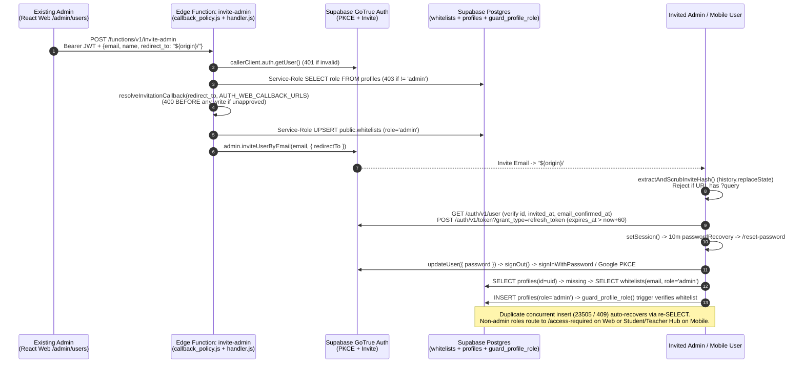
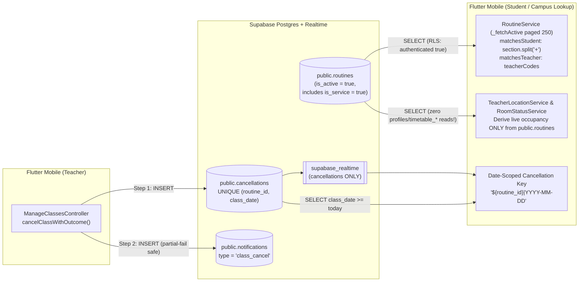
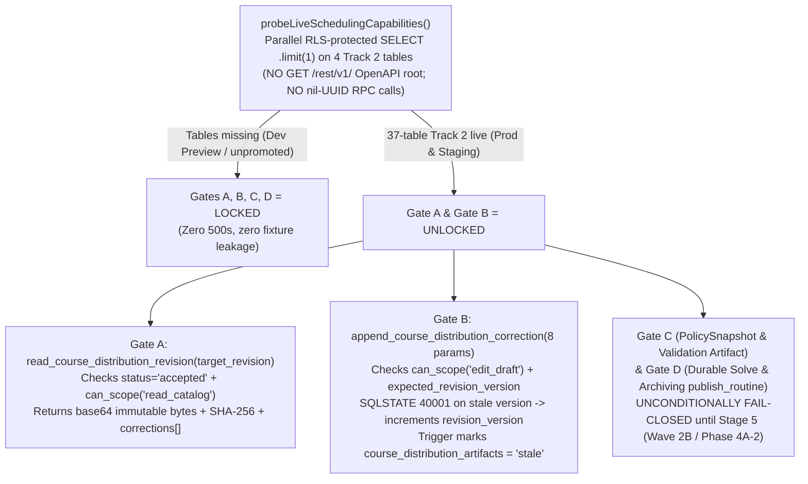
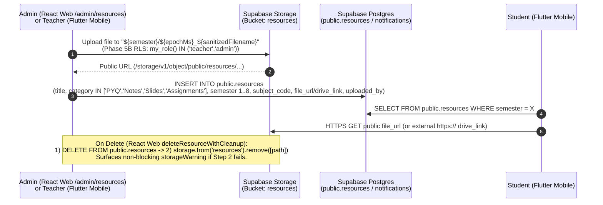

# 04 — End-to-End Data Flows, CI/CD & Wave 2 Impact Matrix

**Freshness Date:** 2026-11-28

**Primary Sources:** `.github/workflows/validate.yml`, `.github/workflows/supabase_keep_alive.yml`, `render.yaml`, `apps/web/public/_headers`, `apps/web/public/_redirects`, `apps/web/public/theme-init.js`, `docs/deployment/CLOUDFLARE_PAGES_AND_CUTOVER_RUNBOOK.md`, `docs/deployment/PHASE_4A1_AND_5B_SQL_PROMOTION_RUNBOOK.md`, `apps/web/src/features/**`, `lib/features/**`, `engine/**`.

> **Wave 2B Operational Resilience Update (`2026-11-28`):** Render free-tier 512 MB RAM stability is enforced via `render.yaml` (`SOLVER_WORKERS=1`, `SOLVER_NUM_WORKERS=1`, `SOLVER_MAX_MEMORY_MB=320`, `SOLVER_LINEARIZATION_LEVEL=0`, `MAX_CONCURRENT_SOLVES=1`), FastAPI lifespan startup orphan-job sweep (`job_store.mark_orphaned_jobs_on_startup`), and React Web `runResilientJobPolling()` (`TRANSIENT_POLL_BACKOFF_MS` ~58s bounded reconnect window across Render restarts/blips). External Render/Cloudflare/Supabase dashboard secret values remain `[UNVERIFIED: External Dashboard / No Plugin Access]`.

---

## 1. End-to-End Cross-System Data Flows

`[VERIFIED: Repo Source]` (`apps/web/src/services/supabase.ts`, `apps/web/src/features/**`, `lib/features/**`, `supabase/**`, `engine/**`)

### Flow 1: Auth, Whitelist Provisioning & Admin Invite Flow



### Flow 2: Live Student/Teacher Routine Read, Lookup & Realtime Cancellation Flow

> **Critical Realtime Publication Fact `[VERIFIED: Repo Source]`:** `supabase_realtime` publishes **ONLY `public.cancellations`** (`puballtables = false` on both Production and Staging). Neither `public.routines` nor `public.notifications` is in `supabase_realtime`! Note that `TeacherLocationService.streamAllRoutines()`, `RoomStatusService.streamAllRoutines()`, and `NotificationService.subscribeToInserts()` in Flutter attach Realtime listeners to `routines`/`notifications` that receive **zero live change deltas** after initial fetch — React Web intentionally avoids false Realtime subscriptions and uses TanStack Query invalidation + explicit Refresh.



### Flow 3: Track 1 Routine Generation, 20-Counter Validation & 3-Step Guarded Publication

```mermaid
sequenceDiagram
    autonumber
    participant Web as React Web Admin<br/>(/admin/routine?tab=generate)
    participant Supa as Supabase Postgres + Storage<br/>(Config Tables, timetables bucket, publish_routine)
    participant Engine as Render FastAPI Engine<br/>(main.py + auth.py + solver.py + render.py)
    participant Mobile as Flutter Mobile<br/>(RoutineEntry.fromMap)

    Web->>Supa: Parallel SELECT timetable_rooms, timetable_faculty,<br/>timetable_course_eligibility, timetable_settings (id=1)
    Web->>Web: assembleEngineConfigFromRecords() (HH:MM clocks, zero non-DB keys)<br/>+ Studio OOXML .xlsx builder OR external .xlsx file
    Web->>Engine: POST /api/timetable/generate (Bearer JWT, file, config, time_limit_s=180)
    Engine-->>Web: 200 { job_id }
    loop Every 2s (max 240 polls; +4s backoff on 429; fast-fail on 404/401/403)
        Web->>Engine: GET /api/timetable/status/{job_id}
    end
    Web->>Engine: GET /api/timetable/result/{job_id}
    Engine-->>Web: rows + service_rows + stats + 20-counter validation + report
    Web->>Web: Pre-Publish Guards:<br/>1) blockingValidationErrorFor (all 20 counters == 0 & ok == true)<br/>2) findCoTeacherBlockers (teachers.length <= 1)<br/>3) assessBaselineConfigForPublish (activeRooms>0, activeFaculty>0, hasSettings)
    Web->>Engine: GET /api/timetable/download/{job_id} (.xlsx Blob)
    Web->>Supa: Step 1: Storage upload -> timetables/CSE_Routine_<label>_<ts>.xlsx
    Web->>Supa: Step 2: RPC publish_routine(p_rows: rows + service_rows with HH:MM:SS)<br/>(Atomic tx: routine_versions + DELETE routines WHERE true + bulk INSERT)
    Web->>Supa: Step 3 (Best-effort + retryable): INSERT timetable_runs (status='published')<br/>+ optional INSERT notifications (type='university')
    Mobile->>Supa: SELECT routines WHERE is_active = true -> RoutineEntry.fromMap()
```

### Flow 4: Track 2 Course Distribution Revision, Audited Correction (`40001`) & Gates A–D



> **Live Gate A–B Status `[VERIFIED: Live Plugin]` + `[VERIFIED: Repo Source]`:** `apps/web/src/features/scheduling/services/schedulingCapabilities.ts` probes the 4 atomic Track 2 tables (`course_distribution_revisions`, `sources`, `corrections`, `artifacts`) via standard RLS-protected PostgREST `SELECT .limit(1)` queries (zero `GET /rest/v1/` calls). With Phase 4A-1 promoted on **both** Staging (`oqwvxplteqtlrhktsplj`) and Production (`yxqyrjyzxitrgkhgauli`), **Gates A & B** unlock cleanly on both environments (`0` rows until distribution sources are uploaded), while `AdminRoutinePage.tsx` reflects this live via the `track2-workbench-gate-badge` pill. Gates C & D remain fail-closed until Stage 5.

### Flow 5: Resource Storage Upload & Campus Broadcast Flow



---

## 2. Complete CI/CD & Deployment Infrastructure Map

### 2.1 GitHub Actions Workflows (`.github/workflows/`)

`[VERIFIED: Repo Source]` (`.github/workflows/validate.yml`, `.github/workflows/supabase_keep_alive.yml`)

#### A. `.github/workflows/validate.yml` — 5 Parallel Verification Jobs
Triggers: `pull_request`, `push` to `branches: [main]`, `workflow_dispatch`. Uses **zero repository secrets or hosted credentials** (`permissions: contents: read`).

| # | Job ID | Runner / Toolchain | Exact Checks Executed |
| :--- | :--- | :--- | :--- |
| 1 | `academic-domain` | `ubuntu-latest`, Python `3.12` (`timeout: 10m`) | Installs `engine/requirements.txt` + `pytest` + `httpx`; runs `pytest` on `test_domain.py`, `test_normalized_domain.py`, `test_legacy_mapping.py`, and Phase 5A `test_api_auth_and_cors.py`. *(Note: full 230-test CP-SAT solver suite is run locally before push, not all files in this fast job.)* |
| 2 | `tools-and-functions` | `ubuntu-latest`, Python `3.12` + Deno `v2.5.6` (`timeout: 10m`) | Runs `python -m unittest discover -s tool/tests -v`, `deno test supabase/functions/send-push/{webhook_auth_test.js,audience_test.js}`, and `deno test supabase/functions/invite-admin/{callback_policy_test.js,handler_test.js}`. |
| 3 | `local-database` | `ubuntu-latest`, Python `3.12` + isolated `supabase/setup-cli@v1` (`2.121.0`) (`timeout: 30m`) | Runs `python tool/task1_local_checks.py --task2` against an ephemeral local Docker stack (two fresh public-schema resets + 44 pgTAP baseline assertions + 795-row sanitized restore + `20261022140809` Task 2 catalog checks). *(CI-only ephemeral container; developers never use Supabase CLI).* |
| 4 | `web-validate` | `ubuntu-latest`, Node `22` (`timeout: 15m`) | `npm --prefix apps/web ci` → `npm --prefix apps/web run typecheck` → `npm --prefix apps/web test` → `npm --prefix apps/web run build` with placeholder non-secret env vars (`VITE_ENABLE_SCHEDULING_PREVIEW_ROUTE="false"`). |
| 5 | `flutter-validate` | `ubuntu-latest`, Flutter `3.47.0` stable (`timeout: 20m`) | `flutter pub get` → `flutter analyze` → `flutter test --exclude-tags visual_capture`. |

#### B. `.github/workflows/supabase_keep_alive.yml` — Secret-Backed, `sb_`-Safe Free-Tier Ping
- **Schedule:** Cron `'0 0 */3 * *'` (every 3 days at 00:00 UTC) + `workflow_dispatch`.
- **Resolved Security & 2027 Key Fixes `[VERIFIED: Repo Source]`:**
  1. **Zero Hardcoded JWTs:** Reads `SUPABASE_URL: ${{ vars.SUPABASE_URL || 'https://yxqyrjyzxitrgkhgauli.supabase.co' }}` and `SUPABASE_ANON_KEY: ${{ secrets.SUPABASE_ANON_KEY }}`. If `SUPABASE_ANON_KEY` is unconfigured, logs a warning and exits `0` cleanly.
  2. **2027 `sb_publishable_...` Header Safety:** Only attaches `-H "Authorization: Bearer ${SUPABASE_ANON_KEY}"` when `SUPABASE_ANON_KEY` starts with `eyJ*`, always sending `-H "apikey: ${SUPABASE_ANON_KEY}"` so opaque publishable keys never trigger JWT parse errors.
  3. **Explicit Status Guard:** Captures HTTP code via `curl -sS -o /dev/null -w "%{http_code}"` and fails (`exit 1`) if `< 200` or `>= 500` (accepting `401` on `/rest/v1/` while registering Kong activity).
  4. **Staging Consideration:** Defaults to Production (`yxqyrjyzxitrgkhgauli`); secondary Staging (`oqwvxplteqtlrhktsplj`) is not pinged unless `vars.SUPABASE_URL` overrides.

### 2.2 Render FastAPI Deployment & Production Auth Enforcement

`[VERIFIED: Repo Source]` (`render.yaml`, `engine/auth.py`, `engine/security_guards.py`, `docs/deployment/CLOUDFLARE_PAGES_AND_CUTOVER_RUNBOOK.md`) `[VERIFIED: Live Plugin]` (2026-11-27 Render `GET /` probe)

- **Service Blueprint (`render.yaml`):** Web service `universe-timetable-engine`, `runtime: python` (`PYTHON_VERSION=3.12.7`), `rootDir: engine`, `plan: free` (`512 MB` RAM), `buildCommand: pip install -r requirements.txt`, `startCommand: uvicorn main:app --host 0.0.0.0 --port $PORT`, `healthCheckPath: /`, `SOLVER_WORKERS="2"`. (`render.yaml` template leaves `ENGINE_AUTH_MODE: optional` as the blueprint default for fresh deployments.)
- **Live Render Production Configuration (`2026-11-27`):** `https://universe-timetable-engine.onrender.com` now runs `Engine v2.0.0` with **`ENGINE_AUTH_MODE=enforced`** (`[VERIFIED: Live Plugin]`), strict `ALLOWED_ORIGINS`, `engine/security_guards.py` OOXML preflight + `429` rate-limiting, 2027 `sb_` key header compatibility (`engine/auth.py`), and Phase 3B `POST /api/timetable/parse-rendered-workbook` pointed at **Production** Supabase (`yxqyrjyzxitrgkhgauli`).
- **Staging Local Engine Workflow (`AGENTS.md` §2):** Because shared Render enforces **Production** Supabase JWTs, local Staging (`oqwvxplteqtlrhktsplj`) end-to-end engine testing runs local `uvicorn` (`engine/.venv/Scripts/python.exe -m uvicorn main:app --port 8000`) pointed at Staging Supabase.

### 2.3 Cloudflare Pages Dual-Environment Static Architecture (`apps/web/public/`)

`[VERIFIED: Repo Source]` (`apps/web/public/_redirects`, `apps/web/public/_headers`, `apps/web/public/theme-init.js`, `AGENTS.md` §1)

- **Live Cloudflare Pages Topology:**
  - **Environment A (Staging):** `https://universe-bfi.pages.dev` → Staging Supabase (`oqwvxplteqtlrhktsplj`).
  - **Environment B (Production):** `https://universe-admin-exi.pages.dev` → hardened Production Supabase (`yxqyrjyzxitrgkhgauli`).
- **Build Contract:** Root `apps/web`, command `npm run build`, output `dist`, `NODE_VERSION=22`.
- **SPA Routing (`_redirects`):** `/* /index.html 200`.
- **Zero-Inline-Script Theme Init (`theme-init.js`):** External pre-paint IIFE reading `localStorage.getItem("universe-web-theme")` + `prefers-color-scheme: dark` and stamping `document.documentElement.dataset.theme = "dark" | "light"` before first paint so `script-src 'self'` needs **zero `'unsafe-inline'`**.
- **Security Headers & CSP (`_headers`):**
  - `X-Frame-Options: DENY`, `X-Content-Type-Options: nosniff`, `Referrer-Policy: strict-origin-when-cross-origin`, `Permissions-Policy: camera=(), microphone=(), geolocation=()`, `Strict-Transport-Security: max-age=31536000; includeSubDomains`.
  - `Content-Security-Policy`: `default-src 'self'; script-src 'self'; style-src 'self' 'unsafe-inline' https://fonts.googleapis.com; font-src 'self' https://fonts.gstatic.com; img-src 'self' data: blob: https:; connect-src 'self' https://*.supabase.co wss://*.supabase.co https://universe-timetable-engine.onrender.com; frame-ancestors 'none'; base-uri 'self'; form-action 'self'`. *(Note: if a separate Staging Render hostname is ever created, add its origin to `connect-src` in `_headers`.)*
  - Caching: `/assets/*` → `public, max-age=31536000, immutable`; `/index.html` → `no-cache`.

### 2.4 Environment Variable Matrix Across Hosts (Names & Sources Only — Zero Secrets)

| Host / Service | Variable Name | Environment A (Staging: `universe-bfi.pages.dev`) | Environment B (Production: `universe-admin-exi.pages.dev`) | Secret? |
| :--- | :--- | :--- | :--- | :--- |
| **Cloudflare Pages** (`apps/web`) | `NODE_VERSION` | `22` | `22` | No |
| **Cloudflare Pages** | `VITE_SUPABASE_URL` | `https://oqwvxplteqtlrhktsplj.supabase.co` | `https://yxqyrjyzxitrgkhgauli.supabase.co` | No |
| **Cloudflare Pages** | `VITE_SUPABASE_ANON_KEY` | `<REDACTED>` *(Staging publishable/anon key)* | `<REDACTED>` *(Prod publishable/anon key)* | Publishable |
| **Cloudflare Pages** | `VITE_TIMETABLE_BASE_URL` | `https://universe-timetable-engine.onrender.com` *(or local `http://127.0.0.1:8000` for Staging E2E)* | `https://universe-timetable-engine.onrender.com` | No |
| **Cloudflare Pages** | `VITE_ENABLE_SCHEDULING_PREVIEW_ROUTE` | `false` | `false` | No |
| **Render** (`engine/`) | `PYTHON_VERSION` / `SOLVER_WORKERS` | `3.12.7` / `"2"` | `3.12.7` / `"2"` | No |
| **Render** (`engine/`) | `ENGINE_AUTH_MODE` | *(Shared Render points to Prod; local Staging `uvicorn` tests against `oqwvxplteqtlrhktsplj`)* | `enforced` (`[VERIFIED: Live Plugin]`) | No |
| **Render** (`engine/`) | `ALLOWED_ORIGINS` | `https://universe-bfi.pages.dev,http://localhost:5173,http://127.0.0.1:5173` | `https://universe-admin-exi.pages.dev,https://universe-bfi.pages.dev` *(exact dashboard list `[UNVERIFIED]`)* | No |
| **Render** (`engine/`) | `SUPABASE_URL` | `https://oqwvxplteqtlrhktsplj.supabase.co` *(local)* | `https://yxqyrjyzxitrgkhgauli.supabase.co` | No |
| **Render** (`engine/`) | `SUPABASE_ANON_KEY` / `SUPABASE_PUBLISHABLE_KEY` | `<REDACTED>` | `<REDACTED>` | Publishable |
| **Render** (`engine/`) | `SUPABASE_SERVICE_ROLE_KEY` / `SUPABASE_SECRET_KEY` | `<REDACTED>` | `<REDACTED>` | **SECRET** |
| **Supabase Edge** (`invite-admin`) | `AUTH_WEB_CALLBACK_URLS` | `https://universe-bfi.pages.dev/,http://localhost:5173/` | `https://universe-admin-exi.pages.dev/` *(exact dashboard value `[UNVERIFIED]`)* | Config |
| **Supabase Edge** (`send-push`) | `PUSH_WEBHOOK_SECRET` | *(Not deployed on Staging)* | `<REDACTED>` *(matches DB webhook `x-webhook-secret`)* | **SECRET** |
| **Supabase Edge** (`send-push`) | `FCM_SERVICE_ACCOUNT` | *(Not deployed on Staging)* | `<REDACTED>` *(Firebase SA JSON)* | **SECRET** |
| **Flutter Mobile** (`--dart-define`) | `SUPABASE_URL`, `SUPABASE_ANON_KEY`, `TIMETABLE_BASE_URL`, `GOOGLE_WEB_CLIENT_ID`, `GEMINI_API_KEY` | Defaults in `AppConstants` point to Prod (`yxqyrjyzxitrgkhgauli`) + Render | Override via `--dart-define` for non-default builds (`GEMINI_API_KEY` for AI RAG; `SUPABASE_ANON_KEY` rotation ahead of 2027) | Mixed |

---

## 3. Wave 2 Backend Change Impact Matrix (Post-Stage-4 Status & Stage 5 Remaining Scope)

`[VERIFIED: Repo Source]` (`AGENTS.md` §1, `apps/web/src/features/scheduling/`, `lib/core/models/routine_model.dart`, `engine/solver.py`) `[VERIFIED: Live Plugin]`

Use this matrix as **Stage 5 (`Wave 2B / Phase 4A-2`)** begins so **zero mobile regressions** or unbacked UI states are introduced:

| Wave 2 Milestone | Status (2026-11-27) | Supabase SQL / RLS / Edge Changes | FastAPI Engine (`engine/`) Changes | Flutter Mobile (`lib/` Android & iOS) Impact | React Web (`apps/web/`) Updates |
| :--- | :--- | :--- | :--- | :--- | :--- |
| **1. Phase 4A-1 Prod SQL Promotion** (`20261022140809` + `20261106130000`) | **COMPLETE** *(Live on Prod & Staging)* | 37 tables, `academic_private`, nullable FK cols on `profiles`/`routines`/`timetable_rooms`/`timetable_faculty`, and Gates A–B RPCs live on `yxqyrjyzxitrgkhgauli`. | `distribution.py` supports `source_contract`. | **Zero Breaking Impact:** All 12 new columns are nullable/defaulted; `RoutineEntry.fromMap` already parses optional canonical FK IDs. | `probeLiveSchedulingCapabilities()` unlocks **Gate A** and **Gate B** automatically on both Production and Staging. |
| **2. Phase 5B Prod RLS & Storage Hardening** (`20261122160000`) | **COMPLETE** *(Live on Prod & Staging)* | `search_path = ''`, `profiles_select` own/admin, `timetable_*` `SELECT` restricted to `is_admin()`, `anon` revoked, scoped `storage.objects` policies, and explicit Production `storage.buckets` MIME/size limits active. | `engine/auth.py` deployed with `ENGINE_AUTH_MODE=enforced`, `ALLOWED_ORIGINS`, `security_guards.py`, and 2027 `sb_` opaque key headers. | **Verified Safe (`F-13`, `F-29`, `F-30`):** Student/Teacher screens read only own `profiles` row and `public.routines`; `send-push` uses `service_role`. | Verified E2E on Staging and live on Production Environment B (`https://universe-admin-exi.pages.dev`). |
| **3. Phase 3B + Archive v2a** (`parse-rendered-workbook` & Archive 2D Preview) | **COMPLETE** *(Live on Prod & Staging)* | Reuses `publish_routine` + `timetables` bucket (`routine_versions`, `timetable_runs`, Storage direct downloads). | `POST /api/timetable/parse-rendered-workbook` (`engine/parse_rendered.py`, `Depends(auth.require_admin_caller)`, `PARSE_RATE_LIMITER`, `validate_xlsx_upload`) live with 1:1 Dart parity. | Mobile Student/Teacher app unaffected; frozen Flutter Web (`web/`, `lib/features/admin/`) ready for post-cutover pruning in Stage 5. | `/admin/routine?tab=upload` (`UploadRoutineTab.tsx`) live; `/admin/routine?tab=archive` (`RoutineArchiveTab.tsx`, `routineArchiveService.ts`) live with direct Storage downloads + Archive v2a 2D Grid Preview. |
| **4. Stage 5 — Gate C: Policy Snapshot, Extended Catalogs & Server Validation Artifact** (`Phase 4A-2`) | **NEXT (`Wave 2B`)** | Add migration + RPCs for `CatalogCourse`, `CohortBatch`/section weekend overrides, `PolicySnapshot` (`R1`–`R16` typed settings + faculty/room slot windows + `employment_type` + `is_sust_adjunct`), and persisted `validation_report` rows in `course_distribution_artifacts`. Enforce `SET search_path = ''` and `academic_private.can_scope(..., 'manage_policy')`. | Wire `engine/domain.py` (`PolicySnapshot`, `ValidationReport`, `NormalizedInput`) into `main.py` / `solver.py`; expose standalone preflight/validation endpoint or RPC integration. | **Zero Mobile Impact:** Students and Teachers never read `PolicySnapshot` or catalog config tables. | Unlock **Gate C** in `schedulingCapabilities.ts`; replace read-only `staged-no-db` banners on `/admin/timetable/courses`, `/admin/timetable/batches`, and `PolicyStudioStage.tsx` with live TanStack Query mutations. |
| **5. Stage 5 — R1–R16 + D1–D6 CP-SAT Solver Extensions** (`Phase 4A-2`) | **NEXT (`Wave 2B`)** | Consumes Gate C schema (`employment_type`, `is_sust_adjunct`, faculty `external_busy_slots` / `available_slots` / `preferred_slots`, room `declared_windows`, explicit Physics lab codes, `allow_sessional_across_break`). | Extend `ingest.py` & `solver.py`: implement R1/R2 section weekends & batch spread `<=1`, R3 section gap `<2`, R4/R5 slot domains, R6/R7 permanent vs adjunct distinct-course bands, R8/R9 preferences & SUST rules, R10/R11 room-window & Physics pins, R12/R13 credit-based blocks & coupled room assignment, drop `solver.py:136` digit filter (R14), and emit structured `D6` outcomes (`OPTIMAL`, `FEASIBLE`, `INFEASIBLE`, `TIME_LIMIT_EXHAUSTED`, `UNKNOWN`, `INPUT_ERROR`). | **Zero Mobile Impact** as long as output rows preserve `day`, `time_start` (`HH:MM:SS`), `time_end`, `subject`, `subject_code`, `room`, `batch`, `section` (`+` for joint), `semester`, `is_active`, `is_service`. | Update `EngineResultSchema` / `ValidationGate` and `RevisionSolveStage` / `GenerateRoutineTab` conflict inspector to render structured `D6` hard violations vs. soft preference misses. |
| **6. Stage 5 — Gate D: Durable Jobs, Co-Teachers, Archiving `publish_routine()`, Archive v2b & Flutter Web Pruning** (`Phase 4A-2`) | **NEXT (`Wave 2B`)** | 1) Add durable `solver_jobs` table.<br/>2) Add `teacher_codes text[] NOT NULL DEFAULT '{}'` to `public.routines`.<br/>3) Upgrade `publish_routine()` to archive prior `routines` snapshot on `routine_versions`, scope deletes by `scheduling_scope_id`, verify fresh `validation_report` server-side, and write `teacher_codes`. | Replace volatile in-memory `JOBS: dict` in `engine/main.py` with Supabase-persisted job state + Storage `.xlsx` persistence so Render restarts never `404`. | **Mobile Compatibility Check:** `RoutineEntry.fromMap` (`routine_model.dart:114`) **already** reads `map['teacher_codes']` into `coTeacherCodes` and `matchesTeacher` checks `teacherCodes`! Update `TeacherLocationService.fetchUniqueTeachers()` (`teacher_location_service.dart:20-37`) to also index `teacher_codes` and expand `B+C` joint-section matching in `send-push/audience.js` & `NotificationItem.matchesProfile`. Prune frozen Flutter Web (`web/`, `lib/features/admin/`). | Unlock **Gate D** in `schedulingCapabilities.ts`; remove `findCoTeacherBlockers` pre-publish throw once `routines.teacher_codes` is live; wire Archive v2b 1-click PostgreSQL rollback in `RoutineArchiveTab` / `ReviewDiffPublishStage`. |
