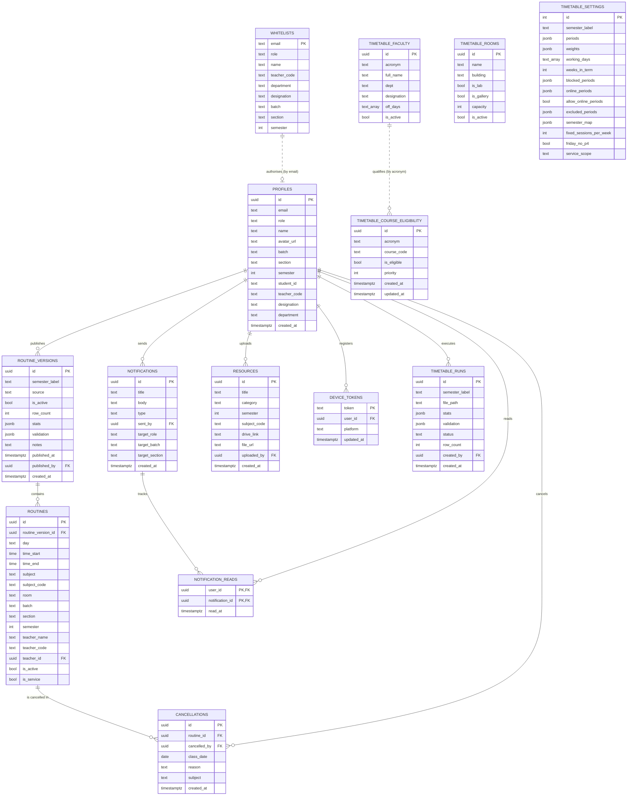

# Diagram 1 — Entity-Relationship (ER) Diagram

> **What this shows:** The complete relational database design of UniVerse — all 14 actively used tables, primary keys (PK), foreign keys (FK), data types, and inter-table relationships.  
> **Source of Truth:** Live Supabase PostgreSQL database schema (Migrations 001–016).  
> **Tools to render:** [dbdiagram.io](https://dbdiagram.io) (DBML) or [mermaid.live](https://mermaid.live) (Mermaid).

---

## 1. Entity Inventory: 14 Implemented Tables

The production database contains 18 total tables, but **only 14 are actively utilized by the deployed application**. The remaining 4 tables (`assignments`, `submissions`, `documents`, `timetable_courses`) represent future scope or legacy prototypes and are omitted from this diagram to maintain strict fidelity to the running software.

| # | Entity (Table) | Purpose & Description | Cardinality Context |
|---|---|---|---|
| 1 | **`profiles`** | Central user record (1:1 with `auth.users.id`). Stores student & teacher academic identities. | Central entity |
| 2 | **`whitelists`** | Pre-authorisation security gate for **both Teachers and Admins** (Migration 016). | 1:1 logical link to `profiles` by email |
| 3 | **`routines`** | Individual scheduled class slots (day, timeslot, course code, room, batch, section, teacher). | Child of `routine_versions` |
| 4 | **`routine_versions`** | **Atomic routine version manager** (Migration 012). Stores active status, audit metadata, and stats. | Parent of `routines` |
| 5 | **`cancellations`** | Specific cancelled class occurrences with date and reason. `routine_id` is `ON DELETE SET NULL`. | Child of `routines` & `profiles` |
| 6 | **`notifications`** | System alerts, cancellation notices, room changes, and campus broadcasts. | Parent of `notification_reads` |
| 7 | **`notification_reads`** | Junction table tracking read/dismiss receipts per user (`user_id` + `notification_id` composite PK). | Resolves M:N users $\leftrightarrow$ alerts |
| 8 | **`resources`** | Academic study materials, lecture slides, PYQs, and Google Drive links by semester. | Child of `profiles` |
| 9 | **`device_tokens`** | FCM registration tokens mapped to user accounts for OS-level push notifications. | Child of `profiles` |
| 10 | **`timetable_rooms`** | Pool of physical rooms with building, capacity, and lab/gallery specifications. | Standalone config |
| 11 | **`timetable_faculty`** | Teacher directory with acronyms, departments, designations, and weekly off-days. | Standalone config |
| 12 | **`timetable_settings`** | Singleton configuration (ID=1) holding term calendar rules (14 columns). | Standalone config |
| 13 | **`timetable_runs`** | Generation log recording solver runtime metrics, row counts, and output status. | Child of `profiles` |
| 14 | **`timetable_course_eligibility`** | Qualification matrix mapping teacher acronyms to permissible course codes (Migration 013). | Logical config link |

---

## 2. Table Schemas & Attributes

### 1. `profiles` *(Core User Entity)*
- **`id`** (UUID, PK) — Matches Supabase `auth.users.id`
- `email` (TEXT, UNIQUE)
- `role` (TEXT) — `'student' | 'teacher' | 'admin'`
- `name` (TEXT)
- `avatar_url` (TEXT)
- `batch` (TEXT, nullable) — For students (e.g. `'60'`)
- `section` (TEXT, nullable) — For students (e.g. `'A'`)
- `semester` (INT, nullable) — For students (1–8)
- `student_id` (TEXT, nullable) — University ID
- `teacher_code` (TEXT, nullable) — For teachers (e.g. `'EBH'`)
- `designation` (TEXT, nullable) — For teachers
- `department` (TEXT, nullable) — (e.g. `'CSE'`)
- `created_at` (TIMESTAMPTZ)

### 2. `whitelists` *(Authorization Gate)*
- **`email`** (TEXT, PK) — Normalized lowercase email
- `role` (TEXT) — `'teacher' | 'admin'`
- `name` (TEXT)
- `teacher_code` (TEXT, nullable)
- `department` (TEXT, nullable)
- `designation` (TEXT, nullable)
- `batch` (TEXT, nullable)
- `section` (TEXT, nullable)
- `semester` (INT, nullable)

### 3. `routine_versions` *(Schedule Version Control)*
- **`id`** (UUID, PK) — Default `gen_random_uuid()`
- `semester_label` (TEXT) — e.g. `'Summer 2025'`
- `source` (TEXT) — `'engine' | 'upload' | 'manual'`
- `is_active` (BOOLEAN) — Partial unique index enforces at most one active version
- `row_count` (INT)
- `stats` (JSONB)
- `validation` (JSONB)
- `notes` (TEXT, nullable)
- `published_at` (TIMESTAMPTZ, nullable)
- **`published_by`** (UUID, FK $\rightarrow$ `profiles.id`)
- `created_at` (TIMESTAMPTZ)

### 4. `routines` *(Scheduled Class Slots)*
- **`id`** (UUID, PK)
- **`routine_version_id`** (UUID, FK $\rightarrow$ `routine_versions.id` ON DELETE CASCADE)
- `day` (TEXT) — `'Sunday' ... 'Saturday'`
- `time_start` (TIME)
- `time_end` (TIME)
- `subject` (TEXT)
- `subject_code` (TEXT)
- `room` (TEXT)
- `batch` (TEXT)
- `section` (TEXT)
- `semester` (INT)
- `teacher_name` (TEXT)
- `teacher_code` (TEXT)
- **`teacher_id`** (UUID, FK $\rightarrow$ `profiles.id`, nullable)
- `is_active` (BOOLEAN)
- `is_service` (BOOLEAN) — Identifies non-departmental/service offerings

### 5. `cancellations` *(Class Cancellations)*
- **`id`** (UUID, PK)
- **`routine_id`** (UUID, FK $\rightarrow$ `routines.id` ON DELETE SET NULL)
- **`cancelled_by`** (UUID, FK $\rightarrow$ `profiles.id`)
- `class_date` (DATE) — The exact date of cancellation
- `reason` (TEXT)
- `batch` (TEXT) · `section` (TEXT) · `subject` (TEXT) · `day` (TEXT) · `time_start` (TEXT)
- `created_at` (TIMESTAMPTZ)

### 6. `notifications` *(System Alerts & Announcements)*
- **`id`** (UUID, PK)
- `title` (TEXT)
- `body` (TEXT)
- `type` (TEXT) — `'university' | 'class_cancel' | 'room_change' | 'test_reminder' | 'resource'`
- **`sent_by`** (UUID, FK $\rightarrow$ `profiles.id`, nullable)
- `target_role` (TEXT, nullable)
- `target_batch` (TEXT, nullable)
- `target_section` (TEXT, nullable)
- `created_at` (TIMESTAMPTZ)

### 7. `notification_reads` *(Read Receipts)*
- **`user_id`** (UUID, PK, FK $\rightarrow$ `profiles.id` ON DELETE CASCADE)
- **`notification_id`** (UUID, PK, FK $\rightarrow$ `notifications.id` ON DELETE CASCADE)
- `read_at` (TIMESTAMPTZ)

### 8. `resources` *(Academic Materials)*
- **`id`** (UUID, PK)
- `title` (TEXT)
- `category` (TEXT) — `'PYQ' | 'Notes' | 'Slides' | 'Assignments'`
- `semester` (INT)
- `subject_code` (TEXT)
- `drive_link` (TEXT, nullable)
- `file_url` (TEXT, nullable)
- **`uploaded_by`** (UUID, FK $\rightarrow$ `profiles.id`)
- `created_at` (TIMESTAMPTZ)

### 9. `device_tokens` *(FCM Mobile Tokens)*
- **`token`** (TEXT, PK) — FCM device registration token
- **`user_id`** (UUID, FK $\rightarrow$ `profiles.id` ON DELETE CASCADE)
- `platform` (TEXT) — Default `'android'`
- `updated_at` (TIMESTAMPTZ)

### 10. `timetable_rooms` *(Facility Inventory)*
- **`id`** (UUID, PK)
- `name` (TEXT, UNIQUE) — e.g. `'Lab 3'`, `'Room 402'`
- `building` (TEXT)
- `is_lab` (BOOLEAN)
- `is_gallery` (BOOLEAN)
- `capacity` (INT)
- `is_active` (BOOLEAN)

### 11. `timetable_faculty` *(Teacher Directory & Availability)*
- **`id`** (UUID, PK)
- `acronym` (TEXT, UNIQUE) — e.g. `'EBH'`
- `full_name` (TEXT)
- `dept` (TEXT)
- `designation` (TEXT)
- `off_days` (TEXT[]) — Weekly off-days (e.g. `['Tuesday']`)
- `is_active` (BOOLEAN)

### 12. `timetable_settings` *(Term Calendar & Solver Parameters)*
- **`id`** (INT, PK) — Always `1` (singleton row)
- `semester_label` (TEXT)
- `periods` (JSONB) — Slot definitions
- `weights` (JSONB) — Solver penalty weights
- `working_days` (TEXT[]) — Active teaching days
- `weeks_in_term` (INT) — Default `14`
- `blocked_periods` (JSONB) — Blocked slots per day
- `online_periods` (JSONB) — Held-back online slots
- `allow_online_periods` (BOOLEAN)
- `excluded_periods` (JSONB)
- `semester_map` (JSONB) — Cohort to semester mapping
- `fixed_sessions_per_week` (INT) — Weekly meetings override (default `2`)
- `friday_no_p4` (BOOLEAN, legacy fallback)
- `service_scope` (TEXT)

### 13. `timetable_runs` *(Solver & Publication History)*
- **`id`** (UUID, PK)
- `semester_label` (TEXT)
- `file_path` (TEXT, nullable) — Path in Supabase Storage `timetables/`
- `stats` (JSONB)
- `validation` (JSONB)
- `status` (TEXT) — `'generated' | 'published'`
- `row_count` (INT)
- **`created_by`** (UUID, FK $\rightarrow$ `profiles.id`)
- `created_at` (TIMESTAMPTZ)

### 14. `timetable_course_eligibility` *(Teacher Qualifications)*
- **`id`** (UUID, PK)
- `acronym` (TEXT) — Maps to `timetable_faculty.acronym`
- `course_code` (TEXT) — e.g. `'CSE-3240'`
- `is_eligible` (BOOLEAN) — Default `true`
- `priority` (INT, nullable)
- `created_at` (TIMESTAMPTZ)
- `updated_at` (TIMESTAMPTZ)

---

## 3. Relationships & Foreign Key Map

| ID | Parent Table (1) | Child Table (N) | Foreign Key Column $\rightarrow$ Target | Relationship Name | Semantic Description |
|---|---|---|---|---|---|
| **R1** | `routine_versions` | `routines` | `routines.routine_version_id` $\rightarrow$ `routine_versions.id` | **contains** | One routine version contains many class slots (CASCADE delete) |
| **R2** | `profiles` | `routine_versions` | `routine_versions.published_by` $\rightarrow$ `profiles.id` | **publishes** | An admin publishes multiple routine versions |
| **R3** | `routines` | `cancellations` | `cancellations.routine_id` $\rightarrow$ `routines.id` | **is cancelled in** | A scheduled class is cancelled on specific dates (ON DELETE SET NULL) |
| **R4** | `profiles` | `cancellations` | `cancellations.cancelled_by` $\rightarrow$ `profiles.id` | **cancels** | A teacher/admin logs class cancellations |
| **R5** | `profiles` | `notifications` | `notifications.sent_by` $\rightarrow$ `profiles.id` | **sends** | A user/admin issues notifications |
| **R6** | `notifications` | `notification_reads` | `notification_reads.notification_id` $\rightarrow$ `notifications.id` | **tracks** | Resolves M:N read state between users and notifications |
| **R7** | `profiles` | `notification_reads` | `notification_reads.user_id` $\rightarrow$ `profiles.id` | **reads** | A user maintains read markers for notifications |
| **R8** | `profiles` | `resources` | `resources.uploaded_by` $\rightarrow$ `profiles.id` | **uploads** | Faculty/admins upload academic course resources |
| **R9** | `profiles` | `device_tokens` | `device_tokens.user_id` $\rightarrow$ `profiles.id` | **registers** | A user registers mobile devices for push notifications |
| **R10** | `profiles` | `timetable_runs` | `timetable_runs.created_by` $\rightarrow$ `profiles.id` | **executes** | An admin runs and records timetable solver jobs |
| **R11** | `whitelists` | `profiles` | Matched on `profiles.email` = `whitelists.email` | **authorises** | Logical gate authorizing Teacher and Admin roles |
| **R12** | `timetable_faculty`| `timetable_course_eligibility` | Matched on `acronym` | **qualifies** | Logical link mapping faculty to permissible courses |

> **Defense Note on `routines.teacher_id`:** While `routines.teacher_id` exists in the schema as a nullable FK to `profiles.id`, routine generation and workbook ingestion bind schedules to **`teacher_code`** (acronym). This ensures classes are accurately scheduled even before an instructor creates their application account.

---

## 4. Ready-to-Render Diagram Specifications

### Option A: Mermaid ER Diagram (Native Markdown & GitHub Compatible)



---

### Option B: DBML (Paste into https://dbdiagram.io)

```dbml
Table profiles {
  id uuid [pk, note: 'matches auth.users.id']
  email text [unique]
  role text
  name text
  avatar_url text
  batch text
  section text
  semester int
  student_id text
  teacher_code text
  designation text
  department text
  created_at timestamptz
}

Table whitelists {
  email text [pk]
  role text
  name text
  teacher_code text
  department text
  designation text
  batch text
  section text
  semester int
}

Table routine_versions {
  id uuid [pk]
  semester_label text
  source text [note: 'engine, upload, manual']
  is_active boolean [note: 'partial unique index enforces <= 1 active']
  row_count int
  stats jsonb
  validation jsonb
  notes text
  published_at timestamptz
  published_by uuid [ref: > profiles.id]
  created_at timestamptz
}

Table routines {
  id uuid [pk]
  routine_version_id uuid [ref: > routine_versions.id]
  day text
  time_start time
  time_end time
  subject text
  subject_code text
  room text
  batch text
  section text
  semester int
  teacher_name text
  teacher_code text
  teacher_id uuid [ref: > profiles.id]
  is_active boolean
  is_service boolean
}

Table cancellations {
  id uuid [pk]
  routine_id uuid [ref: > routines.id]
  cancelled_by uuid [ref: > profiles.id]
  class_date date
  reason text
  subject text
  created_at timestamptz
}

Table notifications {
  id uuid [pk]
  title text
  body text
  type text
  sent_by uuid [ref: > profiles.id]
  target_role text
  target_batch text
  target_section text
  created_at timestamptz
}

Table notification_reads {
  user_id uuid [ref: > profiles.id]
  notification_id uuid [ref: > notifications.id]
  read_at timestamptz
  indexes {
    (user_id, notification_id) [pk]
  }
}

Table resources {
  id uuid [pk]
  title text
  category text
  semester int
  subject_code text
  drive_link text
  file_url text
  uploaded_by uuid [ref: > profiles.id]
  created_at timestamptz
}

Table device_tokens {
  token text [pk]
  user_id uuid [ref: > profiles.id]
  platform text
  updated_at timestamptz
}

Table timetable_rooms {
  id uuid [pk]
  name text [unique]
  building text
  is_lab boolean
  is_gallery boolean
  capacity int
  is_active boolean
}

Table timetable_faculty {
  id uuid [pk]
  acronym text [unique]
  full_name text
  dept text
  designation text
  off_days "text[]"
  is_active boolean
}

Table timetable_settings {
  id int [pk, note: 'singleton row id=1']
  semester_label text
  periods jsonb
  weights jsonb
  working_days "text[]"
  weeks_in_term int
  blocked_periods jsonb
  online_periods jsonb
  allow_online_periods boolean
  excluded_periods jsonb
  semester_map jsonb
  fixed_sessions_per_week int
  friday_no_p4 boolean
  service_scope text
}

Table timetable_runs {
  id uuid [pk]
  semester_label text
  file_path text
  stats jsonb
  validation jsonb
  status text
  row_count int
  created_by uuid [ref: > profiles.id]
  created_at timestamptz
}

Table timetable_course_eligibility {
  id uuid [pk]
  acronym text
  course_code text
  is_eligible boolean
  priority int
  created_at timestamptz
  updated_at timestamptz
}
```
