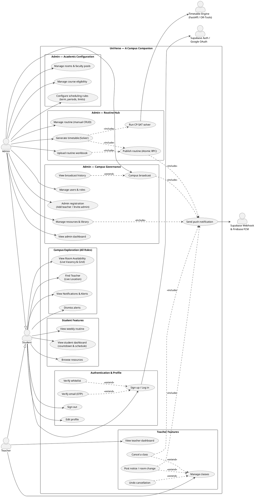

# Diagram 2 — Use Case Diagram

> **What this shows:** System actors (human users and external backend systems) and the complete inventory of use cases they execute within the UniVerse system boundary, including `<<include>>` and `<<extend>>` relationships.  
> **Source of Truth:** Reconciled against Flutter routing (`app_router.dart`), `AppDrawer`, `AdminRoutineScreen`, role guards, and live production services.  
> **Tool to render:** [PlantUML](https://www.plantuml.com/plantuml/uml) or the VS Code PlantUML extension.

---

## 1. System Actors

### Primary Actors (Human Users — Drawn on LEFT)
| Actor | Description | Architectural Scope |
|---|---|---|
| **Student** | Registered university student. | Views personalized routine, dashboard countdown, course resources, and campus explore tools. |
| **Teacher** | Department faculty member. Pre-whitelisted by admin (Migration 016). | Views teaching schedule, manages classes (cancellations, room change notices), and campus explore tools. |
| **Admin** | Department timetable and administrative officer. Pre-whitelisted. | Full control: routine hub (generation, direct upload, manual CRUD), course eligibility, user roles, broadcasts. |

### Secondary Actors (External Systems — Drawn on RIGHT)
| Actor | Role & Integration |
|---|---|
| **Supabase Auth / Google OAuth** | Issues JWTs, authenticates Google ID tokens and email credentials. |
| **Timetable Solver Engine (Render)** | Python FastAPI + Google OR-Tools CP-SAT solver generating clash-free schedules from course distribution `.xlsx`. |
| **Supabase Edge Function & Firebase FCM** | Automated event pipeline: DB Webhook on `notifications (INSERT)` $\rightarrow$ `send-push` Edge Function $\rightarrow$ FCM HTTP v1 $\rightarrow$ Mobile OS push. |

---

## 2. Complete Use Case Inventory

### Common Use Cases (Accessible to Student, Teacher, and Admin)
1. **Sign up / Log in:** Google OAuth or email + password.
2. **Verify email (OTP):** 6-digit verification code (email signup path).
3. **Verify whitelist:** Security gate verifying email pre-authorization for **both Teacher and Admin** roles (Migration 016).
4. **Edit profile:** Update display name, avatar, or role-specific metadata.
5. **View notifications & dismiss alerts:** Real-time alert feed with per-user read/dismiss state.
6. **Find Teacher:** Search faculty by acronym or name, inspect weekly routine, and identify **current real-time classroom location**.
7. **View Room Availability:** Query physical rooms for **live vacant/occupied status** and day-long timetable schedules.
8. **Sign out:** Clear session tokens and local state.

### Student Use Cases
9. **View weekly routine:** Filtered view of scheduled classes by batch and section.
10. **View student dashboard:** Live class indicator, next class countdown timer, and today's schedule summary.
11. **Browse resources:** Filter academic materials by semester; stream or download attached files and Google Drive links.

### Teacher Use Cases
12. **View teacher dashboard:** Live teaching slot countdown, today's assigned classes, and recent alerts.
13. **View teacher routine:** Weekly schedule filtered by teacher acronym.
14. **Manage classes:**
    - **Cancel a class:** Select specific date occurrence and enter cancellation reason.
    - **Post notice / room change / test reminder:** Dispatch targeted alerts to enrolled students.
    - **Undo cancellation:** Revoke a previously submitted cancellation.

### Admin Use Cases
15. **Routine Hub:**
    - **Generate timetable:** Upload distribution `.xlsx` $\rightarrow$ trigger CP-SAT engine $\rightarrow$ review interactive grid $\rightarrow$ publish active version.
    - **Upload routine workbook:** Direct ingestion of pre-rendered university `.xlsx` workbook $\rightarrow$ parse day sheets $\rightarrow$ atomic publish (bypasses solver).
    - **Manage routine (manual CRUD):** Directly insert, edit, or remove individual routine rows.
16. **Academic & Timetable Configuration:**
    - **Manage rooms & faculty pools:** Configure room capacities/types and teacher off-days.
    - **Manage course assignments & eligibility:** Map instructors to qualified courses (`ManageCourseEligibilityScreen`, Migration 013).
    - **Configure scheduling rules:** Configure working days, term length, blocked periods, online slots, and fixed weekly sessions (`TimetableSettingsScreen`, Migrations 011 & 015).
17. **Campus Administration & Governance:**
    - **Campus broadcast:** Issue broadcast announcements targeted by role, batch, or campus-wide.
    - **View broadcast history:** Inspect archive of past broadcast dispatches.
    - **Admin registration:** **Add teachers to whitelist** (assigning code, dept, designation) and **invite admins** via server-side Edge Function.
    - **Manage users:** Review user accounts and adjust system roles.
    - **Manage resources & resource library:** Upload course documents and manage the central repository.
    - **View admin dashboard:** High-level metrics for user population, active schedules, and broadcasts.

### Shared Sub-Use-Case
18. **Send push notification:** Executed automatically whenever an alert is created (cancellations, room changes, broadcasts, new resources, and routine publications). Triggered via Supabase Database Webhook to FCM.

---

## 3. Relationships (`<<include>>` and `<<extend>>`)

| Source Use Case | Relationship | Target Use Case | Justification |
|---|---|---|---|
| `Log in` | `<<extend>>` | `Verify whitelist` | Activated during **Teacher and Admin** authentication; students bypass. |
| `Log in` | `<<extend>>` | `Verify email (OTP)` | Activated exclusively during email/password authentication. |
| `Generate timetable` | `<<include>>` | `Run CP-SAT solver` | Generation strictly requires the external Python engine solve. |
| `Generate timetable` | `<<include>>` | `Publish routine` | Successful generation culminates in atomic database publication. |
| `Upload routine workbook`| `<<include>>` | `Publish routine` | Parsed workbook data is atomically published to live routines. |
| `Publish routine` | `<<include>>` | `Send push notification` | Routine activation immediately broadcasts a campus push alert. |
| `Cancel a class` | `<<include>>` | `Send push notification` | Class cancellations alert enrolled students via FCM. |
| `Post notice / room change`| `<<include>>`| `Send push notification` | Class announcements alert enrolled students via FCM. |
| `Campus broadcast` | `<<include>>` | `Send push notification` | Broadcast messages push to target audience phones. |
| `Manage resources (upload)`| `<<include>>`| `Send push notification` | File uploads notify students of that semester. |
| `Cancel class / Notice / Undo` | `<<extend>>` | `Manage classes` | Actions executed inside the Manage Classes workspace. |
| `View broadcast history` | `<<extend>>` | `Campus broadcast` | Archive screen launched from the broadcast console. |
| `View resource library` | `<<extend>>` | `Manage resources` | Repository management screen launched from upload console. |

---

## 4. Ready-to-Render PlantUML Code

