# Diagram 5 — Activity Diagram

> **What this shows:** The end-to-end operational workflows for each user role across three vertical swimlanes (**Student**, **Teacher**, and **Admin**), including decision points, parallel branches (fork/join), and loopbacks.  
> **Source of Truth:** Reconciled against Flutter navigation flows, role-based drawer destinations (`app_drawer.dart`), authentication triggers (Migration 016), and administrative workflows.  
> **Tool to render:** [draw.io / diagrams.net](https://app.diagrams.net) (UML Activity shapes) or Mermaid.

---

## 1. Swimlane Architecture

The diagram is organized into three side-by-side vertical swimlanes:

| Swimlane | Actor | Scope & Primary Workflow |
|---|---|---|
| **Left** | **Student / User** | Authentication $\rightarrow$ Dashboard $\rightarrow$ Routine viewing, Campus exploration (Find Teacher, Room Availability), Resource browsing, and Alert management. |
| **Center** | **Teacher / Faculty** | Authentication $\rightarrow$ **Whitelist verification gate** $\rightarrow$ Dashboard $\rightarrow$ Routine viewing, **Manage Classes** (cancellations, room change notices), and Campus exploration. |
| **Right** | **Admin** | Authentication $\rightarrow$ Whitelist gate $\rightarrow$ Dashboard $\rightarrow$ **Routine Hub** (Solver generation, direct upload, manual CRUD), **Academic Configuration**, Broadcasts, and Staff registration. |

---

## 2. Activity Workflow per Swimlane

### Swimlane 1: Student / User
1. **Entry Path:**
   - `● Start` $\longrightarrow$ `[Create Account / Login]` (Google OAuth or Email).
   - `◇ Verify Credentials` $\longrightarrow$ **No** $\longrightarrow$ `[Show Error]` $\longrightarrow$ Loop back to login.
   - `◇ Verify Credentials` $\longrightarrow$ **Yes** $\longrightarrow$ `[Student Dashboard]`.
   - `[Student Dashboard]` $\longrightarrow$ `◇ Select Option`.
2. **Parallel Workflows (Fork):**
   - **Dashboard Branch:** `[Live / Next Class Countdown]` $\longrightarrow$ `[View Today's Classes]` $\longrightarrow$ `[Review Recent Alerts]`.
   - **Routine Branch:** `[Load Weekly Routine]` $\longrightarrow$ `[View Routine Grid]` $\longrightarrow$ `[Inspect Cancelled Class Markers]`.
   - **Campus Exploration Branch:** `[Find Teacher: Search Instructor & Locate Active Classroom]` OR `[Room Availability: Check Live Room Vacancy & Day Schedule]`.
   - **Resources Branch:** `[Load Resources]` $\longrightarrow$ `[Browse by Semester Folder]` $\longrightarrow$ `[Open Download / Drive Link]`.
   - **Notifications Branch:** `[Load Notifications Feed]` $\longrightarrow$ `[Mark / Dismiss Alert]`.
   - **Profile Branch:** `[Load Profile]` $\longrightarrow$ `[Edit Profile Details]`.
3. **Exit Path:**
   - All branches synchronize at the horizontal **Join Bar** $\longrightarrow$ `◇ Logout?`
   - **Yes** $\longrightarrow$ `⊙ End`
   - **No** $\longrightarrow$ Loop back to `◇ Select Option`.

---

### Swimlane 2: Teacher / Faculty
1. **Entry Path:**
   - `● Start` $\longrightarrow$ `[Teacher Login]` (Google OAuth or Email).
   - `◇ Verify Credentials` $\longrightarrow$ **No** $\longrightarrow$ `[Show Error]` $\longrightarrow$ Loop back to login.
   - `◇ Verify Credentials` $\longrightarrow$ **Yes** $\longrightarrow$ `◇ Check Whitelist Gate (Migration 016)`.
   - `◇ Check Whitelist Gate` $\longrightarrow$ **Not Whitelisted** $\longrightarrow$ `[Show Not Whitelisted Screen]` $\longrightarrow$ `[Switch Account / Contact Admin]`.
   - `◇ Check Whitelist Gate` $\longrightarrow$ **Whitelisted** $\longrightarrow$ `[Teacher Dashboard]`.
   - `[Teacher Dashboard]` $\longrightarrow$ `◇ Select Option`.
2. **Parallel Workflows (Fork):**
   - **Dashboard Branch:** `[Live Teaching Slot Countdown]` $\longrightarrow$ `[View Today's Teaching Schedule]`.
   - **Routine Branch:** `[Load Teacher Routine]` $\longrightarrow$ `[View Weekly Schedule Grid]`.
   - **Manage Classes Branch (Signature Faculty Feature):**
     - `[Select Day & Class Slot]` $\longrightarrow$ `[Choose Action: Cancel Class / Post Notice / Undo]` $\longrightarrow$ `[Submit Reason & Details]` $\longrightarrow$ `[Write to Database]` $\longrightarrow$ `[Automated Push Alert Sent to Students]`.
   - **Campus Exploration Branch:** `[Find Teacher / Room Availability]`.
   - **Notifications Branch:** `[View Notifications Feed]` $\longrightarrow$ `[Dismiss Alert]`.
   - **Profile Branch:** `[Load Teacher Profile]` $\longrightarrow$ `[Edit Details]`.
3. **Exit Path:**
   - Synchronize at **Join Bar** $\longrightarrow$ `◇ Logout?` (Yes $\rightarrow$ `⊙ End`, No $\rightarrow$ Loop back).

---

### Swimlane 3: Admin
1. **Entry Path:**
   - `● Start` $\longrightarrow$ `[Admin Login]` $\longrightarrow$ `◇ Verify Credentials & Whitelist`.
   - **No** $\longrightarrow$ `[Show Access Denied]` $\longrightarrow$ Loop back.
   - **Yes** $\longrightarrow$ `[Admin Dashboard]` $\longrightarrow$ `◇ Select Option`.
2. **Parallel Workflows (Fork):**
   - **Routine Hub Branch (Triple-Modal Pipeline):**
     - *Path A (Solver):* `[Upload Course Distribution .xlsx]` $\longrightarrow$ `[Trigger CP-SAT Solver]` $\longrightarrow$ `[Review Interactive Grid & Diagnostics]` $\longrightarrow$ `[Atomic Routine Publish RPC]`.
     - *Path B (Direct Upload):* `[Upload Pre-Rendered .xlsx Workbook]` $\longrightarrow$ `[Parse Sheets Client-Side]` $\longrightarrow$ `[Atomic Routine Publish RPC]`.
     - *Path C (Manual):* `[Open Routine Editor]` $\longrightarrow$ `[Add / Edit / Delete Class Slot]`.
   - **Academic Configuration Branch:**
     - `[Manage Rooms & Faculty Directory]`
     - `[Manage Course Eligibility (Teacher-Course Matrix)]`
     - `[Configure Timetable Settings (Term Weeks, Blocked Periods, Online Slots, Fixed Sessions)]`
   - **Campus Broadcast Branch:** `[Compose Broadcast Message]` $\longrightarrow$ `[Select Target Audience]` $\longrightarrow$ `[Dispatch Notification & Push]`.
   - **Admin Registration Branch:** `[Add Teacher to Whitelist (Code, Dept, Designation)]` OR `[Invite Admin via Edge Function]`.
   - **Governance Branch:** `[Manage Users & Roles]` AND `[Manage Resource Repository]`.
   - **Campus Exploration Branch:** `[Find Teacher / Room Availability]`.
3. **Exit Path:**
   - Synchronize at **Join Bar** $\longrightarrow$ `◇ Logout?` (Yes $\rightarrow$ `⊙ End`, No $\rightarrow$ Loop back).

---

## 3. Mermaid Activity Diagram Specification

```mermaid
flowchart TD
    subgraph Student_Swimlane["Student / User"]
        S_Start([Start]) --> S_Login[Create Account / Login]
        S_Login --> S_VAuth{Credentials Valid?}
        S_VAuth -- No --> S_Err[Show Error] --> S_Login
        S_VAuth -- Yes --> S_Dash[Student Dashboard]
        S_Dash --> S_Sel{Select Feature}

        S_Sel --> S_F1[Dashboard: Countdown & Schedule]
        S_Sel --> S_F2[Routine: View Weekly Grid]
        S_Sel --> S_F3[Campus Explore: Find Teacher / Rooms]
        S_Sel --> S_F4[Resources: Browse & Download]
        S_Sel --> S_F5[Alerts: View & Dismiss]
        S_Sel --> S_F6[Profile: View & Edit]

        S_F1 --> S_Join[Join]
        S_F2 --> S_Join
        S_F3 --> S_Join
        S_F4 --> S_Join
        S_F5 --> S_Join
        S_F6 --> S_Join

        S_Join --> S_Logout{Logout?}
        S_Logout -- Yes --> S_End([End])
        S_Logout -- No --> S_Sel
    end

    subgraph Teacher_Swimlane["Teacher / Faculty"]
        T_Start([Start]) --> T_Login[Teacher Login]
        T_Login --> T_VAuth{Credentials Valid?}
        T_VAuth -- No --> T_Err[Show Error] --> T_Login
        T_VAuth -- Yes --> T_VWL{Whitelisted as Teacher?}
        T_VWL -- No --> T_Deny[Show Not Whitelisted Screen]
        T_VWL -- Yes --> T_Dash[Teacher Dashboard]
        T_Dash --> T_Sel{Select Feature}

        T_Sel --> T_F1[Dashboard: Teaching Countdown]
        T_Sel --> T_F2[Routine: View Teaching Schedule]
        T_Sel --> T_F3[Manage Classes: Cancel / Notice / Undo]
        T_Sel --> T_F4[Campus Explore: Find Teacher / Rooms]
        T_Sel --> T_F5[Alerts & Profile]

        T_F3 --> T_Alert[Push Alert Sent to Students]
        T_Alert --> T_Join[Join]
        T_F1 --> T_Join
        T_F2 --> T_Join
        T_F4 --> T_Join
        T_F5 --> T_Join

        T_Join --> T_Logout{Logout?}
        T_Logout -- Yes --> T_End([End])
        T_Logout -- No --> T_Sel
    end

    subgraph Admin_Swimlane["Admin"]
        A_Start([Start]) --> A_Login[Admin Login]
        A_Login --> A_VAuth{Admin Whitelisted?}
        A_VAuth -- No --> A_Deny[Show Access Denied]
        A_VAuth -- Yes --> A_Dash[Admin Dashboard]
        A_Dash --> A_Sel{Select Feature}

        A_Sel --> A_F1[Routine Hub: Solver / Upload / CRUD]
        A_Sel --> A_F2[Academic Config: Rooms / Faculty / Eligibility / Settings]
        A_Sel --> A_F3[Campus Broadcast: Compose & Push]
        A_Sel --> A_F4[Admin Registration: Add Teacher / Invite Admin]
        A_Sel --> A_F5[User & Resource Governance]

        A_F1 --> A_Pub[Atomic Routine Publish RPC]
        A_Pub --> A_Join[Join]
        A_F2 --> A_Join
        A_F3 --> A_Join
        A_F4 --> A_Join
        A_F5 --> A_Join

        A_Join --> A_Logout{Logout?}
        A_Logout -- Yes --> A_End([End])
        A_Logout -- No --> A_Sel
    end
```

