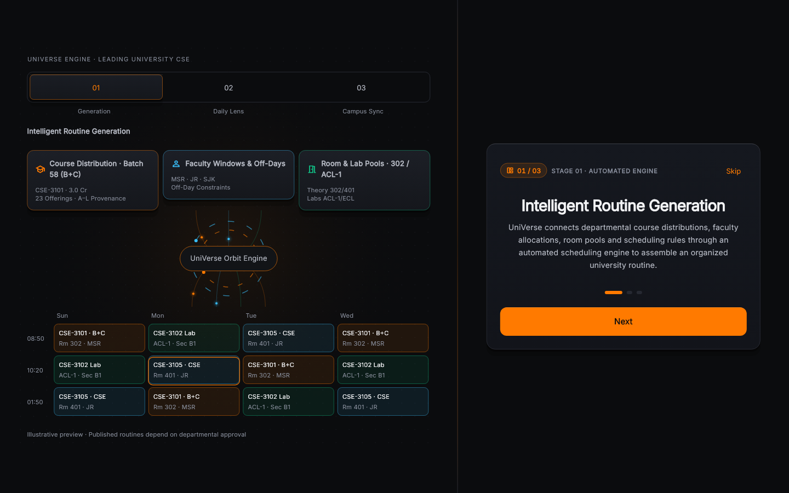
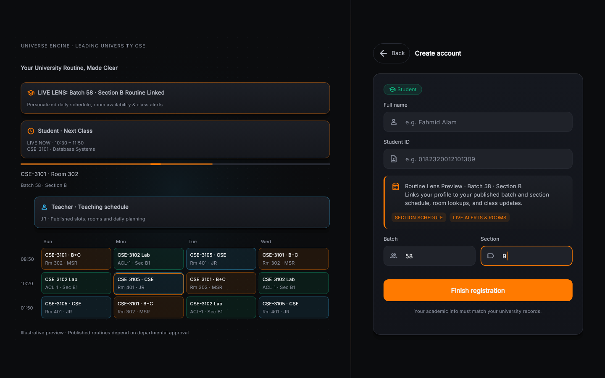
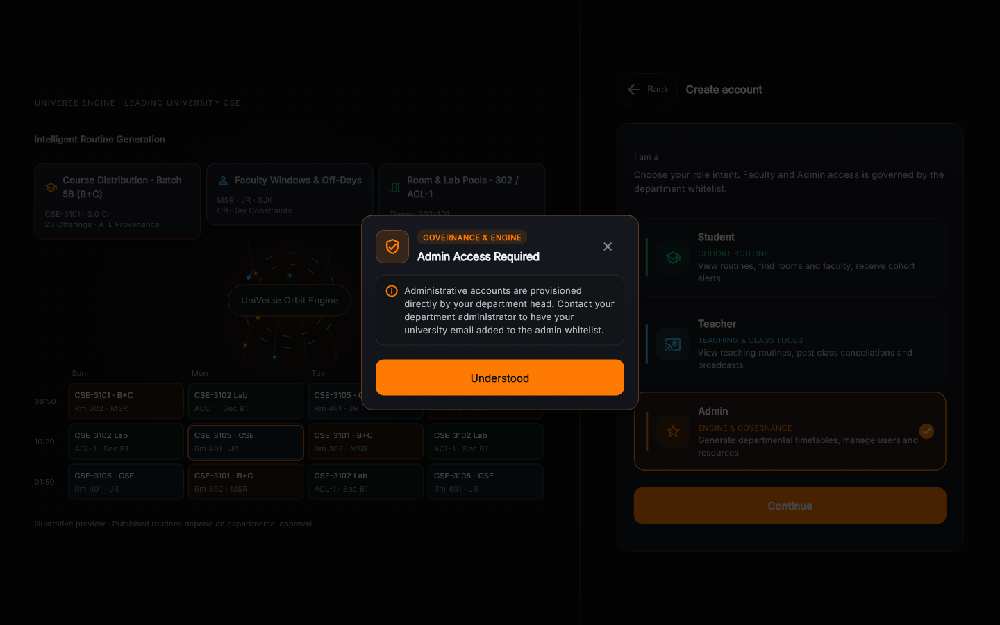

# Phase 3.5 visual inspection gallery

75 PNG files regenerated on 8 November 2026 from the real Flutter screen widgets using synthetic local auth and reduced motion. These files replace the earlier Phase 3 images. They are widget renders, not live authentication or published schedule evidence. All text is illustrative. The test loads Inter Regular and Material icons and normalizes button font inheritance for capture.

## Desktop - 1440 - 900

| View | Render |
|---|---|
| Generation instrument and full-bleed split | [Stage 01](01_onboarding_stage1_desktop_1440.png) |
| Daily class and teaching lenses | [Stage 02](01_onboarding_stage2_desktop_1440.png) |
| Connected campus | [Stage 03](01_onboarding_stage3_desktop_1440.png) |
| Student input: batch 58, section B | [Reactive student lens](06_student_register_lens_preview_desktop_1440.png) |
| Faculty input: JR | [Reactive faculty lens](07_faculty_register_lens_preview_desktop_1440.png) |
| Internal Back control and verification radar | [Verify email](08_verify_email_desktop_1440.png) |
| Role intent and category labels | [Role selection](05_role_selection_desktop_1440.png) |
| Role access governance modal dialog | [Admin access modal](05_role_selection_modal_desktop_1440.png) |
| Account recovery | [Auth error](12_auth_error_desktop_1440.png) |
| Real splash with test-held initialization | [Splash](00_splash_desktop_1440.png) |

## Responsive inspection

| Width | Generation | Registration | Access Governance Modal | Verification |
|---|---|---|---|---|
| 900 - 800, stacked | [Onboarding](01_onboarding_stage1_medium_900.png) | [Student](06_student_register_lens_preview_medium_900.png) | [Modal Dialog](05_role_selection_modal_medium_900.png) | [Verify](08_verify_email_medium_900.png) |
| 920 - 800, compact split | [Onboarding](01_onboarding_stage1_medium_920.png) | [Student](06_student_register_lens_preview_medium_920.png) | [Modal Dialog](05_role_selection_modal_medium_920.png) | [Verify](08_verify_email_medium_920.png) |
| 390 - 844, mobile | [Onboarding](01_onboarding_stage1_mobile_390.png) | [Student](06_student_register_lens_preview_mobile_390.png) | [Modal Sheet](05_role_selection_modal_mobile_390.png) | [Verify](08_verify_email_mobile_390.png) |

Tall forms are scrollable; each PNG records one viewport rather than stitching hidden content. The `desktop_1440`, `medium_900`, `medium_920` and `mobile_390` filename suffixes cover every auth view. Historical aliases are refreshed by the capture script.

## QA observations and limits

Inspected rendered generation, campus, registration and verification screens. The split begins at the top edge; source metadata and semantic matrix accents are visible; the interaction pane owns the large heading, and its Back control no longer cuts across the showcase. No downward-arrow pipeline remains. Font-block artifacts found during capture setup were corrected before final regeneration.

The capture test rejects layout exceptions. The regression suites separately verify 1.3x verification text scale, keyboard-inset scrolling, reactive desktop lens values and zero reduced-motion transient callbacks. A dedicated test checks that runtime motion is active after three seconds and stops when reduced motion is enabled. Browser keyboard traversal, screen-reader checks, physical devices and GPU profiling were not newly verified.

Reproduce with `powershell -NoProfile -ExecutionPolicy Bypass -File tool/capture_phase35_screenshots.ps1` from the repository. This is the supported Phase 3.5 equivalent capture path; the older browser script remains historical.
