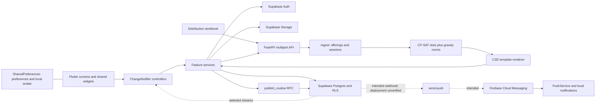

# Current architecture and readiness

Evidence labels: **verified** means local source or local execution; **repository-defined** means SQL/config exists but deployment is unverified; **proposed** means future design. References below are relative to repository root and identify the relevant symbol when useful.

## Architecture verified in source

### Frontend and responsibilities

| Area | Observed implementation | Consequence |
|---|---|---|
| Framework/dependencies | Flutter; `pubspec.yaml`, committed `pubspec.lock`; Dart constraint `>=3.0.0 <4.0.0`; actual code includes newer language features | Declared SDK floor is not a tested minimum; use a tested toolchain |
| State | ChangeNotifier/ListenableBuilder; some feature controllers extend SafeChangeNotifier; no Riverpod/Bloc/Provider | Extend existing controllers and service injection; no state-management rewrite |
| Routing | `lib/core/router/app_router.dart`, GoRouter ShellRoute, role redirects, shared AppShell | Preserve deep links and student/teacher/admin tab sets |
| Auth | `auth_service.dart::signInWithGoogle`: native Google ID-token exchange off-web, browser OAuth on web; email signup/verification/recovery | Supabase is the identity authority; Firebase Auth is absent |
| Startup | `main.dart`: Firebase/push before Supabase on non-web; `AuthController.initialize` fetches profile remotely | Firebase platform failures can prevent startup; offline profile-fetch failure becomes unauthenticated |
| Academic identity | `profile_model.dart`, `routine_model.dart`: batch/section and teacher code are text; semester integer; department list and semesters 1–8 in constants | Labels are not safe global identities |
| Generation | `timetable_gen_controller.dart`: load DB config, upload, poll every 2 s, request 180 s solver budget, show validation/grid/download | Useful workflow; polling bound does not bound individual HTTP requests |
| Upload | `routine_workbook_parser.dart`: ZIP/XML parsing of day sheets or tabular routines; `routine_upload_controller.dart` publishes | Separate producer with weaker validation |
| Manual changes | `routine_admin_controller.dart::save/delete` calls `RoutineService.create/update/delete` directly | Active rows can change outside version publication and validation |
| Views | Student filters exact batch+section; teacher filters one `teacher_code`; room and teacher services read active routines | Combined groups and co-teachers are not represented correctly |
| Availability | Rooms/Find Teacher calculate from device time and routine rows; subscribe then re-fetch; no retained subscription cancellation or clock-boundary ticker in these controllers | Stale status, lifecycle risk, no cancellations/term dates/full inventory |
| Persistence | SharedPreferences for onboarding, dismissed notifications and avatar selection; temporary downloaded workbooks; Hive dependency has no initialized application store | No durable published-timetable/room/teacher cache or sync engine |
| Errors/loading | Per-controller loading/error fields, reusable loading/empty widgets and sign-out overlay; several catches use generic errors or suppress failures | Preserve usable UI patterns; distinguish stale cache from empty/error and publish success from notification failure |
| Adjacent features | Resources use Storage/Drive URLs and semester categories; teacher cancellations write dated rows and a separate notification; profile and user administration use Supabase | Calendar/identity migration affects more than the engine |

The service-layer convention is strong but not absolute: `not_whitelisted_screen.dart` reads `Supabase.instance.client.auth.currentUser` directly. SharedPreferences is also accessed in UI. Claims of strictly enforced layering are inaccurate.

### Timetable pipeline and constraints

`engine/ingest.py` binds headers by text on fixed row 5 of `Course Distribution`, groups by literal `(cohort, code)`, sums class totals, and holds all co-teachers free. It derives occurrences with `ceil(total/weeks)` unless a fixed rate overrides it. Blank teachers are excluded; unknown teachers are not rejected.

`engine/solver.py` uses CP-SAT Boolean `(session, day, period)` choices. It enforces one placement, exact-label teacher/cohort collisions, room-pool counts, day-offs, blocked periods, same-day restrictions and inferred theory/lab adjacency. Greedy assignment selects concrete lab/theory rooms. `_validate` reconciles surviving offerings and slot-index conflicts. Eligibility is a post-solve validation check, not teacher selection; stored priorities do not drive assignment.

`_normalize_config` discards room capacity, equipment and ownership; faculty department is not a scheduling constraint. `service_scope` and the `spread` weight have no corresponding effective rule in the inspected solver. CSE conventions remain: even final course digit implies lab, sibling code implies pairing, nonnumeric batch or GED/WD/WE section implies service. Study semester falls back to batch arithmetic clamped to 1–8.

`engine/render.py` uses fixed period columns, a break column and day-sheet template. Capacity is checked dynamically against template furniture; it is **not simply a fixed 55-row renderer**. Macro-era formatting is removed from generated copies. Source layout metadata still leaks into solver configuration.

`engine/main.py` has no authentication dependencies or job ownership checks. It reads the whole upload, accepts `.xls` despite openpyxl's OOXML input, launches an unbounded daemon thread per request, and keeps jobs/results in `JOBS`. No durable queue, expiry, idempotency, upload/decompression limit, tenant binding, or bounded input time limit is defined. Wildcard CORS is not authorization.

## Supabase: repository-defined, not live-verified

There are **15 migration files: 001–009 and 011–016; no 010**. No `supabase/config.toml` or complete baseline DDL was found. Early migrations reference existing tables; 006 assumes cancellations before 007 defines it. Base definitions for profiles, routines, resources, notifications and core timetable configuration are missing. Seeds contain data, not a complete reproducible schema.

| Objects | Verified definition or use |
|---|---|
| profiles, whitelists | Used by auth/admin; 006 role helpers and policies; 016 gates new teacher/admin role assignments via whitelist and adds department/designation |
| routines | Text teacher fields added by 003; 012 adds version FK, `is_service`, version/batch-section-day/teacher-day indexes |
| routine_versions | 012 UUID PK, publisher FK, source check, metadata and a partial unique index allowing **at most one globally active version** |
| publish_routine | 012, replaced by 014; invoker RPC checks admin and nonempty JSON array, deletes all routines, inserts replacements and activates version in one transaction |
| cancellations | 007 UUID PK, routine/date uniqueness, date index, auth-user FK; 012 changes routine FK to SET NULL |
| timetable settings | Service fetch/upsert id=1; 011 adds working days, weeks 1–52, blocked/online/excluded periods, semester map; 015 adds fixed weekly count 1–7 and backfills 2 |
| timetable_course_eligibility | 013 unique acronym+course code; positive priority check; no faculty/course FK |
| notification_reads | 001 user+notification composite PK/FKs and own-row policies |
| device_tokens | 004 token PK, user FK/index and owner policies; 005 authenticated security-definer token reassignment RPC |
| generated_timetable | Dropped by 009; no current engine writes to it |
| assignments/submissions/documents | Legacy references and policies remain; no implemented assignment or AI feature established |

Publication is atomic within its RPC but **not validated server-side**: `p_validation` is merely saved, not recomputed or required true. Admin table-write policies still allow direct mutation. A global partial unique index is neither a stale-write check nor scoped publication. There is no expected-version parameter, replay key, explicit resource lock or concurrent publication test. Version records retain metadata, not a full row history; deletion means rollback cannot reconstruct an old schedule from those records alone.

Separate upload, publication, run-history insert and notification insert are not one transaction. `recordRun` can fail after publication succeeded; notifications are best-effort. Eligibility replacement also deletes then inserts across separate requests, despite its “single round trip” comment.

### Authorization findings

- 006/008 scope most reads to authenticated users but use broad row visibility for profiles, routines, notifications and config. Notification audience filtering occurs in Dart after fetching all rows.
- Whitelists are own-email/admin; device tokens and read receipts are owner-scoped. A blanket “read_all + admin_write on every table” description is false.
- Cancellation inserts check acting user and staff role, not assignment to the target class. Department scope is absent.
- 016 protects role transitions; unchanged-role edits bypass its whitelist check. It does not bind teacher code, department, or student cohort to verified assignments.
- 013 eligibility read policy has no `TO authenticated`; actual anonymous exposure also depends on deployed grants.
- 006 Storage policies allow all authenticated users insert/update/delete without bucket/path/owner predicates. Public-read policy exists; actual bucket public flags were not verified.
- `my_role`, `is_admin`, and `register_device_token` have explicit execute revokes/grants. Future scoped functions must preserve least privilege and a safe search path.

These are source-level access-control findings, not demonstrations against the live project.

## Firebase and deployment

Only `firebase_core` and `firebase_messaging` are integrated. `push_service.dart` handles permission requests, foreground/background notification display, notification taps, token registration and cleanup. `firebase_options.dart` is Android-focused; other platform directories do not prove supported builds. No Firestore, Firebase Auth, Analytics or Crashlytics data path was found.

Supabase owns profiles, roles, schedules and notification records; Firebase delivers device messages. There is no need to move timetable storage into Firestore for offline use.

**Both `supabase/functions/invite-admin/index.ts` and `send-push/index.ts` are entirely commented out.** They describe intended behavior, not deployable source. A live function may exist independently, but this checkout cannot reproduce it. Webhook credentials, source, FCM secrets, audience behavior and delivery must be reconciled read-only before changing this integration.

`render.yaml` describes a free Python web service with two solver workers, a health path, and Python 3.12.7. `Procfile` and runtime files exist. Deployment activation/branch linkage is external configuration, not proven by the YAML. Python dependencies use open lower bounds, without a reproducible lock. The only checked-in GitHub workflow is keep-alive, not test/build CI.

Android: Gradle wrapper 8.14, AGP 8.11.1, Kotlin 2.2.20; release uses debug signing and a development package id. Dart defines exist for Supabase, engine and Google client configuration. Never copy their values or privileged credentials into reports.

## Prioritized defect register

| ID / priority | Evidence | Impact and required direction |
|---|---|---|
| A01 Critical | `014_publish_routine_safeupdate.sql` global delete; `012` global active index | Department B erases A; scoped immutable publication before expansion |
| A02 Critical | Upload controller/screen allows invalid report; manual RoutineService writes; RPC trusts payload | Invalid schedules can become official; one backend validation boundary for all producers |
| A03 High | Combined-section probe; literal cohort keys and exact student query | B+C can collide with B and is invisible to B; explicit group memberships |
| A04 High | Overlapping-period probe; solver/validator use period ids | Same resource overlaps in clock time and passes; interval validation |
| A05 High | Missing/unknown teacher and fixed-rate probes | Exclusions and policy overrides redefine “complete”; approved preflight manifest |
| A06 High | Capacity probe; `_normalize_config`, `_assign_rooms` | Room feasibility not established; capacity/eligibility integrated into placement |
| A07 High | main.py public API/unbounded JOBS | Unauthorized use and resource exhaustion; authenticated bounded durable jobs |
| A08 High | 006 Storage/cancellation policies; 016 role-only trigger | Object ownership and scoped authorization incomplete; scoped RPCs/RLS and negative tests |
| A09 High | Missing baseline; commented Edge Functions | Deployment cannot be reproduced; recover definitions and test an isolated clone |
| A10 High | RoutineEntry/RPC store one teacher; no dated calendars | Co-teacher availability and cross-term conflicts lost; stable resources and teaching dates |
| A11 High | No expected revision/history rows; direct CRUD | Lost changes and incomplete recovery; immutable revisions and optimistic concurrency |
| A12 Medium | Auth initialize + no Hive usage | Cold-start offline fails; read-only identity-bound snapshot access |
| A13 Medium | Rooms/Find Teacher controllers | Ignores cancellations/clock changes; central dated availability projection |
| A14 Medium | Template period columns; 1–8 constants | New calendars/departments constrained by presentation; generic renderer/configured stages |
| A15 Medium | Eligibility delete/insert; post-publish bookkeeping | Partial state and misleading retry behavior; transactional replacements and outbox |

The six probes are in the pre-existing `tool/audit_scheduler_probes.py` and were read before execution. They use synthetic data only. They demonstrate current gaps, not passing acceptance criteria.

## Clarification audit delta (22 October 2026)

The available re-provided `workbook/` originals match the historical source
hashes. They do contain department room-allocation notes, even though the current
config/solver pipeline does not consume those notes as eligibility constraints.
Keep working CSE room inventory, lab/theory pools, first-fit assignment and TBA
reporting; extend only the verified missing rule. Course Assignments is actually
an eligibility/priority screen, not a substitute teacher selector. Imported
Teacher cells remain authoritative for that distribution; direct Routine
Management teacher/section edits are a provenance gap.

B+C is source-backed joint attendance, not a routine-editor-created entity.
The old literal section query still cannot deliver it to both atomic audiences.
Study-stage arithmetic in solver/parser remains unverified compatibility logic;
the historical workbook has no semester column. User-confirmed current
trimester/bi-semester applicability is changeable and not derivable from old
batch labels. Formal calendar modeling is deferred.

Timings change in summer/winter. Existing settings edit period boundaries and
render.py rewrites headers; current fallbacks/constants are not universal rules.
Each source/generated/published revision needs its applicable verified timing
configuration. A read-only Dart probe reproduced a noon/spacing parser defect;
the 125 stored end-before-start observations must not be called invalid source
classes. See the detailed workbook audit for counts, boundary trace and limits.
