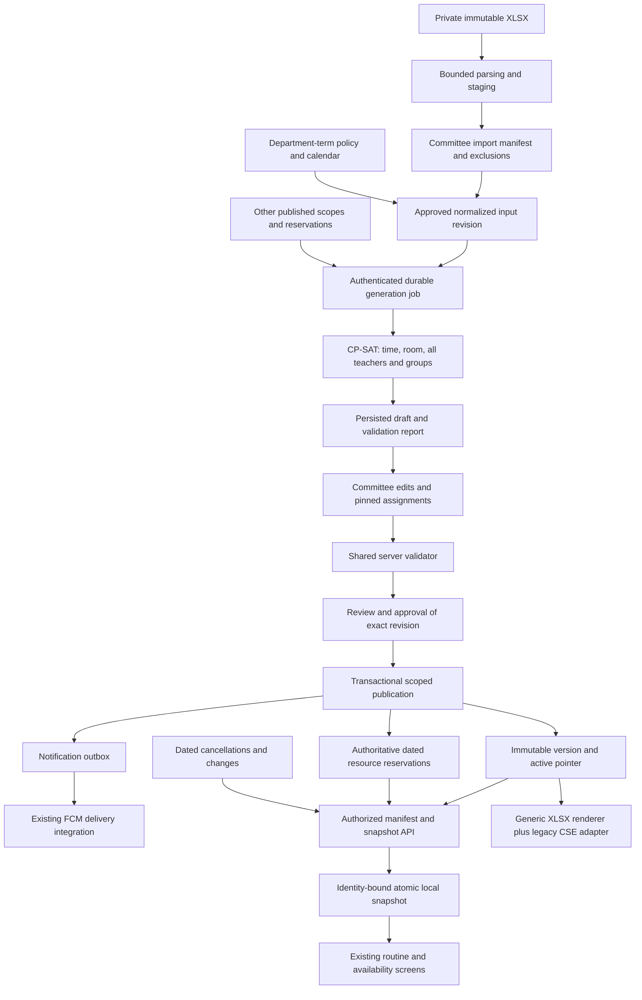

# Target architecture proposal

This is a reviewable design, not an implemented feature description. Proposed numeric limits and service targets need confirmation against campus scale.

## Current scope correction (22 October 2026)

Formal academic terms/calendars and automatic academic progression are deferred.
The calendar/dated-reservation design below remains a future target, not a
prerequisite for the next import/clock correctness unit. Existing local Task 2
carrier types require term IDs: do not invent a real term to satisfy them or
silently change their contract during this documentation-only review. Plan a
compatible source-revision boundary before wiring them into current generation.

Timing is separately dynamic: summer/winter clock grids must come from verified
applicable configuration and be frozen with each revision. Preserve the existing
Timetable Settings editor and renderer; no universal period time, duration,
campus-hour heuristic or month-to-season rule is approved. A later settings
change must not reinterpret an earlier published routine.

Teachers come from the authoritative distribution; the current Course
Assignments screen is an eligibility check, not a reassignment control. Rare
B+C attendance must come from verified source cells and remain one class with
both atomic groups; routine controls must not create combinations. Reuse the
working CSE room inventory/pools and add only the missing verified allocation
constraints. See [inspected evidence and pipeline trace](02-workbook-and-rules.md#verified-clarification-corrections---22-october-2026).

## Keep the existing stack

Keep Flutter screens/controllers/services, GoRouter, ChangeNotifier/SafeChangeNotifier, design tokens, Supabase Auth, PostgreSQL/RLS, Storage, the Python FastAPI service, OR-Tools CP-SAT, and Firebase messaging. Preserve email and native Google onboarding, current user IDs, role names, notification receipts, resource files and existing CSE routine labels.

Selectively introduce a typed domain contract, scoped publication, immutable versions and a local schedule repository. These address demonstrated coupling and correctness gaps without replacing unrelated screens.

## Domain and input contract

Use stable IDs for department, program, calendar, term, cohort, atomic student group, course, faculty and room. Separate:

- Course-owning department, receiving student program, and teacher home department.
- Academic term dates from a cohort's study stage (currently `semester`).
- Co-teaching at the same time from split teaching in different weeks.
- A combined class's display label from the individual groups attending it.
- A resource's availability policy from its actual bookings.

`NormalizedInput` is a versioned JSON contract shared with the engine, defined in proposed `engine/domain.py`. Fields: `schema_version`, `input_revision_id`, `scope_id`, `term_id`, `policy_revision_id`, `resource_revision`, `timezone`, `teaching_dates`, `offerings`, `faculty`, `rooms`, `external_reservations`, `approved_exclusions`.

Each offering has a stable ID, course ID/code/title, group IDs, zero or more teacher assignments with effective dates/weeks and an explicit pending state when none is assigned, approved meeting count/contact-minute requirement, duration, delivery mode, eligible-room criteria, and source references. Decimal credits remain metadata for an explicit academic conversion rule. A meeting requirement is never inferred from code parity after normalization.

A staging input with an unresolved nonblank faculty identity, unresolved exclusion, ambiguous duplicate, unknown mandatory capacity, or unapproved duration/count conflict cannot become an approved input revision. Legacy rules remain a named CSE import profile and a reviewed policy version.

The initial release schedules fixed-duration same-day meetings. Overnight meetings fail clearly until explicitly supported. Nonuniform term weeks/holidays are represented as dates or week patterns, so recurring placement expands to actual occurrences and delivery totals.

## Scheduling approach decision

| Approach | Fit, quality and explanation | Cost / operational implications | Decision |
|---|---|---|---|
| Generalize current CP-SAT + first-fit rooms | Lowest initial change; exact slot conflicts work with homogeneous disjoint room pools | Cannot certify capacity/equipment/calendar-specific constraints as written | Retain as legacy adapter only |
| CP-SAT with eligible room choices and interval constraints, plus committee edits | Hard feasibility and soft objective separation; existing Python/OR-Tools competence/tests reusable | More variables; requires bounded jobs and measured performance | **Recommended incremental target** |
| Greedy/local search or genetic/metaheuristic replacement | Potential fast feasible candidates and preferences exploration | Must separately prove hard validity; adds algorithm maintenance/tuning without removing domain work | Defer; consider only if benchmark shows CP-SAT cannot meet budget |

CP-SAT distinguishes OPTIMAL, FEASIBLE, INFEASIBLE, MODEL_INVALID and UNKNOWN. Only the first two supply accepted candidates; UNKNOWN means no solution established within limits, not proven infeasibility. Keep objective score/bound and time budget in the report. [OR-Tools solver status documentation](https://developers.google.com/optimization/cp/cp_solver)

Start with discrete valid start candidates and eligible room variables; reserve actual minute/date intervals for every participating teacher and atomic group. Use no-overlap/optional intervals when mixed grids and durations require them. Candidate reduction can control size; it must not discard an otherwise required offering. The job-shop interval model provides relevant primitives, not a ready university domain model. [OR-Tools scheduling example](https://developers.google.com/optimization/scheduling/job_shop)

### Hard constraints

Mandatory: valid scoped relationships, active resources, approved requirements/durations, dates within term, no overlap for any shared teacher/group/room, teacher availability, room eligibility/capacity when mandatory, valid modes, approved hard breaks/adjacency, and pinned assignments. Unknown required inputs block generation. A cancellation frees a specific dated occurrence; it does not redefine the weekly requirement silently.

Soft preferences: preferred hours, workload balance, gaps, compact days, late-slot avoidance and optional adjacency. Use named bounded weights and report preference violations separately. Do not present minimized teaching days as proof of gap minimization: the current compactness objective counts used days.

The independent validator rechecks generated or edited results from approved input, not from solver “success” status. It uses interval arithmetic and all group/teacher links. Completeness includes approved exclusions and contact time, not only retained parser offerings.

### Cross-department coordination

A publication scope is one department/program's term schedule; shared resource IDs are university-wide. Every job freezes existing published reservations from overlapping date ranges. Non-overlapping terms can reuse rooms/times.

At publication, re-read current reservations and the resource revision under a university resource lock. If another department published since generation, revalidate and either publish safely or return a conflict requiring regeneration/review. Lock publication initially at university level to simplify correctness; generation remains concurrent. Reduce lock granularity only after measurement.

For tightly coupled shared courses, generate a coordinated multi-scope draft or hold common sessions fixed. Never independently “solve each department” and merge conflicts afterward.

## Human workflow and regeneration

State machine: `imported → needs_resolution → input_approved → draft → in_review → approved → published`; any draft edit creates a new revision and invalidates approval. Rejected work returns to draft with recorded reasons. “Superseded” describes a previously published immutable version.

Capabilities: `import`, `edit_draft`, `review`, `approve`, `publish`, `manage_policy`, scoped through membership rows. Keep global admin for platform administration and emergency recovery, with audit logging. Whether approval requires a different person from the author is an institutional decision; make this a controlled policy, never an ad hoc client bypass.

Manual edits go through the same server validator. Immediate client feedback is advisory; server validation gates approval and publication. A committee override may change a soft preference, teacher assignment or approved policy/input, with reason and actor. It cannot waive double-booking, authorization, referential integrity or mandatory delivery. Input changes create new requirement revisions.

Regeneration creates a child draft, retains lineage and pinned manual assignments, and never mutates approved/published versions. If pinned assignments make a solve impossible, show the conflicting pins; require explicit unpinning. Approved work must be cloned to revise.

Store structured diagnostics: offering/group/resource IDs, source locations, rule ID, severity, candidate-domain size and conflicting reservations. Start with deterministic preflight explanations; add CP-SAT assumption-core diagnostics only where supported and tested. Do not claim a minimal unsatisfiable core from the current heuristic error text.

## Job execution and import security

Retain FastAPI polling endpoints as a compatibility facade. Verify Supabase user tokens server-side, then authorize membership from current DB state. Bind each job/result/download to its scope and actor. Use the project's actual signing configuration; do not decode a JWT without verifying it. [Supabase JWT guidance](https://supabase.com/docs/guides/auth/jwts)

Persist job state and frozen input before work starts. A bounded worker in the existing Python deployment leases queued jobs, heartbeats, and records results to private Storage. Initial limits: one running job per scope, two per instance, 180-second solve budget and 240-second whole-job deadline; queued admission and byte limits enforced before parsing. Expired lease becomes retryable/failed with attempt count, not silently lost. Generate idempotency key: actor+scope+input hash+policy revision+request key.

No Redis, Kafka, Kubernetes or new solver service is initially required. A single bounded worker plus Postgres job rows is sufficient to test first. If hosting cannot support measured CPU/memory/uptime, resize that service; do not promise free-tier service levels.

## Offline access and availability

Availability means **scheduled availability**, not physical presence. Online status combines active publications, actual teaching dates, dated cancellations/relocations, resource closures and current campus time. A teacher may be away despite having no booked class.

Add a shared `ScheduleRepository` consumed by routine/dashboard/room/teacher controllers. Keep existing services as remote adapters. Cache published schedule snapshots and the minimal authorized directory projection, not whitelist data, tokens, imports or committee drafts.

Candidate stores:

| Store | Benefit | Cost | Recommendation |
|---|---|---|---|
| Existing Hive dependency, immutable serialized snapshots | No new database dependency; suits read-only term snapshots | Must implement crash-safe activation, bounds and indexing | Initial choice, benchmark and verify maintenance/platform compatibility at implementation |
| SQLite through a maintained Flutter adapter | Transactions and indexed queries useful at larger scale | New dependency/migrations/platform testing | Switch behind repository interface only if scale/atomicity tests justify it |
| Firestore or external sync product | Managed offline features | New authority/dual writes/auth coordination and operational cost | Not justified for this task |

Flutter's offline-first guidance places local and remote sources behind a repository and treats synchronization as explicit application behavior. [Flutter offline-first support](https://docs.flutter.dev/app-architecture/design-patterns/offline-first)

### Snapshot protocol

1. After online authorization, fetch a server manifest containing `schema_version`, authorized scope IDs, permission epoch, publication IDs, per-scope content hashes/counts, and a consistent exception cursor.
2. Download only changed scope snapshots in pages pinned to immutable version IDs. A consistent server snapshot also covers faculty/room metadata revisions. Never page an unversioned mutable routines table while publishing.
3. Stage the complete snapshot in a new local record/file, validate checksum/count/schema, flush, then activate through a recoverable manifest pointer. On crash, retain the previous complete snapshot. Keep old data until activation succeeds.
4. Sync dated exceptions and reference changes using a monotonically increasing sequence plus explicit deletion tombstones. If the cursor falls outside retention, request a fresh snapshot.
5. Treat Realtime and FCM as invalidation hints. On resume/reconnect, verify the manifest regardless of whether an event was received. Realtime is not a durable offline replay log. Postgres Changes has authorization, deletion and scaling considerations that must be tested. [Supabase Postgres Changes](https://supabase.com/docs/guides/realtime/postgres-changes)
6. Serialize sync; discard results from an older account/scope generation. Retry idempotent reads with capped exponential backoff/jitter; keep visible cached data on transport failure.

### Authentication and protection

Use a distinct **offline read-only** state. A locally cached admin profile does not grant online administrative capabilities. Initial proposal: a previously authenticated account may view its authorized, minimized snapshot for seven days after successful authorization; expose age and last sync. First login requires connectivity. Explicit logout/account switch purges that account's cache and key. Server revocation is enforced on reconnect; immediate revocation while disconnected is impossible, so grace duration requires institutional approval.

Distinguish transport failure from server 401/403, deleted user, changed membership or corrupt cache. Do not restore cached access for an explicit denial. Protect cache with per-account encryption keys held in platform secure storage; key loss triggers a fresh download. Exclude cache from backup where supported. A secure-storage dependency would be justified for keys; SharedPreferences is not the place for them.

Initial scope excludes offline administrative edits, approval, publishing and cancellation writes. If later requested, queue draft proposals with base revision and actor; reconnect requires fresh authorization and explicit conflict resolution. No last-write-wins for schedules.

### Freshness contract (proposed acceptance targets)

- Connected foreground clients: publication/exception updates visible within **5 seconds p95** on the staging load/network fixture; fallback manifest poll every **30 seconds**. Loss of subscription must not leave data falsely labeled current.
- If no successful server check for **60 seconds**, display an unverified/stale indicator; always expose last successful sync and publication identity.
- Offline: display “Saved schedule — last synchronized …”; recompute time-based status from saved data within **1 second** of a class boundary and on resume, using Asia/Dhaka rather than device timezone.
- No promise of new updates while disconnected, or guaranteed background refresh. FCM platform/background behavior has restrictions. [Firebase Flutter message reception](https://firebase.google.com/docs/cloud-messaging/flutter/receive-messages)
- All known rooms/faculty may appear through an authorized minimal directory even when they have no classes; “no scheduled class” is distinct from “data unavailable.”

## Operational uncertainty

The Supabase changelog was checked; the Markdown endpoint failed in the browser and the HTML index was used. The announced TLS cipher change warrants testing the oldest supported Android device, not changing the architecture. [Supabase changelog](https://supabase.com/changelog)

Live schema, hosting memory, department sizes, current calendars, academic duration rules, cache policy and deployable notification source remain open. These affect rollout gates; they do not justify inventing production guarantees.

### Cohort lifecycle and pending teachers

Proposed cohort identities are scoped to programs; configurable atomic sections belong to each cohort, with no fixed counts or global section labels. Explicit cohort-term records capture progression under the relevant department/program calendar; admission and graduation rules are configurable, and graduated cohorts can be archived without deleting historical references. Calendar and policy revisions used by a publication remain bound to its immutable snapshot.

A valid offering may initially have no teacher. Preserve it and its requirements with a pending assignment state; do not create a fictitious faculty member or teacher reservation. Assigned teachers still require identity, availability and conflict checks. Whether a pending offering may be generated or published is an unresolved academic policy decision; until approved, publication must not claim teacher conflict validation is complete. Later assignment creates a new draft/input revision, revalidates affected resources and publishes a new version when applicable. This extension is secondary to the core generation design.
