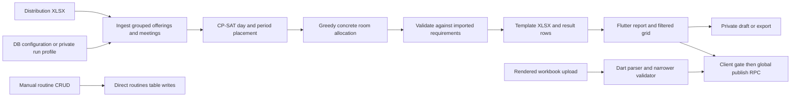

# Admin web extension and CSE routine generation: pre-implementation audit

Date: 4 November 2026, Asia/Dhaka. Scope: source inspection, local verification, documentation maintenance and a proposed roadmap only. No implementation, deployment, database operation, commit or push is authorized by this report.

Read with the [16-requirement matrix](16-committee-traceability-2026-11-04.md) and [documentation/PDF inventory](17-documentation-inventory-2026-11-04.md). This is the current priority assessment; earlier reports retain their dated evidence, not authority to resume their implementation instructions.

**Later November 4 policy synchronization:** [decision record 18](18-committee-decisions-and-policy-baseline-2026-11-04.md) is authoritative for D1-D6 and the new editable Course Distribution requirement CD1. [Workflow 19](19-specialist-coordination-workflow-2026-11-04.md) defines specialist ownership. Initial source findings and original verification below remain dated history; policy proposals/clarification entries are updated explicitly, not retroactively claimed implemented.

## Executive assessment

**Establish the browser-based admin experience first, extending the existing Flutter application. Keep Supabase, the feature-first architecture and the CP-SAT engine.** The repository supports incremental development; a separate frontend or solver rewrite has no demonstrated necessity. Browser compatibility and desktop usability require deliberate work before calling the existing app a functioning web admin.

The current system is a useful schedule-drafting prototype with real import, generation, preview, export and publication paths. It does not implement the committee's full policy. None of the 16 requirements is fully supported end to end at its stated scope; several have reusable foundations. In particular, room CRUD and six/seven period editing exist, but semester-scoped allocation, per-day grids and browser verification do not. The matrix explains the conservative support ratings individually.

The main scheduling changes are specific: per-resource availability, independent section patterns and batch fairness, faculty attendance distinct from teaching, explicit employment/travel categories, accepted distribution corrections, approved credit/meeting patterns and room-aware placement. CP-SAT can express these rules; feasibility and hosting performance must be measured on approved configurations. A feasible solution under today's constraints is not proof of compliance with tomorrow's constraints.

Keep the long-term multi-department direction. Add scope/revision boundaries to new configuration rather than repeating the global singleton settings model. Do not make formal calendar rollout, automatic academic progression, offline caching or another actor's web UX a prerequisite for the first admin browser milestone. Existing canonical models require term IDs; do not invent institutional terms to wire them in prematurely.

Before general publication, address the backend validation boundary: migration 014 checks admin authority and nonempty rows, but stores the caller's validation report without recomputing academic validity. Manual CRUD bypasses the generation gate. A browser UI alone cannot close these paths.

## Method, baseline and boundaries

Git was inspected before project analysis: branch `main`, HEAD `4d17ecf`. Initial tracked modifications: `CLAUDE.md`, `README.md`, and `lib/features/admin/controllers/timetable_gen_controller.dart`. The controller's existing change handles HTTP 429 polling backoff. Untracked items already included three root audit/structure documents, the Fall report numbered 14, `.github/workflows/validate.yml`, local Supabase config/catalog migration/reconciliation/tests, two Fall scripts and `workbook/`. These are pre-existing user work, not artifacts of this audit.

Inspection covered `lib/` feature boundaries and the active admin/auth/routine paths; engine ingestion, model, placement, validation and renderer; SQL migrations and reconciliation contracts; function entrypoints; tests and deployment declarations; source-owned Markdown; and all 16 repository PDFs via text extraction. No workbook contact records or credentials are reproduced. The Fall profile was inspected for contract/configuration structure, not treated as approved committee policy.

Hidden directories were inventoried. `.claude` contains settings, not a project skill; no repository `AGENTS.md`, `GEMINI.md` or `SKILL.md` was found by the source-file search. `.github` holds workflows and tooling directories; `.vscode`/`.idea` are editor context. `.git` history was consulted without mutation. Dependency internals in `.venv`, `.dart_tool`, generated build trees, widget previews and caches were excluded because they are not maintained application evidence. `.task1-local` is historical local rehearsal output, not active documentation authority. Native runner boilerplate was considered for platform/deployment context rather than audited line by line. DOCX, binary diagram artwork and every workbook cell were not comprehensively audited; they are outside the Markdown/PDF inventory and are not represented as verified academic specifications.

Evidence terms: **implemented** means executable source exists; **tested locally** means a check was run in this audit; **historical** means a prior report records it; **proposed** means future work. No live Supabase, OAuth, FCM, browser, Render account or production data was accessed. Historical deployment claims remain historical.

## Current architecture and data contracts

| Layer | Actual evidence | Assessment |
|---|---|---|
| Application | `pubspec.yaml`; `lib/main.dart:main`, `UniVerseApp` | Flutter/Dart; Supabase initialization; Firebase/push startup skipped on web. Existing `web/index.html` is scaffolding, not browser acceptance evidence. |
| State and composition | `core/router/app_shell.dart:AppShell`; feature controllers; `core/utils/safe_change_notifier.dart` | ChangeNotifier/ListenableBuilder, feature-first screen → controller → service. Reuse; no state-management migration needed. |
| Navigation/roles | `core/router/app_router.dart:AppRouter.redirectFor`, `_isWrongRolePage`; `route_names.dart` | GoRouter, student/teacher/admin dashboards and prefix-based role redirects. Client redirects are UX, not backend authority. Unknown role handling and every admin route deserve negative tests. |
| Admin | `features/admin/screens/admin_routine_screen.dart:AdminRoutineScreen` | Manage/Generate/Upload in an IndexedStack; query `tab` selects the segment. Other screens manage faculty, rooms, eligibility, settings, users, resources and broadcasts. Mobile scaffold/bottom navigation is not yet a desktop workbench. |
| Identity | `features/auth/services/auth_service.dart:AuthService`; auth controller; migration 016 | Supabase email/password and Google. Students self-register; new teacher/admin roles require whitelist. Profile identity and scheduling faculty identity remain separate. |
| Operational data | `core/models/routine_model.dart:RoutineEntry`; migrations 007, 012, 014 | Weekly routine rows, dated cancellations, version metadata. Source batch/section, subject code and teacher/room text remain key legacy contracts. |
| Configuration | `timetable_config_model.dart`; `TimetableConfigService.buildEngineConfig` | Global rooms/faculty, singleton `timetable_settings` id 1, course eligibility. Rooms have lab/gallery/active/capacity; faculty have acronym/dept/designation/off-days/active. No employment category, travel flag or per-slot faculty calendar. |
| Canonical foundation | `engine/domain.py:AcademicCatalog`, `NormalizedInput`, `PolicySnapshot`, `Assignment`; `academic_model.dart`; `AcademicConfigService`; `20261022140809_academic_catalog.sql` | Additive identity/scope/catalog APIs and strict exchange records exist locally. `fetchAcademicCatalog()` explicitly opts in; legacy generation still uses `buildEngineConfig()`. DTO presence does not mean the solver consumes reservations or uses canonical IDs. |
| Backend baseline | `supabase/reconciliation/20261021214512_reconstructed_baseline.sql`; `docs/backend-setup.md`; `supabase/config.toml` | Reconstructed baseline and local verifier exist. Historical migrations 001–009, 011–016 still are not a complete provisioning chain. Root automatic replay is disabled. Local catalog migration is not evidence of hosted deployment. |
| Messaging/other features | resources/notifications/profile/dashboard/teacher/rooms/find_teacher features; `core/services/push_service.dart` | Preserve existing actors and features. Offline timetable storage is not initialized merely because Hive is declared. Room/teacher availability remains schedule-derived, not physical presence. |
| Operations | `render.yaml`, engine Procfile/runtime/requirements; `.github/workflows/validate.yml` | Render declaration sets two solver workers; dependencies have open lower bounds. CI workflow exists in pre-existing untracked work; its presence proves no remote execution. |

The catalog models departments → programs → cohorts → student groups, calendars → years → terms, cohort-term study stages, scheduling scopes, reviewed aliases and memberships. Migration adds nullable canonical links without rewriting legacy rows. It is a useful future foundation; it does not yet supply a full course/offering/pattern database for the committee workflow. `AcademicCatalog` is not a deployed replacement for all legacy configuration.

Authorization evidence: migration 006 defines `my_role()`/`is_admin()`, authenticated reads and admin routine writes; 008 protects timetable configuration; 012/014 publication uses `is_admin()` and a transaction; 016 guards new teacher/admin role assignment. The additive catalog defines scoped capabilities, but those are not used by legacy publication. Broad legacy Storage policies and cancellation assignment checks remain relevant: a staff/actor predicate alone does not prove the class belongs to that teacher. See `006_enable_rls_all_tables.sql`, `007_cancellations_schema.sql` and reconstructed policy definitions. Reconcile actual deployed policies before rollout; this audit is not a new vulnerability exploit or a deployed-security certification.

Executable `send-push/index.ts` and `invite-admin/index.ts` now exist. Push imports `webhook_auth.js` and `audience.js`; its header explicitly labels test-only authorization changes and no production rollout. Older assertions that both files are entirely commented are stale. Positive invite/email behavior and end-to-end push delivery were not retested here.

## Actual routine workflow: input to output

1. `TimetableGenController.pickFile()` reads `.xlsx` bytes. `generate()` takes `GenerationProfile.engineConfig` or calls `TimetableConfigService.buildEngineConfig()`. The DB path fetches active rooms/faculty, settings and eligibility; clocks pass through `ClockTime`. The run profile requires explicit count policy, periods and source length/CRC32. It is always private preview; CRC is accidental-mismatch protection, not approval/authentication.
2. `TimetableEngineService.generate()` submits multipart `file`, JSON-string `config`, and `time_limit_s` to `/api/timetable/generate`. Flutter requests 180 solver seconds. `engine/main.py:generate` starts a daemon thread and stores state in global `JOBS`. Status progresses queued → ingesting → solving → rendering → done/failed. No authenticated job ownership, bounded queue, durable store or job eviction is implemented.
3. `_run_job()` normalizes config, then `ingest.ingest_bytes()` reads `Course Distribution`, row-5 headers and row-6 data. `ingest_workbook()` groups by cohort/course, preserves source rows and teachers, classifies labs using the CSE even-digit convention, and identifies service groups or explicit `Is Service`. Blank faculty stays pending; no-code/no-batch exclusions remain reported. All source rows still need academic disposition; counting surviving offerings is not full source approval.
4. `derive_required_sessions()` uses a positive fixed override first; otherwise ceil(term class total / teaching weeks), then per-week hint, then two. Credits are metadata, not the new credit-based meeting policy. Fixed-rate source under-delivery is still warned about at import; `_validate` proves counts against the already selected `required_sessions`, not against an independent approved contact-hour policy.
5. `solver.solve()` creates Boolean `(session, day, period)` variables over whole-day faculty exclusions and global day/period blocks. Every meeting is placed exactly once. All attached teachers and every `+` section member reserve the slot. Pool capacity bounds cover total labs/theory and EEE/ECL versus CSE lab categories. Occurrence ordering removes symmetry. Normally an offering cannot meet twice on the same day; config can exempt courses or relax globally.
6. `_build_pairs()` pairs even-code lab with preceding odd-code theory in the same cohort. Default hard adjacency requires the paired meetings on the same day in touching clock slots. This is **theory-to-lab adjacency**, not consecutive meetings of one sessional course. Soft adjacency is supported as engine config. Objective terms penalize section active days, last-period use, and repeated same-day meetings when exempted; the UI's `spread` weight is not consumed as a load-balance objective. Section compactness means fewer active days, not bounded intraday gaps. Teacher day preferences and workload compactness are absent.
7. `_assign_rooms()` greedily assigns a concrete room after time placement, prioritizing lab categories/larger known groups and skipping known undersized rooms. Room names are canonicalized through aliases. It does not schedule a room's external availability or guarantee the same room for a two-meeting block. Pool counts cannot fully represent capacity/eligibility/calendar restrictions. A time placement can be feasible while room allocation fails; the result contains TBA diagnostics. It is not proof that no other valid placement exists.
8. `_validate()` checks missing/under/over/unexpected offerings, teacher/atomic-group/room collisions, declared off-days and global blocks, lab category, invalid slot/day, same-day rule, eligibility, teacher mismatch, unknown rooms/faculty and known capacity. Counts are exact; issue examples are capped at `DETAIL_LIMIT=50`. Unknown nonblank faculty fails; pending faculty is counted separately and is not itself fatal. A report can be `ok` while still containing unresolved pending teachers; committee publication policy must address this explicitly.
9. `_normalize_config()` rejects overlapping usable clock periods. Consequently slot-index collision checks are sound for that single nonoverlapping grid; they do not prove absence of conflicts with arbitrary external clock intervals or another department's grid. This is narrower than old blanket claims about interval overlap gaps.
10. `render.render_bytes()` fills the existing CSE template, with explicit period columns/break column, dynamic cohort capacity checks and Sunday TBA legend. It exports main rows, not service rows. Result JSON retains both; Flutter `allRows` combines them for publication. Fixed template furniture and rendering/parsing semantics still need six/seven-slot regression verification.
11. Flutter polls every two seconds, with a nominal 240-iteration ceiling; individual HTTP calls have 90-second timeouts. The existing user edit backs off four seconds on 429 and does not consume the five consecutive ordinary-error threshold. These waits mean the loop is not a strict eight-minute wall-clock deadline. Leaving the screen does not provide durable job recovery.
12. Generated preview uses `TimetableGridScreen` with faculty/room/student filters, day chips, horizontal and vertical scrolling. `saveDraft()` writes local JSON preserving teacher lists; it is not hosted draft management, browser download, versioned review or manual draft editing. `downloadAndOpen()` uses native directories/File/OpenFilex and can upload normal-run workbooks to Storage. A private profile avoids that upload.
13. `blockingValidationErrorFor()` fails closed on absent/failing validation; generated publication also refuses private runs and co-teacher loss. `TimetableEngineService.publishToRoutines()` checks validation and shared-teacher storage. `publish_routine()` globally replaces all rows atomically and flips at most one global active version. Versions retain metadata; deleted historical routine rows cannot be reconstructed from it. Workbook upload uses the same publication service but a **different, narrower validator**. Manual management calls `RoutineService.create/update/delete` directly.

Upload limitation: `RoutineWorkbookParser._validate()` checks intervals and resource clashes and records pending/unresolved faculty, but has no authoritative distribution completeness check or the 16 committee rules. Normal upload construction supplies periods and names, not all engine resource policies. Thus “both upload and generation are validated” does not mean equivalent validation. Manual edits, direct RPC calls and older clients remain part of the acceptance boundary.

## Scheduling feasibility and changes needed later

Retain CP-SAT and extend in slices. Introduce separate section teaching-day and faculty teaching-day variables for applicable scheduling rules; permanent attendance/off-days are independently configured obligations, not inferred from those variables. Extend existing faculty off-day controls, independent section defaults/overrides and batch maximum off-day spread one; valid-start domains for declared availability; allowed consecutive patterns for theory/sessionals; and eligible room variables or a room matching stage that feeds placement retries. Keep an independent validator with the same approved policy snapshot and complete required offerings. Do not simply add new controls that `_normalize_config()` discards.

The current two-stage allocator is adequate for interchangeable static pools. Requirements 10, 11 and 13 make room identity/calendar part of feasibility. Prefer selective room-aware decisions for restricted rooms and same-room blocks, then benchmark whether general room variables are needed. A matching failure must trigger an explicit placement retry or a diagnostic, not silent TBA acceptance. No engine replacement is recommended.

Competing rules can make a valid routine impossible: a two-day adjunct whitelist may not overlap a section's allowed weekend pattern; Physics availability can exclude every consecutive pair; permanent configured attendance/off-days and actual teaching availability must be reconciled without forcing classes onto every attendance day; a fixed-two override conflicts with three-meeting sessionals. Report contradictions before solving where possible. Preserve **INFEASIBLE**, **UNKNOWN** and known **time-budget exhaustion**, invalid input, room assignment failure and service/network failure as distinct outcomes. `_infeasible_message()` provides heuristic diagnostics, not a proven minimal conflicting rule set; it currently labels non-FEASIBLE statuses as "No feasible timetable" and suggests relaxing adjacency. D6 confirms that this existing wording needs replacement: UNKNOWN does not establish impossibility, and suggestions cannot automatically weaken mandatory policy. Never label a timeout as mathematical impossibility or silently weaken mandatory rules.

Hard/soft priorities need explicit precedence: authorization/resource collisions and approved mandatory academic rules first; then committee-approved preference tiers. Weighted sums can trade several small violations for one large one, so use bounded penalties or staged optimization where priority must be strict. Display each unmet preference, its measured amount and its configured priority. Satisfying soft preferences is not guaranteed by `FEASIBLE` status.

Proposed minimum additions, not migrations performed here:

| Gap | Smallest useful direction | Existing base to preserve |
|---|---|---|
| Semester applicability | Department + explicit routine/source revision, timing/policy/resource snapshot | Legacy labels and existing settings editor; deferred formal calendars |
| Faculty policy | Stable faculty mapping; employment category; separate attendance/off-days and teaching activity; SUST flag; availability/external commitments/preferences and revision | `TimetableFaculty`, catalog faculty identity, source teacher assignments |
| Course policy | Explicit course type/owner/credits; confirmed 1/1.5/2-credit theory two-meeting block; sessional count/pair and explicit scoped break permission; source-based three-credit policy; Physics restriction | Ingest Offering/source rows; explicit per-course exceptions |
| Shared rooms | Inventory identity, semester allocation, availability and external reservation intervals | Existing room CRUD, aliases and capacity metadata |
| Sections | Source-backed atomic membership, independent weekend default/override per section, batch max-min off-day count <=1 | `_groups`, `RoutineEntry.matchesStudent`, reviewed catalog aliases |
| Durable review | Persisted input/policy hashes, run/draft revision, validation report and approved publication snapshot | `GenerationProfile`, private draft serialization, run/version metadata |
| Safe writes | Shared backend validator, stale-revision rejection and consistent write boundary | Existing admin checks and atomic RPC; preserve readers during cutover |

## Browser admin architecture assessment

| Approach | Reuse/benefit | Cost and risk | Recommendation |
|---|---|---|---|
| Responsive admin area in the existing Flutter application | Reuses Dart models/controllers/services, theme, GoRouter, roles and the backend | Platform file boundary, auth callback and mobile shell must be adapted; grid accessibility/performance must be tested | Preferred first phase |
| Dedicated Flutter admin entrypoint in the same repository | Shares almost all logic while isolating startup/routes/platform-only features | A second bootstrap/build target introduces drift unless common code stays shared | Fallback if the single-entry route graph/platform imports prevent a clean bounded browser milestone |
| Separate web framework with shared Supabase/FastAPI | Independent native browser UI ecosystem | Reimplements Dart business/UI logic and risks divergent validation/config semantics; still needs the same backend fixes | Defer; reconsider only after measured browser UX/performance failure or a concrete team requirement |

This recommendation follows inspected reuse opportunities. Official [Flutter web guidance](https://docs.flutter.dev/platform-integration/web) supports existing applications and interactive SPAs; it does not establish compatibility of this checkout's plugins. Verify the resolved `pubspec.lock` versions and actual browser flows during phase 1 without assuming every declared plugin supports every target.

Specific first-phase blockers and acceptance work:

- Replace native export/draft filesystem calls behind a small platform boundary. `timetable_gen_controller.dart` imports `dart:io`, types `Directory`, writes `File`, calls path_provider and OpenFilex. Browser download/upload should work from bytes and deliberate user actions. Inspect reachable resource/PDF and push dependencies; `flutter_pdfview` is declared but a dependency name alone does not prove an active PDF-view flow or compile failure. No browser build was run here.
- `AuthService.signInWithGoogle()` takes a web OAuth branch but still passes `com.example.universe://login-callback/`. Audit email verification, reset and admin invitation callbacks as well. Use approved browser HTTPS/test origins and preserve native links. Supabase's [redirect URL guidance](https://supabase.com/docs/guides/auth/redirect-urls) explains configured return URLs; actual dashboard allowlists were not inspected.
- Retain GoRouter, select hash versus path URLs deliberately, and configure hosting fallback if path URLs are chosen. [Flutter URL strategies](https://docs.flutter.dev/ui/navigation/url-strategies) documents that distinction. A refreshed `timetableGrid` currently has no rows because its payload is `s.extra`; persist a draft/run ID before promising refreshable review links. Test back/forward, nested URLs, expiry/sign-out, unauthorized direct routes, and the mobile-oriented shell's exit behavior.
- Add a desktop navigation rail/sidebar and workspace layout only for admin routes; preserve design tokens and mobile features. Wide configuration tables, side-by-side validation details and a full week overview are necessary. Existing day-only grid omits empty days/periods because axes derive from scheduled rows, so it cannot itself demonstrate weekend/gap compliance.
- Benchmark the 65-cohort/roughly 934-meeting historical Fall scale on agreed browsers. Current grid eagerly builds cells in nested SingleChildScrollViews, with fixed cell widths and per-cell scroll. Start with filtering/indexing and stable axes; use lazy rendering only if measured. Test keyboard navigation, focus, zoom, screen readers, frozen headings, empty slots, joint sections and aliases. Do not claim browser performance from Android tests.
- Keep CP-SAT in Python; do not move the solver into the browser. Test browser HTTPS → API multipart upload, CORS, timeouts, download and error recovery. Current API wildcard CORS is not admin authentication. Require authenticated ownership and bounded jobs before broader operational access.
- Deploy the eventual static Flutter web artifact separately from the existing Python service, sharing the existing backend. Hosting provider/custom domain is an open decision; no Firebase/Sites/new hosting service is necessary just because tooling exists. Review base path, HTTPS, caching of index/assets, callback URLs, rollback and preview/test environments. Do not change endpoints or live data during this audit.

The application does not need a wholesale restructure, but “enable web and ship” is insufficient. Extract platform-specific file actions, adjust admin presentation and harden service boundaries as bounded changes after approval.

## Proposed committee workflow and UI structure

Committee requirements are R1–R16 in the matrix. The workspace sequence, readiness checks, durable drafts and conflict inspector below are **audit proposals** that make those requirements usable; they are not attributed to the committee as additional mandates.

1. **Select CSE and routine revision/semester.** Display configuration provenance, source workbook and timing revision. Copy a prior configuration explicitly rather than overwriting the active singleton. A label alone must not select a guessed calendar or study stage.
2. **Course Distribution (CD1).** View source records and resulting offerings in an editable structured draft. Keep original workbook/formulas/cache immutable; accept validated source corrections with original/modified values, actor/reason/revision. Use record 18's inspected field boundaries; derived IDs/counts/sessions are read-only recomputed results. Show grouping, pending teachers, credit/count/duration and room effects. The accepted draft, not a separate UI dataset, feeds configuration, generation, validation, preview, export and publication.
3. **Configure time and spaces.** Choose six/seven teachable periods, clocks, scheduled break and day blocks. Select semester theory rooms and declared ECL/Physics windows with external reservations. Prevent duplicate physical-room aliases and overlapping periods; removing a room in a draft must not erase historical references.
4. **Configure people.** Reuse faculty off-day management, adding Permanent/Adjunct policy and safe faculty-own selection. Permanent faculty normally select two off-days, with explicit necessary option three; attendance days may have no teaching and faculty off-days need not be consecutive. Display attendance separately from actual teaching. Count adjunct distinct assigned courses across sections, preserving co-teachers. Collect SUST flag, external slot blocks, incoming availability and preferences; missing restricted declarations are unresolved.
5. **Review policy.** Show each section's independent weekend default/override and batch total off-day spread <=1, separately from faculty off-days. Show gap limits, distinct-course workload preferences and credit-specific blocks; display explicit 2-credit sessional break-crossing permission as disabled/enabled, with no effect on other break rules. Hard limits and preference tiers must be visibly different. Enable dependent controls only when supporting data exists. Disallow fixed-two as an override for a course requiring three meetings unless an academically approved rule resolves the conflict.
6. **Preflight.** Show missing faculty/room declarations, counts per section/teacher, candidate consecutive pairs, external collisions and necessary capacity bounds. Capacity checks are necessary, not a feasibility proof. Link each problem to its input/configuration field; do not start an expensive solve with obviously empty domains.
7. **Generate.** Freeze input/policy/resource revisions; show job state, elapsed time and budget. Prevent duplicate submissions; allow safe navigation/reconnection and cancellation if implemented later. Distinguish solver computation from network polling failure.
8. **Inspect.** Full week + section/faculty/room views with stable empty slots/breaks. Show hard violations, source exclusions, pending faculty and soft-rule penalties separately. Include separate faculty attendance and actual teaching-day counts, distinct-course workload count, batch off-day range, independent section weekends, gap lengths and break permission. A detail drawer should identify requirement ID, affected resources/meetings and how to fix the configuration.
9. **Revise.** Save a draft and compare changes; any future manual move/pin must run the same validator before acceptance. Revalidate affected neighbors and the whole draft before approval. Existing manual live-row CRUD is not that workflow.
10. **Approve and publish.** Review the exact revision/report, reject stale availability or unauthorized scope, publish atomically and retain recoverable history. Preview/export may remain available with explicit warnings for pending data; publication eligibility must be decided with faculty. Do not use an unvalidated “publish anyway” path.

## Proposed roadmap, ordered by current priority

No step below is an instruction to begin implementation. Phase 1 precedes new scheduling feature development. Read-only exposure of existing capabilities may come before full rule integration; broad publishing is gated on safe write boundaries.

| Phase | Objective and components | Prerequisites/dependencies | Risks | Expected outcome and validation |
|---|---|---|---|---|
| 0. Decisions, no feature work | Apply confirmed D1-D6/CD1; agree browser approach, test origin and first milestone. Defer remaining questions until dependent implementation | This audit and committee review | Accidental scope expansion or fabricated academic policy | Approved phase-1 scope and named decision owners; no migration or calendar backfill needed |
| 1. Browser admin foundation **first** | Existing Flutter bootstrap/router/admin shell; platform-safe file pick/export/draft handling; OAuth/recovery callbacks; reuse services and existing Generate/Manage/Upload/config screens | Approved web approach; disposable/local fixtures; intended browser origin | Native dependencies, login redirects, mobile back handling, transient preview state | Browser login/logout, role denial, desktop navigation, config viewing/editing in test backend, synthetic generate→inspect→download. Refresh/back/forward and mobile regressions pass. No new scheduling rules in this phase; prevent unintended live writes |
| 2a. Accepted distribution contract and foundation | Role 4 owns revision/authorization/persistence, Role 3 owns deterministic source-correction normalization, Role 2 reviews table contract; preserve original workbook/formula/cache | Phase 1; agree source records, effective values, grouping and source/config/resource revisions without fabricated term IDs | Duplicate UI/server truth; stale formulas; permissive merged-row conflicts | Narrow accepted-draft/normalizer service and stale-edit denial work before dependent UI consumers; unresolved three-credit/adjunct policies remain visibly unresolved |
| 2b. Editable Course Distribution and configuration workspace | Role 2 owns source table/original-versus-corrected values and accepted-edit flow; expose independent section defaults/overrides, attendance/off-days, distinct-course counts, patterns and explicit sessional break permission incrementally | Phase 2a agreed contract and browser foundation; resolve only semantics used by enabled controls | A local editable table ignored by generation; global settings leakage; stale candidate after edits | CD1 accepted revision drives normalization, generation, validation, preview and export, with publication revision binding completed in phase 3. Verify source correction round trip; no JSON editing prerequisite |
| 3. Shared validation and safe publication/write contracts | Extend phase 2a revision foundations with independent policy validator, complete source reconciliation, server-authoritative publish/manual/upload boundary and recoverable version references | Phase 2a/2b accepted-draft contracts; reviewed baseline; compatible client plan, not every future policy UI | Old APK/direct writes, partial publication, co-teacher loss, races | Invalid/absent/stale validation rejected; publication binds exact accepted input/config/resource revisions; failed transaction preserves prior schedule; full group/teacher retention; negative role/scope tests |
| 4. Incremental constraint integration | Role 3 hard availability/patterns, independent section weekends and batch spread; permanent attendance not teaching-day forcing; pattern-specific break candidates and room-aware blocks; then clarified adjunct/faculty/SUST preferences | Phase 2a/2b policy snapshot + phase 3 validator; benchmark fixtures | Overconstraint, capacity partitioning, conflicting old theory-lab pairing/default same-day ban, solver runtime | Each rule has positive/boundary/contradiction tests and independent validator checks. Integrated known-feasible/known-infeasible fixtures; no silent relaxation. FEASIBLE differs from preference optimality |
| 5. Operational committee review | Stable week grids, diagnostics, comparisons, approved edits/pins, controlled regeneration, job ownership/limits and recovery; compatible scoped publication | Phases 3–4; approved hosting capacity and access model | Eager UI rendering, stale shared reservations, job loss, approval invalidation | Committee rehearsal on approved Fall/CSE data; zero mandatory errors; visible preference tradeoffs; retry/time-budget and concurrent/stale publish tests; recoverable history and export reconciliation |
| 6. Later university expansion | Broader actor web support, formal calendars/dated cross-department reservation coordination, verified offline snapshots and remaining academic system scope | Stable CSE pilot and separate approval | Treating CSE parity/section naming as university invariants; legacy clients | Another department can configure/import/publish without overwriting CSE or colliding shared resources. Formal calendar/date and offline decisions receive their own acceptance tests |

Security/resource limits needed to safely expose the browser milestone belong inside that milestone, not an unrelated feature project ahead of it. Fine-grained multi-department rollout can wait; isolation-friendly new keys and safe existing publication cannot be ignored indefinitely.

## Faculty clarification and architecture decisions before coding dependent rules

Confirmed decisions are in record 18 and must not be asked again. This table is the current remaining-decision register; the original questions and corrected assumptions are summarized as history in record 18. Ask one concrete question only when authorized implementation depends on it; continue independent approved work.

| Remaining issue | Why it matters / alternatives | Point of need / recommendation | Owner |
|---|---|---|---|
| Weekend defaults/week wrap and counted section obligations | Actual default pairs and cyclic boundaries need evidence; independent section pairs and max batch difference one are already confirmed | Section-policy editor; establish applicable default and exact counted obligations, not a shared-pair rule | Faculty/committee |
| Section/SUST gap counting and general break semantics | Empty teaching slots versus elapsed time; D5 covers only the relevant two-credit sessional pair | Corresponding gap rule; do not generalize sessional permission to theory or SUST | Faculty |
| External declarations/travel buffers and permanent attendance | Attendance can exist without teaching; external duty may block availability or count toward attendance under an unresolved institutional rule | Availability/attendance integration; preserve configured faculty off-days | Faculty/committee |
| Adjunct one-course band and day-range strictness/exactness | Distinct-course count is fixed; 2/3/4+ bands may be preferences or strict bounds | Adjunct objective/validator implementation; do not count section offerings or guess one-course behavior | Faculty |
| Three-credit theory inconsistent weekly counts and degree of spread | Credits are not count; exact distribution across working days needs a measurable rule | Count normalization/three-credit pattern slice; keep unresolved, never infer three meetings | Faculty |
| Contact duration/source formulas; type/service/prerequisite corrections | Original formula/cache is evidence; duration is not an implemented arbitrary-duration knob; some metadata is unparsed | Enabling each correction; preserve immutable source and explicit effective values | Academic owner/maintainer |
| Legacy theory-lab adjacency and theory break crossing | Confirmed low-credit theory block conflicts with old ban/penalty/pairing; sessional permission grants no theory exception | Pattern integration; review old pairing policy, not the already confirmed two-meeting count | Faculty |
| Preference tiers, Physics code list/room identity and declaration ownership | These remain absent source/approval data | Corresponding policy/room slice; no prefix-only Physics inference or undocumented priority | Committee/resource owner |
| Faculty self-service, scope/revision/term compatibility and deployment | Existing off-day UI is admin-only; canonical carrier needs real term IDs; browser origin not chosen | Role 4/1 contract design; least required own-record authorization and no fabricated calendar dates | Maintainer/academic owner |
| Pending faculty publication eligibility | Current preview permits pending; backend does not enforce all academic validity | Publication policy slice; no unvalidated publish-anyway path | Faculty/product owner |

D6 is confirmed: conflicts require traceable authorized correction and revalidation/regeneration, never silent mandatory-rule relaxation. The implementation must separate proven infeasibility, timeout, unknown, invalid/incomplete input, allocation and network/service failure. No blanket clarification round blocks the web foundation or independent work.

## Git-history findings and verification

`faeea43` (2 November) integrates the updated engine and admin workflow; `4d17ecf` adds EEE/CSE laboratory restrictions and TBA rendering. `engine/room_policy.py` is tracked at this HEAD, contrary to the dated report 12's pre-merge warning. Earlier `6d9d5d6` introduced fixed weekly sessions; OAuth-related history includes `27d9d47`. These explain why October snapshots are not current feature inventories. Commit subjects are provenance, not proof of deployment or academic acceptance. No branch, history, commit or remote state was changed.

Local regression results and documentation integrity checks are recorded in the final verification addendum below. Earlier reports' 60/72/104/113 Flutter and 142/176/205 engine counts describe different dates/scopes; none was reused as this audit's fresh result. No browser build, live authorization test, real committee-approved full solve or deployment was performed. Full backend rebuilds, seed/import tools and production-connected scripts were deliberately not run. In particular, `seed_config.py` is a mutation tool, not an inspection step.

## Final pre-implementation recommendation

Already working in source: distribution normalization, configurable global grids/pools/off-days, CP-SAT placement, selected lab-category checks, source-aware diagnostics, workbook export, private profiles/drafts, filtered previews and atomic legacy publication. Preserve these, source-backed joint sections, imported teacher assignments, clock regressions, co-teacher preview guards, current mobile actors and the additive multi-department identity direction.

Change later: resource calendars, credit-based patterns, section/faculty policy, room-aware feasibility, shared validation, revision-bound browser drafts, safe scoped writes and desktop presentation. **First implement the browser admin foundation after separate approval**, then configuration, validation and scheduling integration. Resolve academic hard/soft/count/break semantics before implementing dependent rules. The audit stops here; no implementation follows automatically.

## Initial audit verification addendum — 4 November 2026, before committee synchronization

| Executed check | Result and limits |
|---|---|
| From root: `flutter test --no-pub` | Exit 0; **115 tests passed**. Existing dependencies reused; no dependency installation/upgrade. This is not browser/device acceptance or a fresh analyzer result. |
| From root, existing engine interpreter: `.\engine\.venv\Scripts\python.exe -m pytest engine/tests -q -p no:cacheprovider`, with bytecode writing disabled | Exit 0; **210 passed, 1 skipped**, 126.64 seconds. The optional full real-workbook solve was not enabled. Existing fixtures/ingestion tests do not prove the 16 new policies are implemented. |
| Relative Markdown link checks on all seven updated documents and three new reports | All 59 local targets exist. Historical diagrams/plans were not rewritten to eliminate all old prose/path references; new active links are valid. |
| Matrix structure | All **16 individually numbered rows** exist, each with all 11 requested analysis fields. |
| Archive preservation | SHA-256 of archived polish handoff equals its original content. No PDF was moved/modified/deleted. |
| File-content comparison | Baseline hashes for 456 source-owned tracked/untracked files were compared after changes. Only seven pre-existing Markdown files changed, one Markdown file moved, and three reports were added. All non-Markdown source-owned file hashes match the baseline, including the user's already-modified controller and untracked backend/config/workbook artifacts. Generated dependency/build/test caches were excluded. |
| Git checks | Branch remains main; complete tracked diff/status reviewed, with existing user changes distinguished from this task. `git diff --check` passes. The apparent tracked deletion of POLISH_HANDOFF is its unstaged move to the archive. No commit, staging, push, reset or checkout occurred. |

The complete change manifest, original/new archive path and per-PDF recommendations are in inventory 17. Remaining unverified items: browser compile/runtime and accessibility/performance, production schema/policy drift, API ownership and hosting limits in operation, actual OAuth allowlists, positive invitation/FCM delivery, logs supporting the historical provider-429 explanation, committee-approved rule interpretations/contact hours and feasibility under all 16 integrated rules. These are explicit future acceptance work, not claims hidden behind passing regressions.
